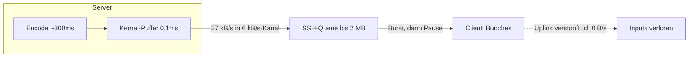

# Plan: Bunching + Eingabe-Priorität — `source10_instrumentation`

Stand: 2026-10-17. Basis: `source10_instrumentation` (Protokoll v3,
1280×720, GPU-Hybrid-OCR, `.lbwlog`-Recording, 90 Tests).
Anlass: Server-Log
`source10_instrumentation/20261017_0614.lbwlog` (136,6 s Wall,
3773 Records, KEIN `End`) — mitgeschrieben während einer Animation im
Browser. Direkt in Rust geschrieben (kein Transpiler, s. §6).

## 1. Befund: Was das 0614er-Log beweist (verifiziert per `lbw-logstat`)

Alle Zahlen sind echte Messwerte aus dem mitgelieferten Log
(`lbw-logstat` + `lbw-logstat --deep`, s. §5):

- **Kanal 6,6-fach über Budget:** Animationsphase (letzte ~70 s) im
  Schnitt ~37 kB/s Server→Client (`s+7756` ff.: 25–40 kB/s je Sekunde),
  90 von 129 Daten-Sekunden über 6-kB/s-Budget. Spitzen 40 kB/s.
- **Queue: ~2 MB ≈ 329 s Kanalzeit:** Leaky-Bucket-Maximum 1 973 941 B.
  Der Server „denkt“, Senden dauere 0,1 ms (`send` p50 0,090 ms) — das
  ist nur der Kernel-`memcpy` in den TCP-Puffer (bekannt aus Review),
  die Bytes hängen noch Minuten im SSH-Tunnel fest.
- **Bunching am Client:** Eine Animation erzeugt ~5 Tiles/s
  (498 Tiles / 662 Frames, avg 5181 B, p50 762 B, p90 12 594 B,
  max 13 628 B ≈ 2,2 s Kanalzeit pro Kachel). TCP/SSH spült die
  aufgelaufene Queue stoßweise — mehrere Frames stecken in einem
  Netzwerkpaket, die Animation ruckelt (schnell, dann lange Pause).
- **Inputs verhungern:** Während der Animation `cli_bps = 0` am Server
  (keine einzige Eingabe von `s+7757` bis `s+7818`), obwohl der Nutzer
  Maus/Tastatur bedient. Ergebnis: Input→Kachel p50 614 ms,
  p90 1884 ms, max 2458 ms. Kleine Text-Deltas (~40–95 B ≈ 10 ms
  Kanalzeit) stehen hinter 13-kB-Kacheln an — kein Express-Weg.
- **CPU läuft warm für die Tonne:** `encode` p90 294 ms, max 405 ms;
  was enkoidiert wird, kann der Kanal ohnehin nicht abtragen.

## 2. Implementierungsvorschlag

1. **Neues Modul `server/src/11_pace.rs` (Leaky Bucket, ~150 Zeilen):**
   `Pacer { budget_bps, allowance, last }` — `pace(n)` liefert die
   Wartezeit, die `n` Bytes bei `budget_bps` kosten, abzüglich
   angesparter Idle-Zeit (Cap: 1 s Guthaben, damit Idle-Phasen keinen
   Riesen-Burst freigeben). Reine Rechenfunktion + `Instant`, gut
   testbar, keine neuen Deps.
2. **Session (`10_session.rs`) paced nur Kacheln, nie Texte:**
   Vor jedem `Tile`-`write_msg` wartet die Schleife die
   Pacer-Dauer ab (in 50-ms-Scheiben, Abbruch bei
   Reader-Ende/Disconnect). `Hello`/`ClearText`/`AddText`/`RemoveText`
   (~5–95 B) gehen **sofort** raus — Text-Echo (~10 ms) überholt das
   Bild (250–850 ms) grundsätzlich. Der Grab ist immer aktuell
   (`src.grab()`), deshalb verliert Pacing kein Bild: Die nächste
   `dirty_bbox` fasst die aufgestaute Bewegung automatisch zusammen —
   niedrigere fps statt Burst-Pause, ohne Datenverlust.
3. **Eigene Stufe `pace`:** Die Pace-Wartezeit landet in einem neuen
   `FrameMs.pace`-Feld (`LOG_VERSION` 2 → 3, alte Logs nicht mehr
   lesbar — keine Backward-Kompatibilität nötig). `send` bleibt
   reiner Kernel-`memcpy`, `pace` zeigt die budgetgerechte
   Übergabezeit — die Review-Kritik (0,1-ms-Scheinwert) ist damit
   behoben, indem beide Zahlen nebeneinander stehen. `logstat`
   (Human + `--json`) zeigt `pace` als eigene Zeile.
4. **Nagle aus, Flush schneller:** `TCP_NODELAY` auf Server-
   (Accept + Session) und Client-Socket (Connect) — 10-Byte-Eingaben
   warten nicht mehr bis 40 ms auf Füllung; Header+Body einer Nachricht
   verlassen den Socket zusammen. Client-Lese-Timeout 50 ms → 10 ms:
   Die bekannte 0–50-ms-Eingabe-Wartezeit aus dem
   Instrumentierungs-Walkthrough (§2.5) schrumpft auf 0–10 ms.
   Server-`input_loop` (200 ms, eigener Thread) bleibt — dort dominiert
   das Netz, nicht der Poll.
5. **`--budget <B/s>` (Default 6000):** Server-Flag für die
   Kanalrate; `validate()` lehnt 0 ab. Client braucht kein Flag
   (sendet nur Eingaben, je ~10 B).

## 3. Latenz-/Verhaltensziele (messbar mit bestehenden Tools)

| Ziel | Vorher (0614) | Nachher (Erwartung) |
|---|---|---|
| Queue-Spitze (`queue_peak_b`) | 1 973 941 B | < 30 kB im Animations-Soak |
| Sekunden über Budget | 90 / 129 | ~0 bei Dauerlast |
| Input→Kachel p50 | 614 ms | ≤ 1 Tile-Kanalzeit + Encode |
| Text-Echo trotz Animation | hinter Tiles | ~10 ms + Netz |
| `send` p50 | 0,09 ms (Schein) | ≈ budgetgerechte Übergabezeit |

Verifikation ohne neue Tools: `lbw-logstat` (Queue, Budget-Sekunden,
Input→Text vs. Input→Kachel-Split) + bestehende Smokes.

## 4. Offene Requirements / Vorschläge (mit Empfehlung)

| # | Frage | Empfehlung |
|---|---|---|
| 1 | Protokoll v4 mit Prioritäts-/Seq-Feldern? | Nein — v3 bleibt; Priorität ist reine Sender-Disziplin (Text vor Tile), kein Wire-Bit nötig |
| 2 | Überholte Tiles verwerfen statt pacen (noch niedrigere Latenz)? | Nein — erst messen, ob Pacing reicht; Verwerfen bräuchte `dropped`-Bilanz = Log-Formatbruch |
| 3 | Adaptiver Quantizer bei großer Kachel (13 kB → 2,2 s)? | Follow-up — Pacing macht große Kacheln langsam statt blockierend; Adaption danach anhand neuer Logs entscheiden |
| 4 | Client-Eingaben bündeln/drosseln (Maus-Spam)? | Nein — Eingaben sind ~10 B, der Kanal verhungert an Downstream, nicht an Upstream |
| 5 | Alte `.lbwlog`-Dateien weiter lesbar? | Nein — keine Backward-Kompatibilität nötig; `LOG_VERSION` 3, alte Dateien verfallen |

## 5. Kontext-Dateien für den ausführenden Agenten

Referenz (`source10_instrumentation/`, lesen vor dem Ändern):

- `common/src/01_types.rs` — Protokoll v3 (bleibt gleich).
- `common/src/02_framing.rs` — `write_msg`-Muster (unverändert).
- `server/src/01_config.rs` — CLI-Muster (→ `--budget` dazu).
- `server/src/10_session.rs` — Schleife (→ Pace-Hooks vor Tile-Send;
  Text-Pfad unverändert sofort).
- `server/src/main.rs` — Accept (→ `set_nodelay`).
- `server/src/lib.rs` — Modul-Deklarationen (→ `11_pace`).
- `server/tests/common.rs` — `StubOcr`, `test_cfg`, `read_until`.
- `server/tests/loopback.rs` — Session-Testmuster (→ Pace-Assertions).
- `client/src/01_config.rs` — unverändert (kein Flag).
- `client/src/03_net.rs` — Netz-Thread (→ `set_nodelay`, 50 ms → 10 ms).
- `log/src/01_record.rs` — **nicht** anfassen (kein Formatbruch).
- `scripts/smoke_xvfb.sh`, `scripts/smoke_record.sh` — E2E-Vorlagen.
- `20261017_0614.lbwlog` — Referenzmessung (Befund-Zahlen oben).

Externe Referenzen: keine neuen Crates → keine DeepWiki-Abfragen nötig.

## 6. Commit-Konvention (verbindlich)

Conventional Commits (`feat:`/`fix:`/`docs:`/`test:`), deutsche Messages,
Betreff ≤ 72 Zeichen, Body mit Was/Warum/Verifikation. Auftraggeber:
wolpumba (wolpumba@gmail.com). Geplante Commits: (1) `docs: Plan/Tasks
Bunching ...`, (2) `feat: Leaky-Bucket-Pacer ...`, (3) `feat:
Tile-Pacing + Text-Priorität ...`, (4) `feat: Nagle aus, Flush
schneller ...`, (5) `test: ...` (falls separat), (6) `docs: Walkthrough
...`. Jeder Commit baut und hält Tests grün.

## 7. Festlegungen (begründet)

- **Kein Protokollbruch (v3 bleibt):** Priorität entsteht durch
  Sender-Reihenfolge, nicht durch Wire-Bits — kein Client-Update nötig.
- **Kein Rücksicht auf alte Logs:** `FrameMs` bekommt ein eigenes
  `pace`-Feld (`LOG_VERSION` 3) statt `send` umzudeuten — sauber
  trennbar, alte Dateien verfallen bewusst.
- **Kein Transpiler, keine neuen Deps:** chirurgische Änderung
  (ein neues Modul + Hooks); Stil wie bisher (nummerierte Dateien,
  < 600 Zeilen, `cargo fmt` + `cargo clippy` sauber).
- **Pacing statt Verwerfen:** Der Grab ist immer live — verzögerte
  Frames fassen Bewegung zusammen statt sie zu verlieren. Der Kanal
  sieht einen gleichmäßigen Rinnsal statt Burst-Pause.
