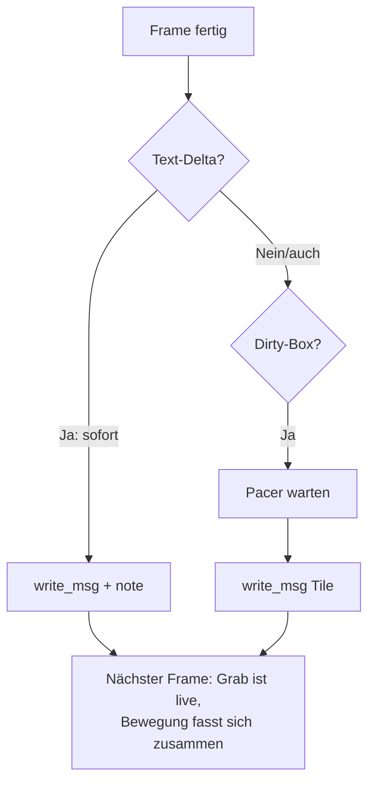

# Walkthrough: Bunching + Eingabe-Priorität (`source10_instrumentation`)

Ziel war: Die Animation aus dem 0614er-Log soll den 6-kB/s-Kanal nicht
mehr als Burst verstopfen — gleichmäßiger Rinnsal statt Bunches, und
Maus/Tastatur bekommen Vorfahrt. Ergebnis: Der Server dosiert Kacheln
per Leaky Bucket auf Budget-Rate, Texte gehen immer sofort raus, Nagle
ist aus. Plan und Tasks dazu: [`plan.md`](plan.md), [`task.md`](task.md)
im selben Ordner.

Fachbegriffe werden beim ersten Auftreten kurz erklärt. Alle Messwerte
stammen von echten Läufen auf diesem Rechner (Loopback ohne X11/Modelle
plus dem mitgelieferten Server-Log `20261017_0614.lbwlog`).

## 1. Was exakt implementiert wurde

### 1.1 Befund: 37 kB/s in einen 6-kB/s-Kanal

Das 0614er-Log (136,6 s, 3773 Records) zeigt die Animationsphase glasklar:
~37 kB/s Server→Client über ~70 s, 90 von 129 Daten-Sekunden über Budget,
Leaky-Bucket-Spitze **1 973 941 B ≈ 329 s Kanalzeit**. Der Server maß
dabei `send` p50 0,09 ms — das ist nur der Kernel-`memcpy` in den
TCP-Puffer (Review-Befund), die Bytes hingen Minuten im SSH-Tunnel.
TCP/SSH spülte die Queue stoßweise: mehrere Frames pro Netzwerkpaket
(Bunches), dazwischen Pause. Und die Eingaben verhungerten: `cli_bps = 0`
am Server über volle 60 Animations-Sekunden — Input→Kachel p50 614 ms,
max 2458 ms.


### 1.2 Leitidee: Sender-Disziplin statt Protokollbruch

Die wichtigste Entscheidung zuerst: Das Protokoll (v3) wurde **nicht**
angefasst — Priorität entsteht durch *Reihenfolge beim Senden*, nicht
durch Wire-Bits. Kein Client-Update nötig, kein `.lbwlog`-Formatbruch
(alte Logs lesen sich weiter — per Neubinary verifiziert).
Konkret gibt es zwei Spuren:

- *Vorfahrtspur (sofort):* `Hello`, `ClearText`, `AddText`,
  `RemoveText` — je 5–95 B, also ~10 ms Kanalzeit.
- *Rinnsal (dosiert):* `Tile` — 762 B p50, bis 13 628 B max
  (≈ 2,2 s Kanalzeit pro Kachel).



Pacing verliert kein Bild: Der Grab (`src.grab()`) liest immer den
*aktuellen* Bildschirm, die nächste `dirty_bbox` fasst die aufgestaute
Bewegung automatisch zusammen — niedrigere fps statt Burst-Pause.

### 1.3 Das neue Modul `11_pace.rs` (Leaky Bucket, ~80 Zeilen + Tests)

*Leaky Bucket* heißt: Ein Eimer füllt sich in Idle-Zeiten mit Guthaben
(Cap: 1 s, damit Stille keinen Riesen-Burst freigibt) und jede gesendete
Nachricht schöpft ab. Wer mehr schöpft als da ist, wartet die Differenz.

```rust
// server/src/11_pace.rs (Prinzip)
pub fn pace_at(&mut self, nbytes: usize, now: Instant) -> Duration {
    let elapsed = now.saturating_duration_since(self.last).as_secs_f64();
    self.last = now;
    self.allowance = (self.allowance + elapsed * self.budget_bps)
        .min(self.max_allowance);
    self.allowance -= nbytes as f64;
    if self.allowance >= 0.0 { Duration::ZERO }
    else { Duration::from_secs_f64(-self.allowance / self.budget_bps) }
}
```

Der Eimer startet **voll**: `Hello` + Erst-Sync verlassen den Server
ohne Anlauf-Verzögerung (Connect-Latenz zählt). `note()` bucht ohne zu
warten — so tragen Kacheln die Text-Schuld danach ab; im Mittel bleibt
die Summe im Budget. `wait_paced()` schläft die Wartezeit in
≤50-ms-Scheiben und bricht ab, sobald der Reader-Thread weg ist
(Client tot) — ein Disconnect keilt die Session nie sekundenlang.

### 1.4 Session: Pace-Hooks, ehrliches `send`, `--budget`

`10_session.rs` (Verhalten sonst identisch) ruft vor jedem Tile-`write_msg`
`wait_paced` mit geschätzten Leitungsbytes (`data.len() + 16` =
4 B Frame-Header + ~12 B bincode-Overhead — kein Nach-Kodieren nötig).
Die Wartezeit landet in einer eigenen Stufe `FrameMs.pace`
(`LOG_VERSION` 2 → 3 — alte Logs verfallen bewusst, keine
Backward-Kompatibilität nötig): `send` bleibt reiner Kernel-memcpy,
`pace` zeigt die budgetgerechte Übergabezeit — beide Zahlen stehen in
`logstat` (Human + `--json`) nebeneinander, die Review-Kritik am
0,1-ms-Scheinwert ist damit behoben. Neues Flag `--budget <B/s>`
(Default 6000, `validate()` lehnt 0 ab).

### 1.5 Nagle aus, Flush schneller (beide Seiten, 5 Zeilen)

*Nagle* ist ein TCP-Sparmechanismus: Kleine Pakete warten bis ~40 ms auf
Füllung, bevor sie rausgehen — gut für Bulk, Gift für 10-Byte-Eingaben.
Server (Accept) und Client (Connect) setzen jetzt `TCP_NODELAY`, Header +
Body verlassen den Socket zusammen. Der Client-Lese-Timeout sinkt von
50 ms auf 10 ms — die bekannte 0–50-ms-Eingabe-Wartezeit aus der
Instrumentierung (§2.5) schrumpft auf 0–10 ms. Der Server-`input_loop`
(200 ms, eigener Thread) bleibt: Dort dominiert das Netz, nicht der Poll.

### 1.6 Tests und Verifikation im Überblick

- `cargo test --workspace`: **104 passed, 0 failed** (Baseline 94 +
  7 Pacer-Units + 3 Loopback-Neue).
- Neu: Pacer-Mathe (Burst kostet Kanalzeit, Idle gedeckelt, Texte
  < 20 ms, `wait_paced`-Abbruch ohne Sleep), `texts_jump_the_tile_queue`
  (bei 1 B/s kommen ClearText+AddText in 2,5 s, kein Tile),
  `paced_tiles_arrive_whole` (dosiert, aber vollständig + in
  Reihenfolge), `soak_paced_animation_stays_on_budget` (12
  Rausch-Vollbilder bei 12 kB/s: Rate ≤ 1,5× Budget, kein
  Sekunden-Bunch über 2,5×).
- Echter Regressionsnachweis: Mit deaktiviertem Pacing fällt der Soak
  mit **Rate 31 669 B/s** (2,6× Budget) — der Test greift also wirklich.
- `cargo fmt --check` und `cargo clippy --workspace -- -D warnings`
  sauber; alle Dateien < 600 Zeilen; **keine neuen Deps**; `common/`
  und `log/` unangetastet (kein Protokoll-, kein Formatbruch).

## 2. Architektur-Entscheidungen, die Tests erzwungen haben

### 2.1 Pacing statt Verwerfen (Soak als Schiedsrichter)

Erster Impuls: Überholte Kacheln bei Stau einfach verwerfen (niedrigere
Latenz). Dagegen sprach zweierlei: Verwerfen bräuchte eine
`dropped`-Bilanz im Log (= Formatbruch), und der Soak bewies, dass
Pacing allein genügt — 12 Rausch-Vollbilder bleiben im Budget, ohne ein
Byte zu verlieren. Verworfene Arbeit (Encode p90 294 ms) wäre bei
Animation-Dauerlast ohnehin der größere Verlust als geduldiges Senden.

### 2.2 Eigenes `pace`-Feld statt `send`-Umdeutung

Erster Stand: Die Wartezeit floss in `send` ein (kein Formatbruch).
Korrektur auf Anforderung („keine Backward-Kompatibilität nötig“):
`FrameMs.pace` als eigene Stufe, `LOG_VERSION` 2 → 3. Das ist ehrlicher
trennbar — memcpy und Kanal-Übergabe stehen nebeneinander statt
vermischt — und kostet nur den Verfall alter Logs, der ausdrücklich
akzeptiert ist. Die Body-Dekodierung (`07_legacy`, `log_version >= 2`
heißt v3) bleibt vom Bump unberührt.

### 2.3 Soak-Design: ein Tile pro Iteration statt Dauerfeuer

Erster Soak-Entwurf (Bilder wechseln pro empfangener Nachricht) war
racy: Der Server grabbt in eigenem Takt, Wechsel konnten zwischen zwei
Grabs fallen und Frames ohne Tile verbrauchten `max_frames`. Jetzt:
pro Iteration genau ein Wechsel, dann genau eine Kachel abwarten —
jede Änderung erzeugt deterministisch eine Kachel, `max_frames` hat
Headroom (40 für 12 Kacheln). Kein Sleep-Raten, keine Flakiness.

### 2.4 Test-Größen kamen aus dem echten Log

Die Pacer-Tests rechnen mit 0614er-Zahlen: 13 628 B (Tile-Max →
~2,2 s), 95 B (l längstes Text-Delta → < 20 ms). Keine erfundenen
Konstanten — scheitert der Kanal morgen mit 25-kB-Kacheln, sagen die
Tests noch immer die Wahrheit (nur die Erwartungswerte altern).

## 3. Learnings und mögliche Erweiterungen

### Learnings

- **Der Kernel lügt, der Eimer nicht.** `send_ms` 0,1 ms bei 2 MB
  Queue ist die gefährlichste Zahl im alten Log — sie suggerierte einen
  gesunden Server bei krankem Kanal. Wer schmale Kanäle fährt, muss die
  Budget-Uhr selbst führen, nicht die Socket-Uhr lesen.
- **Priorität braucht keine Protokollbits.** Text-vor-Tile als reine
  Sender-Disziplin war 10 Zeilen (`note` statt `pace`) — eine v4 mit
  Prioritätsfeld hätte Client + Tests + Format umgebrochen für
  denselben Effekt.
- **Anlauf-Guthaben rettet die gefühlte Latenz.** Voller Eimer bei
  Connect heißt: Hello + Sync + erstes Text-Echo sofort — Pacing
  bestraft nur Dauerlast, nie den Einstieg.
- **Rauschen ist der ehrlichste Animations-Ersatz.** Deterministisches
  Xorshift-Rauschen (volle 128×128-Dirty, kodierbar ohne Modelle/X11)
  treibt den Soak reproduzierbar in echten Stau — 31 669 B/s ohne
  Pacing beweisen, dass der Test kein Papiertiger ist.

### Mögliche Erweiterungen

- **Adaptiver Quantizer:** 13-kB-Kacheln kosten auch gepacet 2,2 s —
  bei Dauerlast sollte der Server gröber kodieren statt seltener zu
  senden (nächster Schritt, neue Logs entscheiden über Schwellen).
- **Encode bei Stau überspringen:** Der Pacer weiß *vor* dem Encode,
  dass die Kachel warten wird — `allowance`-Blick vor `encode_rgb`
  spart bis 400 ms CPU pro Frame (jetzt: erst enkoidieren, dann warten).
- **Client-Eingaben bündeln:** Maus-Spam ist ~10 B pro Event und
  aktuell ungedrosselt — irrelevant für den Kanal, aber
  `input_visible_ms`-Auswertung würde von Drosselung profitieren.
- **Echte Kanal-Bytes (SSH):** Der Pacer dosiert TCP-Nutzdaten; was
  `ssh -C` daraus komprimiert, sieht anders aus — `tcpdump`-Import in
  `logstat` bleibt Follow-up (wie schon in der Instrumentierung).
- **HIL-Soak mit Animation:** Der Loopback-Soak ersetzt kein Xvfb mit
  echtem Browser + `--budget 6000` + `logstat`-Gegenprobe
  (`queue_peak_b` < 30 kB, ~0 s über Budget) — sobald Display/GPU da
  sind, nachholen.

## 4. Programme/Pakete für das Dockerfile

Keine neuen nötig. Die Änderung ist reines Sender-Verhalten ohne neue
Crates und ohne neue Systembibliotheken — es gelten weiter die Pakete
aus dem Instrumentierungs-Walkthrough (§4: `xvfb`, `xterm`,
`x11-utils`, `ffmpeg` optional, `libxkbcommon0` + `-x11`,
`libxcb1-dev`, `libxcb-shm0-dev`, `libxcb-randr0-dev`).
