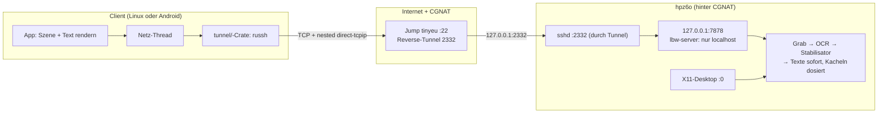
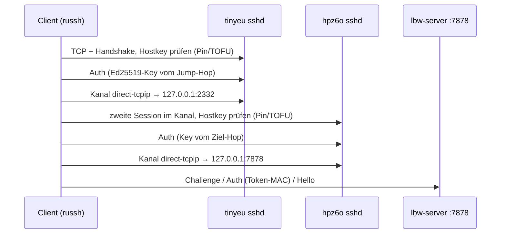
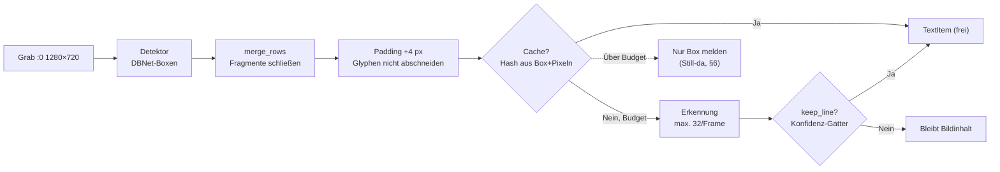
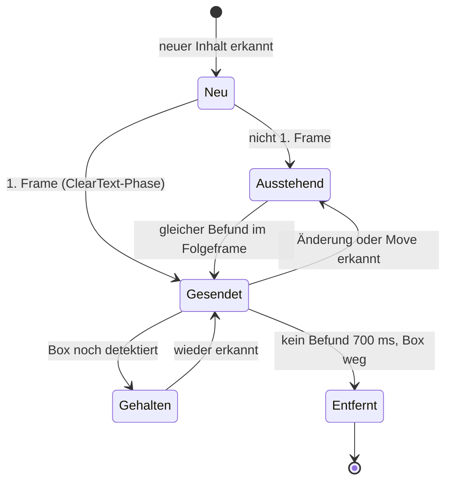
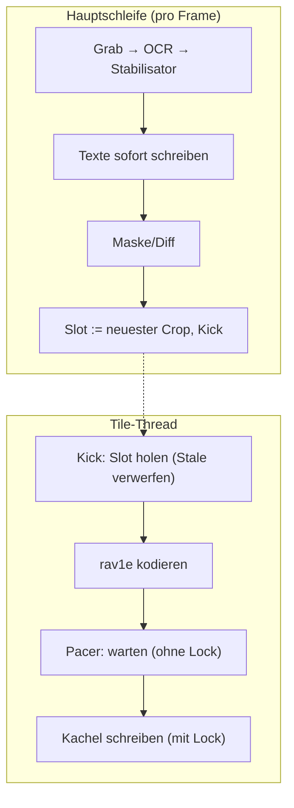
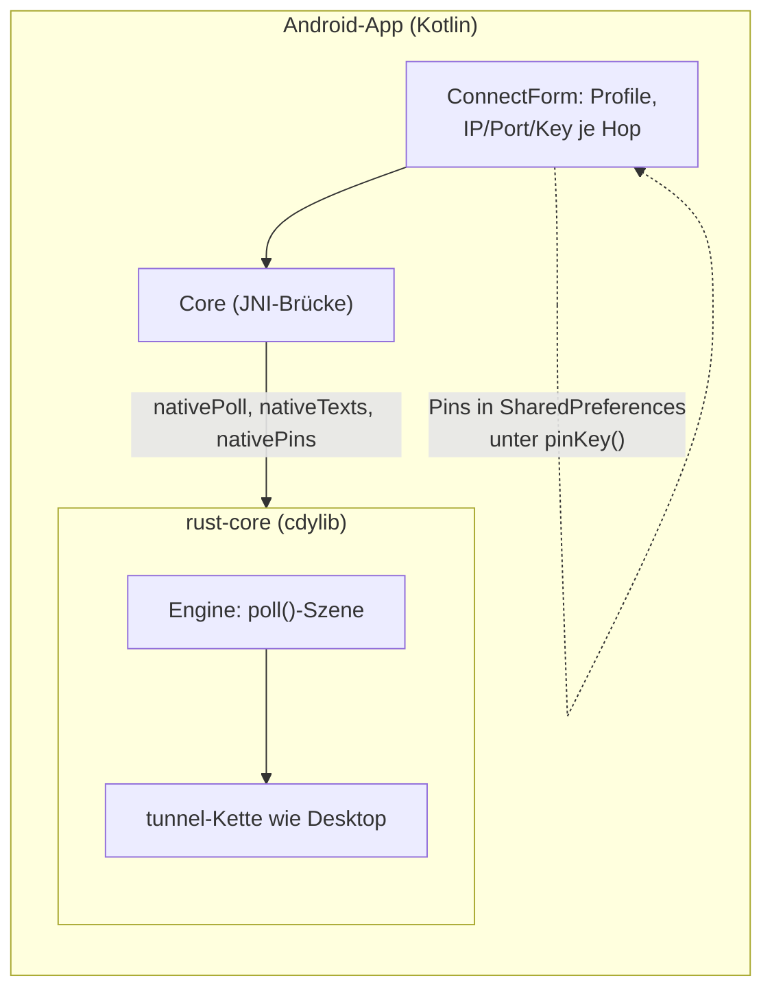
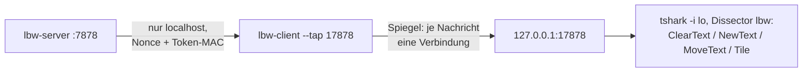

# Walkthrough: `source11_compact` — minimaler Desktop, der seine Texte nicht als Bild schleppt

Ziel war: Ein 1280×720-Desktop über einen 6-kB/s-Kanal bedienen, bei dem
der SSH-Tunnel von den Clients selbst gebaut wird (auch durch einen
Jump-Host, weil der Server hinter Carrier-Grade-NAT sitzt). Ergebnis:
`source11_compact` — ein Server, der nur an `127.0.0.1:7878` bindet,
erkannte Textzeilen als kleine Botschaften statt als Bild schickt und
Bildkacheln (AV1) dosiert hinterherschiebt. Plan und Tasks dazu:
[`plan.md`](plan.md), [`tasks.md`](tasks.md) im selben Ordner.

Fachbegriffe werden beim ersten Auftreten kurz erklärt. Alle Messwerte
stammen von echten Läufen auf diesem Rechner: Loopback-Tests, ein
Live-Lauf gegen `:0` (Firefox mit Google Maps) und der Emulator-E2E.
Wo ein Wert vom Container-Setup abhängt, steht das dabei.

## 1. Das Problem in drei Sätzen

1. **Bild ist teuer und matschig.** Eine 1280×720-Kachel als AV1 kostet
   je nach Inhalt 1–200 kB; Text in Video-Qualität ist trotzdem schlecht
   lesbar (Video-Codecs sind für weiche Verläufe gebaut, nicht für harte
   Glyphen-Kanten). Eine erkannte Zeile dagegen: ~30–60 B als
   `NewText`.
2. **SSH ist gesetzt, aber der Server hängt hinter CGNAT.** Der Client
   muss den Tunnel selbst bauen: erst zum öffentlich erreichbaren
   `tinyeu` (`51.107.16.14:22`), dann durch dessen Reverse-Tunnel zum
   Zielrechner `hpz6o` (dort als `127.0.0.1:2332` sichtbar) — genau wie
   in der SSH-Konfiguration des Betreibers:

   ```sshconfig
   Host tinyeu
       HostName 51.107.16.14
       Port 22
       ServerAliveInterval 15
       LocalForward 2332 127.0.0.1:2332
       IdentityFile ~/.ssh/tinyeu_key.pem
   Host hpz6o
       HostName 127.0.0.1
       Port 2332
       User kiel
       IdentityFile ~/.ssh/id_lenovo_to_hpz6o
   ```

3. **Wireshark muss mitlesen können.** Der Klartext-Strom läuft deshalb
   auf `127.0.0.1` (serverseitig Autorisierung per Nonce + Token-MAC),
   und der Client spiegelt ihn auf Wunsch auf einen lokalen Tap-Port.

## 2. Die Architektur auf einen Blick

Drei Schichten, je eine Crate bzw. ein Verzeichnis unter
`source11_compact/`: `common/` (Protokoll), `tunnel/` (SSH-Kette),
`server/` + `client/` + `android/` (Endpunkte).



Warum diese Form? Der Server braucht **keinen** Port im Internet, keine
eigene Kryptografie und keinen eigenen Schlüssel-Austausch — all das ist
SSHs Job (`russh` 0.64 in Rust, in beiden Client-Arten dieselbe
`tunnel/`-Crate). Der Server prüft nur noch, ob der Client am anderen
Tunnel-Ende das LBW-Token kennt (§4). TLS oder ein eigenes Wire-Protokoll
mit AEAD wären doppelte Arbeit gewesen; das Klartext auf `127.0.0.1`
bleibt dabei absichtlich — es ist die Voraussetzung für den Dissector
(§9) und durch SSH nach außen abgeschirmt.

## 3. Der Tunnel: zwei SSH-Sessions ineinander

Eine SSH-Verbindung kann in einem Kanal (`direct-tcpip`) eine zweite
komplette SSH-Session transportieren — inklusive deren eigener
Hostkey-Prüfung. Genau das bildet die Kette aus §1 nach, ohne einen
einzigen lokalen Forward-Port:



Drei Details, die man sonst erst in der Praxis lernt:

- **TOFU-Pinning pro Hop.** Beim ersten Kontakt lernt der Client den
  Hostkey („Trust On First Use") und speichert ihn als
  `SHA256:…`-Fingerprint in den Profil-Einstellungen. Ab dann wird
  *geprüft* statt gelernt — ein stiller MITM am Jump scheitert, bevor
  die Auth läuft. `connect_chain_with_pins` liefert die gelernten
  Fingerprints pro Hop zurück, `Engine::pins()` (Android) bzw. `--pin`
  (Desktop) führt sie zurück in die Persistenz.
- **Ein hängender Versuch darf Retry nicht blockieren.** TCP-Connect
  hat einen Timeout (10 s), aber SSH-Handshake/Auth/Kanalöffnung einzeln
  keinen. Im Emulator-Lauf hing der erste Verbindungsversuch einmal
  >160 s — der Retry griff schlicht nie. Darum gibt es jetzt
  `attempt_timeout` (30 s) pro Ketten-Versuch; ein Regressionstest gegen
  TEST-NET-1 (Pakete ins Leere) belegt, dass der Deckel zuschlägt
  (2,1 s statt 5 s+ Hängen).
- **Keepalive ist Politik, nicht Hoffnung.** Die Schichten-übergreifende
  Betriebs-Politik (`TunnelPolicy`) bündelt Keepalive (15 s, 3 Fehlschläge
  bis Abbruch — das `ServerAliveInterval`-Äquivalent), Reconnect-Abstände
  (0,5 s → 5 s) und eben die Timeouts. Der Android-Client übersteht so
  HOME-Reconnect und kurze Netzabbrüche ohne Neu-Login.

## 4. Das Protokoll v4: Text ist eine Liste von IDs

Auf dem Draht liegt ein simples Framing: `[u32-LE-Länge][bincode-Body]`.
Zuerst beweist der Client die Berechtigung: Der Server schickt eine
zufällige 16-B-Nonce (`Challenge`), der Client antwortet mit
`MAC = HMAC-SHA256(token, nonce ‖ "lbw11")` — Domain-Trennung inklusive,
damit der MAC nie für fremde Zwecke missbraucht werden kann.

Danach gilt die Kernidee des ganzen Projekts: **Text wird nicht jeden
Frame wiederholt.** Jede erkannte Zeile bekommt eine sessionsweite ID
(u64) und lebt als eigenständige Botschaft:

| Botschaft | Inhalt | Kanalzeit |
|---|---|---|
| `ClearText` | Alle Texte verwerfen (nur 1. Frame) | ~5 B |
| `NewText` | ID, Box, Farben, String | ~30–60 B |
| `MoveText` | Nur ID + neue Box (Scroll!) | ~8 B |
| `RemoveText` | ID | ~8 B |
| `Tile` | AV1-Box (Restbild) | 0,5–200 kB |

Ein Browser-Scroll ist damit fast gratis: Dieselben Zeilen wandern —
der Client bewegt 47 bekannte IDs per `MoveText` (live gemessen, §7),
statt 47 neue Strings zu schicken. Der Client hält die Szene als
ID→TextItem-Map; `MoveText` verschiebt nur die Box. Kein OCR-Text
überträgt sich doppelt, und AV1 muss nie Text „erfinden" — das ist der
Unterschied zwischen „lesbar" und „Matsche".

## 5. Die OCR-Pipeline: vom Screenshot zur Zeile

Pro Frame läuft: Bildschirm greifen (X11, 1280×720) → Textboxen finden
(DBNet-Detektor, `PP-OCRv6_small_det.onnx`) → Zeilen erkennen
(`PP-OCRv6_small_rec.onnx`) → stabilisieren (§6) → senden. Gemessen
(RTX A4000 im Container, CPU-Erkennung): Detektion ~16 ms (CUDA, warm)
bis ~140 ms (CPU), Erkennung ~14 ms je unbekannter Zeile. Ein komplett
neuer Bildschirm kostet also einmalig ~1,5 s — danach trägt fast alles
der Cache.



Die drei hier eingebauten Verfeinerungen zahlen direkt auf die zwei
Nutzerbeschwerden ein („kaum Text erkannt", „Text bleibt lange stehen"):

**Zeilen-Merge (`merge_rows`).** Der Detektor fragmentiert Linien:
Aus „Directions" werden `Directi` + `ons`, aus einer Straßenzeile
`Karl-Vo-` + `eck`. Fragmente erkennen schlecht (wenig Kontext) und
jeder kostet einen Erkennungs-Lauf. `merge_rows` verschmilzt Boxen
gleicher Grundlinie (Mitten-Abstand ≤ Höhe/3) mit kleiner Lücke
(≤ Höhe/2) — aber nur mit Bremse: ähnliche Höhe (keine Brücken über
hohe Overlay-Boxen) und Gesamtbreite ≤ 320 px. Ohne Bremse verkettete
ein Karten-Overlay einmal die ganze 1249-px-Breite zu einer Müllzeile.
Vorher → nachher auf dem echten Maps-Bild: `Directi`+`ons` wurden zu
`Directi Save`-Nähe, die Tab-Titel zu ganzen Zeilen, und
`Home (Nefenfeldstrasse 11)` kommt sauber aus dem Eingabefeld statt
als Bruchstück (das `Ca`-Fragment einer schmalen Tab blieb — Restsee).

**Konfidenz-Gatter (`keep_line`).** Mehrzeilige Zeilen brauchen
Konfidenz ≥ 0,5, Einzelzeichen ≥ 0,75. Rotierte Karten-Labels lieferten
sonst Ratetext wie `三`, `六`, `ofo` über die Karte gemalt; echte
UI-Zeichen („X", „+") liest das Netz dagegen mit ≥ 0,9.

**Budget + Priorität.** Nur höchstens 32 *unbekannte* Zeilen je Frame
wird erkannt; der Rest kommt in Folgeframes (Cache-Treffer sind frei).
Misses nahe zuletzt gesendeten Rechtecken laufen zuerst — beim
Verschieben konvergiert der sichtbare Text zuerst, neue Ränder folgen.
Ein kompletter Szenenwechsel konvergiert so in ~3 Frames à ~0,5 s
statt in einem 1,5-s-Block; ein ruhiger Bildschirm kostet danach
unter 1 ms Erkennung (Cache-Treffer >99 % auf statischem Inhalt).

## 6. Der Stabilisator: OCR flackert, der Client darf das nicht sehen

PP-OCR liefert je Frame leicht andere Ergebnisse: Box ±wenige Pixel,
gelegentlich ein falsches Zeichen, kurzes Aussetzen. Roh gesendet, wäre
das NewText/RemoveText-Spam am Client. Der Stabilisator (rein
funktional, ohne Display testbar) hält einen stabilisierten Zeilen-
zustand `sent` je ID und entscheidet pro Frame:



Drei Mechaniken gegen das Flackern — nur das Entfernen ist noch
*zeit*basiert, Neu/Änderung bestätigt der Folgeframe:

- **Matching statt Position.** Alte und neue Zeile werden per
  Text-Ähnlichkeit (Levenshtein) *und* Lage gepaart: ≥ 0,8 ähnlich
  matcht hart; sonst hält eine Hysterese (0,5–0,8 bei naher Box) den
  alten Inhalt, damit Tippjitter nicht als falsches Zeichen durchschlägt.
  Die Hysterese ist aber kein Dauerzustand: Wiederholt sich derselbe
  abweichende Befund dreimal in Folge, ist es neuer Inhalt auf derselben
  ID und geht als `NewText` raus — sonst bliebe die ID stumm blockiert
  (Tab-Wechsel auf ähnlich lautende Zeile, real erlebt mit
  „Unterricht" gegen die Tableiste „Wetterbericht").
- **Folgeframe-Bestätigung für Neu/Änderung, Zeit-Debounce nur für Weg
  (700 ms).** Neu oder geändert wird gesendet, sobald derselbe Befund in
  zwei aufeinanderfolgenden Frames steht — ein einzelner Flacker-Frame
  bleibt stumm, aber keine Wanduhr verzögert mehr (früher: 250 ms plus
  Frame-Takt, jetzt: ein Frame wie in source10). Nur das Entfernen bleibt
  zeitbasiert, weil die Frame-Zeit zwischen 0,1 s (Cache) und 2 s (voller
  Szenenwechsel) schwankt: Frame-gezählt hieß „5 Frames weg" im
  Bewegungsfall **8,5 s Geistertext** — exakt die gemeldete Beschwerde.
  Zeitbasiert schrumpft das auf 0,7 s, unabhängig vom Durchsatz.
- **Still-da-Urteil mit Szenenwechsel-Ausnahme.** Eine bekannte Zeile,
  deren *Box* noch detektiert wird (die Erkennung hängt im Budget
  hinterher), gilt als anwesend — kein vorschnelles `RemoveText` mit
  anschließendem Re-`NewText`. Ausnahme: Belegt anderslautender Text
  ihre Box zur Hälfte oder mehr, steht dort wirklich neuer Inhalt
  (Tab-Wechsel) und der Weg-Timer läuft — sonst hielte Still-da alte
  Tabs ewig über neuem Inhalt fest (der gemeldete „Geistertext").
  Dazu das Move-Totband (6 px / 4 px Größenänderung), damit
  Subpixel-Jitter keine sinnfreien Moves erzeugt.
- **Erstbestätigung neuer Zeilen.** Eine Zeile, die nach dem ersten Frame
  neu auftaucht, bekommt beim zweiten gleichen Befund ihr `NewText`
  (der Stabilisator merkt sich, ob je gesendet wurde). Zuvor versandete
  sie in einem toten Zweig — das war der eigentliche
  „neuer Text wird nicht erkannt"-Fehler.

## 7. Kacheln im Hintergrund: Text hat immer Vorfahrt

Was *nicht* als Text kommt (Bilder, Karten, Video), geht als AV1-Box
durch den Kanal. Drei Regeln halten das erträglich:

- **Maske.** Gesendete Text-Rechtecke werden vor dem Diff mit ihrer
  Hintergrundfarbe zugemalt: Der Client malt den scharfen Text selbst —
  eine AV1-Kopie desselben Texts wäre doppelte Bandbreite *und* doppelt
  gemalt (matschiges Echo unter scharfer Schrift). Die Maske ist ein
  Zuschlag von 6 px je Seite gegen Glyphen-Fransen.
- **Big-Move-Ausnahme.** Ändert sich >30 % der Roh-Pixel (Fenster
  verschoben), wäre die Maske aus *alten* Rechtecken ein Lochmuster über
  neuem Inhalt. Dann geht die Kachel unmaskiert raus: kurz unscharf,
  aber aktuell — scharfer Text folgt in ~1 s.
- **Dosierung (Leaky Bucket).** Kacheln werden auf Budget-Rate
  (Standard 6000 B/s) gleichmäßig ausgegeben statt als Burst. Texte
  dagegen gehen *immer sofort* raus und buchen nur nachträglich auf dem
  Budgetkonto — ihre Bytes sind verschwindend.

Kacheln liefen früher in der Hauptschleife: rav1e-Kodierung (~0,5–2 s)
plus Pacing-Schlaf (bei 6 kB/s für 60-kB-Kacheln ~10 s) blockierten
*alles*, auch den längst erkannten Text. Seit dem Tile-Thread kodiert,
dosiert und sendet ein eigener Thread; die Hauptschleife übergibt nur
den Roh-Crop („Latest-wins": überholte Kacheln verfallen). Ein
gemeinsamer Writer-Lock serialisiert Texte und Kacheln auf dem Socket —
ohne ihn verzahnten sich große `send()`s auf Byte-Ebene und der Client
sah Protokoll-Müll (Session-Abrisse im Emulator-E2E, §11).



Der Unterschied, live auf `:0` gemessen (Firefox-Fenster zweimal per
`xdotool` verschoben, Nachrichtenstrom am Empfänger gezählt):

| Zeitpunkt | Hauptschleife (alt) | Tile-Thread (neu) |
|---|---|---|
| Move | ~11–13 s bis MoveText ankommt | **47 `MoveText` + 6 `NewText` in derselben Sekunde** |
| Vollbild-Kachel | blockiert alles | läuft im Hintergrund (t+9 s) |
| Ruhiger Bildschirm | 0 Nachrichten | 0 Nachrichten (alles Cache) |

## 8. Android: dieselbe Crate, andere Oberfläche

Der Android-Client teilt den Kern mit dem Desktop: `android/rust-core`
ist ein `cdylib`, das `common/`, `tunnel/` und die Netz/Szenen-Logik
aus `client/` wiederverwendet — kein JSch, kein Java-Crypto, der ganze
Tunnel steht in Rust. Kotlin macht nur UI: Verbindungs-Formular,
Zeichnen (Bitmap + Typeface direkt), Touch/IME.



Drei Android-spezifische Lehren stehen im Code verewigt:

- **`quad_main` bedeutet: Bibliothek zieht Fenster-Code.** Der Client
  nutzt für den Desktop `macroquad` (Fenster+Font). Die Bibliothek zog
  das auch in die Android-`cdylib` — deren Backend erwartet ein Symbol
  `quad_main`, das in einer `.so` niemand liefert: `dlopen` schlug auf
  dem Gerät fehl. Fix: `macroquad` hinter dem Default-Feature `desktop`
  aus der Bibliothek nehmen (`default-features = false` auf Android).
  Kuriosum für die Fehlersuche: JVM-Host-Tests fielen nie auf, weil das
  Host-`.so` das Symbol aus der glibc ziehen darf.
- **Mehrzeilige Extras zerhackt `adb`.** Für den E2E-Typ wurden Keys
  als Intent-Extras übergeben — `adb shell am start --es` zerschneidet
  mehrzeilige Werte in eigene Shell-Kommandos (jede PEM-Zeile wird ein
  „Kommando"). Keys reisen deshalb Base64-kodiert (`*_key_b64`,
  reiner Decoder in `ConnectForm.decodeKeyExtra`, JVM-getestet).
- **TOFU-Pins zurück in die App.** Nach Link-up ruft die App
  `Core.pins()` (JNI `nativePins`) ab und speichert die Fingerprints
  je Hop unter `pinKey()` in den SharedPreferences — inklusive
  „Host-Keys vergessen" zum Zurücksetzen. Im Emulator-E2E sind beide
  Pins (Jump + Ziel) als Checks 5a/5b belegt.

## 9. Wireshark: das Protokoll in Klartext lesen

Der Dissector `packet-lbw.c` (rein C, wird gegen die System-
Wireshark-API 4.6 gebaut) zerlegt Länge, Variante und Felder. Entschlüsseln
muss er nichts: Auf `127.0.0.1` liegt der Strom wie entworfen im Klartext
(§2), der Rest steht in SSH.



So sieht man, was wirklich auf dem Draht lag — z. B. die Messung in §7:
`Text`-Meldungen zählen, `Tile`-Meldungen datieren. `wireshark/check.sh`
verifiziert den Dissector gegen ein Sample-pcap (14 Varianten plus
Baum-Nachweis). Bau und Start: `wireshark/CMakeLists.txt` bzw. die
Kurzanleitung in `source11_compact/wireshark/README.md`,
Deploy (tinyeu/hpz6o, systemd-Reverse-Tunnel) in
`source11_compact/DEPLOY.md`.

## 10. Tests sind die Beweise

Jede Behauptung oben hat einen ausführbaren Nachweis:

```bash
cargo test --workspace          # 100 Rust-Tests (Protokoll, Stabilisator,
cargo fmt --check               #   Tunnel gegen echte sshd, Loopbacks)
cargo clippy --workspace --all-targets -- -D warnings
./wireshark/check.sh            # Dissector: 14 Varianten + Baum
./scripts/smoke_e2e.sh          # Desktop-Kette Jump→Ziel, Tap-Dissektion
bash android/scripts/emulator_e2e.sh   # echte App im Emulator (9 Checks)
```

- **Session ohne Display/Modelle** (`server/tests/loopback.rs`): volle
  Sitzung im Speicher — Handshake, Text-Delta, eine schmutzige Kachel
  nach einem Pixel. Der Tile-Thread wurde hier mitverifiziert (sechs
  Tests, inklusive des Erst-Frame-Masken-Regressionsfalls: Kein
  Big-Move ohne Vorbild!).
- **Stabilisator** (`09_stabilize.rs`): Jitter bleibt still, Tippen
  bestätigt der Folgeframe (keine Wanduhr mehr), Scroll sendet nur
  Moves, Verschwinden nach 700 ms, Still-da hält.
- **Tunnel** (`tunnel/tests/`): Echo durch echte sshd-Paare, Retry bei
  spät startendem sshd, Neustart von sshd, neuer Attempt-Deckel.
- **Android JVM** (28 Tests, gegen das Host-`.so`): Protokoll-Blob,
  Keymap, Viewport, TOFU-Pin-Helfer, Base64-Key-Decoder.
- **Emulator-E2E**: echte App gegen echten Server durch echte
  sshd-Paare (Ports 2322/2323 statt Standard — Beweis, dass nichts
  hartcodiert ist). Neun Checks: Kette, OCR-Marker, Tipp-Up-Pfad
  (App → Server), frischer OCR-Text, Screenshot, beide Pins, Keys in
  Prefs, Reconnect nach HOME.

## 11. Grenzen und Ehrlichkeiten

- **LOC-Ziel verfehlt.** Geplant ~3,5–4 k Zeilen, gelandet ~9,7 k
  (6,1 k Rust src + 0,8 k Rust-Tests + 1,9 k Kotlin + 0,9 k C/Shell).
  Funktionalität zu kürzen, um die Zahl zu treffen, wäre falsch
  gewesen — ausgewiesen statt geschönt.
- **Rotierter Text bleibt schwach.** Straßen-Labels auf Karten sind
  diagonal und 12 px klein; Erkennung dort ist Roulette, einzelne
  Fehlzeichen stehen bleiben. Das Konfidenz-Gatter (§5) enthält den
  Schaden, mehr ist mit dem kleinen Modell nicht zu holen.
- **enigo-Tasten auf Xvfb.** Der Server injiziert Eingaben per `enigo`.
  Auf Xvfb kommen Mausbewegungen an, Tasten nicht (direkt belegt) —
  der E2E-Check 3b tippt deshalb per `xdotool` (3a belegt den
  App→Server-Pfad unabhängig). Auf echtem Xorg steht der Beleg für
  Tasten noch aus.
- **CI nicht trocken gefahren.** Der Workflow
  (`.github/workflows/release-29-source11.yml`) ist geschrieben, aber
  hier ohne GitHub-Zugang nie gelaufen — erster Dry-Run fällig.
- **Größen.** Android-`.so` 5,5 MB (arm64) / 7,0 MB (x86_64), APK
  ~19 MB (Debug). Der SSH-Client darf laut Plan wachsen; Größen
  werden in der CI nur berichtet, nicht gegated.
- **Latenz-p50.** Es gibt HUD/Tap-Metriken, aber keine automatisierte
  p50-Auswertung im CI — Follow-up, kein Blocker.

Alles andere ist lauffähig: `DEPLOY.md` für den Produktiv-Stack,
`WALKTHROUGH.md` im Code-Verzeichnis für den Schnelldurchlauf.

## 12. Das Gesamtprojekt: sechs Generationen, eine Idee

Die Kapitel 1–11 beschreiben nur die jüngste Generation. Das Projekt
ist älter, und die Top-Level-`README.md` fasst die Linie so zusammen
(wörtlich, weil sie die ehrliche Rangfolge enthält):

| Generation | Was sie gebracht hat | Stand |
|---|---|---|
| `source6` | Ausgangsprogramm, ONNX-Experimente, erste Android-Skizze | historisch |
| `source7_mvp` | MVP: fester 640×640-Ausschnitt, Text als Vektordaten (PP-OCRv6), Rest als AV1 im 10×10-Raster (64×64-Kacheln), TCP direkt | lauffähig, klein |
| `source8_transpiled` | Transpiler-Eingabe, um `source7` per `cl-rust-generator` zu erzeugen — kein Produkt, sondern Werkzeugschritt | historisch |
| `source9_gpu` | 1280×720 statt 640×640, GPU-Hybrid (DBNet-Detektor per CUDA-EP auf der GPU, Erkenner auf CPU), eine AV1-Box pro Frame, Protokoll v2 | lauffähig |
| `source10_instrumentation` | Wie source9, plus Protokoll v3 (stabile Text-IDs, Delta statt Resend) und komplette Instrumentierung: `--record` schreibt `.lbwlog`, `lbw-logstat` wertet offline aus, `lbw-replay` spielt headless nach | **aktuell beste Implementierung** |
| `source11_compact` | Protokoll v4, Auth (Nonce + Token-MAC), Clients bauen den SSH-Tunnel selbst (`tunnel/`-Crate, Jump-Kette, Android) — aber: Latenz real schlechter als source10 | lauffähig, nicht ablösend |

Die Konstanten über alle Generationen: X11-Grab (kein Wayland),
PP-OCRv6-Modelle (`PP-OCRv6_small_det.onnx` /
`PP-OCRv6_small_rec.onnx`, per Symlink aus `source7_mvp/models`,
nicht im Git), Text als Vektor statt als Bildpixel, AV1 (`rav1e`/
`rav1d`) für den Rest, `macroquad`-Client, `enigo` für Eingaben,
Server bindet nur an `127.0.0.1:7878`. Was sich pro Generation
änderte, waren Auflösung, Rechenort, Protokoll und — in den letzten
beiden — Messbarkeit bzw. Tunnel-Automatik. Die zwei Problemfelder,
an denen jede Generation wieder ansetzt, sind **Erkennung** und
**Verbindung**; die nächsten zwei Kapitel vergleichen sie direkt.

## 13. Problemfeld Erkennung: source10 gegen source11

Zuerst die Überraschung, die jeder Diff sofort zeigt: Die eigentliche
OCR ist in beiden Generationen **zeilengleich**. `03_detect.rs`
(DBNet-Boxen, 300 Zeilen) und `04_recognize.rs` (181 Zeilen) sind
identisch, der Erkennungs-Cache (Hash aus Box + Pixeln, statische
Zeilen ~0 ms) stammt schon aus source10, und die GPU-Aufteilung
(Detektor CUDA, Erkenner CPU) aus source9. Wer „kaum Text erkannt"
in source11 sucht, findet die Ursache nicht im Netz — sondern in
dem, was source11 *um* die unveränderte OCR herum gebaut bzw.
weggelassen hat.

**Was source11 dazugebaut hat** (alles in `server/src/05_ocr.rs`,
353 → 567 Zeilen, plus neues `09_stabilize.rs`, 530 Zeilen):

- `merge_rows`: verschmilzt Detektor-Fragmente gleicher Grundlinie
  vor der Erkennung (§5). In source10 ging jedes Fragment einzeln
  durch den Erkenner — mehr Läufe, schlechterer Kontext, mehr
  Bruchstück-Texte am Client.
- `keep_line` mit `MIN_SINGLE_CONF = 0.75`: Einzelzeichen brauchen
  deutlich mehr Konfidenz als Zeilen (≥ 0,5). Filtert Karten- und
  Icon-Ratetext, den source10 noch als Text meldete.
- `REC_BUDGET = 32` + `text_full(max_new, hint)`: höchstens 32
  ungecachte Erkennungen pro Frame, Misses nahe zuletzt gesendeten
  Rechtecken zuerst. Source10 erkannte im ersten Frame *alles*
  (~1,5 s Block für einen vollen Bildschirm), dafür stand danach
  alles auf einmal da; source11 konvergiert in ~3 Frames.
- Der Stabilisator (§6) existiert in source10 **nicht**: Dort gingen
  OCR-Rohdeltas (per `09_textids.rs`/`assign_ids` + `diff_texts`)
  direkt auf den Draht. Jedes Flackern — Box ±2 px, ein falsches
  Zeichen, ein Aussetzer — wurde zu `NewText`/`RemoveText` am
  Client. Genau daraus kamen die beiden Nutzerbeschwerden, auf die
  §5/§6 antworten: Geistertext (weil „weg" frame-gezählt statt
  zeitbasiert entschieden wurde) und Flacker-Spam.

**Was source11 dafür verloren hat:** die Messbarkeit. Source10
zeichnet pro Frame die Pipeline-Stufen auf (Capture/Det/Rec/
Mask+Diff/Encode/Send, Input→Injektion-Latenz) und kann Läufe per
`lbw-logstat --deep` und `lbw-replay` offline sezieren — Erkennungs-
probleme sind dort mit Zahlen statt mit Eindruck zu jagen. Source11
hat `lbw-log` bewusst gestrichen (Kompaktheitsziel); übrig sind
HUD und Tap-Mitschnitt. Für die *Diagnose* von Erkennungsfehlern
ist source10 bis heute das bessere Werkzeug, für den *Betrieb*
(kein Flackern, keine Geister) ist es source11.

Ehrliche Grenze beider: rotierte, ~12 px kleine Karten-Labels
bleiben Roulette (§11) — das ist eine Modellgrenze von
PP-OCRv6-small, keine Pipeline-Frage, und in beiden Generationen
gleich.

## 14. Problemfeld Verbindung: source10 gegen source11

Auf den ersten Blick hat source11 hier „mehr": eine eigene
`tunnel/`-Crate (294 Zeilen Kettenlogik), die der Client selbst
aufbaut — Jump-Host-Kette per verschachteltem `direct-tcpip`,
TOFU-Pins pro Hop, `attempt_timeout` (30 s), Keepalive-Politik
(15 s/3), Reconnect mit Backoff (0,5 s → 5 s). Source10 kennt davon
nichts: Dort startet der *Betreiber* den Tunnel von Hand
(`ssh -N -L 7878:127.0.0.1:7878`), der Client bekommt nur
`--connect 127.0.0.1:7878`, und der Server lauscht ohne jede Auth —
„kein Auth!" steht ausdrücklich in beiden READMEs (source9 wie
source10). Für Android ist der Hand-Tunnel gar keine Option;
genau dafür wurde source11 gebaut (§3, §8).

Trotzdem steht in der Top-`README.md`: „best implementation
currently is source10", und zu source11: „latency is actually
worse". Der Diff erklärt, warum das kein Widerspruch ist:

- **Der Pacer ist identisch.** `08_pace.rs` (source11) und
  `11_pace.rs` (source10) sind bytegleich (167 Zeilen, Leaky
  Bucket, Text-Vorfahrt). An der Dosierung liegt die schlechtere
  Latenz also nicht.
- **Die Session ist gewachsen, nicht schneller geworden.**
  `07_session.rs` hat 472 statt 402 Zeilen: dazu kamen der
  Challenge/Auth-Handshake (Nonce + HMAC, `verify_auth`), der
  Stabilisator-Aufruf pro Frame und der Tile-Thread mit
  Writer-Lock (§7). Der Tile-Thread war nötig (früher blockierten
  Kodierung + Pacing-Schlaf die Hauptschleife 11–13 s), aber jede
  zusätzliche Stufe kostet im Pfad Grab → Send Zeit, und der
  Stabilisator verlangte früher 250 ms Wanduhr-Debounce, bevor neue oder
  geänderte Texte überhaupt losdurften. Das ist inzwischen auf
  Folgeframe-Bestätigung umgestellt (ein Frame statt 250 ms plus Takt) —
  Restunterschied zu source10 ist damit im Wesentlichen der einmalige
  Auth-Handshake pro Verbindung.
- **Der Tunnel selbst kostet einen Hop mehr Wahrheit.** Die
  verschachtelte Session (Client → tinyeu → Reverse-Tunnel 2332 →
  hpz6o-sshd → :7878) ersetzt einen einzelnen SSH-Forward durch
  zwei Handshakes, zwei Hostkey-Prüfungen und doppelte
  Verschachtelung jedes Pakets. Das ist der Preis für
  „kein Hand-Tunnel, auch hinter CGNAT, auch auf Android" —
  bezahlt wird er in Verbindungsaufbau und Paketweg, nicht im
  Protokoll (v4-`MoveText` macht Scrollen in beiden Welten fast
  gratis, §4).
- **Wieder die Messbarkeit.** Source10s `--record` + `lbw-logstat`
  liefert Durchsatz, Gaps und Input→Photon-Latenz aus echten
  Läufen; source11 hat die automatisierte Latenz-p50-Auswertung
  ausdrücklich vertagt (§11, README-Tabelle: „vertagt"). Die
  Aussage „Latenz schlechter" ist deshalb Betreiber-Erfahrung aus
  HUD/Tap, kein CI-Gate — in source10 wäre sie eine Zahl.

Kurz: In der Verbindung hat source11 ein **Reichweiten**-Problem
gelöst (CGNAT, Android, kein Hand-Tunnel, Auth statt offenem
localhost-Vertrauen) und dafür an **Latenz und Beobachtbarkeit**
bezahlt. Wer am selben Schreibtisch-Netz misst und optimiert,
ist mit source10 besser dran; wer von unterwegs per Handy auf
einen Rechner hinter CGNAT muss, kommt an source11 nicht vorbei.

## 15. Welche Generation wofür — die ehrliche Rangfolge

| Frage | Antwort |
|---|---|
| Beste Implementierung heute (Latenz, Messbarkeit) | `source10_instrumentation` — so steht es in der Top-`README.md`, und §13/§14 zeigen warum |
| Einzige mit Android-Client und Selbst-Tunnel | `source11_compact` |
| Einzige mit Auth am Server-Port | `source11_compact` (v4, Nonce + Token-MAC); source9/10: bewusst kein Auth, Tunnel ist Handarbeit |
| Kleinste verständliche Referenz | `source7_mvp` (640×640, 10×10-Raster) |
| Erkennungs-Flackern/Geistertext behoben | nur `source11_compact` (Stabilisator, §6) |
| Läufe offline analysierbar/replaybar | nur `source10_instrumentation` (`.lbwlog`, `lbw-logstat`, `lbw-replay`) |

Der naheliegende nächste Schritt ist damit kein source12, sondern
Rückportierung in eine der beiden Linien: Stabilisator und
`merge_rows`/`keep_line` nach source10 (dort fehlt nur das Modul,
die Session-Schnittstelle `text_full` müsste mitwachsen) — oder
`lbw-log`-Recording in source11 wieder andocken, damit die
Latenz-Frage (§14) aus dem Bauch in eine Messung wandert. Beides
ist im jeweiligen Plan-Ordner anschlussfähig; entschieden ist
davon noch nichts.

## 16. Offene Punkte über alle Generationen

- **Latenz-p50 als Gate fehlt überall.** Source10 misst, wertet
  aber nicht automatisch gegen einen Schwellenwert aus; source11
  misst nicht einmal (Follow-up seit Plan §11 offen).
- **Automatischer Server-Start fehlt.** Die Top-`README.md` nennt
  ihn für source11 ausdrücklich als Rest („still needs automatic
  server start") — der Client baut den Tunnel, startet aber den
  `lbw-server` hinter dem Tunnel nicht selbst.
- **Echtes Xorg für Eingaben unbelegt.** `enigo`-Tasten sind nur
  auf Xvfb widerlegt bzw. per `xdotool` umgangen (§11); der
  Tasten-Beleg auf echtem Xorg steht generationsübergreifend aus.
- **CI der jüngsten Linie ungefahren.** Der Release-Workflow für
  source11 ist geschrieben, aber ohne GitHub-Zugang hier nie
  gelaufen (§11) — erster Dry-Run fällig, bevor man sich auf
  Artefakte verlässt.
- **Modelle nie im Git.** Alle Generationen teilen sich per
  Symlink dieselben ONNX-Dateien aus `source7_mvp/models`
  (52 MB, SHA256-geprüft per `scripts/fetch_models.sh` in
  source11) — wer einen Stand allein auscheckt, muss den
  Symlink-Graphen mitdenken.
