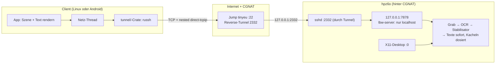
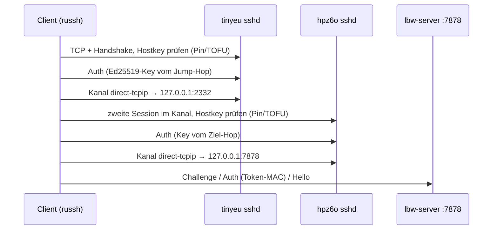
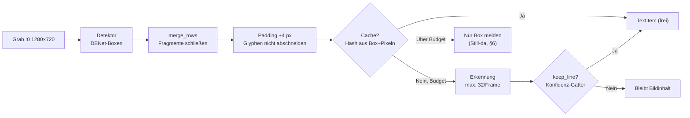
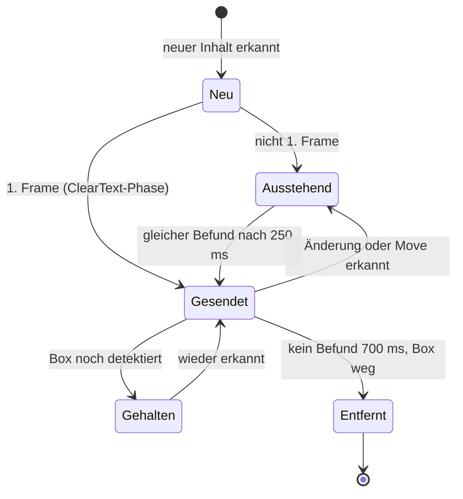
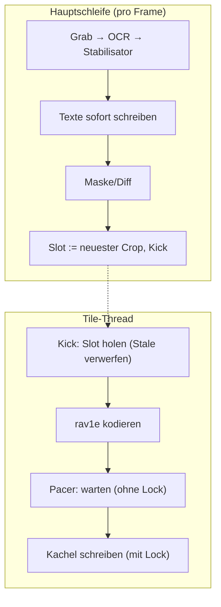
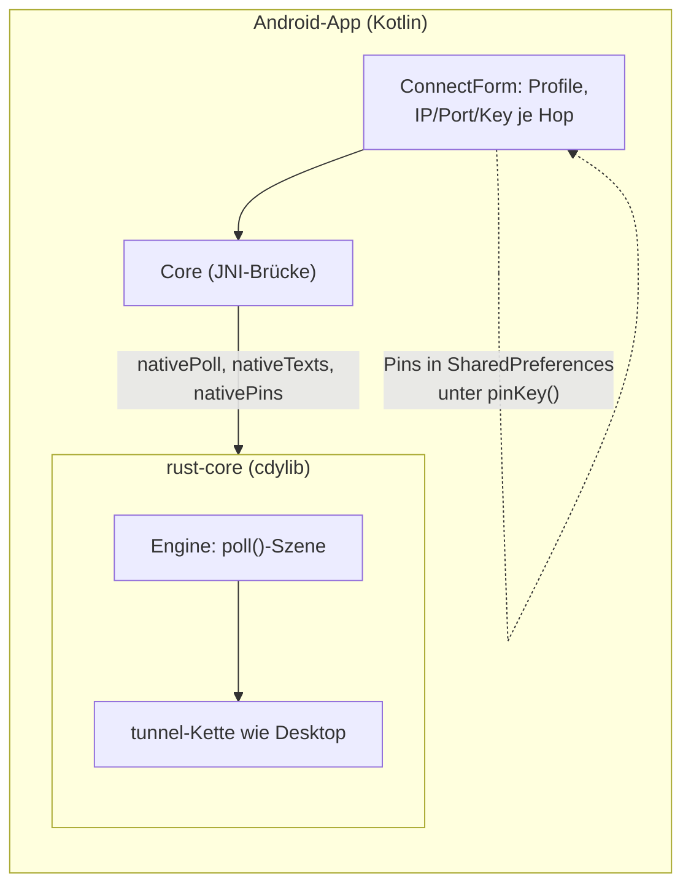
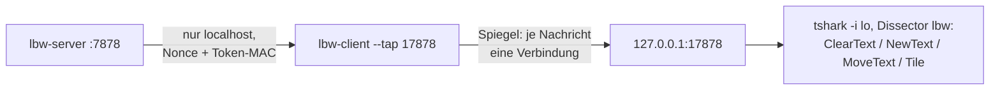

# Walkthrough: `source11_compact` — minimaler Desktop, der seine Texte nicht als Bild schleppt

Ziel war: Ein 1280×720-Desktop über einen 6-kB/s-Kanal bedienen, bei dem
der SSH-Tunnel von den Clients selbst gebaut wird (auch durch einen
Jump-Host, weil der Server hinter Carrier-Grade-NAT sitzt). Ergebnis:
`source11_compact` — ein Server, der nur an `127.0.0.1:7878` bindet,
erkannte Textzeilen als kleine Botschaften statt als Bild schickt und
Bildkacheln (AV1) dosiert hinterherschiebt. Plan und Tasks dazu:
[`plan.md`](plan.md), [`tasks.md`](tasks.md) im selben Ordner.

Fachbegriffe werden beim ersten Auftreten kurz erklärt. Alle Messwerte
stammen von echten Läufen auf diesem Rechner: Loopback-Tests, ein
Live-Lauf gegen `:0` (Firefox mit Google Maps) und der Emulator-E2E.
Wo ein Wert vom Container-Setup abhängt, steht das dabei.

## 1. Das Problem in drei Sätzen

1. **Bild ist teuer und matschig.** Eine 1280×720-Kachel als AV1 kostet
   je nach Inhalt 1–200 kB; Text in Video-Qualität ist trotzdem schlecht
   lesbar (Video-Codecs sind für weiche Verläufe gebaut, nicht für harte
   Glyphen-Kanten). Eine erkannte Zeile dagegen: ~30–60 B als
   `NewText`.
2. **SSH ist gesetzt, aber der Server hängt hinter CGNAT.** Der Client
   muss den Tunnel selbst bauen: erst zum öffentlich erreichbaren
   `tinyeu` (`51.107.16.14:22`), dann durch dessen Reverse-Tunnel zum
   Zielrechner `hpz6o` (dort als `127.0.0.1:2332` sichtbar) — genau wie
   in der SSH-Konfiguration des Betreibers:

   ```sshconfig
   Host tinyeu
       HostName 51.107.16.14
       Port 22
       ServerAliveInterval 15
       LocalForward 2332 127.0.0.1:2332
       IdentityFile ~/.ssh/tinyeu_key.pem
   Host hpz6o
       HostName 127.0.0.1
       Port 2332
       User kiel
       IdentityFile ~/.ssh/id_lenovo_to_hpz6o
   ```

3. **Wireshark muss mitlesen können.** Der Klartext-Strom läuft deshalb
   auf `127.0.0.1` (serverseitig Autorisierung per Nonce + Token-MAC),
   und der Client spiegelt ihn auf Wunsch auf einen lokalen Tap-Port.

## 2. Die Architektur auf einen Blick

Drei Schichten, je eine Crate bzw. ein Verzeichnis unter
`source11_compact/`: `common/` (Protokoll), `tunnel/` (SSH-Kette),
`server/` + `client/` + `android/` (Endpunkte).



Warum diese Form? Der Server braucht **keinen** Port im Internet, keine
eigene Kryptografie und keinen eigenen Schlüssel-Austausch — all das ist
SSHs Job (`russh` 0.64 in Rust, in beiden Client-Arten dieselbe
`tunnel/`-Crate). Der Server prüft nur noch, ob der Client am anderen
Tunnel-Ende das LBW-Token kennt (§4). TLS oder ein eigenes Wire-Protokoll
mit AEAD wären doppelte Arbeit gewesen; das Klartext auf `127.0.0.1`
bleibt dabei absichtlich — es ist die Voraussetzung für den Dissector
(§9) und durch SSH nach außen abgeschirmt.

## 3. Der Tunnel: zwei SSH-Sessions ineinander

Eine SSH-Verbindung kann in einem Kanal (`direct-tcpip`) eine zweite
komplette SSH-Session transportieren — inklusive deren eigener
Hostkey-Prüfung. Genau das bildet die Kette aus §1 nach, ohne einen
einzigen lokalen Forward-Port:



Drei Details, die man sonst erst in der Praxis lernt:

- **TOFU-Pinning pro Hop.** Beim ersten Kontakt lernt der Client den
  Hostkey („Trust On First Use") und speichert ihn als
  `SHA256:…`-Fingerprint in den Profil-Einstellungen. Ab dann wird
  *geprüft* statt gelernt — ein stiller MITM am Jump scheitert, bevor
  die Auth läuft. `connect_chain_with_pins` liefert die gelernten
  Fingerprints pro Hop zurück, `Engine::pins()` (Android) bzw. `--pin`
  (Desktop) führt sie zurück in die Persistenz.
- **Ein hängender Versuch darf Retry nicht blockieren.** TCP-Connect
  hat einen Timeout (10 s), aber SSH-Handshake/Auth/Kanalöffnung einzeln
  keinen. Im Emulator-Lauf hing der erste Verbindungsversuch einmal
  >160 s — der Retry griff schlicht nie. Darum gibt es jetzt
  `attempt_timeout` (30 s) pro Ketten-Versuch; ein Regressionstest gegen
  TEST-NET-1 (Pakete ins Leere) belegt, dass der Deckel zuschlägt
  (2,1 s statt 5 s+ Hängen).
- **Keepalive ist Politik, nicht Hoffnung.** Die Schichten-übergreifende
  Betriebs-Politik (`TunnelPolicy`) bündelt Keepalive (15 s, 3 Fehlschläge
  bis Abbruch — das `ServerAliveInterval`-Äquivalent), Reconnect-Abstände
  (0,5 s → 5 s) und eben die Timeouts. Der Android-Client übersteht so
  HOME-Reconnect und kurze Netzabbrüche ohne Neu-Login.

## 4. Das Protokoll v4: Text ist eine Liste von IDs

Auf dem Draht liegt ein simples Framing: `[u32-LE-Länge][bincode-Body]`.
Zuerst beweist der Client die Berechtigung: Der Server schickt eine
zufällige 16-B-Nonce (`Challenge`), der Client antwortet mit
`MAC = HMAC-SHA256(token, nonce ‖ "lbw11")` — Domain-Trennung inklusive,
damit der MAC nie für fremde Zwecke missbraucht werden kann.

Danach gilt die Kernidee des ganzen Projekts: **Text wird nicht jeden
Frame wiederholt.** Jede erkannte Zeile bekommt eine sessionsweite ID
(u64) und lebt als eigenständige Botschaft:

| Botschaft | Inhalt | Kanalzeit |
|---|---|---|
| `ClearText` | Alle Texte verwerfen (nur 1. Frame) | ~5 B |
| `NewText` | ID, Box, Farben, String | ~30–60 B |
| `MoveText` | Nur ID + neue Box (Scroll!) | ~8 B |
| `RemoveText` | ID | ~8 B |
| `Tile` | AV1-Box (Restbild) | 0,5–200 kB |

Ein Browser-Scroll ist damit fast gratis: Dieselben Zeilen wandern —
der Client bewegt 47 bekannte IDs per `MoveText` (live gemessen, §7),
statt 47 neue Strings zu schicken. Der Client hält die Szene als
ID→TextItem-Map; `MoveText` verschiebt nur die Box. Kein OCR-Text
überträgt sich doppelt, und AV1 muss nie Text „erfinden" — das ist der
Unterschied zwischen „lesbar" und „Matsche".

## 5. Die OCR-Pipeline: vom Screenshot zur Zeile

Pro Frame läuft: Bildschirm greifen (X11, 1280×720) → Textboxen finden
(DBNet-Detektor, `PP-OCRv6_small_det.onnx`) → Zeilen erkennen
(`PP-OCRv6_small_rec.onnx`) → stabilisieren (§6) → senden. Gemessen
(RTX A4000 im Container, CPU-Erkennung): Detektion ~16 ms (CUDA, warm)
bis ~140 ms (CPU), Erkennung ~14 ms je unbekannter Zeile. Ein komplett
neuer Bildschirm kostet also einmalig ~1,5 s — danach trägt fast alles
der Cache.



Die drei hier eingebauten Verfeinerungen zahlen direkt auf die zwei
Nutzerbeschwerden ein („kaum Text erkannt", „Text bleibt lange stehen"):

**Zeilen-Merge (`merge_rows`).** Der Detektor fragmentiert Linien:
Aus „Directions" werden `Directi` + `ons`, aus einer Straßenzeile
`Karl-Vo-` + `eck`. Fragmente erkennen schlecht (wenig Kontext) und
jeder kostet einen Erkennungs-Lauf. `merge_rows` verschmilzt Boxen
gleicher Grundlinie (Mitten-Abstand ≤ Höhe/3) mit kleiner Lücke
(≤ Höhe/2) — aber nur mit Bremse: ähnliche Höhe (keine Brücken über
hohe Overlay-Boxen) und Gesamtbreite ≤ 320 px. Ohne Bremse verkettete
ein Karten-Overlay einmal die ganze 1249-px-Breite zu einer Müllzeile.
Vorher → nachher auf dem echten Maps-Bild: `Directi`+`ons` wurden zu
`Directi Save`-Nähe, die Tab-Titel zu ganzen Zeilen, und
`Home (Nefenfeldstrasse 11)` kommt sauber aus dem Eingabefeld statt
als Bruchstück (das `Ca`-Fragment einer schmalen Tab blieb — Restsee).

**Konfidenz-Gatter (`keep_line`).** Mehrzeilige Zeilen brauchen
Konfidenz ≥ 0,5, Einzelzeichen ≥ 0,75. Rotierte Karten-Labels lieferten
sonst Ratetext wie `三`, `六`, `ofo` über die Karte gemalt; echte
UI-Zeichen („X", „+") liest das Netz dagegen mit ≥ 0,9.

**Budget + Priorität.** Nur höchstens 32 *unbekannte* Zeilen je Frame
wird erkannt; der Rest kommt in Folgeframes (Cache-Treffer sind frei).
Misses nahe zuletzt gesendeten Rechtecken laufen zuerst — beim
Verschieben konvergiert der sichtbare Text zuerst, neue Ränder folgen.
Ein kompletter Szenenwechsel konvergiert so in ~3 Frames à ~0,5 s
statt in einem 1,5-s-Block; ein ruhiger Bildschirm kostet danach
unter 1 ms Erkennung (Cache-Treffer >99 % auf statischem Inhalt).

## 6. Der Stabilisator: OCR flackert, der Client darf das nicht sehen

PP-OCR liefert je Frame leicht andere Ergebnisse: Box ±wenige Pixel,
gelegentlich ein falsches Zeichen, kurzes Aussetzen. Roh gesendet, wäre
das NewText/RemoveText-Spam am Client. Der Stabilisator (rein
funktional, ohne Display testbar) hält einen stabilisierten Zeilen-
zustand `sent` je ID und entscheidet pro Frame:



Drei Mechaniken gegen das Flackern — und warum sie *zeit*basiert sind:

- **Matching statt Position.** Alte und neue Zeile werden per
  Text-Ähnlichkeit (Levenshtein) *und* Lage gepaart: ≥ 0,8 ähnlich
  matcht hart; sonst hält eine Hysterese (0,5–0,8 bei naher Box) den
  alten Inhalt, damit Tippjitter nicht als falsches Zeichen durchschlägt.
- **Zeit-Debounce statt Frame-Zählen (250 ms neu/geändert, 700 ms weg).**
  Die Frame-Zeit schwankt zwischen 0,1 s (Cache) und 2 s (voller
  Szenenwechsel). Frame-gezählt hieß „5 Frames weg" im Bewegungsfall
  **8,5 s Geistertext** — exakt die gemeldete Beschwerde. Zeitbasiert
  schrumpft das auf 0,7 s, unabhängig vom Durchsatz.
- **Still-da-Urteil.** Eine bekannte Zeile, deren *Box* noch detektiert
  wird (die Erkennung hängt im Budget hinterher), gilt als anwesend —
  kein vorschnelles `RemoveText` mit anschließendem Re-`NewText`.
  Dazu das Move-Totband (6 px / 4 px Größenänderung), damit
  Subpixel-Jitter keine sinnfreien Moves erzeugt.

## 7. Kacheln im Hintergrund: Text hat immer Vorfahrt

Was *nicht* als Text kommt (Bilder, Karten, Video), geht als AV1-Box
durch den Kanal. Drei Regeln halten das erträglich:

- **Maske.** Gesendete Text-Rechtecke werden vor dem Diff mit ihrer
  Hintergrundfarbe zugemalt: Der Client malt den scharfen Text selbst —
  eine AV1-Kopie desselben Texts wäre doppelte Bandbreite *und* doppelt
  gemalt (matschiges Echo unter scharfer Schrift). Die Maske ist ein
  Zuschlag von 6 px je Seite gegen Glyphen-Fransen.
- **Big-Move-Ausnahme.** Ändert sich >30 % der Roh-Pixel (Fenster
  verschoben), wäre die Maske aus *alten* Rechtecken ein Lochmuster über
  neuem Inhalt. Dann geht die Kachel unmaskiert raus: kurz unscharf,
  aber aktuell — scharfer Text folgt in ~1 s.
- **Dosierung (Leaky Bucket).** Kacheln werden auf Budget-Rate
  (Standard 6000 B/s) gleichmäßig ausgegeben statt als Burst. Texte
  dagegen gehen *immer sofort* raus und buchen nur nachträglich auf dem
  Budgetkonto — ihre Bytes sind verschwindend.

Kacheln liefen früher in der Hauptschleife: rav1e-Kodierung (~0,5–2 s)
plus Pacing-Schlaf (bei 6 kB/s für 60-kB-Kacheln ~10 s) blockierten
*alles*, auch den längst erkannten Text. Seit dem Tile-Thread kodiert,
dosiert und sendet ein eigener Thread; die Hauptschleife übergibt nur
den Roh-Crop („Latest-wins": überholte Kacheln verfallen). Ein
gemeinsamer Writer-Lock serialisiert Texte und Kacheln auf dem Socket —
ohne ihn verzahnten sich große `send()`s auf Byte-Ebene und der Client
sah Protokoll-Müll (Session-Abrisse im Emulator-E2E, §11).



Der Unterschied, live auf `:0` gemessen (Firefox-Fenster zweimal per
`xdotool` verschoben, Nachrichtenstrom am Empfänger gezählt):

| Zeitpunkt | Hauptschleife (alt) | Tile-Thread (neu) |
|---|---|---|
| Move | ~11–13 s bis MoveText ankommt | **47 `MoveText` + 6 `NewText` in derselben Sekunde** |
| Vollbild-Kachel | blockiert alles | läuft im Hintergrund (t+9 s) |
| Ruhiger Bildschirm | 0 Nachrichten | 0 Nachrichten (alles Cache) |

## 8. Android: dieselbe Crate, andere Oberfläche

Der Android-Client teilt den Kern mit dem Desktop: `android/rust-core`
ist ein `cdylib`, das `common/`, `tunnel/` und die Netz/Szenen-Logik
aus `client/` wiederverwendet — kein JSch, kein Java-Crypto, der ganze
Tunnel steht in Rust. Kotlin macht nur UI: Verbindungs-Formular,
Zeichnen (Bitmap + Typeface direkt), Touch/IME.



Drei Android-spezifische Lehren stehen im Code verewigt:

- **`quad_main` bedeutet: Bibliothek zieht Fenster-Code.** Der Client
  nutzt für den Desktop `macroquad` (Fenster+Font). Die Bibliothek zog
  das auch in die Android-`cdylib` — deren Backend erwartet ein Symbol
  `quad_main`, das in einer `.so` niemand liefert: `dlopen` schlug auf
  dem Gerät fehl. Fix: `macroquad` hinter dem Default-Feature `desktop`
  aus der Bibliothek nehmen (`default-features = false` auf Android).
  Kuriosum für die Fehlersuche: JVM-Host-Tests fielen nie auf, weil das
  Host-`.so` das Symbol aus der glibc ziehen darf.
- **Mehrzeilige Extras zerhackt `adb`.** Für den E2E-Typ wurden Keys
  als Intent-Extras übergeben — `adb shell am start --es` zerschneidet
  mehrzeilige Werte in eigene Shell-Kommandos (jede PEM-Zeile wird ein
  „Kommando"). Keys reisen deshalb Base64-kodiert (`*_key_b64`,
  reiner Decoder in `ConnectForm.decodeKeyExtra`, JVM-getestet).
- **TOFU-Pins zurück in die App.** Nach Link-up ruft die App
  `Core.pins()` (JNI `nativePins`) ab und speichert die Fingerprints
  je Hop unter `pinKey()` in den SharedPreferences — inklusive
  „Host-Keys vergessen" zum Zurücksetzen. Im Emulator-E2E sind beide
  Pins (Jump + Ziel) als Checks 5a/5b belegt.

## 9. Wireshark: das Protokoll in Klartext lesen

Der Dissector `packet-lbw.c` (rein C, wird gegen die System-
Wireshark-API 4.6 gebaut) zerlegt Länge, Variante und Felder. Entschlüsseln
muss er nichts: Auf `127.0.0.1` liegt der Strom wie entworfen im Klartext
(§2), der Rest steht in SSH.



So sieht man, was wirklich auf dem Draht lag — z. B. die Messung in §7:
`Text`-Meldungen zählen, `Tile`-Meldungen datieren. `wireshark/check.sh`
verifiziert den Dissector gegen ein Sample-pcap (14 Varianten plus
Baum-Nachweis). Bau und Start: `wireshark/CMakeLists.txt` bzw. die
Kurzanleitung in `source11_compact/wireshark/README.md`,
Deploy (tinyeu/hpz6o, systemd-Reverse-Tunnel) in
`source11_compact/DEPLOY.md`.

## 10. Tests sind die Beweise

Jede Behauptung oben hat einen ausführbaren Nachweis:

```bash
cargo test --workspace          # 100 Rust-Tests (Protokoll, Stabilisator,
cargo fmt --check               #   Tunnel gegen echte sshd, Loopbacks)
cargo clippy --workspace --all-targets -- -D warnings
./wireshark/check.sh            # Dissector: 14 Varianten + Baum
./scripts/smoke_e2e.sh          # Desktop-Kette Jump→Ziel, Tap-Dissektion
bash android/scripts/emulator_e2e.sh   # echte App im Emulator (9 Checks)
```

- **Session ohne Display/Modelle** (`server/tests/loopback.rs`): volle
  Sitzung im Speicher — Handshake, Text-Delta, eine schmutzige Kachel
  nach einem Pixel. Der Tile-Thread wurde hier mitverifiziert (sechs
  Tests, inklusive des Erst-Frame-Masken-Regressionsfalls: Kein
  Big-Move ohne Vorbild!).
- **Stabilisator** (`09_stabilize.rs`): Jitter bleibt still, Tippen
  kommt nach 250 ms, Scroll sendet nur Moves, Verschwinden nach
  700 ms, Still-da hält.
- **Tunnel** (`tunnel/tests/`): Echo durch echte sshd-Paare, Retry bei
  spät startendem sshd, Neustart von sshd, neuer Attempt-Deckel.
- **Android JVM** (28 Tests, gegen das Host-`.so`): Protokoll-Blob,
  Keymap, Viewport, TOFU-Pin-Helfer, Base64-Key-Decoder.
- **Emulator-E2E**: echte App gegen echten Server durch echte
  sshd-Paare (Ports 2322/2323 statt Standard — Beweis, dass nichts
  hartcodiert ist). Neun Checks: Kette, OCR-Marker, Tipp-Up-Pfad
  (App → Server), frischer OCR-Text, Screenshot, beide Pins, Keys in
  Prefs, Reconnect nach HOME.

## 11. Grenzen und Ehrlichkeiten

- **LOC-Ziel verfehlt.** Geplant ~3,5–4 k Zeilen, gelandet ~9,7 k
  (6,1 k Rust src + 0,8 k Rust-Tests + 1,9 k Kotlin + 0,9 k C/Shell).
  Funktionalität zu kürzen, um die Zahl zu treffen, wäre falsch
  gewesen — ausgewiesen statt geschönt.
- **Rotierter Text bleibt schwach.** Straßen-Labels auf Karten sind
  diagonal und 12 px klein; Erkennung dort ist Roulette, einzelne
  Fehlzeichen stehen bleiben. Das Konfidenz-Gatter (§5) enthält den
  Schaden, mehr ist mit dem kleinen Modell nicht zu holen.
- **enigo-Tasten auf Xvfb.** Der Server injiziert Eingaben per `enigo`.
  Auf Xvfb kommen Mausbewegungen an, Tasten nicht (direkt belegt) —
  der E2E-Check 3b tippt deshalb per `xdotool` (3a belegt den
  App→Server-Pfad unabhängig). Auf echtem Xorg steht der Beleg für
  Tasten noch aus.
- **CI nicht trocken gefahren.** Der Workflow
  (`.github/workflows/release-29-source11.yml`) ist geschrieben, aber
  hier ohne GitHub-Zugang nie gelaufen — erster Dry-Run fällig.
- **Größen.** Android-`.so` 5,5 MB (arm64) / 7,0 MB (x86_64), APK
  ~19 MB (Debug). Der SSH-Client darf laut Plan wachsen; Größen
  werden in der CI nur berichtet, nicht gegated.
- **Latenz-p50.** Es gibt HUD/Tap-Metriken, aber keine automatisierte
  p50-Auswertung im CI — Follow-up, kein Blocker.

Alles andere ist lauffähig: `DEPLOY.md` für den Produktiv-Stack,
`WALKTHROUGH.md` im Code-Verzeichnis für den Schnelldurchlauf.
