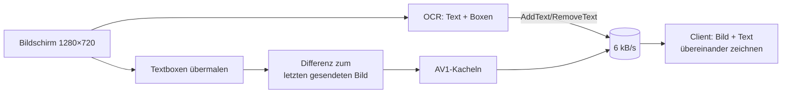
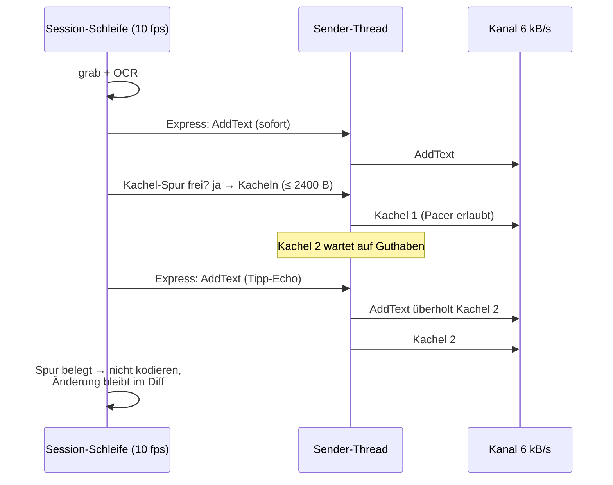

# Handbuch: `source10_instrumentation_b`

Dieses Handbuch erklärt, **wie** der Low-Bandwidth-Remote-Desktop in
`source10_instrumentation_b` funktioniert, **warum** er so gebaut ist und
**wie man ihn bedient und misst**. Es setzt nur Grundwissen über TCP und
Rust voraus; Fachbegriffe werden beim ersten Auftreten erklärt.

Was sich gegenüber source10 geändert hat und welche Messungen dahinter
stehen, steht im [Walkthrough](walkthrough.md); die Befunde im
[Review](review.md).

## 1. Das Problem in einem Bild

Der Kanal ist eine SIM-Karte ohne Vertrag: rund **6 kB/s**, oft stockend,
dazu ein SSH-Tunnel. 6 kB/s heißt: Jedes Kilobyte kostet ~170 ms
*Leitungszeit*. Ein Bildschirm hat 1280×720 Pixel — selbst gut
komprimiert sind das zig Kilobyte. Ein Remote-Desktop „wie üblich"
(Bild streamen) ist damit unbrauchbar.

Die Lösung dieser Projektreihe hat zwei Säulen:

1. **Text als Text.** Ein OCR-Modell (PP-OCRv6: *DBNet* findet
   Textzeilen, *SVTR* liest sie) wandelt sichtbaren Text in Zeichenketten
   mit Box und Farben um. Eine Zeile kostet 40–100 Byte statt mehrerer
   Kilobyte Pixel. Der Client zeichnet den Text selbst.
2. **Nur Änderungen als Bild.** Der Rest (Icons, Bilder, Animationen) geht
   als *AV1-Still-Picture* — ein einzelnes, komprimiertes Standbild — und
   nur für die Region, die sich geändert hat. Textflächen werden vorher
   mit ihrer Hintergrundfarbe übermalt (*Maskierung*), damit Text nicht
   doppelt (als Pixel *und* als Zeichen) übertragen wird.



## 2. Wer besitzt den Kanal? (Head-of-Line-Blocking)

TCP ist ein **Rohr**: Bytes kommen in der Reihenfolge an, in der sie
geschrieben wurden. Schreibt der Server eine 42-kB-Kachel und eine
Millisekunde später einen 60-Byte-Text, dann sieht der Client den Text
erst, wenn die 42 kB durch sind — bei 6 kB/s nach **7 Sekunden**. Das
nennt man *Head-of-Line-Blocking* (die Spitze der Warteschlange blockiert
alles dahinter).

Ein *Leaky Bucket* (Pacer, „löchriger Eimer") hilft nur teilweise: Er
sorgt dafür, dass der Server im **Mittel** nicht schneller schreibt als
der Kanal abfließt. Aber sobald eine Riesen-Nachricht geschrieben ist,
gehört das Rohr ihr. Darum gilt in source10_b:

> **Keine Nachricht darf den Kanal lange besitzen.**

Kacheln werden auf `--max-tile` Byte gedeckelt (Default 2400 B ≈ 0,4 s).
Ein Text wartet also höchstens auf *eine* kleine Kachel.

## 3. Die drei Regeln des Servers



1. **Zwei Spuren** (`server/src/12_send.rs`). Ein eigener Thread besitzt
   den Socket. Texte (*Express-Spur*) schreibt er sofort. Kacheln
   (*Kachel-Spur*) schreibt er erst, wenn der Pacer Guthaben hat — und
   während er darauf wartet, schaut er alle 10 ms nach neuen Texten.
2. **Die Schleife wartet nie.** Capture, OCR und Text-Deltas laufen im
   10-fps-Takt weiter, egal wie voll der Kanal ist.
3. **Nur kodieren, was gesendet werden kann.** Ist die Kachel-Spur
   belegt, wird gar nicht erst AV1-kodiert. Verglichen wird mit dem
   *Schattenbild* — dem Bild, das der Client nach Abfluss der Spur hat —
   nicht mit dem letzten Frame. Eine übersprungene Änderung steckt so
   automatisch in der nächsten Differenz; es geht nichts verloren und es
   wird nichts Veraltetes gesendet.

### Der Pacer in drei Zeilen

```rust
// server/src/11_pace.rs — Guthaben wächst mit der Zeit (max. 1 s Budget)
allowance = (allowance + elapsed * budget_bps).min(budget_bps);
// Sender fragt, ohne zu buchen: darf die Kachel jetzt?
let wait = pacer.wait_for_at(tile_len, Instant::now());
// Erst beim Schreiben wird gebucht (Texte genauso, nur ohne Warten)
pacer.note(n);
```

### Kacheln deckeln

```rust
// server/src/07_av1.rs (Prinzip)
let data = encode(box);
if data.len() <= max { return vec![(box, data)]; }   // Normalfall: 1 Kachel
let k = data.len().div_ceil(max);                     // so viele Streifen
for band in split(box, k) {                           // parallel kodiert
    if let Some(r) = dirty_in(prev, cur, band) {      // unveränderte Bänder fallen weg
        out.extend(capped(prev, cur, r, depth + 1));  // zu groß → nochmal teilen
    }
}
```

Kleine Änderungen (ein getippter Buchstabe, ein Cursor) bleiben **eine**
Kachel wie bisher; nur große Änderungen werden zerlegt.

## 4. Bedienung

```sh
cd source10_instrumentation_b
ls models/PP-OCRv6_small_det.onnx     # Symlink auf ../source7_mvp/models
cargo build --release

# Server (CPU-only; lauscht nur an localhost — keine Authentifizierung!)
DISPLAY=:0 ./target/release/lbw-server --budget 6000 --max-tile 2400 \
    --record /tmp/srv.lbwlog
# Client, typischerweise am Ende eines SSH-Tunnels (ssh -C -L 7878:localhost:7878 …)
./target/release/lbw-client --connect 127.0.0.1:7878 --record /tmp/cli.lbwlog
```

| Option (Server) | Default | Bedeutung |
|---|---|---|
| `--listen` | `127.0.0.1:7878` | Adresse; nicht-localhost erzeugt eine Warnung |
| `--budget` | `6000` | Kanalrate in B/s, nach der Kacheln dosiert werden |
| `--max-tile` | `2400` | Kachel-Deckel in Byte; `0` = unbegrenzt (Vergleich) |
| `--quantizer` | `180` | AV1-Qualität (höher = kleiner/gröber) |
| `--record` | – | `.lbwlog`-Aufnahme |
| `-v` | – | Pipeline-Log je Frame, inkl. „(Kanal belegt)" |

**Sicherheit:** Das Protokoll hat keine Authentifizierung. Der Server
bindet deshalb nur an localhost; der Zugang läuft über SSH.

Wahl von `--budget`: etwas *unter* der echten Kanalrate (z. B. 5000 bei
stockenden 6 kB/s). Ist das Budget zu hoch, staut sich wieder alles im
Tunnel; zu niedrig verschenkt nur Bildrate — Texte sind davon nie betroffen.

## 5. Messen: `lbw-logstat`, Prüfstand, HIL

### 5.1 `lbw-logstat` lesen

```sh
./target/release/lbw-logstat /tmp/srv.lbwlog /tmp/cli.lbwlog
```

Die wichtigsten Zeilen:

```text
Input→Text (Client-Uhr): n=93 avg=302.8 p50=165.9 p90=881.2 … ms
  (Erst-Echo; ohne sichtbare Reaktion binnen 10 s: 0)
Kanal-Sim (6000 B/s FIFO): größte Nachricht 407 B (≈ 68 ms Leitung)
  Text-Zustellung: n=973 … p50=224.6 p90=489.3 …
```

- **Erst-Echo:** Für jede Eingabe (Taste/Klick gedrückt, Text) zählt die
  Zeit bis zur *nächsten* sichtbaren Änderung. Ein Echo darf viele
  Eingaben beantworten (fünf Tasten, ein Bild-Update). `p50`/`p90` sind
  Median und 90-%-Perzentil.
- **Kanal-Simulation:** spielt die Sendezeitpunkte des Server-Logs durch
  ein ideales 6-kB/s-Rohr. So sieht man Head-of-Line-Blocking schon im
  Server-Log, ohne Client-Log und ohne Uhrensynchronisation.
- `--deep` liefert Tiefenanalyse (Verbindungen, Dedup, Kachelraster),
  `--json` einen maschinenlesbaren Export.

### 5.2 Prüfstand mit echten Daten

Der Prüfstand nimmt eine echte Server-Aufnahme, malt deren Kacheln und
Texte als *Bildquelle* nach und schickt sie durch eine echte Session an
einen Client, der nur `--budget` B/s liest:

```sh
L=../source10_instrumentation/20261018_0839.lbwlog
cargo run --release -p lbw-client --example bench -- $L --from 10 --secs 60
# dieselbe Quelle gegen den alten Server (A/B):
cargo run --release --manifest-path tools/bench10/Cargo.toml -- $L --from 10 --secs 60
# Server-Optionen hinter `--`:
cargo run --release -p lbw-client --example bench -- $L --from 10 --secs 60 -- --max-tile 0
```

Ausgabe: Text-Latenz (Ankunft − Erscheinen in der Quelle), Anzahl
Kacheln, größte Nachricht, Rate.

### 5.3 HIL-Smoke

```sh
./scripts/smoke_hil.sh
```

Startet Xvfb, ein xterm mit wiederholtem farbigem Bildlauf, den Server mit
echten Modellen und einen Drossel-Proxy (`examples/throttle.rs`,
6000 B/s je Richtung). Der Probe-Client tippt *über den Proxy* Wörter in
die Shell — gemessen wird also der volle Weg Client → Kanal → Server →
xterm → OCR → Kanal → Client.

## 6. Tests

```sh
cargo test --workspace                                         # 121 Tests
cargo test --release -p lbw-server --test models -- --ignored  # echte Modelle (CPU)
cargo test --release -p lbw-server --test tabs --test padding -- --ignored
```

`client/tests/realdata.rs` ist der Prüfstand als Test (15 s des echten
0839-Logs um die 42-kB-Kachel herum); fehlt das (gitignorte) Log, wird er
übersprungen.

## 7. Glossar

| Begriff | Erklärung |
|---|---|
| AV1-Still-Picture | Einzelnes Intra-Bild im AV1-Format (hier: rav1e kodiert, rav1d dekodiert) |
| DBNet / SVTR | OCR-Detektor (findet Zeilen) / Erkenner (liest Zeichen), als ONNX auf der CPU |
| Erst-Echo | Latenzmaß: Eingabe → nächste sichtbare Änderung (viele-zu-eins) |
| Express-Spur | Sender-Warteschlange für Texte, ungebremst |
| Head-of-Line-Blocking | Kleine Nachricht wartet hinter großer im selben TCP-Strom |
| Leaky Bucket / Pacer | Guthaben-Zähler, der die mittlere Senderate begrenzt |
| Schattenbild | Serverseitige Kopie dessen, was der Client (nach Abfluss) zeigt |
| `.lbwlog` | Aufnahmeformat: alle Nachrichten + Pipeline-Timings |
