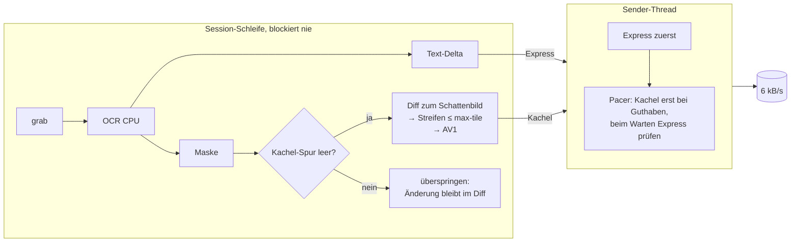

# Plan: `source10_instrumentation_b` — Latenz unter Last, CPU-only

Stand: 2026-10-31. Basis: `source10_instrumentation` (Protokoll v3,
Leaky-Bucket-Pacing, `.lbwlog`). Anlass: [`review.md`](review.md)
(Befunde B1–B8). Ziel: Dieselbe Funktion, dasselbe Protokoll (v3 — alte
Clients/Server und der Wireshark-Dissector bleiben kompatibel), aber
**Text-Echo und Eingaben bleiben auch während großer Bildänderungen
flüssig**. Direkt in Rust (kein Transpiler — Präzedenz seit source9).

## 1. Leitidee

Das Problem ist nicht die mittlere Rate (die hält der Pacer), sondern
**wer den Kanal gerade besitzt**. Drei Regeln:

1. *Keine Nachricht belegt den Kanal länger als ~0,4 s.* Kacheln werden in
   Streifen zerlegt und auf `--max-tile` Byte begrenzt.
2. *Die Erkennungsschleife wartet nie auf den Kanal.* Ein eigener
   Sender-Thread besitzt Socket und Pacer; Texte überholen wartende
   Kacheln **auch während** des Wartens.
3. *Kodiert wird nur, was gesendet werden kann.* Neue Kacheln entstehen
   erst, wenn die Kachel-Spur leer ist, und zwar als Differenz zum zuletzt
   **gesendeten** Bild (Schattenbild) — nichts Veraltetes, nichts geht
   verloren.

## 2. Implementierungsvorschlag

1. **Kopie** `source10_instrumentation` → `source10_instrumentation_b`
   (ohne `target/`, ohne Logs), `models` → `../source7_mvp/models`.
   Echte Logs werden per Pfad `../source10_instrumentation/*.lbwlog`
   referenziert (gitignored; Tests überspringen, falls sie fehlen).
2. **CPU-only** (`03_detect.rs`, `05_ocr.rs`, `main.rs`, `Cargo.toml`):
   `ort` ohne `cuda`, `Provider` und `--cpu` entfallen.
3. **Sender-Thread** `server/src/12_send.rs`: `Sender` mit
   `Mutex<Queues>` + `Condvar`, Spuren `express` (Hello/Clear/Add/Remove)
   und `tiles`. Schleife: Express sofort; sonst Kachel, wenn
   `Pacer::wait_for(n) == 0`, sonst bis zu 10 ms auf Express warten.
   Recorder-`Msg` entstehen zum **echten** Schreibzeitpunkt.
   `tile_lane_free()` = Spur leer und Pacer-Schuld ≤ 250 ms
   (Encode-Vorlauf).
4. **Pacer** (`11_pace.rs`): neue nicht-buchende Abfrage
   `wait_for_at(n, now)`; `wait_paced` entfällt (wartet nicht mehr in
   der Schleife).
5. **Streifen** (`06_tiles.rs`): `stripes(prev, cur, dirty, band)` —
   Dirty-Box in 64-px-Bänder, je Band eigene enge Box, unveränderte Bänder
   fallen weg. `07_av1.rs`: `encode_capped(rgb-Quelle, r, q, max)` halbiert
   zu große Streifen rekursiv (Höhe, dann Breite; Minimum 16 px).
   Streifen werden parallel kodiert (`std::thread::scope`).
6. **Session** (`10_session.rs`): Schattenbild statt `prev`; Encode nur bei
   freier Kachel-Spur; `FrameMs.pace` = 0 (Schleife wartet nicht),
   `Frame.tile` = Vereinigungsbox aller Streifen (Format v3 bleibt
   unverändert, beide `logstat`-Versionen lesen beide Logs).
   Signatur von `serve_client` bleibt identisch (→ A/B-Prüfstand, §5).
7. **Config**: `--max-tile <B>` (Default 2400 ≈ 0,4 s bei 6 kB/s;
   `0` = unbegrenzt, Vergleichsmodus).
8. **Client** (`03_net.rs`): aufeinanderfolgende `MouseMove` vor dem
   Senden zusammenfassen (nur letzte Position; Klick-Reihenfolge bleibt).
9. **logstat** (`log/`): Erst-Echo-Metrik (B4), Version-2-Logs lesbar (B5),
   neues Modul `09_channel.rs`: Kanal-Simulation (FIFO, 6000 B/s) über
   die Server-Sendestempel → Zustellverzögerung je Text/Kachel und
   längste Kanalbelegung einer Nachricht.
10. **Prüfstand** `client/examples/bench.rs` (+ `tools/bench10/` für
    dieselbe Quelle gegen source10): echtes Log → Bildfolge + Texte →
    `serve_client` mit Ersatz-Quelle/-OCR → 6-kB/s-Drosselleser →
    Text-Latenz, max. Nachricht, Kanal-Stau.
11. **HIL**: `client/examples/throttle.rs` (TCP-Proxy mit Rate),
    `scripts/smoke_hil.sh`: Xvfb + xterm + echte CPU-Modelle + Proxy
    6000 B/s + `xdotool`-Tippen während eines Bildlaufs.

## 3. Ziele (messbar)

| Ziel | source10 (0839-Log / Prüfstand) | Erwartung `_b` |
|---|---|---|
| Größte Nachricht | 42 448 B (7 s Kanal) | ≤ `max-tile` + Hülle |
| Text-Zustellung p90 (Kanal-Sim) | s. Walkthrough | < 1 s |
| Schleife blockiert (`pace` max) | 6 104 ms | 0 ms |
| Mittlere Rate | ≤ Budget | ≤ Budget |
| Tests | 105 | ≥ 105 + neue |

## 4. Offene Requirements / Vorschläge

| # | Frage | Empfehlung |
|---|---|---|
| 1 | Protokoll v4 (z. B. `MoveText`, Prioritätsbits)? | Nein — v3 reicht; Streifen sind normale `Tile`s, Priorität ist Sender-Disziplin |
| 2 | Grobe Qualität unter Last + Nachschärfen im Leerlauf? | Follow-up; erst Streifen messen |
| 3 | Kachel-Cache für wiederholte Kleinstkacheln? | Nein (1,4 % Verlust, B8) |
| 4 | CUDA behalten als Option? | Nein — hier nicht testbar, CPU misst 107 ms det |
| 5 | Log-Format v4? | Nein — v3 bleibt, damit A/B-Logs vergleichbar sind; v2 wieder lesbar |

## 5. Kontext-Dateien für den ausführenden Agenten

- `plan/20261031_01_review_b/review.md` — Befunde, Zahlen.
- `plan/20261017_01_bunching/walkthrough.md` — Pacer-Herkunft.
- `plan/20261010_01_instrumentation/walkthrough.md` — Log-Format, Tools.
- `server/src/10_session.rs` — Schleife (Umbau: Schatten, Sender).
- `server/src/11_pace.rs` — Leaky Bucket (+ `wait_for_at`).
- `server/src/06_tiles.rs`, `07_av1.rs` — Box/Encoder (+ Streifen, Cap).
- `server/src/03_detect.rs`, `05_ocr.rs`, `main.rs` — CPU-only.
- `server/tests/common.rs`, `loopback.rs` — Testmuster (StubOcr).
- `client/src/03_net.rs` — Maus-Zusammenfassung.
- `log/src/03_stats.rs` — Latenz-Metrik; `07_legacy.rs` — Altformate.
- `client/src/bin/lbw-replay.rs` — Vorbild für Log→Bild im Prüfstand.

DeepWiki-Abfragen (ausgeführt): `xiph/rav1e` (Header-Overhead, Tiles,
Kontext-Kosten pro Frame), `pykeio/ort` (CPU-only-Features),
`plops/cl-rust-generator` (Konventionen).

## 6. Commit-Konvention

Conventional Commits, deutsch, Betreff ≤ 72 Zeichen, Body
Was/Warum/Verifikation, Auftraggeber wolpumba (wolpumba@gmail.com).
Geplant: (1) `docs: Review + Plan …`, (2) `feat: source10_b Gerüst
CPU-only`, (3) `fix: logstat Erst-Echo + v2-Logs + Kanal-Sim`,
(4) `feat: Sender-Thread + Streifen + Schattenbild`, (5) `feat: Client
Maus zusammenfassen`, (6) `test: Prüfstand mit echten Daten + HIL`,
(7) `docs: Handbuch + Walkthrough`.
