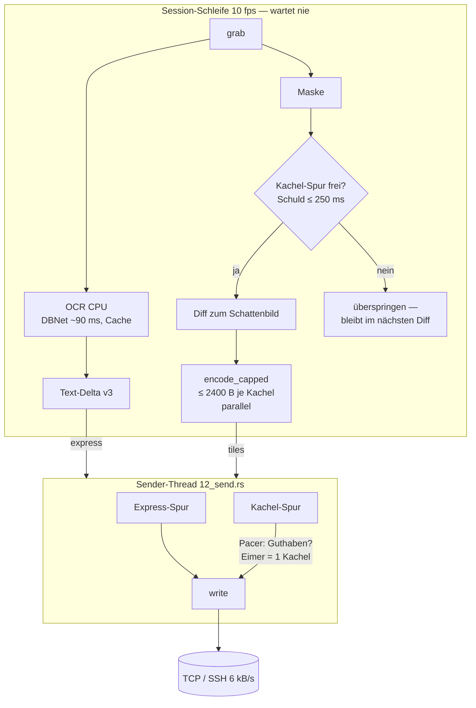
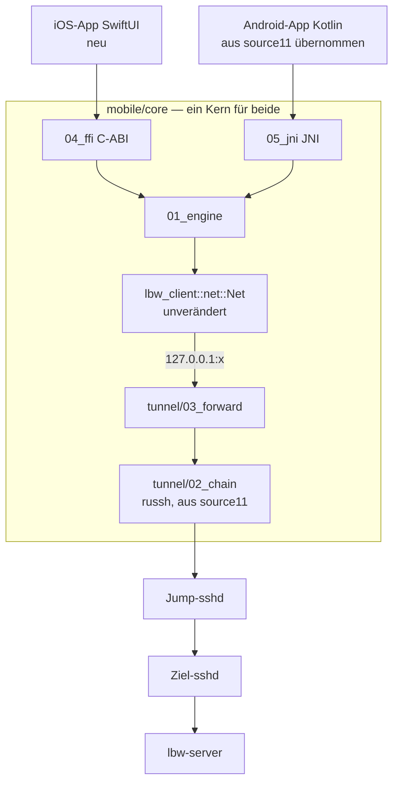

# Walkthrough: `source10_instrumentation_b` — Latenz unter Last, CPU-only

Ziel war: Den aktuell besten Stand (`source10_instrumentation`) prüfen und
eine verbesserte Version bauen, bei der **Text-Echo und Eingaben auch
während großer Bildwechsel flüssig bleiben** — auf diesem Rechner
vollständig testbar, also **CPU-only** (kein CUDA-Treiber im Container).
Grundlage: [`review.md`](review.md) (Befunde B1–B8), [`plan.md`](plan.md),
[`tasks.md`](tasks.md); Bedienung und Konzepte erklärt das
[`handbuch.md`](handbuch.md).

Alle Zahlen stammen aus echten Läufen in diesem Container (Threadripper
PRO 7955WX) mit den echten Aufnahmen `20261017_0614.lbwlog` (Animation,
vor Pacing) und `20261018_0839.lbwlog` (Browser-Session, mit Pacing).

## 1. Was exakt implementiert wurde

### 1.1 Der Befund in einer Zahl: 42 448 Byte

Das 0839-Log zeigt, dass der Leaky Bucket aus dem Bunching-Plan den
*Durchschnitt* einhält, aber nicht verhindert, dass **eine einzelne
Kachel** den Kanal besitzt: max. 42 448 B = **7 s** Leitungszeit bei
6 kB/s. Während dieser Zeit stand zusätzlich die ganze Erkennungsschleife
im Pacer (`pace` max 6 104 ms) — keine OCR, keine Text-Deltas.

Um das sichtbar zu machen, musste zuerst das Messwerkzeug ehrlich werden
(§1.5): Die alte `logstat`-Metrik meldete für dasselbe Log
„Input→Kachel p50 **47 515 ms**" — ein Artefakt der 1:1-FIFO-Paarung.
Korrigiert sind es p50 1 503 ms, p90 4 875 ms; die neue Kanal-Simulation
ergibt für Texte p50 2 050 ms, p90 5 983 ms, max 6 991 ms.

### 1.2 Architektur von source10_b



Neu bzw. geändert (Protokoll v3 und Log-Format v3 unverändert):

| Datei | Inhalt |
|---|---|
| `server/src/12_send.rs` (neu) | Sender-Thread: Express-/Kachel-Spur, Pacer, `tile_lane_free`, Abbruch per `Shutdown` |
| `server/src/11_pace.rs` | `wait_for_at` (fragen ohne buchen), `with_burst` (Eimergröße) |
| `server/src/06_tiles.rs` | `dirty_in` (Diff innerhalb eines Bandes), `fit` |
| `server/src/07_av1.rs` | `encode_capped`: proportional in Bänder zerlegen, parallel kodieren |
| `server/src/10_session.rs` | Schattenbild, Encode nur bei freier Spur, `FrameMs.pace = 0` |
| `server/src/03_detect.rs`, `05_ocr.rs`, `main.rs` | CPU-only, ort rc.15 (`Environment`) |
| `client/src/03_net.rs` | `coalesce_moves` |
| `log/src/07_legacy.rs`, `02_io.rs` | Log-Version 1/2 wieder lesbar |
| `log/src/10_echo.rs` (neu), `03_stats.rs` | Erst-Echo-Latenz |
| `log/src/09_channel.rs` (neu) | Kanal-Simulation je Nachricht |
| `client/examples/bench.rs`, `tools/bench10/` (neu) | Prüfstand mit echten Daten, A/B |
| `client/examples/throttle.rs`, `scripts/smoke_hil.sh` (neu) | Drossel-Proxy, HIL |

### 1.3 Sender-Thread: zwei Spuren statt einer Schleife

Kern der Änderung ist, *wer* auf den Kanal wartet. Vorher die
Erkennungsschleife, jetzt ein eigener Thread:

```rust
// server/src/12_send.rs — Thread-Schleife (gekürzt)
let out = if let Some(o) = lanes.express.pop_front() {
    o                                        // Text: sofort
} else if let Some(o) = lanes.tiles.front() {
    let wait = pacer.wait_for_at(o.frame.len(), Instant::now());
    if !wait.is_zero() {                      // Kachel muss warten …
        g = cv.wait_timeout(g, wait.min(POLL)).unwrap().0;
        continue;                             // … aber alle 10 ms nach Text schauen
    }
    lanes.tiles.pop_front().unwrap()
} else { g = cv.wait(g).unwrap(); continue };
pacer.note(n);
drop(g);                                      // ohne Lock schreiben
wr.write_all(&out.frame)
```

Die `Msg`-Records des Recorders entstehen jetzt **zum echten
Schreibzeitpunkt** — damit wird die Kanal-Simulation über Server-Logs
von source10_b genauer als bei source10.

### 1.4 Kachel-Deckel und Schattenbild

`encode_capped` kodiert zuerst die ganze Änderungsbox. Passt sie unter
`--max-tile`, bleibt es bei einer Kachel (wie source10 — kleine
Änderungen kosten keinen zusätzlichen Header). Sonst wird sie in
`k = ⌈Bytes/Deckel⌉` Bänder geteilt, jedes Band auf seine eigene
Änderung verkleinert (unveränderte Bänder fallen weg) und parallel neu
kodiert (`std::thread::scope`). Das *Schattenbild* (das, was der Client
nach Abfluss der Kachel-Spur zeigt) ersetzt den Vorframe als
Diff-Basis — so kann die Session Frames überspringen, ohne dass Pixel
verloren gehen.

### 1.5 Messwerkzeug: Erst-Echo, Kanal-Simulation, alte Logs

- **Erst-Echo** (`log/src/10_echo.rs`): Jede wartende Eingabe wird vom
  *nächsten* Echo beantwortet (viele-zu-eins), nur gedrückte
  Tasten/Klicks zählen, nach 10 s gilt eine Eingabe als „ohne Reaktion".
- **Kanal-Simulation** (`log/src/09_channel.rs`): FIFO-Rohr mit
  6000 B/s über die Sendestempel — zeigt Head-of-Line-Blocking im
  Server-Log allein.
- **Version-2-Logs** (`07_legacy.rs`): Spiegel-Enum `LogRecordV2` ohne
  `FrameMs.pace`; der Reader wählt den Decoder anhand des
  `Session`-Records. Das 0614-Referenz-Log ist wieder auswertbar (Test
  `real_0614_log_is_readable_again`).

### 1.6 Ergebnisse

**Prüfstand mit echten Daten** (`bench`; Quelle = Bildschirm + Texte der
Aufnahme, Kanal = Leser mit genau 6000 B/s; Text-Latenz = Ankunft beim
Client − Erscheinen in der Quelle):

| Lauf | Text p50 | Text p90 | Text max | fehlend | größte Nachricht |
|---|---|---|---|---|---|
| 0839 10+60 s, **source10** | 1 146 ms | 6 098 ms | 8 158 ms | 21 | 41 650 B |
| 0839 10+60 s, **source10_b** | 1 ms | 1 ms | 8 ms | 2 | 2 398 B |
| 0839 100+60 s, source10 | 5 250 ms | 5 381 ms | 5 436 ms | 0 | 36 746 B |
| 0839 100+60 s, source10_b | 1 ms | 1 ms | 1 ms | 0 | 2 409 B |
| 0614 60+60 s (Animation), source10_b | 1 ms | 43 ms | 501 ms | 19 | 2 406 B |

(source10 kann das 0614-Log nicht lesen — Befund B5 — daher dort kein
A/B.)

Deckel-Sweep (0839 10+60 s, source10_b):

| `--max-tile` | Kacheln | Text max | größte Nachricht |
|---|---|---|---|
| 1200 | 432 | 201 ms | 1 204 B |
| **2400 (Default)** | 221 | 8 ms | 2 398 B |
| 4800 | 117 | 3 ms | 4 805 B |
| 0 (unbegrenzt) | 27 | 6 289 ms (p90 6 044) | 41 650 B |

Der unbegrenzte Lauf zeigt: Sender-Thread *allein* genügt nicht — erst
der Deckel beseitigt das Head-of-Line-Blocking. 4800 war im idealen
Prüfstand minimal besser, aber im HIL (stockende Abflüsse) zählt die
Worst-Case-Belegung einer Nachricht (0,8 s statt 0,4 s); 2400 bleibt
Default.

**Stress: Kanal langsamer als Budget** (Server glaubt 6000 B/s, Kanal
liefert 4500 B/s — wie ein stockender Tunnel):

| | Text p50 | Text p90 | Text max | fehlend |
|---|---|---|---|---|
| source10 | 3 620 ms | 8 447 ms | 10 199 ms | 27 |
| source10_b | 98 ms | 1 682 ms | 2 011 ms | 2 |

Besser, aber nicht gut — dazu §3.

**HIL** (`smoke_hil.sh`: Xvfb, echtes xterm, echte CPU-Modelle,
ffplay-Testbild 400×300 @10 fps als Animation, Drossel-Proxy 6000 B/s,
Probe tippt acht Wörter *über den Proxy*):

| | source10 | source10_b |
|---|---|---|
| Frames in 30 s | 141 | 248 |
| Textwechsel gesendet | 38 | 115 |
| größte Nachricht | 6 650 B | 2 392 B |
| Kanal-Sim Text-Zustellung p90 / max | 983 / 1 023 ms | 382 / 414 ms |
| Input→Text (Server-Uhr) p90 / p99 | 596 / 2 374 ms | 435 / 912 ms |
| Input→Text (Client-Uhr) p90 / max | 433 / 1 146 ms | 354 / 506 ms |

**Tests:** `cargo test --workspace` **122 passed** (Baseline source10: 105),
3× hintereinander stabil; ignorierte Modell-/Xvfb-Tests (`models`,
`padding`, `tabs`) auf CPU grün; `cargo clippy --workspace --all-targets
-- -D warnings` und `cargo fmt --check` sauber; alle Dateien < 600 Zeilen
(`loopback.rs` → `pacing.rs`, `03_stats.rs` → `10_echo.rs` ausgelagert).

## 2. Architektur-Entscheidungen, die Tests erzwungen haben

### 2.1 Pacer: Nachrichten größer als der Eimer verhungerten

Der erste Prüfstand-Lauf mit `--max-tile 0` lieferte nur 6 Kacheln und
711 B/s. Ursache: `wait_for_at(n)` verlangte Guthaben ≥ `n`, der Eimer
fasst aber nur 1 s Budget — eine 41-kB-Kachel wurde nie fällig. In
source10 fiel das nicht auf, weil dort `pace_at` immer eine endliche
Wartezeit lieferte. Fix: Nachrichten über Eimergröße dürfen bei *vollem*
Eimer los und gehen in Schuld (Test `tile_bigger_than_bucket_is_not_starved`).

### 2.2 Eimer = eine Kachel statt 1 s Budget

Der HIL mit Animation zeigte Text-Zustellung p90 980 ms, obwohl keine
Nachricht über 2,4 kB lag. Grund: Nach einer Kodierpause hatte der 1-s-Eimer
6000 B Guthaben, und drei Streifen gingen *am Stück* raus — ein Text
dahinter wartete ~0,9 s. `Pacer::with_burst` begrenzt den Eimer auf eine
Kachel (min. ¼ s, max. 1 s Budget). Ergebnis: p90 382 ms; im Prüfstand
fiel die maximale Text-Latenz von 274 ms auf 8 ms. Ein Test
(`texts_jump_the_tile_queue` mit 1 B/s) fing den ersten Entwurf ab, der
den Eimer nach unten nicht auf das Budget begrenzte.

### 2.3 Log-Format v3 bleibt — für echte A/B-Vergleiche

Ursprünglich sollte `Frame` mehrere Kacheln oder ein `deferred`-Flag
tragen (v4). Verworfen: Dann könnte source10s `logstat` die neuen Logs
nicht lesen und umgekehrt. Stattdessen trägt `Frame.tile` die
Vereinigungsbox aller Streifen, die Streifen selbst stehen als einzelne
`Msg`-Records im Log. `FrameMs.pace` ist in source10_b immer 0 — die
Schleife wartet nicht mehr.

### 2.4 Prüfstand: dieselbe Quelle für beide Server

`serve_client` behielt deshalb exakt seine Signatur: `bench.rs` baut
unverändert gegen beide Crate-Sätze (`tools/bench10` mit Pfad-Deps auf
source10 und `ort = "=2.0.0-rc.13"`, weil `^rc.13` sonst auf rc.15
auflöst und die alte `Session::builder()`-API bricht).

### 2.5 Echtzeit-Test braucht optimierte eigene Crates

`client/tests/realdata.rs` verpasste im Debug-Build ein Viertel der Texte
(unoptimiertes Pixel-Kopieren im Prüfstand-Player). Fix: zeilenweises
Kopieren plus `opt-level = 1` für `lbw-client`/`lbw-server` im
Dev-Profil; danach 0 fehlende Texte.

### 2.6 HIL-Last muss Bildlast sein

Der erste HIL (xterm-Bildlauf) war textdominiert: größte Nachricht 407 B,
beide Server gleich gut. Erst die ffplay-Animation (wie die
Browser-Animation des 0614-Logs) trennt die Varianten.

## 3. Learnings und mögliche Erweiterungen

### Learnings

- **Mittelwert ≠ Besitz.** Ein Pacer begrenzt die Rate, aber Latenz
  entscheidet sich daran, wie lange *eine* Nachricht das Rohr besitzt.
  Der Deckel ist die wichtigste Einzelmaßnahme (Sweep: 6 289 → 8 ms).
- **Messwerkzeuge zuerst prüfen.** Die 47-s-Latenz der alten Metrik
  hätte jede Optimierung „bestätigt" oder „widerlegt" — beides falsch.
- **Der Prüfstand findet, was Unit-Tests nicht sehen** (verhungernde
  Kacheln, Eimergröße). Echte Aufnahmen als Quelle sind billig, weil
  das Log ohnehin alle Bytes enthält.
- **CPU reicht.** DBNet 85–107 ms auf 8 Threads, der Erkennungs-Cache
  macht statische Zeilen ~0 ms; der Server hält 8 fps unter Animation.
- **Grenze: das Budget ist geraten.** Liefert der Kanal weniger als
  `--budget`, staut es sich trotzdem (Stress: p90 1,7 s).

### Mögliche Erweiterungen

- **Adaptives Budget:** Der Client meldet empfangene Bytes zurück
  (`Ack{bytes}` alle 250 ms, Protokoll v4); der Server schätzt die echte
  Rate und den Rückstau und regelt das Budget nach (wie BBR/LEDBAT).
  Das ist die logische Antwort auf den Stress-Befund.
- **Qualität unter Last:** Bei belegter Spur gröber kodieren
  (Quantizer hoch), im Leerlauf nachschärfen.
- **Kachel-Cache** für wiederkehrende Kleinstkacheln (B8, 1,4 %).
- **`MoveText`** für Scrollen (Text-Dedup 16 %).
- **Mobile Clients:** umgesetzt, s. §5.

## 4. Programme/Pakete für das Dockerfile

| Paket | Wofür |
|---|---|
| `libxcb1-dev`, `libxcb-shm0-dev`, `libxcb-randr0-dev` | Bauen des Servers (scrap, x11rb) — fehlten im Container, Baseline-Build scheiterte daran |
| `xauth`, `xvfb`, `xterm`, `x11-utils`, `xdotool` | Smokes/HIL |
| `ffmpeg` (enthält `ffplay`) | Animations-Last im HIL |
| `libxkbcommon-x11-0` | macroquad-Fenster des Clients |
| `cargo-edit` (cargo install) | `cargo upgrade --dry-run` |

| `openssh-server` | sshd-Paare für Tunnel-/Mobil-Tests |
| `openjdk-21-jdk-headless`, Android cmdline-tools → SDK 36, NDK 27.0.12077973, emulator + `system-images;android-36;google_apis;x86_64` | Android-Build und Emulator-E2E |
| `fonts-unifont` | CJK-Schrift für die Android-App |
| `swiftlang` | Swift-Hülle der iOS-App auf Linux testen |
| rustup-Targets `aarch64-linux-android`, `x86_64-linux-android` | Android-Kern |

Nicht mehr nötig für source10_b: CUDA/cuDNN (CPU-only).

## 5. Nachtrag: Mobil-Clients (Android + iPhone) mit SSH-Jump-Host

Auftrag nach dem Server: Clients für Android und iPhone, gebaut per GitHub
Actions, Verbindung über SSH-Jump-Host mit Ed25519-Keys. Bedienung:
[`handbuch_mobile.md`](handbuch_mobile.md).

### 5.1 Was implementiert wurde



- `tunnel/` aus source11 übernommen (dort gegen echte sshd-Ketten
  getestet) und um `03_forward.rs` ergänzt: ein lokaler Forward wie
  `ssh -L`. Der Desktop-Netz-Thread (`Net`) läuft unverändert darüber —
  Protokoll v3, Reconnect, AV1-Decode und Maus-Bündelung existieren nur
  einmal. Dafür wurde `macroquad` im Client hinter das Feature `desktop`
  gelegt.
- `mobile/core`: `Engine` (JSON-Konfig, Forward + Net + Szene), C-ABI mit
  Header `include/lbw_core.h`, JNI mit **denselben Signaturen wie
  source11** — die dort per Emulator-E2E erprobte Kotlin-App (Viewport,
  Trackpad, Sondertasten) ließ sich fast unverändert übernehmen.
- Tastennamen auf die des source10-Servers abgebildet (`Backspace` statt
  `BackSpace`, kein F1–F12/Insert); Tasten werden gedrückt **und**
  losgelassen (source11 schickte nur `down`).
- iOS-App neu (SwiftUI-Formular, UIKit-`RemoteView` mit `CADisplayLink`,
  `UIKeyInput`, Keys im Schlüsselbund), Projekt per XcodeGen.
- Workflow `.github/workflows/release-29-source10b.yml`: Linux
  (fmt/clippy/Tests inkl. SSH-Kette, Server-Paket **mit Gewichten**,
  Client 2,8 MB), Android (APK, JVM-Tests), iOS (macOS-Runner:
  XCFramework, Simulator-Build, unsigniertes `.ipa`), Release bei Tag
  `lbw10b-v*`. `actionlint` sauber.

### 5.2 Nachweise

| Nachweis | Ergebnis |
|---|---|
| `ssh_e2e.rs`: C-ABI → Forward → Jump-sshd → genestet → Ziel-sshd (Ed25519 überall) → `serve_client` | Verbindung, Text, Kachel, Pins = echte Hostkeys, 6 Eingaben exakt beim Injector |
| falscher Pin am Jump | nie verbunden, Fehler in der Statuszeile |
| `c_header.rs`: C-Programm mit `-Wall -Werror` gegen `lbw_core.h` | läuft gegen echten Server |
| `c_header.rs`: `LbwCore.swift` der iOS-App mit `swiftc` (Linux) gegen den Kern | läuft gegen echten Server (fand einen Parser-Fehler, §5.3) |
| Android-Cross-Build (NDK 27) | `.so` arm64 5,3 MB / x86_64 6,7 MB (gestrippt), 15 JNI + 11 C-Symbole |
| Gradle: APK + JVM-Tests | 29 Tests grün (4 davon laden den echten Kern) |
| `emulator_e2e.sh` (KVM, Android 36) gegen echten Server mit CPU-OCR durch Jump-Kette | **9/9 OK**: Kette, OCR-Text, Tippen → Server, xterm-Text → OCR → App, Screenshot, beide Pins, Reconnect nach HOME |
| `cargo test --workspace` | **142 passed** (2× hintereinander) |

Nicht hier prüfbar: der iOS-Build selbst. `aws-lc-sys` (Krypto von
russh) braucht für `aarch64-apple-ios` das Apple-SDK — `cargo check
--target aarch64-apple-ios` scheitert auf Linux im Build-Skript. Der Job
`ios` auf `macos-15` ist ungelaufen; Swift-Code: `LbwCore.swift`
funktional getestet, alle Dateien `swiftc -parse`-sauber, UIKit/SwiftUI-
Teile nicht typgeprüft.

### 5.3 Umentscheidungen durch Tests

- **Text-Parser (Swift):** Der Linux-Swift-Test lieferte „1 Texte", aber
  einen leeren Parse — die Mindestlänge je Eintrag war 26 statt 24 Byte,
  kurze Texte fielen weg. Ohne den Linux-Test wäre das erst auf dem iPhone
  aufgefallen.
- **Pins positionsgenau:** Die source11-Kotlin-Form ließ fehlende Pins weg
  (`mapNotNull`) — ein ungepinnter Jump verschob den Ziel-Pin auf den
  Jump (Dauerfehler „falscher Hostkey"). Fix + JVM-Test `EngineJsonTest`.
- **Fehler je Versuch:** Ein falscher Pin erschien erst nach allen
  Retries (~9 s) in der Statuszeile; der Forward meldet jetzt jeden
  Fehlversuch sofort.
- **Port 7878 belegt:** Im Container (Host-Netz) lauscht dort ein Server
  außerhalb des Containers; der Emulator-Test nimmt `LBW_PORT` (7979).
