# NVIDIA/OpenShell

## GitHub & DeepWiki
- GitHub: https://github.com/NVIDIA/OpenShell
- DeepWiki: https://deepwiki.com/NVIDIA/OpenShell

## Kurze Einführung
OpenShell ist eine sichere, private Laufzeitumgebung für autonome KI-Agenten, die isolierte Ausführungsumgebungen bereitstellt, um Daten, Anmeldeinformationen und Infrastruktur zu schützen.  Es erzwingt Richtlinien auf Kernel-Ebene für Dateizugriffe, Systemaufrufe und Netzwerkverbindungen und verwendet formale Verifikation für Richtlinienänderungen.  Das System ist in ein Gateway, einen Supervisor und eine Sandbox unterteilt, um eine starke Isolation und Sicherheit zu gewährleisten. 

## Die 3 wichtigsten (oder komplexesten) Algorithmen

### 1. Richtlinien-Engine und -Durchsetzung (OPA Engine)
1.  **Name & Verortung im Code**: Die Richtlinien-Engine ist hauptsächlich im `openshell-policy`-Crate implementiert und verwendet die `OpaEngine` zur Evaluierung von Rego-Richtlinien.  Die zugehörigen Schemata sind in `crates/openshell-policy-schema/` definiert. 
2.  **Detaillierte technische Funktionsweise**: Die `OpaEngine` evaluiert Rego-Richtlinien, die aus deklarativen YAML-Richtlinien generiert werden.  Diese Richtlinien definieren Einschränkungen für Dateisystem, Netzwerk und Prozesse.  Der Supervisor (`openshell-supervisor`) ist für die Durchsetzung dieser Richtlinien innerhalb der Sandbox verantwortlich, indem er Dateizugriffe, Systemaufrufe und Netzwerkaktivitäten überwacht und mediiert. 
3.  **"Warum prägend"**: Dieser Algorithmus ist prägend, da er die Kernfunktionalität von OpenShell – die sichere und richtliniengesteuerte Ausführung von KI-Agenten – ermöglicht.  Die Fähigkeit, detaillierte Richtlinien auf Kernel-Ebene durchzusetzen und Änderungen formal zu verifizieren, ist entscheidend für die Sicherheit und Integrität der Sandbox-Umgebung. 

### 2. Compute Driver Abstraktionsschicht
1.  **Name & Verortung im Code**: Die Compute Driver sind eine Abstraktionsschicht, die es dem Gateway ermöglicht, Sandboxes über verschiedene Backends hinweg zu orchestrieren.  Implementierungen finden sich in Crates wie `crates/openshell-driver-docker/`, `crates/openshell-driver-podman/`, `crates/openshell-driver-kubernetes/`, `crates/openshell-driver-vm/` und `crates/openshell-driver-mxc/`. 
2.  **Detaillierte technische Funktionsweise**: Jeder Compute Driver implementiert das `ComputeDriver` gRPC-Interface.  Das Gateway (`openshell-server`) verwaltet den Lebenszyklus von Sandboxes und delegiert plattformspezifische Operationen wie das Erstellen, Verfolgen und Löschen von Sandboxes an den entsprechenden Treiber.  Beispielsweise erstellt der `openshell-driver-docker` zwei Container pro Sandbox: einen für `openshell-sandbox` und einen für `openshell-supervisor`. 
3.  **"Warum prägend"**: Diese Abstraktion ist entscheidend für die Portabilität und Flexibilität von OpenShell.  Sie ermöglicht es, OpenShell in verschiedenen Infrastrukturumgebungen (Docker, Kubernetes, VMs, Windows MXC) einzusetzen, ohne den Kern des Gateways ändern zu müssen. 

### 3. Mediated Channel und Netzwerk-Mediation
1.  **Name & Verortung im Code**: Der "Mediated Channel" ist die Kommunikationsverbindung zwischen dem Supervisor und der Sandbox.  Die Netzwerk-Mediation wird hauptsächlich vom `openshell-supervisor-network`-Crate gehandhabt. 
2.  **Detaillierte technische Funktionsweise**: Der Supervisor und die Sandbox kommunizieren über ein gegenseitig authentifiziertes HTTP/2-Verbindungsprotokoll, das als OpenShell Sandbox Protocol bezeichnet wird.  Diese Verbindung transportiert verschiedene unabhängige Streams für Kontrolle, DNS und TCP-Verbindungen.  Wenn ein Agent eine Netzwerkanfrage stellt, identifiziert die Sandbox das aufrufende Programm, leitet die Anfrage über den Mediated Channel an den Supervisor weiter, der sie gegen die Richtlinie prüft und gegebenenfalls Anmeldeinformationen hinzufügt, bevor die tatsächliche Verbindung hergestellt wird. 
3.  **"Warum prägend"**: Dieser Mechanismus ist fundamental für die Sicherheit von OpenShell.  Er stellt sicher, dass der Agent niemals echte Anmeldeinformationen sieht und dass jede Netzwerkanfrage einer strengen Richtlinienprüfung unterliegt, bevor sie die Sandbox verlässt.  Die Trennung von Sandbox und Supervisor mit einem vertrauenswürdigen Kanal verhindert, dass ein kompromittierter Agent die Netzwerkrichtlinien umgehen kann. 

## Architektur & Zusammenspiel

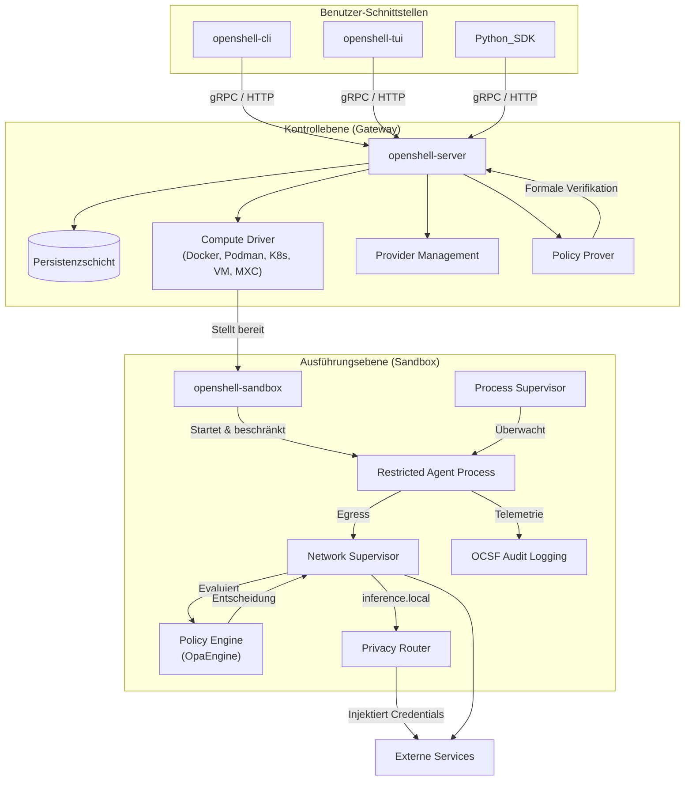
   

## Notes
OpenShell legt großen Wert auf eine "Agent-First"-Entwicklungsphilosophie, bei der autonome KI-Agenten zur Entwicklung und Wartung der Codebasis eingesetzt werden.  Dies wird durch "Agent Skills" unterstützt, die Aufgaben wie das Triagieren von Issues und das Debuggen automatisieren.  Ein "Vouch System" ist implementiert, um die Qualität von KI-generierten Beiträgen zu sichern. 

Das System sammelt anonyme Telemetriedaten, um das Projekt zu verbessern, wobei sensible Informationen ausgeschlossen sind. 

Für die Isolation auf Linux-Systemen nutzt OpenShell Landlock für das Dateisystem-Sandboxing und seccomp für die Systemaufruf-Filterung.  Auf Windows wird der `openshell-driver-mxc` verwendet, der Microsoft Execution Containers (AppContainer/IsolationSession) für die Sandbox-Isolation nutzt. 

Die `crates/openshell-core/` Bibliothek bietet gemeinsame Typen, Konfigurationen und Fehlerbehandlung für alle OpenShell-Komponenten.  Das `openshell-sdk` bietet eine asynchrone Rust-Client-Bibliothek für das Gateway, die von CLI und TUI verwendet wird. 

Wiki pages you might want to explore:
- [OpenShell Overview (NVIDIA/OpenShell)](/wiki/NVIDIA/OpenShell#1)
- [Glossary (NVIDIA/OpenShell)](/wiki/NVIDIA/OpenShell#14)

View this search on DeepWiki: https://deepwiki.com/search/zielrepository-nvidiaopenshell_e4b71d21-5a82-4336-b821-a4aa2987131c

---

# pbakaus/impeccable

## GitHub & DeepWiki
- GitHub: https://github.com/pbakaus/impeccable
- DeepWiki: https://deepwiki.com/pbakaus/impeccable

## Kurze Einführung
Impeccable ist ein Design-Skill für KI-Coding-Agenten, der agentenseitige Design-Anleitungen mit einer Rust-Engine für deterministische Erkennung und Laufzeitoperationen kombiniert.  Es wird über eine npm-CLI, anbieterspezifische Skill-Trees, Plugins und eine Browser-Erweiterung vertrieben.  Das Projekt zielt darauf ab, die Qualität von KI-generiertem Frontend-Design zu verbessern, indem es häufige Anti-Patterns erkennt und Design-Anleitungen bereitstellt. 

## Die 3 wichtigsten (oder komplexesten) Algorithmen

### 1. Der Anti-Pattern-Erkennungs-Engine
1.  **Name & Verortung im Code**: Der Kern der Anti-Pattern-Erkennung befindet sich in den Rust-Crates `crates/core` und `crates/foundation`.  `crates/core` enthält die eigentlichen Prüfungen (`check_*` / `scan_*` Funktionen und Heuristiken), während `crates/foundation` die grundlegenden Typen, die Regel-Registry, Farbmathematik und DOM-Interaktion bereitstellt.  
2.  **Detaillierte technische Funktionsweise**: Der Engine scannt HTML-, CSS-, JSX-, TSX-, Vue- und Svelte-Dateien sowie Live-URLs auf 62 deterministische Regeln.  Die Regeln decken eine Vielzahl von Designproblemen ab, darunter "AI Slop Tells" (Muster, die auf KI-Generierung hinweisen), Typografie, Farbe & Kontrast, Layout & Komposition und Animationen.  Die Erkennung kann statisch für Dateien oder dynamisch für URLs über Puppeteer erfolgen, um den gerenderten DOM und das berechnete Layout zu analysieren.  Die Ergebnisse werden als Diagnosen ausgegeben, entweder menschenlesbar an `stderr` oder maschinenlesbar als JSON oder GitHub Actions Annotations.  
3.  **Warum prägend**: Dieser Algorithmus ist prägend, da er die Kernfunktionalität von Impeccable darstellt: die deterministische Erkennung von Design-Anti-Patterns.  Er ermöglicht es, Designfehler objektiv zu identifizieren, unabhängig von der subjektiven Bewertung eines LLM, und bietet eine skalierbare Lösung für die Qualitätssicherung von Frontend-Code.  Die Fähigkeit, sowohl statische Dateien als auch Live-URLs zu scannen, macht ihn vielseitig einsetzbar in verschiedenen Entwicklungsphasen. 

### 2. Der Build- und Transformationsprozess
1.  **Name & Verortung im Code**: Der Build-Prozess wird hauptsächlich durch `scripts/build.js` gesteuert und nutzt Transformer in `scripts/lib/transformers/`.  
2.  **Detaillierte technische Funktionsweise**: Das System folgt einem "source → build → provider-output"-Modell.  Skill-Inhalte werden in `skill/` verfasst (z.B. `SKILL.src.md`, `reference/`).  `scripts/build.js` liest diese Quellen, wendet anbieterspezifische Transformationen an und erzeugt Ausgaben in anbieterspezifischen Formaten in `dist/`.  Platzhalter wie `{{model}}`, `{{config_file}}` und `{{scripts_path}}` werden während dieses Prozesses durch anbieterspezifische Werte ersetzt.  Die generierten Provider-Verzeichnisse (z.B. `.claude/skills/`, `.cursor/skills/`) sind dabei Artefakte und werden im Repository nachverfolgt, um eine direkte Installation zu ermöglichen. 
3.  **Warum prägend**: Dieser Prozess ist entscheidend für die Skalierbarkeit und Anpassungsfähigkeit von Impeccable an verschiedene KI-Agenten und Plattformen.  Er ermöglicht es, eine einzige Quelle für die Skill-Definition zu pflegen und daraus maßgeschneiderte Versionen für diverse Umgebungen zu generieren, ohne den Code für jeden Anbieter duplizieren zu müssen.  Dies reduziert den Wartungsaufwand erheblich und stellt sicher, dass die Skill-Inhalte konsistent über alle unterstützten Tools hinweg sind. 

### 3. Der Engine-Launcher und Binär-Resolver
1.  **Name & Verortung im Code**: Der Engine-Launcher ist `skill/scripts/impeccable` (und `impeccable.cmd` für Windows).  Die Logik zur Auflösung der Binärdatei befindet sich in diesem Launcher-Skript. 
2.  **Detaillierte technische Funktionsweise**: Jedes Kommando, das der Skill-Text ausführt, ist `{{scripts_path}}/impeccable <verb>`.  Der Launcher sucht die Engine-Binärdatei in einer bestimmten Reihenfolge: zuerst in `$IMPECCABLE_BIN` (falls gesetzt), dann im sibling-Verzeichnis `scripts/bin/<os>-<arch>/impeccable[.exe]`, danach in `~/.impeccable/bin/impeccable`, gefolgt vom versions-gepinnten Benutzer-Cache `~/.impeccable/bin/<VERSION>/`, und schließlich im System-PATH.  Als letzte Möglichkeit lädt er die gepinnte Version in den Cache herunter.  Die Binärdatei selbst wird aus dem Rust Cargo Workspace (`crates/*`) gebaut. 
3.  **Warum prägend**: Dieser Mechanismus gewährleistet, dass die Impeccable-Engine plattformübergreifend und ohne Node.js-Laufzeitabhängigkeiten ausgeführt werden kann.  Die Trennung von Launcher und Binärdatei ermöglicht eine flexible Verteilung und Aktualisierung der Engine, während die Skill-Texte unabhängig davon bleiben.  Dies ist entscheidend für die Performance und Zuverlässigkeit, da die deterministischen Prüfungen in einer nativen, performanten Umgebung ausgeführt werden. 

## Architektur & Zusammenspiel

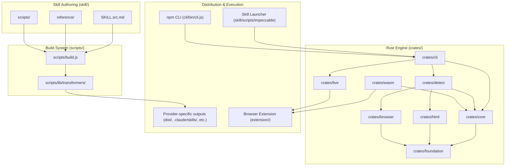

## Notes
Das Repository verwendet `bun` für das Build-System und Test-Runner, was eine schnelle Ausführung von JavaScript-basierten Aufgaben ermöglicht.  Die Rust-Engine wird in WebAssembly kompiliert (`crates/wasm`), um die gleichen Regeln sowohl nativ als auch im Browser (für die Erweiterung und Live-Overlays) ausführen zu können, was die Konsistenz der Erkennung über verschiedene Umgebungen hinweg sicherstellt.   Für die Testabdeckung werden "Oracle"-Tests verwendet, die das beobachtbare Verhalten der Engine binär gegen aufgezeichnete Goldens pinnen, um Regressionen zu verhindern. 

Wiki pages you might want to explore:
- [Overview (pbakaus/impeccable)](/wiki/pbakaus/impeccable#1)

View this search on DeepWiki: https://deepwiki.com/search/zielrepository-pbakausimpeccab_fa58361c-79ae-4a23-9ce7-6e4edbfc6431

---

# longbridge/gpui-kit

## GitHub & DeepWiki
- GitHub: https://github.com/longbridge/gpui-kit
- DeepWiki: https://deepwiki.com/longbridge/gpui-kit

## Kurze Einführung
`gpui-kit` ist ein umfassendes Rust-Framework für Desktop-Anwendungen, das auf GPUI aufbaut. Es bietet eine produktionsreife UI-System mit Daten-, Layout- und Bearbeitungsfunktionen . Das Framework ist in drei Schichten unterteilt: `gpui-base` für ungestyltes Verhalten, `gpui-component` für ein vollständiges gestyltes UI-System und `gpui-shell` für eine optionale JavaScript-Erweiterungslaufzeit . Es richtet sich an Entwickler, die leistungsstarke, plattformübergreifende Desktop-Anwendungen mit Rust erstellen möchten, und bietet Unterstützung für WebAssembly und Zugänglichkeit .

## Die 3 wichtigsten (oder komplexesten) Algorithmen

### 1. Materialisierung von `SpecArena` in native GPUI-Elemente
1.  **Name & Verortung im Code**: Der Materialisierungs-Algorithmus ist in `crates/shell/src/materialize.rs` implementiert . Die zentrale Datenstruktur ist `SpecArena`, die in `crates/shell/src/spec.rs` definiert ist .
2.  **Detaillierte technische Funktionsweise**: JavaScript-Erweiterungen generieren deklarative Beschreibungen von UI-Elementen als `SpecNode`-Instanzen, die in einer `SpecArena` gesammelt werden . Der Materialisierungs-Algorithmus in Rust wandelt diese `SpecArena` in native GPUI-Elemente um . Dieser Prozess läuft vollständig in Rust ab und ruft niemals Skriptcode auf, was eine unabhängige Benchmark und Snapshot-Tests des Renderpfads ermöglicht . Eine Besonderheit sind "lazy lists", bei denen die Zeilen durch einen Skript-Callback erzeugt werden, der während des Layouts und Pre-Paints ausgeführt wird, um nur die sichtbaren Elemente zu rendern .
3.  **"Warum prägend"**: Dieser Algorithmus ist entscheidend für die Performance und Skalierbarkeit von `gpui-shell`. Durch die Trennung der Skript-Beschreibung von der Rust-Materialisierung wird sichergestellt, dass das Skript nicht bei jedem Frame ausgeführt werden muss . Dies ermöglicht eine flüssige Benutzeroberfläche mit 120 FPS, selbst bei komplexen Anwendungen, da nur Änderungen im Skript eine Neubeschreibung erfordern, während das Rendern selbst in Rust optimiert ist .

### 2. `InputBaseState` für Textbearbeitung
1.  **Name & Verortung im Code**: `InputBaseState` ist die Kern-State-Engine für Texteingabefelder und Editoren und befindet sich in `crates/base/src/input/base/state.rs` .
2.  **Detaillierte technische Funktionsweise**: `InputBaseState` verwaltet Textpuffer basierend auf der `ropey::Rope`-Datenstruktur, Multi-Cursor-Auswahlen, Undo/Redo-Transaktionen über `UndoManager` und die Integration von Syntax-Highlighting . Die `Rope`-Datenstruktur ist eine effiziente, unveränderliche Zeichenketten-Sequenz, die schnelle Einfüge- und Löschvorgänge ermöglicht .
3.  **"Warum prägend"**: Dieser Algorithmus ist prägend für die hohe Performance und Benutzerfreundlichkeit der Textbearbeitungsfunktionen. Die Verwendung von `ropey::Rope` gewährleistet sub-Millisekunden-Operationen selbst bei Dokumenten mit Hunderttausenden von Zeilen . Dies ist entscheidend für Code-Editoren und Textbereiche, die eine reaktionsschnelle und effiziente Handhabung großer Textmengen erfordern .

### 3. `PaneTree` für Dock-Layouts
1.  **Name & Verortung im Code**: `PaneTree` ist die hierarchische Baumstruktur, die Panel-Splits, Tab-Gruppen und Fenster-Docks modelliert und in `crates/base/src/dock/mod.rs` zu finden ist .
2.  **Detaillierte technische Funktionsweise**: `PaneTree` verwaltet die Adressierung von Knoten über `NodeId` und `PanelId`, die Normalisierung von Panels und die Serialisierung des Layouts . Es ist die "headless" Verhaltensschicht, auf der `DockSkin` in `gpui-component` die visuelle Darstellung aufbaut .
3.  **"Warum prägend"**: `PaneTree` ist grundlegend für die flexible und serialisierbare Dock-Layout-Funktionalität des Frameworks . Es ermöglicht komplexe Fensteranordnungen mit verschachtelten Splits und ziehbaren Tabs, die persistent gespeichert und wiederhergestellt werden können. Dies ist ein Kernmerkmal für professionelle Desktop-Anwendungen, die anpassbare Arbeitsbereiche benötigen.

## Architektur & Zusammenspiel

Das `gpui-kit` ist in einer Drei-Schichten-Architektur aufgebaut, die Verhalten, Styling und Erweiterbarkeit trennt .

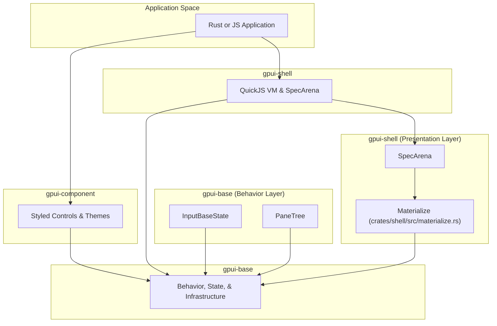
    

Die Architektur besteht aus folgenden Hauptkomponenten:
*   **`gpui-base`**: Diese Schicht ist für das ungestylte Verhalten, Layout-Primitive, Textbearbeitungs-Engines und die Infrastruktur zuständig . Hier sind Algorithmen wie `InputBaseState` für die Textverarbeitung  und `PaneTree` für das Dock-Layout  angesiedelt.
*   **`gpui-component`**: Bietet eine vollständige Bibliothek von gestylten UI-Steuerelementen, die auf `gpui-base` aufbauen .
*   **`gpui-shell`**: Ermöglicht JavaScript-Erweiterungen die Interaktion mit dem Rust-Host über eine QuickJS-basierte Skripting-Laufzeit . Hier kommt der Materialisierungs-Algorithmus zum Einsatz, der `SpecArena`-Beschreibungen in native GPUI-Elemente umwandelt .

Das Zusammenspiel ist so konzipiert, dass `gpui-base` die Kernlogik und das Verhalten bereitstellt, während `gpui-component` und `gpui-shell` die Präsentationsschicht bilden. `gpui-shell` nutzt die `SpecArena` um UI-Beschreibungen von JavaScript zu empfangen und diese über den `materialize`-Prozess in die von `gpui-base` bereitgestellten GPUI-Elemente zu übersetzen . Dies gewährleistet eine klare Trennung der Verantwortlichkeiten und ermöglicht eine hohe Leistung, da die kritischen Rendering-Pfade in Rust verbleiben .

## Notes
Eine weitere wichtige technische Eigenschaft ist das "Seam Pattern" . Dieses Muster beschreibt die architektonische Grenze, an der `gpui-base` ungestyltes, robustes Interaktionsverhalten definiert und `gpui-component` (oder `gpui-shell`) die visuelle Darstellung bereitstellt . Dies ermöglicht eine hohe Flexibilität und Wiederverwendbarkeit der Basiskomponenten.

Das Framework unterstützt auch Virtual Lists , die nur den sichtbaren Bereich rendern, selbst wenn die Elemente unterschiedliche Größen haben . Dies ist ein wichtiges Performance-Merkmal für die Darstellung großer Datenmengen.

Für die JavaScript-Erweiterungen in `gpui-shell` wird QuickJS als VM verwendet . Die Skriptausführung ist auf den Hauptthread beschränkt, und es gibt keine Multi-Thread-Skripting-Unterstützung . Dies vereinfacht das Concurrency-Modell und vermeidet komplexe Synchronisationsprobleme.

Das System nutzt auch ein `Dispatch Macro` , um Benutzeraktionen und Statusabfragen von generischen Wrappern (`AnyInputState`) an konkrete Implementierungen (`InputState`, `TextareaState`, `EditorState`) weiterzuleiten . Dies sorgt für eine einheitliche Schnittstelle und erleichtert die Erweiterung des Eingabesystems.

Wiki pages you might want to explore:
- [Glossary (longbridge/gpui-kit)](/wiki/longbridge/gpui-kit#13)
- [gpui-shell: JavaScript Extension System (longbridge/gpui-kit)](/wiki/longbridge/gpui-kit#6)

View this search on DeepWiki: https://deepwiki.com/search/zielrepository-longbridgegpuik_f39cf4d1-e383-4b92-83be-ca26bbf3d644

---

# t8y2/dbx

## GitHub & DeepWiki
- GitHub: https://github.com/t8y2/dbx
- DeepWiki: https://deepwiki.com/t8y2/dbx

## Kurze Einführung
DBX ist ein quelloffenes, leichtgewichtiges Datenbankverwaltungstool, das über 100 Datenbank-Engines unterstützt und eine minimale Installationsgröße von etwa 25 MB aufweist  . Es bietet eine einheitliche Arbeitsumgebung für Verbindungsmanagement, Objekt-Browsing, SQL-Bearbeitung, Datenänderungen und Schema-Tools . DBX richtet sich an Entwickler und Datenanalysten, die eine vielseitige und performante Lösung für die Interaktion mit verschiedenen Dateninfrastrukturen suchen, einschließlich relationaler, NoSQL- und Messaging-Systeme .

## Die 3 wichtigsten (oder komplexesten) Algorithmen

### 1. Multi-Channel Protocol (MCP) Server für KI-Integration
1.  **Name & Verortung im Code:** `dbx-mcp` Crate , implementiert in Rust . Die Kernlogik befindet sich in `crates/dbx-core/src/ai/mcp_policy.rs`  und `crates/dbx-core/src/query/mod.rs` .
2.  **Detaillierte technische Funktionsweise:** Der MCP-Server ermöglicht es KI-Agenten, Datenbankschemata zu inspizieren und sichere Datenbankoperationen über in DBX konfigurierte Verbindungen auszuführen . Er bietet 18 MCP-Tools für die Erkennung von Verbindungen und Datenbanken, Schemata, SQL, Redis, Sessions, Nachrichten und DBX UI-Integration . Die Implementierung umfasst die Protokollverarbeitung, das Laden von Verbindungen, SQL-Sicherheitsprüfungen, Schema-Zugriff und die Ausführung von Datenbankbefehlen . Sicherheitskontrollen für SQL, Redis und MongoDB werden bei jeder Anfrage neu geladen .
3.  **Warum prägend:** Dieser Algorithmus ist prägend, da er DBX zu einem "AI-ready" Tool macht . Er ermöglicht die nahtlose Integration mit KI-Programmierassistenten wie Claude Code und Cursor, indem er eine sichere und kontrollierte Schnittstelle zu den Datenbanken bereitstellt . Die Fähigkeit, Schemata zu analysieren und SQL-Operationen sicher auszuführen, ohne manuelle Copy-Paste-Vorgänge, verbessert die Produktivität erheblich und reduziert Fehler .

### 2. Dynamisches Treiber- und Plugin-System
1.  **Name & Verortung im Code:** Das Treibersystem wird durch die Crates `dbx-drivers` und `dbx-plugin-runtime`  verwaltet. Die Plugin-Definitionen und -Strukturen sind in `plugins/README.md`  beschrieben.
2.  **Detaillierte technische Funktionsweise:** DBX unterstützt über 100 Datenbanken durch ein mehrstufiges Treibersystem, das native Rust-Treiber, Agenten (Go, Rust, Java JDBC) und generische JDBC-Plugins umfasst . Plugins werden als `.dbxp`-Pakete verteilt, die ZIP-Container mit strengen Regeln für Checksummen, Signaturen und Dateistrukturen sind . Jedes Plugin wird signaturverifiziert und in einer Sandbox ausgeführt, um Sicherheit zu gewährleisten . Das System ermöglicht die Erweiterung von DBX um neue Verbindungstypen und Tools .
3.  **Warum prägend:** Dieses System ist entscheidend für die hohe Kompatibilität und Erweiterbarkeit von DBX . Es ermöglicht DBX, eine breite Palette von Datenbanken und Datensystemen zu unterstützen, ohne dass alle Treiber direkt in die Hauptanwendung integriert werden müssen. Die Sandbox-Ausführung von Plugins gewährleistet die Stabilität und Sicherheit der Anwendung, während die Möglichkeit, eigene Plugins zu entwickeln, die Anpassungsfähigkeit für spezifische Anwendungsfälle erhöht .

### 3. Sicherheitsmodell mit mehrschichtigen Kontrollen
1.  **Name & Verortung im Code:** Das Sicherheitsmodell wird in `crates/dbx-core/src/safety/production_safety.rs`  und `crates/dbx-core/src/safety/risk_metrics.rs`  implementiert. Die Konfiguration erfolgt über `tauri.conf.json`  für die Desktop-Anwendung.
2.  **Detaillierte technische Funktionsweise:** DBX verwendet ein mehrschichtiges Sicherheitsmodell, das über einfache Bestätigungsdialoge hinausgeht . Es umfasst:
    *   **Datenbank-Kontoberechtigungen:** Die letztendliche Grenze für Operationen .
    *   **Nur-Lese-Verbindungen:** Blockieren erkennbare Schreibvorgänge im Abfrageausführungspfad .
    *   **Produktionsschutz:** Erfordert eine explizite Bestätigung für jeden erkannten Schreibvorgang in Produktionsumgebungen .
    *   **Überprüfbare Änderungen:** Zeigt SQL-Anweisungen vor der Ausführung bei Datenbearbeitung oder Schemaänderungen an .
    *   **AI Ask-Modus:** Gibt Antworten zurück, ohne SQL auszuführen; der Agent erhält keine autonome Schreibberechtigung in der Produktion .
    *   **MCP-Richtlinie:** Zentralisiert die Steuerung der Verbindungs-Allowlist und der Ausführungsmodi (Nur-Lese, Daten-Lese/Schreib, Vollzugriff) .
    *   **Sensible Konfiguration:** Getrennte Speicherung und AES-GCM-Verschlüsselung für Konfigurationsexporte .
3.  **Warum prägend:** Dieses umfassende Sicherheitsmodell ist prägend, da es das Vertrauen der Benutzer in die Handhabung sensibler Datenbankoperationen stärkt . Es minimiert das Risiko unbeabsichtigter oder schädlicher Änderungen an Datenbanken, insbesondere in Produktionsumgebungen, und bietet gleichzeitig Flexibilität für Entwicklungs- und Testzwecke. Die Integration von Sicherheitsprüfungen in die KI-Interaktionen ist ein Alleinstellungsmerkmal, das die sichere Nutzung von KI-Assistenten im Datenbankkontext ermöglicht .

## Architektur & Zusammenspiel

```mermaid
graph TD
    UserIntent[""Benutzerinteraktion / UI-Ereignis (apps/desktop/src)"""] --> Frontend[""Frontend Store & Dispatcher (lib/backend/api.ts)""]
    Frontend -->|"Desktop IPC"| TauriCmd[""Tauri Command Handler (src-tauri/src/commands/mod.rs)"""]
    Frontend -->|"HTTP/WS API"| AxumRoute[""Axum Route Dispatcher (crates/dbx-web/src/main.rs)""]
    TauriCmd --> AppState[""Shared Application State (AppState)""]
    AxumRoute --> AppState
    AppState --> Core[""Core Business Logic (crates/dbx-core/src/lib.rs)""]
    Core --> Drivers[""Database Drivers & Capabilities (dbx_drivers::database_capabilities)""]
    Drivers --> ExternalDB[""Externe Datenbanken (Postgres, MySQL, Redis, Mongo)"""]
    Core --> MCP[""MCP Server (packages/mcp-server)"""]
    MCP --> AI_Agents[""KI-Agenten (Claude Code, Cursor)"""]
    Core --> Plugins[""Plugin Runtime (dbx-plugin-runtime)"""]
    Plugins --> CustomExtensions[""Benutzerdefinierte Erweiterungen"""]

    style UserIntent fill:#f9f,stroke:#333,stroke-width:2px
    style Frontend fill:#bbf,stroke:#333,stroke-width:2px
    style TauriCmd fill:#ccf,stroke:#333,stroke-width:2px
    style AxumRoute fill:#ccf,stroke:#333,stroke-width:2px
    style AppState fill:#cfc,stroke:#333,stroke-width:2px
    style Core fill:#ffc,stroke:#333,stroke-width:2px
    style Drivers fill:#fcc,stroke:#333,stroke-width:2px
    style ExternalDB fill:#eee,stroke:#333,stroke-width:2px
    style MCP fill:#e0e0e0,stroke:#333,stroke-width:2px
    style AI_Agents fill:#d0d0d0,stroke:#333,stroke-width:2px
    style Plugins fill:#e0e0e0,stroke:#333,stroke-width:2px
    style CustomExtensions fill:#d0d0d0,stroke:#333,stroke-width:2px
```
Die Benutzerinteraktionen beginnen im Vue 3-Frontend (`apps/desktop/src`) und werden über die API-Abstraktionsschicht (`lib/backend/api.ts`) geleitet . Desktop-Builds delegieren an Tauri-Befehlsmodule (`src-tauri/src/commands/mod.rs`), während Web-Builds über `dbx-web` (`crates/dbx-web/src/main.rs`) geleitet werden . Beide Backends konvergieren auf `AppState` und teilen Kernoperationen, die in `crates/dbx-core/src/lib.rs` definiert sind . Datenbankoperationen nutzen Treiberfunktionen, die in `dbx_drivers` verwaltet werden, um mit externen Datenquellen zu kommunizieren . Der MCP-Server (`packages/mcp-server`) interagiert mit der Kernlogik, um KI-Agenten den Zugriff auf Datenbanken zu ermöglichen . Das Plugin-System (`dbx-plugin-runtime`) erweitert die Funktionalität von DBX durch die Integration benutzerdefinierter Erweiterungen .

## Notes
DBX zeichnet sich durch seine geringe Größe von nur 25 MB aus, da es keine Java JRE, Python venv oder gebündeltes Chromium benötigt . Stattdessen nutzt es die System-Webview und eine leistungsstarke Rust-Backend-Implementierung . Es bietet verschiedene Bereitstellungsmodi, darunter eine native Desktop-Anwendung, einen selbst gehosteten Docker/Web-Server über Axum und Kommandozeilen-Schnittstellen mit MCP Server-Integration für KI-Agenten . Das Projekt verwendet Nix flakes für die Entwicklungsumgebung und Build-Skripte . Für die Frontend-Entwicklung kommen Vue 3 und TypeScript zum Einsatz, mit CodeMirror 6 als Editor .

Wiki pages you might want to explore:
- [DBX Overview (t8y2/dbx)](/wiki/t8y2/dbx#1)
- [Build, CI/CD and Release Engineering (t8y2/dbx)](/wiki/t8y2/dbx#12)

View this search on DeepWiki: https://deepwiki.com/search/zielrepository-t8y2dbx-erstell_06ebcc7e-0462-4ca2-aa7b-959efd84c0f8

---

# trycua/cua

## GitHub & DeepWiki
- GitHub: https://github.com/trycua/cua
- DeepWiki: https://deepwiki.com/trycua/cua

## Kurze Einführung
`cua` ist ein Monorepo, das sich auf die Entwicklung von Computer-Use Agents (CUAs) konzentriert, die in der Lage sind, mit grafischen Benutzeroberflächen (GUIs) und Shell-Umgebungen zu interagieren, um Aufgaben zu automatisieren. Das Projekt umfasst plattformübergreifende Treiber (`cua-driver`), Sandbox-Umgebungen (`cua-sandbox`), VM-Management (`lume`) und Tools zur Leistungsbewertung (`cua-bench`). Das Hauptziel ist es, Agenten die Interaktion mit Anwendungen zu ermöglichen, ohne die Benutzererfahrung zu stören, indem der "No-Foreground Contract" eingehalten wird.      

## Die 3 wichtigsten (oder komplexesten) Algorithmen

### 1. `cua-input-v3` Protokoll für isolierte Eingabe auf Wayland
Das `cua-input-v3`-Protokoll ist ein experimenteller Kandidat für isolierte Eingaben auf Wayland, speziell für die Anforderungen des `cua-driver` entwickelt.  Es ist in `libs/cua-driver/hyprland-plugin/protocol/cua-input-v3.md` dokumentiert und in `libs/cua-driver/hyprland-plugin/src/input_experiment.cpp` implementiert.  

**Detaillierte technische Funktionsweise:**
Das Protokoll definiert zwei unabhängige Compositor-Seats, `Cua-Agent` und `Cua-Agent-2`, und unterstützt sowohl Hintergrund- als auch Vordergrund-Eingaberouten.  Es verwendet Linux `SOCK_SEQPACKET`-Sockets (`cua-input-v3.sock` und `cua-input-v3-2.sock`) mit `SO_PEERCRED`-Prüfungen, um sicherzustellen, dass die Compositor-UID übereinstimmt.  Schlüsselbefehle umfassen `HELLO`, `CLAIM`, `TARGET`, `FOREGROUND_TARGET`, `ACTIVATE`, `CLICK`, `KEY`, `SCROLL` und `DRAG`.  Jede Aktion erfordert eine neue routenspezifische Zielauswahl und ist durch eine technische Lebensdauer begrenzt.  Die `InputExperiment`-Klasse verwaltet Client-Verbindungen, Seats, Pointer, Tastaturen und Touch-Geräte für dieses Protokoll. 

**Warum prägend:**
Dieses Protokoll ist prägend, da es eine robuste und isolierte Eingabemechanismus auf Wayland ermöglicht, der die primäre Benutzereingabe nicht stört.  Dies ist entscheidend für den "No-Foreground Contract" des `cua-driver`, der es Agenten erlaubt, im Hintergrund zu agieren, ohne den Benutzer zu unterbrechen.  Die strikte Isolierung und die Überprüfung der Compositor-UID erhöhen die Sicherheit und Zuverlässigkeit der Agenteninteraktionen. 

### 2. Plattformübergreifende Eingabe-Delivery-Mechanismen
Der `cua-driver` verwendet unterschiedliche Mechanismen zur Eingabeübermittlung, abhängig vom Betriebssystem und der Fenstermanagement-Umgebung, um den "No-Foreground Contract" zu gewährleisten.  

**Detaillierte technische Funktionsweise:**
*   **Linux (X11):** Verwendet hauptsächlich `XSendEvent` für die Hintergrund-Eingabeinjektion, um synthetische Ereignisse direkt an ein Fenster zu senden, ohne den Eingabefokus zu ändern.  Für Terminal-Emulatoren, die synthetische Ereignisse ignorieren, erfolgt die Eingabe durch Schreiben in den PTY-Master.  Auf Wayland wird der `portal-libei`-Pfad für GNOME und KDE Plasma genutzt, der `xdg-desktop-portal` und `libei` verwendet, um Eingabeereignisse sicher zu injizieren. 
*   **macOS:** Die Eingabe erfolgt über Accessibility (AX) und HID-Ereignisse. 
*   **Windows:** Nutzt `PostMessage` für die Hintergrund-Maus- und Tastaturinjektion und UI Automation (UIA) für die Traversierung des Accessibility-Baums. 

**Warum prägend:**
Diese plattformspezifischen, aber konsistenten Eingabemechanismen sind entscheidend, um den "No-Foreground Contract" des `cua-driver` zu erfüllen.  Sie ermöglichen es Agenten, mit Anwendungen zu interagieren, ohne den Benutzer zu stören, was für Hintergrundautomatisierung und Multi-Agenten-Workflows unerlässlich ist.  Die Fähigkeit, den Fokus nicht zu stehlen, ist ein Kernmerkmal, das `cua-driver` von traditionellen Automatisierungstools unterscheidet. 

### 3. Agent Cursor Overlay
Das Agent Cursor Overlay bietet visuelles Feedback für die Aktionen des Agenten, ohne den physischen Mauszeiger des Benutzers zu bewegen.  Es wird plattformübergreifend implementiert, teilt sich aber eine gemeinsame `cursor-overlay`-Kiste für den Animationszustand und die Rendering-Pipeline. 

**Detaillierte technische Funktionsweise:**
Die `cursor-overlay`-Kiste definiert die kanonische Cursor-Theme-Semantik und Laufzeitparameter.  Sie enthält Enums wie `CursorAction`, `DeliveryModifier` und `TargetModifier`, um den visuellen Zustand des Cursors zu beschreiben.  Die `CursorVisualState`-Struktur verfolgt angeforderte und aufgelöste Aktionen, Zustellung, Ziel, verstrichene Zeit und andere Rendering-Parameter. 
*   **Linux (X11):** Erstellt ein Override-Redirect X11-Fenster mit einem 32-Bit-ARGB-Visual, das den gesamten Anzeigebereich abdeckt.  Ein Hintergrund-Thread rendert Cursor-lokale Kacheln und lädt sie mit `XPutImage` und `XShape`-Clipping hoch. 
*   **macOS:** Das Overlay ist ein transparentes, klickbares `NSWindow`. 
*   **Windows:** Das Overlay ist ein transparentes, klickbares Layered Window, das den virtuellen Bildschirm überspannt. 

**Warum prägend:**
Das Agent Cursor Overlay ist prägend, da es die visuelle Trennung zwischen Benutzer und Agent ermöglicht.  Jeder Agent erhält einen eigenen `cursor_id` und einen eigenen gemalten Cursor, wodurch der physische Mauszeiger des Benutzers unberührt bleibt.  Dies ist entscheidend für Multi-Agenten- und Hintergrund-Workflows, da es die Nachvollziehbarkeit und die Koexistenz von Agenten und Benutzern auf demselben Desktop verbessert. 

## Architektur & Zusammenspiel

Das `cua`-Repository ist als Monorepo strukturiert, das verschiedene Komponenten für die Entwicklung von Computer-Use Agents (CUAs) enthält. Die Kernarchitektur basiert auf einem `cua-driver`, der plattformübergreifend die Interaktion mit dem Betriebssystem übernimmt. Dieser Treiber kommuniziert über ein Model Context Protocol (MCP) mit den Agenten.  

Die Architektur kann wie folgt visualisiert werden:

```mermaid
graph TD
    subgraph "Agenten-Schicht"
        A[KI-Agent (z.B. Claude Code)] --> B(MCP Server: cua-driver mcp)
    end

    subgraph "Cua Driver (Rust)"
        B --> C{Plattform-Abstraktion}
        C -- Linux --> D[platform-linux Crate]
        C -- macOS --> E[platform-macos Crate]
        C -- Windows --> F[platform-windows Crate]
    end

    subgraph "Plattform-Spezifische Implementierung"
        D --> D1[Eingabe-Delivery (X11, Wayland/libei)]
        D --> D2[Cursor Overlay (X11, Wayland)]
        D --> D3[Hyprland Plugin (cua-input-v3)]
        E --> E1[Eingabe-Delivery (AX, HID)]
        E --> E2[Cursor Overlay (NSWindow)]
        F --> F1[Eingabe-Delivery (PostMessage, UIA)]
        F --> F2[Cursor Overlay (Layered Window)]
    end

    subgraph "Betriebssystem-APIs"
        D1 --> OS_L[Linux OS APIs]
        D2 --> OS_L
        D3 --> OS_L
        E1 --> OS_M[macOS OS APIs]
        E2 --> OS_M
        F1 --> OS_W[Windows OS APIs]
        F2 --> OS_W
    end

    OS_L & OS_M & OS_W --> T[Zielanwendung]

    style A fill:#f9f,stroke:#333,stroke-width:2px
    style B fill:#ccf,stroke:#333,stroke-width:2px
    style C fill:#ccf,stroke:#333,stroke-width:2px
    style D fill:#bbf,stroke:#333,stroke-width:2px
    style E fill:#bbf,stroke:#333,stroke-width:2px
    style F fill:#bbf,stroke:#333,stroke-width:2px
    style D1 fill:#9cf,stroke:#333,stroke-width:2px
    style D2 fill:#9cf,stroke:#333,stroke-width:2px
    style D3 fill:#9cf,stroke:#333,stroke-width:2px
    style E1 fill:#9cf,stroke:#333,stroke-width:2px
    style E2 fill:#9cf,stroke:#333,stroke-width:2px
    style F1 fill:#9cf,stroke:#333,stroke-width:2px
    style F2 fill:#9cf,stroke:#333,stroke-width:2px
    style OS_L fill:#fcf,stroke:#333,stroke-width:2px
    style OS_M fill:#fcf,stroke:#333,stroke-width:2px
    style OS_W fill:#fcf,stroke:#333,stroke-width:2px
    style T fill:#fcf,stroke:#333,stroke-width:2px
```
**Erläuterung des Diagramms:**

1.  **Agenten-Schicht:** Ein KI-Agent (z.B. Claude Code) initiiert Aktionen, indem er Befehle an den MCP-Server des `cua-driver` sendet. 
2.  **MCP Server (`cua-driver mcp`):** Dies ist der Kommunikationspunkt für Agenten. Er empfängt Befehle und leitet sie an die interne Logik des `cua-driver` weiter. <cite repo="trycua/cua" path="libs/cua-

Wiki pages you might want to explore:
- [Development Environment Setup (trycua/cua)](/wiki/trycua/cua#14.1)
- [Glossary (trycua/cua)](/wiki/trycua/cua#18)
- [Hyprland Plugin and Compositor Integration (trycua/cua)](/wiki/trycua/cua#6.7)

View this search on DeepWiki: https://deepwiki.com/search/zielrepository-trycuacua-erste_84895f23-799d-42ef-bf9b-b558921283d2

---

# bevyengine/bevy

## GitHub & DeepWiki
- GitHub: https://github.com/bevyengine/bevy
- DeepWiki: https://deepwiki.com/bevyengine/bevy

## Kurze Einführung
Bevy ist eine datengetriebene Game-Engine und ein Anwendungs-Framework, das in Rust geschrieben ist.  Es bietet einen vollständigen Funktionsumfang für 2D und 3D und ist modular sowie datenorientiert aufgebaut, basierend auf dem Entity Component System (ECS)-Paradigma.  Die Engine zielt darauf ab, leistungsstark, einfach zu bedienen, modular und schnell zu sein, um eine hohe Produktivität zu gewährleisten. 

## Die 3 wichtigsten (oder komplexesten) Algorithmen

### 1. Entity Component System (ECS)
1.  **Name & Verortung im Code**: Das ECS ist das Herzstück von Bevy und wird hauptsächlich im `bevy_ecs`-Crate implementiert.  Zentrale Strukturen sind `World` , `Entity` , `Component`  und `System` .
2.  **Detaillierte technische Funktionsweise**: Das ECS trennt Daten (`Component`s) von der Logik (`System`s) und ordnet Daten `Entity`s zu.  Die `World` verwaltet alle ECS-Daten, einschließlich `Entity`s, `Component`s und `Resource`s.  `System`s sind Rust-Funktionen, die `SystemParam`-Argumente verwenden, um selektiv auf `Component`-Daten zuzugreifen und diese zu verarbeiten.  `Commands` werden verwendet, um strukturelle Änderungen an der `World` zu verzögern und am Ende eines Frames anzuwenden. 
3.  **"Warum prägend"**: Das ECS-Paradigma ermöglicht eine hohe Performance und Parallelität, da es die Datenzugriffsmuster optimiert und die Entkopplung von Daten und Logik fördert.  Dies ist entscheidend für die Skalierbarkeit und Effizienz einer Game-Engine.

### 2. GPU-Clustering von Lichtern und Objekten
1.  **Name & Verortung im Code**: Dieser Algorithmus ist im `bevy_pbr`-Crate unter `crates/bevy_pbr/src/cluster/gpu.rs` zu finden.  Die Hauptstrukturen sind `GpuClusteringPlugin`  und die zugehörigen Pipelines wie `ClusteringRasterPipeline`, `ClusteringZSlicingPipeline` und `ClusteringAllocationPipeline`. 
2.  **Detaillierte technische Funktionsweise**: Das GPU-Clustering nutzt den Hardware-Rasterizer für Compute-Zwecke, um Workloads in 2D-achsenparallelen Bounding Boxes zu verteilen.  Der Prozess umfasst mehrere Schritte: Z-Slicing zur Generierung indirekter Instanzen, Zähl-Rasterisierung zur Bestimmung der Anzahl der Objekte pro Cluster, lokale und globale Allokation mittels Präfixsummen, und schließlich die Populate-Rasterisierung zur Speicherung der Objekt-IDs in den Clustern. 
3.  **"Warum prägend"**: Dieser Algorithmus ist entscheidend für die effiziente Beleuchtung und das Management von Objekten in komplexen 3D-Szenen. Durch die Nutzung der GPU für das Clustering wird die CPU entlastet und eine hohe Performance bei der Verarbeitung vieler Lichter und Objekte erreicht, was für moderne Render-Engines unerlässlich ist.

### 3. RenderGraph und RenderApp
1.  **Name & Verortung im Code**: Der RenderGraph und die RenderApp sind im `bevy_render`-Crate implementiert.  Die `RenderApp` ist eine separate `SubApp`  und der `RenderGraph` ist eine zentrale Struktur zur Definition der Rendering-Pipeline. 
2.  **Detaillierte technische Funktionsweise**: Die `RenderApp` ist eine dedizierte Sub-Anwendung für die Rendering-Logik, die parallel zur Hauptanwendung läuft.  Daten werden über den `ExtractSchedule` von der Haupt-World in die Render-World kopiert.  Der `RenderGraph` definiert die Ausführungsreihenfolge verschiedener Rendering-Pässe und -Knoten als gerichteter azyklischer Graph.  Die `PipelineCache` verwaltet die Kompilierung und Spezialisierung von GPU-Pipelines. 
3.  **"Warum prägend"**: Diese Architektur ermöglicht eine hochgradig modulare und flexible Rendering-Pipeline. Die Trennung der Render-Logik in eine eigene App und die graphbasierte Definition der Render-Pässe erlauben es Entwicklern, Rendering-Effekte einfach hinzuzufügen, zu ändern oder zu entfernen, was die Anpassbarkeit und Erweiterbarkeit der Engine erheblich verbessert. Die Parallelisierung von Main- und Render-World trägt zudem zur Performance bei.

## Architektur & Zusammenspiel

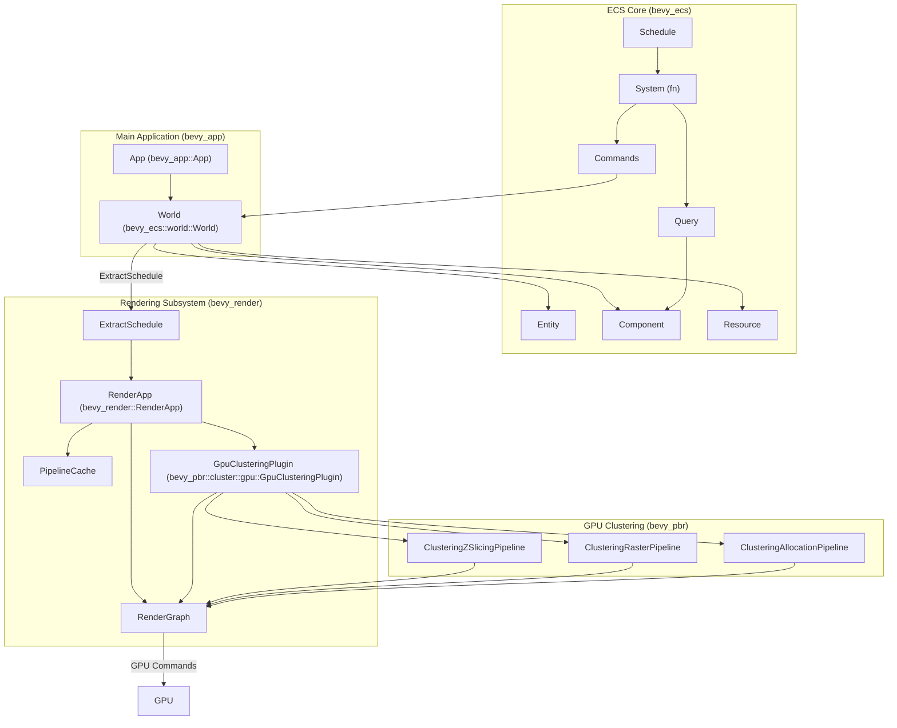

## Notes
Weitere technische Highlights umfassen das modulare Plugin-System, das es ermöglicht, nur benötigte Funktionalitäten zu laden und zu erweitern.  Bevy nutzt `wgpu` als plattformübergreifende Rendering-API, was eine breite Kompatibilität gewährleistet.  Das Asset-System unterstützt asynchrones Laden und Hot-Reloading, was die Entwicklungsgeschwindigkeit erhöht.  Für die UI-Entwicklung kommt `Taffy` zum Einsatz, eine Flexbox- und Grid-Layout-Engine. 

Wiki pages you might want to explore:
- [Overview (bevyengine/bevy)](/wiki/bevyengine/bevy#1)
- [Crate Organization (bevyengine/bevy)](/wiki/bevyengine/bevy#1.2)
- [Glossary (bevyengine/bevy)](/wiki/bevyengine/bevy#11)

View this search on DeepWiki: https://deepwiki.com/search/zielrepository-bevyenginebevy_28e11fc0-4e13-4566-8830-2ff7d9e9cbe7

---

# lexmount/moli

## GitHub & DeepWiki
- GitHub: https://github.com/lexmount/moli
- DeepWiki: https://deepwiki.com/lexmount/moli

## Kurze Einführung
Moli ist eine produktionsreife, quelloffene Browser-Engine, die speziell für KI-Agenten und Automatisierungs-Workloads entwickelt wurde.  Im Gegensatz zu herkömmlichen Browsern, die eine kontinuierliche visuelle Darstellung priorisieren, verfolgt Moli eine "Struktur-zuerst"-Philosophie, bei der das native DOM und der Stilzustand als einzige Quelle der Wahrheit dienen.  Es führt echtes JavaScript über die V8-Engine aus und verwaltet ein Live-DOM, berechnet jedoch Layout oder Paint nur bei explizitem Bedarf, was es ressourceneffizient für KI-Agenten macht. 

## Die 3 wichtigsten (oder komplexesten) Algorithmen

### 1. On-Demand-Layout und Rendering
1.  **Name & Verortung im Code:** Das Konzept des On-Demand-Layouts und Renderings wird durch die `LayoutPolicy` in `moli-page-types` gesteuert und in der `moli-core` Bibliothek implementiert.  Die Logik ist in den `README.md` Dateien beschrieben. 
2.  **Detaillierte technische Funktionsweise:** Moli behandelt das native DOM und den Stilzustand als einzige Quelle der Wahrheit.  Layout- und Paint-Operationen werden nur dann ausgelöst, wenn sie explizit von einer Operation benötigt werden, z.B. beim Erstellen eines Screenshots oder der Berechnung von Elementkoordinaten.  Für Operationen wie das Extrahieren von HTML/Markdown oder das Abfragen des DOMs wird der Browser-Laufzeitzustand direkt gelesen, ohne Layout oder Paint auszulösen.  Wenn eine Geometrieanfrage gestellt wird, wird eine Layoutberechnung durchgeführt und nur der neueste eingefrorene Layoutbaum beibehalten.  Screenshots erfordern einen Neuaufbau des Layoutbaums und das Rendern eines frischen Frames, dessen Paint-Zustand danach verworfen wird. 
3.  **"Warum prägend":** Dieses Modell ist prägend, da es Moli ermöglicht, eine vollständige Browser-Laufzeitumgebung mit einem geringen Ressourcenbedarf zu kombinieren.  Es ist besonders gut für Crawling, Browser-Agenten, Retrieval-Pipelines, Evaluierungsumgebungen und Reinforcement-Learning-Workloads geeignet, da ressourcenintensive visuelle Arbeiten nur bei Bedarf ausgeführt werden. 

### 2. `FrozenLayoutTree`
1.  **Name & Verortung im Code:** `FrozenLayoutTree` ist eine zentrale Datenstruktur, die in den Architektur-Beschreibungen erwähnt wird. 
2.  **Detaillierte technische Funktionsweise:** Bei der ersten Geometrieanfrage (Kaltstart) wird aus dem aktuellen DOM/Stil ein temporärer Arbeitsbaum aufgebaut.  Dessen kanonische Geometrie wird in einen unveränderlichen, vom DOM unabhängigen `FrozenLayoutTree` eingefroren.  Nur dieser jeweils neueste Baum wird vorgehalten.  Normale Geometrieabfragen können ihn auch nach Seitenänderungen weiterverwenden.  Screenshots und Screencasts bauen dagegen jedes Mal neu auf und ersetzen den eingefrorenen Baum. 
3.  **"Warum prägend":** Der `FrozenLayoutTree` ist entscheidend für die Ressourceneffizienz von Moli.  Durch das Einfrieren der Geometrie und das Wiederverwenden des Baumes für normale Abfragen wird vermieden, dass Layout-Berechnungen unnötig wiederholt werden, was die Performance erheblich steigert, insbesondere bei Workloads, die keine kontinuierliche visuelle Aktualisierung benötigen. 

### 3. Unified Automation Protocol Server
1.  **Name & Verortung im Code:** Der Unified Automation Protocol Server wird in den Fähigkeiten von Moli beschrieben.  Die Implementierung erfolgt über den `moli` Binary, der die `moli-protocol` und spezifische Protokoll-Crates wie `moli-protocol-cdp` und `moli-protocol-webdriver-bidi` nutzt. 
2.  **Detaillierte technische Funktionsweise:** Moli bietet einen einzigen Endpunkt, der alle drei gängigen Automatisierungsprotokolle bedient: CDP (Chrome DevTools Protocol), WebDriver Classic und WebDriver BiDi.  Dies ermöglicht eine einfache Integration mit Tools wie Playwright und Selenium.  Der Server kann über die CLI mit `moli serve` gestartet werden, wobei Optionen wie `--layout` und `--resource` die Aktivierung visueller Funktionen und das Laden optionaler Ressourcen steuern. 
3.  **"Warum prägend":** Diese Vereinheitlichung ist prägend, da sie die Komplexität für Entwickler von Automatisierungs-Workflows reduziert.  Es ist keine separate Installation von Treibern wie ChromeDriver oder geckodriver erforderlich, was die Einrichtung vereinfacht und die Kompatibilität mit verschiedenen Automatisierungs-Frameworks erhöht. 

## Architektur & Zusammenspiel

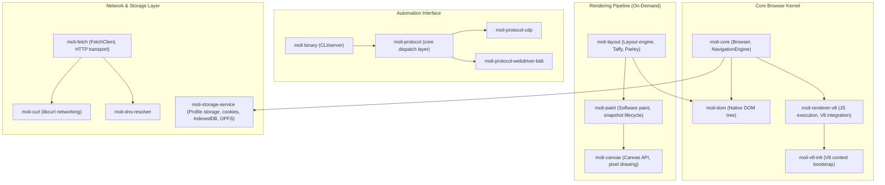
Die Architektur von Moli ist modular aufgebaut und besteht aus mehreren Rust-Crates, die zusammen einen vollständigen Browser-Kernel bilden.  Die `moli` Binary dient als Kommandozeilen-Einstiegspunkt und integriert die `moli-core` Bibliothek für Browser-Laufzeit-APIs.  Der `moli-core` Crate ist die öffentliche Schnittstelle für Browser-Laufzeit-APIs wie `runtime`, `page`, `network` und `protocol_types`.  Er interagiert mit `moli-dom` für die DOM-Verwaltung und `moli-renderer-v8` für die JavaScript-Ausführung.  Die Rendering-Pipeline, bestehend aus `moli-layout`, `moli-paint` und `moli-canvas`, ist für das On-Demand-Rendering zuständig.  Der Netzwerk- und Speicherdienst wird durch `moli-fetch`, `moli-curl`, `moli-dns-resolver` und `moli-storage-service` bereitgestellt. 

## Notes
Moli nutzt eine Reihe von externen Bibliotheken, um seine Funktionalität zu realisieren. Dazu gehören `libcurl` für den Netzwerktransport, `html5ever` für das HTML-Parsing, `rusty_v8` / V8 für die JavaScript-Ausführung, Servo/Stylo für Selektoren und CSS-Kaskaden, Taffy + Parley für Box- und Textlayout sowie AnyRender/Vello CPU, `usvg` und das Rust-Bildökosystem für Software-Rendering.  Die `moli-renderer-v8` Komponente integriert V8 und verwendet `serde_v8` für die Serialisierung.  Moli ist dual-lizenziert unter MIT und Apache 2.0. 

Wiki pages you might want to explore:
- [Moli Overview (lexmount/moli)](/wiki/lexmount/moli#1)

View this search on DeepWiki: https://deepwiki.com/search/zielrepository-lexmountmoli-er_7b983d23-d048-43ba-8abe-bb893ad3f28e

---

# xerj-org/xerj

## GitHub & DeepWiki
- GitHub: https://github.com/xerj-org/xerj
- DeepWiki: https://deepwiki.com/xerj-org/xerj

## Kurze Einführung
XERJ ist eine KI-native Such-, Vektor- und Log-Analyse-Engine, die in Rust geschrieben wurde und als einzelnes, statisch verlinktes Binary bereitgestellt wird.  Sie ist für KI-Agenten-Workloads konzipiert und bietet eine Elasticsearch 8.x HTTP-Protokoll-Kompatibilität als Migrationsbrücke für bestehende Clients und Tools.  Die Zielgruppe sind Entwickler und Unternehmen, die eine performante, ressourcenschonende und JVM-freie Alternative zu Elasticsearch suchen, insbesondere für KI-gesteuerte Anwendungen und Log-Analysen. 

## Die 3 wichtigsten (oder komplexesten) Algorithmen

### 1. Query Parsing und AST-Generierung
1.  **Name & Verortung im Code:** `parse_request` und `parse_query` in `xerj-query::parser`  . Die resultierende Datenstruktur ist der `QueryNode` Abstract Syntax Tree (AST) .
2.  **Detaillierte technische Funktionsweise:** Die Funktion `parse_request` in `engine/crates/xerj-query/src/parser.rs` wandelt eine vollständige Elasticsearch-kompatible Suchanfrage (JSON-Body) in eine `SearchRequest`-Struktur um.   Intern ruft sie `parse_query` auf, um den `query`-Teil des Requests in einen `QueryNode` AST zu überführen.   Dabei werden Limits wie `MAX_QUERY_DEPTH` (Standard 64) und `MAX_CLAUSE_COUNT` (Standard 1024) durch `DepthGuard` und `charge_clause()` erzwungen, um Denial-of-Service-Angriffe durch zu komplexe Anfragen zu verhindern.  
3.  **Warum prägend:** Dieser Algorithmus ist prägend, da er die Grundlage für die gesamte Suchfunktionalität bildet.  Eine effiziente und robuste Parsing-Engine ist entscheidend für die Performance und Stabilität des Systems, insbesondere bei der Verarbeitung komplexer und potenziell bösartiger Benutzeranfragen. Die strikte Begrenzung der Komplexität schützt vor Ressourcenerschöpfung und stellt die Skalierbarkeit sicher. 

### 2. Write-Ahead Log (WAL) und Memtable-Management
1.  **Name & Verortung im Code:** Der WAL wird im `xerj-storage` Crate verwaltet, insbesondere in `engine/crates/xerj-storage/src/wal.rs`.  Die Memtables sind in `xerj-engine::memtable` und `xerj-storage::index_store` implementiert. 
2.  **Detaillierte technische Funktionsweise:** Dokumente werden zuerst in den WAL geschrieben, bevor sie in die In-Memory-Memtables gelangen.  Der WAL stellt die Crash-Recovery-Fähigkeit sicher, indem er alle Mutationen persistent speichert.  Die Memtables sind in Shards unterteilt, um parallele Schreibvorgänge zu ermöglichen und Hotspots zu vermeiden.  Wenn die Memtables bestimmte Schwellenwerte (z.B. `flush_size_mb` oder `flush_interval_secs`) erreichen, werden sie in unveränderliche Segmente auf die Festplatte geschrieben (`Index::flush()`).  Diese Segmente werden später im Hintergrund zusammengeführt (`merge`), um die Speichereffizienz zu optimieren und gelöschte Dokumente zu entfernen. 
3.  **Warum prägend:** Dieses Design ist entscheidend für die Datenintegrität, Performance und Skalierbarkeit. Der WAL garantiert, dass keine Daten bei einem Systemabsturz verloren gehen.  Die Verwendung von Sharded Memtables und das Flush-Merge-Modell ermöglichen hohe Ingest-Durchsätze und gleichzeitig eine schnelle Suchbarkeit neuer Dokumente, da Suchanfragen sowohl die Memtables als auch die Segmente abfragen. 

### 3. Resource Governor
1.  **Name & Verortung im Code:** `ResourceGovernor` in `engine/crates/xerj-engine/src/governor.rs`. 
2.  **Detaillierte technische Funktionsweise:** Der `ResourceGovernor` ist ein prozessweiter Circuit Breaker, der das System vor Out-Of-Memory (OOM)-Fehlern schützt.  Er überwacht den gesamten Speicherverbrauch der Memtables (`memtable_budget`), die Resident Set Size (RSS) des Prozesses im Vergleich zu Cgroup/System-Limits (`rss_watermark`), begrenzt die Anzahl gleichzeitiger Suchanfragen und Bulk-Parses (`concurrency_semaphores`) und blockiert Schreibvorgänge, wenn die Festplattennutzung einen Schwellenwert überschreitet (`disk_flood_stage`).  Bei Überschreitung von Limits wird anstatt eines Absturzes ein HTTP 429-Fehler zurückgegeben. 
3.  **Warum prägend:** Dieser Algorithmus ist von zentraler Bedeutung für die Robustheit und Zuverlässigkeit von XERJ. Er verhindert, dass das System unter Last oder bei Fehlkonfigurationen abstürzt, was ein häufiges Problem bei JVM-basierten Suchmaschinen ist.  Durch die proaktive Ressourcenverwaltung und das Zurückweisen von Anfragen bei Überlastung stellt der Governor sicher, dass XERJ auch unter extremen Bedingungen stabil bleibt und eine hohe Verfügbarkeit gewährleistet. 

## Architektur & Zusammenspiel

```mermaid
graph TD
    subgraph "Transport Layer (xerj-server)"
        A[main.rs] -->|":8080"| B[Native REST (Axum)]
        A -->|":9200"| C[ES-Compat (Axum)]
        A -->|":8081"| D[gRPC (Tonic)]
    end

    subgraph "API & Auth (xerj-api)"
        B --> E[auth.rs]
        C --> E
        E -->|Principal| F[authz.rs]
    end

    subgraph "Core Hub (xerj-engine)"
        F --> G[Engine]
        G --> H[governor.rs (ResourceGovernor)]
        G --> I[Index]
    end

    subgraph "Execution & Storage"
        I --> J[xerj-query (parse_request, parse_query, QueryNode AST)]
        I --> K[xerj-storage (WAL, Memtable, Segments)]
        I --> L[xerj-fts]
        I --> M[xerj-vector]
        I --> N[xerj-logs]
        I --> O[xerj-compress]
    end

    subgraph "Intelligence (xerj-ai)"
        I --> P[Embedder]
    end

    subgraph "Other Supporting Crates"
        G --> Q[xerj-autoindex]
        G --> R[xerj-cluster]
        G --> S[xerj-wasm]
        G --> T[xerj-console-api]
        G --> U[xerj-common]
    end

    J --> G
    K --> G
    L --> G
    M --> G
    N --> G
    O --> G
    P --> G
    Q --> G
    R --> G
    S --> G
    T --> G
    U --> G
```


Das `xerj-server` Crate ist der Einstiegspunkt, der die CLI-Argumente parst, die Konfiguration lädt und drei TCP-Listener startet: Native REST auf Port 8080, ES-kompatibel auf Port 9200 und gRPC auf Port 8081.  Alle Listener teilen sich eine `AppState`-Instanz, die Zugriff auf die `Config` und die `Engine` ermöglicht. 

Das `xerj-api` Crate verarbeitet eingehende HTTP-Anfragen und leitet sie nach Authentifizierung und Autorisierung an die `Engine` im `xerj-engine` Crate weiter.  Die `Engine` ist der zentrale Koordinator, der mehrere Indizes verwaltet und die Kernlogik für Ingest, Suche und Aggregationen orchestriert. 

Suchanfragen durchlaufen eine Pipeline im `xerj-query` Crate, wo sie geparst, in einen `QueryNode` AST umgewandelt und optimiert werden.  Die Ausführung erfolgt dann durch den `SegmentExecutor`, der sowohl In-Memory-Memtables als auch On-Disk-Segmente abfragt, um frische und persistente Daten zu berücksichtigen. 

Ingest-Vorgänge schreiben Daten zuerst in den WAL und dann in sharded Memtables im `xerj-storage` Crate.  Diese Memtables werden periodisch in unveränderliche Segmente geflusht und im Hintergrund zusammengeführt.  Der `ResourceGovernor` im `xerj-engine` Crate überwacht und steuert die Ressourcennutzung systemweit, um Stabilität zu gewährleisten. 

## Notes

**Nebenläufigkeitsmodelle:** XERJ nutzt `tokio` für asynchrone Operationen und `rayon` für datenparallele Aufgaben.   Für den lock-freien Zugriff auf kritische Datenstrukturen werden `ArcSwap<IndexSnapshot>` für Segment-Swaps und `DashMap` für Version Maps und Pipelines verwendet.  Die FTS-Memtable-Shards verwenden `parking_lot::RwLock` für effizienten, feingranularen Zugriff. 

**Caching-Strategien:** `mmap` wird für Segment-Reads eingesetzt, wodurch Daten aus dem OS-Page-Cache und nicht aus dem App-Heap bereitgestellt werden.  Der `FieldCache` im Aggregations-Engine optimiert die Extraktion von Feldwerten, indem er diese einmalig extrahiert und für mehrere Aggregationen wiederverwendet. 

**Weitere technische Highlights:**
*   **Zero-Dependency:** XERJ ist ein einzelnes statisches Rust-Binary ohne externe Abhängigkeiten wie die JVM. 
*   **`autoindex`:** Eine Zero-Configuration-Pipeline, die automatisch gemischte Dateiformate in typisierte, abfragbare Indizes überführt. 
*   **Exakte Aggregationen:** Im Gegensatz zu Elasticsearch, das bei hoher Kardinalität Schätzungen verwendet, berechnet XERJ `terms`-Aggregationen exakt über den gesamten Dokumentsatz. 
*   **Hohe Vektor-Dimensionen:** Unterstützt bis zu 16.384 Dimensionen pro Vektorfeld, was viermal so viel ist wie das Limit von Elasticsearch. 
*   **Jemalloc:** Verwendet `tikv-jemallocator` als globalen Allokator, um RSS-Bloat unter hoher Last zu verhindern und Speicher aktiv an das OS zurückzugeben. <cite repo="xerj-org/xerj" path="engine/crates/xerj-server/src

Wiki pages you might want to explore:
- [Architecture Overview (xerj-org/xerj)](/wiki/xerj-org/xerj#1.1)
- [Getting Started (xerj-org/xerj)](/wiki/xerj-org/xerj#1.2)
- [Glossary (xerj-org/xerj)](/wiki/xerj-org/xerj#13)

View this search on DeepWiki: https://deepwiki.com/search/zielrepository-xerjorgxerj-ers_bb4f7589-b9e3-4894-a2df-e223250f0ac3

---

# microsoft/mxc

## GitHub & DeepWiki
- GitHub: https://github.com/microsoft/mxc
- DeepWiki: https://deepwiki.com/microsoft/mxc

## Kurze Einführung
MXC (Microsoft eXecution Container) ist ein plattformübergreifendes Sandbox-Code-Ausführungssystem, das für die sichere Ausführung von nicht vertrauenswürdigem Code wie KI-Modellausgaben, Plugins und Drittanbieter-Tools auf Windows, Linux und macOS entwickelt wurde . Es bietet mehrere Containment-Backends hinter einem vereinheitlichten Containment-Modell, standardisierten JSON-Policy-Verträgen und typisierten SDKs . Die Software zielt darauf ab, Anwendungen eine sichere Umgebung zur Ausführung potenziell unsicherer Workloads zu bieten, indem sie eine Isolationsschicht zwischen der Host-Anwendung und dem ausgeführten Code schafft .

## Die 3 wichtigsten (oder komplexesten) Algorithmen

### 1. Policy-gesteuerte Sandboxing-Engine
Die Policy-gesteuerte Sandboxing-Engine ist das Herzstück von MXC und befindet sich hauptsächlich im `mxc_sdk::mxc_engine`-Modul . Sie ist verantwortlich für die Validierung von Container-Anfragen, die Auswahl des geeigneten Containment-Backends und die Durchsetzung der definierten Sicherheitsrichtlinien .

**Detaillierte technische Funktionsweise:**
Wenn eine Anwendung eine `ContainerRequest` über eines der SDKs (Rust, .NET, Node.js) sendet , wird diese Anfrage an die `mxc_ffi`-Schicht weitergeleitet . Dort wird die Anfrage als versioniertes JSON-Dokument empfangen und an die `mxc_engine` übergeben . Die Engine validiert die Anfrage anhand der definierten Schemata  und wählt basierend auf der `Containment`-Spezifikation in der `ContainerRequest` das passende Backend aus . Die Engine stellt sicher, dass nicht unterstützte Richtlinien abgelehnt werden, bevor ein Sandbox erstellt wird .

**Warum prägend:**
Dieser Algorithmus ist prägend, da er die Kernfunktionalität von MXC – die sichere Ausführung von Code in einer Sandbox – ermöglicht . Die Fähigkeit, verschiedene Containment-Backends über ein einheitliches Modell zu abstrahieren und gleichzeitig detaillierte Richtlinien für Dateisystem-, Netzwerk- und UI-Zugriffe durchzusetzen, ist entscheidend für die Sicherheit und Flexibilität des Systems . Die strikte Validierung und Ablehnung nicht unterstützter Richtlinien (`Unsupported policy must fail closed`)  gewährleistet, dass die Sandbox immer in einem sicheren Zustand bleibt.

### 2. Containment Backend Dispatch und Abstraktion
Das Containment Backend Dispatch-System ist ebenfalls Teil des `mxc_sdk::mxc_engine`-Moduls  und nutzt Module aus `mxc_sdk::mxc_common` . Es verwaltet die Auswahl und Interaktion mit den verschiedenen plattformspezifischen Containment-Backends .

**Detaillierte technische Funktionsweise:**
Die `mxc_engine` enthält die Logik für das Backend-Dispatching und die Host-Plattform-Sondierung . Basierend auf der `Containment`-Einstellung in der `ContainerRequest` wählt die Engine das entsprechende Backend aus, z.B. `processcontainer` für Windows, `bubblewrap` für Linux oder `seatbelt` für macOS . Die `mxc_common`-Module stellen plattformunabhängige Hilfsfunktionen und Datenstrukturen bereit, die von allen Backends genutzt werden . Dies umfasst unter anderem Module für Dateisystemzugriff, Netzwerkrichtlinien und Fehlerbehandlung .

**Warum prägend:**
Dieses System ist prägend, da es die Cross-Plattform-Fähigkeit von MXC ermöglicht . Durch die Abstraktion der Backend-Implementierungen können Entwickler eine einheitliche API verwenden, während MXC im Hintergrund das optimale und sicherste Containment für die jeweilige Plattform auswählt . Dies reduziert die Komplexität für den Anwendungsentwickler und erhöht die Portabilität des Codes, der in der Sandbox ausgeführt wird.

### 3. Lebenszyklusmanagement von Containern
Das Lebenszyklusmanagement von Containern wird durch die `mxc_sdk` APIs bereitgestellt und unterstützt sowohl "Run-to-completion" als auch "State-aware" Operationen . Die Kernlogik hierfür ist in den SDKs selbst (`sdk/node`, `sdk/dotnet`, `src/mxc-sdk`)  und im `mxc_ffi`-Modul  implementiert.

**Detaillierte technische Funktionsweise:**
MXC bietet zwei Hauptmodi für die Container-Ausführung:
*   **Run-to-completion:** Für einfache, einmalige Ausführungen, bei denen die Ausgabe erfasst wird . Die `run`-Funktion in den SDKs (z.B. `v1::run` in Rust , `run` in Node.js  und `MxcContainer.RunAsync` in .NET ) führt die Workload aus und gibt das Ergebnis zurück, sobald sie abgeschlossen ist.
*   **State-aware lifecycle:** Für persistente Container, die Provisionierung, Start, Ausführung, Stopp und Deprovisionierung umfassen . Die `spawn`-Funktionen (z.B. `v1::spawn` in Rust , `spawn` in Node.js  und `MxcContainer.SpawnAsync` in .NET ) geben ein `MxcProcess`-Handle zurück, das die Interaktion mit den Standard-Streams (stdin, stdout, stderr) sowie Warte- und Beendigungsoperationen ermöglicht . Die `mxc_ffi`-Schicht bietet entsprechende Funktionen wie `mxc_run_state_aware_json` und `mxc_exec_state_aware_json` für diese Operationen .

**Warum prägend:**
Dieses Management ist prägend, da es die Flexibilität von MXC für verschiedene Anwendungsfälle erhöht . "Run-to-completion" ist ideal für kurzlebige Aufgaben, während "State-aware" Operationen für langlebige Dienste oder interaktive Sitzungen unerlässlich sind . Die Bereitstellung dieser unterschiedlichen Lebenszyklen über konsistente SDK-APIs vereinfacht die Integration in Host-Anwendungen erheblich.

## Architektur & Zusammenspiel

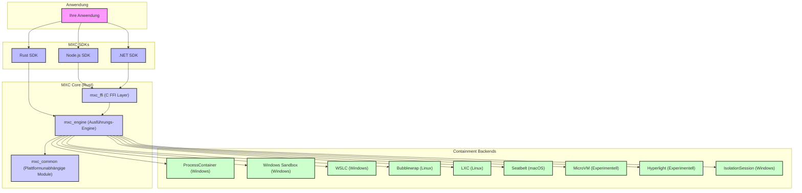
Die Anwendung interagiert mit MXC über eines der bereitgestellten SDKs (Node.js, .NET, Rust) . Die Node.js- und .NET-SDKs nutzen eine C FFI-Schicht (`mxc_ffi`) , um mit der nativen Rust-Implementierung zu kommunizieren, während das Rust SDK direkt die `mxc_engine` aufruft . Die `mxc_engine` ist die zentrale Ausführungseinheit, die für das Backend-Dispatching und die Durchsetzung von Richtlinien zuständig ist . Sie greift auf plattformunabhängige Module in `mxc_common` zu  und delegiert die eigentliche Codeausführung an das ausgewählte Containment-Backend .

## Notes
Eine bemerkenswerte technische Eigenschaft ist die detaillierte Diagnosefähigkeit von MXC, insbesondere der "Audit mode" und "Debug console mode" . Diese Modi helfen Entwicklern, Zugriffsverweigerungen in der Sandbox zu verstehen und die Containment-Regeln entsprechend anzupassen . Der "Audit mode" ermöglicht es, Richtlinien zu erstellen, indem Zugriffsversuche protokolliert werden, ohne sie sofort zu blockieren .

Ein weiteres Highlight ist die Verwendung von `mxc_sdk::mxc_common` als plattformübergreifende Grundlage . Dies stellt sicher, dass Kernfunktionalitäten und Datenstrukturen konsistent über alle unterstützten Betriebssysteme hinweg verwendet werden können, was die Wartbarkeit und Erweiterbarkeit des Systems erheblich verbessert .

Die Garbage Collection für verwaiste Scratch-Verzeichnisse im `windows_sandbox`-Backend ist ein Beispiel für die Robustheit des Systems . Sie stellt sicher, dass temporäre Ressourcen, die von VMs verwendet werden, ordnungsgemäß bereinigt werden, um Speicherle

Wiki pages you might want to explore:
- [MXC Overview (microsoft/mxc)](/wiki/microsoft/mxc#1)
- [Repository Structure (microsoft/mxc)](/wiki/microsoft/mxc#1.2)

View this search on DeepWiki: https://deepwiki.com/search/zielrepository-microsoftmxc-er_465b456e-6620-49f8-8b7e-b7bd142b6a3d

---

# trymirai/uzu

## GitHub & DeepWiki
- GitHub: https://github.com/trymirai/uzu
- DeepWiki: https://deepwiki.com/trymirai/uzu

## Kurze Einführung
`uzu` ist eine leistungsstarke lokale Inferenz-Engine, die speziell für das Ausführen großer Sprachmodelle (LLMs) auf Apple Silicon und anderen Plattformen entwickelt wurde. Sie bietet geringe Latenz, vollständigen Datenschutz und keine Inferenzkosten direkt auf der Hardware des Endverbrauchers. Das Projekt ist als Cargo-Workspace strukturiert und kombiniert einen modernen Inferenz-Core mit einer Reihe von Legacy-Crates für High-Level-Funktionalitäten und Sprach-Bindings.  

## Die 3 wichtigsten (oder komplexesten) Algorithmen

### 1. MergedRegistry für Modellverwaltung
1.  **Name & Verortung im Code**: `MergedRegistry` in `crates/legacy/uzu/src/engine/mod.rs`  und die zugehörigen Registries wie `MiraiRegistry`, `LocalRegistry` und `OpenAIRegistry` im Modul `registry`. 
2.  **Detaillierte technische Funktionsweise**: Die `MergedRegistry` aggregiert Modelle aus verschiedenen Quellen, darunter eine Mirai-spezifische Registry, eine lokale Registry für benutzerdefinierte Modelle und OpenAI-kompatible Registries (z.B. für Ollama, LM Studio).  Beim Start der Engine werden diese Registries initialisiert und ihre Modelle in der `MergedRegistry` zusammengeführt.  Dies ermöglicht eine einheitliche Abfrage und Verwaltung von Modellen, unabhängig von ihrer Herkunft. 
3.  **Warum prägend**: Dieser Algorithmus ist entscheidend für die Flexibilität und Erweiterbarkeit von `uzu`. Er ermöglicht es Benutzern, nahtlos zwischen lokalen, Mirai-gehosteten und externen (OpenAI-kompatiblen) Modellen zu wechseln, ohne die zugrunde liegende Engine-Logik ändern zu müssen.  Die Abstraktion der Modellquellen ist ein Schlüsselfaktor für die Benutzerfreundlichkeit und die breite Modellunterstützung. 

### 2. Download-Manager für Modell-Assets
1.  **Name & Verortung im Code**: `Downloader` in `crates/legacy/uzu/src/engine/mod.rs`  und das `download-manager` Crate. 
2.  **Detaillierte technische Funktionsweise**: Der `Downloader` ist verantwortlich für das Herunterladen von Modell-Assets. Er nutzt das `download-manager` Crate, welches Funktionen für Dateisperren, CRC-Verifizierung und Fortschritts-Streams über Apple's `URLSession` oder generische HTTP-Backends bereitstellt.  Die `Engine` initialisiert einen `Storage`-Dienst, der die Konfiguration für den Download-Manager bereitstellt, einschließlich des Cache-Pfads und API-Schlüsseln. 
3.  **Warum prägend**: Ein effizienter und robuster Download-Manager ist unerlässlich für eine lokale Inferenz-Engine, da Modelle oft sehr groß sind.  Die Fähigkeit, Downloads sicher zu verwalten, den Fortschritt zu verfolgen und die Integrität der heruntergeladenen Dateien zu gewährleisten, ist entscheidend für eine zuverlässige Benutzererfahrung und die schnelle Bereitstellung von Modellen. 

### 3. Engine-Backends und Geräteverwaltung
1.  **Name & Verortung im Code**: `Engine` in `crates/legacy/uzu/src/engine/mod.rs`  verwaltet verschiedene `Backend`-Implementierungen, die in `shoji::traits::Backend` definiert sind.  Spezifische Backends wie `UzuLlmBackend` sind im Modul `engine::bridge` zu finden. 
2.  **Detaillierte technische Funktionsweise**: Die `Engine` initialisiert und verwaltet eine Sammlung von Backends, die die eigentliche Inferenz durchführen.  `uzu` unterstützt Backends wie Metal (für Apple Silicon) und CPU.  Die `Device`-Erkennung stellt sicher, dass die Engine die verfügbare Hardware optimal nutzen kann.  Die `Engine` fügt Backends hinzu, wie z.B. die `UzuLlmBackend`, die die Kerninferenzlogik kapselt. 
3.  **Warum prägend**: Die modulare Backend-Architektur ist entscheidend für die hohe Performance und die plattformübergreifende Kompatibilität von `uzu`.  Durch die Abstraktion der Hardware-spezifischen Implementierungen können neue Backends (z.B. für andere GPUs oder CPUs) hinzugefügt werden, ohne die High-Level-API zu beeinflussen.  Dies ermöglicht es `uzu`, die Vorteile von spezialisierter Hardware wie Apple Silicon voll auszuschöpfen und gleichzeitig eine breite Kompatibilität zu gewährleisten. 

## Architektur & Zusammenspiel

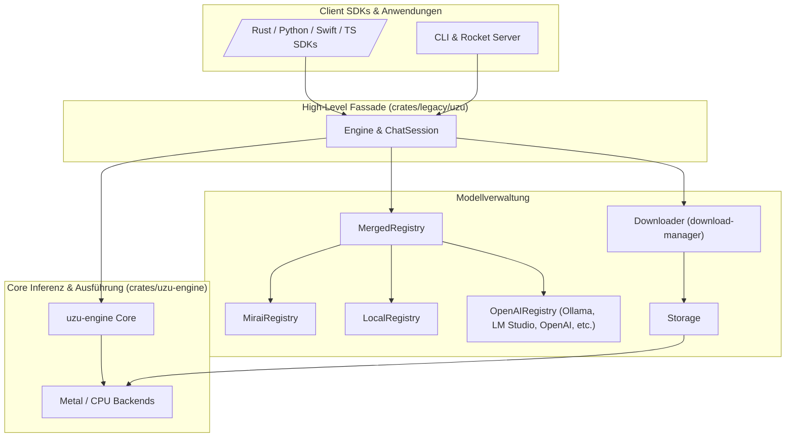


## Notes
`uzu` nutzt `kiban` als eine plattformübergreifende Abstraktionsschicht für Dateisystem- und Laufzeitoperationen, die auf nativen Zielen `tokio` und auf WebAssembly (WASM) Browser-Primitive wie OPFS verwendet.  Dies ermöglicht die Entwicklung von Code, der sowohl auf Desktop- als auch auf Web-Umgebungen funktioniert. 

Die Engine unterstützt auch eine `uzu_config` Prozedural-Makro, das die Konfiguration von Strukturen vereinfacht und die Serialisierung/Deserialisierung mit `serde` handhabt, einschließlich der Erzwingung von `deny_unknown_fields` und `required` Feldern. 

Für die Entwicklung bietet `uzu` Bindings für Swift (via `uniffi-rs`), Python (via `pyo3`) und TypeScript (via `napi-rs`), was die Integration in verschiedene Anwendungslandschaften erleichtert. 

Wiki pages you might want to explore:
- [Overview (trymirai/uzu)](/wiki/trymirai/uzu#1)
- [Workspace and Crate Layout (trymirai/uzu)](/wiki/trymirai/uzu#1.1)

View this search on DeepWiki: https://deepwiki.com/search/zielrepository-trymiraiuzu-ers_9ef2660b-b3f2-4bd6-a4d6-26f48bc83bff

---

# hydra-db/hydradb

## GitHub & DeepWiki
- GitHub: https://github.com/hydra-db/hydradb
- DeepWiki: https://deepwiki.com/hydra-db/hydradb

## Kurze Einführung
HydraDB ist eine in Rust geschriebene, objekt-store-native verteilte Graphdatenbank, die auf SlateDB aufbaut.  Sie trennt Speicherung und Berechnung vollständig, wobei S3-kompatibler Objektspeicher die dauerhafte Quelle der Wahrheit ist.  Die Datenbank ist für Anwendungsfälle konzipiert, die skalierbare Graphtraversierungen und konsistente Leseoperationen in einer verteilten Umgebung erfordern. 

## Die 3 wichtigsten (oder komplexesten) Algorithmen

### 1. Sparse Kernel Ladder für Graphtraversierung
1.  **Name & Verortung im Code:** Die "Sparse Kernel Ladder" ist ein Konzept, das in `src/sparse_kernel/mod.rs` implementiert ist und verschiedene Traversierungsalgorithmen umfasst. 
2.  **Detaillierte technische Funktionsweise:** HydraDB verwendet je nach Verfügbarkeit von Artefakten und Konfiguration eine von drei "Sprossen" für Traversierungen: 
    *   **Adjacency BFS:** Nutzt `BTreeMap` und `BTreeSet` und dient als Fallback ohne Vorkompilierung. 
    *   **Compact CSC BFS:** Eine reine Rust-Implementierung, die flache Arrays (`u32`/`u64`) und eine "seen bitmap" verwendet. 
    *   **SuiteSparse GraphBLAS:** Nutzt `GrB_Matrix` und maskierte `GrB_mxv` (Matrix-Vektor-Multiplikation) über FFI.  Die Auswahl des Sparse Kernels erfolgt zur Laufzeit, nicht zur Kompilierzeit, über die Umgebungsvariable `GRAPH_SPARSE_KERNEL`. 
3.  **Warum prägend:** Dieser Algorithmus ist prägend, da er die Flexibilität und Performance der Graphtraversierung in HydraDB maßgeblich beeinflusst.  Die Möglichkeit, zwischen verschiedenen Implementierungen zu wählen, ermöglicht es, die optimale Balance zwischen Speicherverbrauch, CPU-Auslastung und Abfragegeschwindigkeit für unterschiedliche Graphtopologien und Workloads zu finden. 

### 2. Writer Fencing und Konsistenzmechanismen
1.  **Name & Verortung im Code:** Die Konzepte des "Writer Fencing" und der "Writer Lease" sind zentral für die Konsistenz und werden in der Architektur beschrieben  und in Schreiboperationen wie `write_edge_mutations_batch_txn` in `src/shard/write.rs` angewendet. 
2.  **Detaillierte technische Funktionsweise:** HydraDB verwendet CAS-Leases (Compare-and-Swap) im Objektspeicher, um den aktiven Writer für jede Zelle zu bestimmen.  SlateDB-Writer-Epochen stellen sicher, dass veraltete Writer keine Daten nach der Beförderung eines neuen Writers committen können.  Dies wird durch die Validierung der Schreib-Fence-Transaktion (`validate_write_fence_txn`) innerhalb der Schreiboperationen gewährleistet. 
3.  **Warum prägend:** Dieses Design ist entscheidend für die Datenintegrität und die Skalierbarkeit von HydraDB in einer verteilten Umgebung.  Es ermöglicht eine sichere Writer-Übergabe und verhindert Datenkorruption, während gleichzeitig die Disaggregation von Speicherung und Berechnung aufrechterhalten wird. 

### 3. Snapshot-konsistente Leseoperationen mit WAL Tail Overlay
1.  **Name & Verortung im Code:** Das Konzept der "Snapshot-Konsistenz" und des "WAL Tail Overlay" wird in der Dokumentation beschrieben  und ist in der Abfrageausführung in `src/shard/query.rs` implementiert. 
2.  **Detaillierte technische Funktionsweise:** Jede Abfrage in HydraDB wird gegen einen festen SlateDB-Snapshot ausgeführt.  Für indizierte Traversierungen wird eine kompilierte CSC-Generation mit dem sichtbaren WAL-Overlay kombiniert.  Dies bedeutet, dass die Abfrageergebnisse sowohl die im Index enthaltenen Daten als auch die neuesten, noch nicht in den Index integrierten Mutationen aus dem Write-Ahead-Log (WAL) berücksichtigen.  Die `execute_parsed_opencypher_rows` Funktion in `src/shard/query.rs` ist für die Auswahl des korrekten Snapshots und die Ausführung der Abfrage verantwortlich. 
3.  **Warum prägend:** Dieses Verfahren gewährleistet konsistente Leseoperationen, selbst wenn der Index nicht vollständig aktuell ist.  Es ermöglicht eine hohe Verfügbarkeit und Performance, da Leseanfragen nicht auf die vollständige Indexerstellung warten müssen und dennoch eine aktuelle Sicht auf die Daten erhalten. 

## Architektur & Zusammenspiel

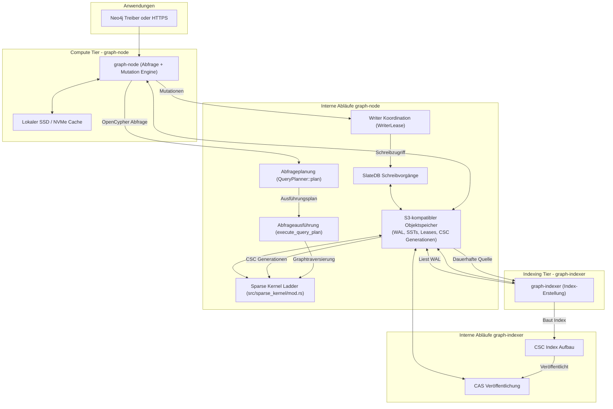
     

## Notes
HydraDB unterstützt zwei primäre Konsistenzmodi für Leseoperationen: **Causal Consistency** (Standard-Hot-Path, verwendet Bookmarks zur Sicherstellung, dass der Leser seine eigenen vorherigen Schreibvorgänge sieht) und **Strong Consistency** (erzwingt eine Speicheraktualisierung auf die neueste verfügbare Sequenz vor der Abfrageausführung).  Für hochgradige Vertices verwendet HydraDB **Adjacency Segments**, um massive Einzel-Key-Lesevorgänge zu vermeiden, wobei gelöschte Kanten durch **Tombstones** markiert werden.  Die Datenbank bietet auch native Pfadprozeduren wie `algo.SPpaths`, `algo.SSpaths` und `algo.MSpaths` für effiziente Graphtraversierungen. 

Wiki pages you might want to explore:
- [Glossary (hydra-db/hydradb)](/wiki/hydra-db/hydradb#11)

View this search on DeepWiki: https://deepwiki.com/search/zielrepository-hydradbhydradb_a0c24826-838d-43d9-a62c-5ba382e45088

---

# Pumpkin-MC/Pumpkin

## GitHub & DeepWiki
- GitHub: https://github.com/Pumpkin-MC/Pumpkin
- DeepWiki: https://deepwiki.com/Pumpkin-MC/Pumpkin

## Kurze Einführung
Pumpkin ist ein in Rust entwickelter Minecraft-Server, der auf hohe Leistung, Anpassbarkeit und Kompatibilität mit den neuesten Java- und Bedrock-Editionen ausgelegt ist.  Er nutzt Multithreading, um eine effiziente Spielerfahrung zu gewährleisten und bietet eine flexible Plugin-Architektur.  Die Zielgruppe sind Serverbetreiber, die einen performanten und erweiterbaren Minecraft-Server suchen. 

## Die 3 wichtigsten (oder komplexesten) Algorithmen

### 1. Dual-Runtime-Parallelisierungsmodell (Tokio & Rayon)
Das Dual-Runtime-Modell von Pumpkin trennt asynchrone I/O-Operationen von CPU-intensiven Berechnungen, um eine hohe Leistung und Reaktionsfähigkeit zu gewährleisten. 

*   **Verortung im Code:** Die Initialisierung des Tokio-Laufzeitumgebung erfolgt über `#[tokio::main] async fn main()` in `crates/pumpkin/src/main.rs` , während der globale Rayon-Thread-Pool in `crates/pumpkin/src/main.rs` konfiguriert wird.  Die Kommunikation zwischen den Laufzeiten erfolgt über asynchrone Kanäle, wie im Beispiel `Level::fetch_chunks` in `crates/pumpkin-world/src/level.rs` zu sehen ist. 
*   **Detaillierte technische Funktionsweise:** Die Tokio-Laufzeit ist für I/O-gebundene Aufgaben wie Netzwerkkommunikation (Java TCP, Bedrock UDP/RakNet/NetherNet), RCON und Plugin-Async-Aufgaben zuständig.  Der Rayon-Thread-Pool übernimmt CPU-intensive Aufgaben wie Chunk-Generierung, Beleuchtungsberechnungen und Pfadfindung.  Es ist entscheidend, dass Rayon-Aufgaben niemals Tokio-Futures blockieren; die Kommunikation muss über asynchrone Kanäle erfolgen. 
*   **Warum prägend:** Dieses Modell ist prägend für die Performance und Skalierbarkeit von Pumpkin.  Durch die Trennung von I/O und CPU-Arbeit wird sichergestellt, dass der Server auch unter Last reaktionsschnell bleibt und die Tick-Rate stabil gehalten werden kann.  Dies ermöglicht eine effiziente Nutzung moderner Multi-Core-Prozessoren. 

### 2. Chunk-Lade- und Generierungs-Pipeline (`GenerationSchedule`)
Die Chunk-Lade- und Generierungs-Pipeline ist ein komplexes System, das die Welt in Minecraft dynamisch erstellt und verwaltet. 

*   **Verortung im Code:** Das Kernstück ist der `GenerationSchedule`, ein DAG-basiertes System, das in `crates/pumpkin-world/src/chunk_system/schedule.rs` definiert ist.  Die `World`-Struktur in `crates/pumpkin-core/src/world/mod.rs` verwaltet die `Level`-Instanz, die für Chunk-Operationen zuständig ist. 
*   **Detaillierte technische Funktionsweise:** Der `GenerationSchedule` stellt sicher, dass die Chunk-Generierungsschritte in der richtigen Reihenfolge ablaufen (z.B. Biome → Noise → Oberfläche → Features).  Er plant asynchrone Rayon-Aufgaben, um den Inhalt der Chunks zu berechnen.  Chunks können von der Festplatte geladen (Anvil, Linear, Pump-Formate) oder neu generiert werden.    Die `SyncChunk` (`Arc<ChunkData>`) repräsentiert einen unveränderlichen Schnappschuss eines geladenen Chunks und ermöglicht sicheres Thread-Sharing. 
*   **Warum prägend:** Dieses System ist entscheidend für die dynamische und performante Weltgenerierung in Minecraft.  Die DAG-basierte Planung und die Nutzung von Rayon für parallele Berechnungen ermöglichen eine effiziente und reibungslose Generierung großer Welten, was direkt die Spielerfahrung beeinflusst. 

### 3. WebAssembly (WASM) Plugin-System mit WIT
Pumpkin verwendet ein WASM-basiertes Plugin-System, um die Serverfunktionalität sicher und flexibel zu erweitern. 

*   **Verortung im Code:** Die Spezifikation der Schnittstellen erfolgt über WebAssembly Interface Types (WIT) in `crates/pumpkin-plugin-wit`.  Die Ausführung der WASM-Plugins erfolgt durch die Wasmtime-Laufzeitumgebung, die im `pumpkin-wasm-host`-Crate implementiert ist.  Der `Resource Store` in `crates/pumpkin-wasm-host/src/scheduler.rs` verwaltet Host-seitige Ressourcen, die den Plugins zugänglich gemacht werden. 
*   **Detaillierte technische Funktionsweise:** WIT definiert die Aufrufkonventionen und den Datenaustausch zwischen dem Rust-Host und den WASM-Plugin-Modulen, was eine typisierte und sichere Interoperabilität ermöglicht.  WASM-Plugins werden in einer Sandbox ausgeführt, was die Isolation und das Hot-Reloading ermöglicht.  Der `Resource Store` stellt sicher, dass Plugins sicher auf Host-Ressourcen zugreifen und diese ordnungsgemäß bereinigt werden. 
*   **Warum prägend:** Dieses Plugin-System ist prägend für die Flexibilität und Erweiterbarkeit von Pumpkin.  Es ermöglicht Entwicklern, Plugins in jeder Sprache zu schreiben, die zu WASM kompiliert werden kann, und bietet gleichzeitig eine hohe Sicherheit und Stabilität durch die Sandbox-Umgebung. 

## Architektur & Zusammenspiel

```mermaid
graph TD
    subgraph "Pumpkin Server (crates/pumpkin)"
        A[main() - Initialisierung] --> B(PumpkinServer::new)
        B --> C(PumpkinServer::start)
    end

    subgraph "Core Logik (crates/pumpkin-core)"
        C --> D{Tokio Runtime (Async I/O)}
        C --> E{Rayon Thread Pool (CPU-bound)}
        D -- Netzwerk-Events --> F[JavaClient / BedrockClient]
        F -- Paketverarbeitung --> G[World::handle_packet]
        E -- Chunk Generierung --> H[GenerationSchedule]
        H -- Welt-Updates --> I[World::tick]
    end

    subgraph "Welt-Management (crates/pumpkin-world)"
        I --> J[Level - Chunk-Verwaltung]
        J --> K[ChunkHolder - Chunk-Lebenszyklus]
        J --> L[SyncChunk - Immutable Chunk-Daten]
        H --> L
        L -- Speicherung --> M[Anvil / Linear / Pump Formate]
    end

    subgraph "Plugin-System"
        B --> N[WasmPluginLoader]
        N --> O[Wasmtime Host]
        O -- WIT-Schnittstellen --> P[WASM Plugins]
        P -- Resource Store --> Q[Host-Ressourcen]
        G -- Plugin-Events --> P
        I -- Plugin-Events --> P
    end

    subgraph "Daten & Konfiguration"
        A --> R[PumpkinConfig]
        A --> S[VanillaData]
        G --> S
        I --> S
    end

    style A fill:#f9f,stroke:#333,stroke-width:2px
    style B fill:#f9f,stroke:#333,stroke-width:2px
    style C fill:#f9f,stroke:#333,stroke-width:2px
    style D fill:#ccf,stroke:#333,stroke-width:2px
    style E fill:#cfc,stroke:#333,stroke-width:2px
    style F fill:#f9f,stroke:#333,stroke-width:2px
    style G fill:#f9f,stroke:#333,stroke-width:2px
    style H fill:#f9f,stroke:#333,stroke-width:2px
    style I fill:#f9f,stroke:#333,stroke-width:2px
    style J fill:#f9f,stroke:#333,stroke-width:2px
    style K fill:#f9f,stroke:#333,stroke-width:2px
    style L fill:#f9f,stroke:#333,stroke-width:2px
    style M fill:#f9f,stroke:#333,stroke-width:2px
    style N fill:#f9f,stroke:#333,stroke-width:2px
    style O fill:#f9f,stroke:#333,stroke-width:2px
    style P fill:#f9f,stroke:#333,stroke-width:2px
    style Q fill:#f9f,stroke:#333,stroke-width:2px
    style R fill:#f9f,stroke:#333,stroke-width:2px
    style S fill:#f9f,stroke:#333,stroke-width:2px
```

Das Diagramm visualisiert das Zusammenspiel der Hauptkomponenten von Pumpkin. Der Server startet mit `main()` , initialisiert `PumpkinServer`  und beginnt die Hauptschleife mit `PumpkinServer::start()`.  Die Dual-Runtime-Architektur trennt Tokio für asynchrone I/O  und Rayon für CPU-intensive Aufgaben.  Netzwerk-Events werden von `JavaClient` oder `BedrockClient` verarbeitet  und an die `World`-Instanz weitergeleitet.  Die Chunk-Generierung wird durch den `GenerationSchedule` orchestriert , der `SyncChunk`-Objekte erzeugt  und diese in verschiedenen Formaten speichert.  Das Plugin-System nutzt `WasmPluginLoader`  und `Wasmtime Host`  zur Ausführung von WASM-Plugins, die über WIT-Schnittstellen  und einen `Resource Store`  mit dem Host interagieren. Konfigurationen (`PumpkinConfig`)  und Vanilla-Daten (`VanillaData`)  werden während der Initialisierung geladen und von verschiedenen Komponenten genutzt.

## Notes
Ein weiteres technisches Highlight ist die Unterstützung mehrerer Chunk-Speicherformate wie Anvil, Linear und Pump.  Das Linear-Format verwendet Zstd-Kompression und Layout-Optimierungen für schnellere Disk-I/O im Vergleich zum Vanilla Anvil-Format.  Das `World`-Objekt in `crates/pumpkin-core/src/world/mod.rs` verwaltet zudem eine Vielzahl von Subsystemen wie Scoreboards, Worldborders, Wetter und

Wiki pages you might want to explore:
- [Architecture Overview (Pumpkin-MC/Pumpkin)](/wiki/Pumpkin-MC/Pumpkin#1.1)
- [Server Lifecycle and Tick System (Pumpkin-MC/Pumpkin)](/wiki/Pumpkin-MC/Pumpkin#2.1)
- [Glossary (Pumpkin-MC/Pumpkin)](/wiki/Pumpkin-MC/Pumpkin#8)

View this search on DeepWiki: https://deepwiki.com/search/zielrepository-pumpkinmcpumpki_57c17d19-aa55-413b-aa17-fc7348aa4017

---

# xingkongliang/skills-manager

## GitHub & DeepWiki
- GitHub: https://github.com/xingkongliang/skills-manager
- DeepWiki: https://deepwiki.com/xingkongliang/skills-manager

## Kurze Einführung
Skills Manager ist eine Desktop-Anwendung, die die Verwaltung von KI-Agenten-Skills über verschiedene Coding-Tools hinweg zentralisiert.  Sie ermöglicht Benutzern die Installation, Organisation und Synchronisierung von Skills aus verschiedenen Quellen wie Git-Repositories, lokalen Ordnern und einem Marktplatz.  Das Tool zielt darauf ab, die Produktivität von Entwicklern zu steigern, indem es eine einheitliche Oberfläche für die Verwaltung von Skills für mehrere KI-Agenten bietet. 

## Die 3 wichtigsten (oder komplexesten) Algorithmen

### 1. Objekt-Merge-Algorithmus für die Git-Synchronisierung
1.  **Name & Verortung im Code**: Der Algorithmus ist im Modul `src-tauri/src/core/merge/apply.rs` implementiert, insbesondere in der Funktion `object_merge_pull_unlocked`.  Die zugehörigen Datenstrukturen für die Konfliktlösung befinden sich in `src-tauri/src/core/merge/resolve.rs`, mit der Enumeration `ResolveAction` für die verschiedenen Lösungsstrategien. 

2.  **Detaillierte technische Funktionsweise**: Der `object_merge_pull_unlocked`-Algorithmus ist für die Synchronisierung der Skill-Bibliothek mit einem entfernten Git-Repository verantwortlich.  Er beginnt mit der Sicherstellung, dass keine unterbrochenen Git-Operationen vorliegen.  Anschließend werden alle Änderungen in der Datenbank in Metadaten-Dateien projiziert und ungespeicherte Änderungen committet.  Nach dem Fetchen des Remote-Branches  ermittelt der Algorithmus den gemeinsamen Basis-Commit zwischen dem lokalen und dem Remote-Repository.  Er prüft auf veraltete Client-Schreibvorgänge  und erstellt Snapshots des Basis-, lokalen und Remote-Zustands der Skills.  Ein kritischer Teil ist die Erkennung und Behandlung von Konflikten, die als "Pending Conflicts" markiert werden, wenn beide Seiten denselben Skill unterschiedlich geändert haben.  Die Konfliktlösung erfolgt über `resolve_conflict_unlocked`, die Aktionen wie `KeepLocal`, `UseRemote` oder `KeepBoth` unterstützt.  Vor jeder Auflösung wird ein Sicherheitsschnappschuss erstellt. 

3.  **Warum prägend**: Dieser Algorithmus ist prägend, da er eine "Skill-aware merging"-Strategie implementiert, die über traditionelle zeilenbasierte Git-Merges hinausgeht.  Er ermöglicht eine robuste und fehlertolerante Synchronisierung der Skill-Bibliothek über mehrere Geräte hinweg, selbst bei gleichzeitigen Änderungen.  Die Fähigkeit, Konflikte auf Skill-Ebene zu erkennen und dem Benutzer granulare Lösungsoptionen anzubieten, ist entscheidend für die Datenintegrität und Benutzerfreundlichkeit der Anwendung.  Die automatische Hintergrundsynchronisierung und die Wiederherstellungspunkte tragen zur Skalierbarkeit und Zuverlässigkeit des Systems bei. 

### 2. Skill-Installations-Pipeline
1.  **Name & Verortung im Code**: Die Kernlogik befindet sich im Modul `src-tauri/src/core/installer.rs`, mit Funktionen wie `install_from_local` und `install_skill_dir_to_destination`.   Die zugehörigen Befehle für die Benutzeroberfläche sind in `src-tauri/src/commands/skills.rs` zu finden, z.B. `install_git` und `install_local`.  

2.  **Detaillierte technische Funktionsweise**: Die Installations-Pipeline ist für das Einbringen neuer Skills in die zentrale Bibliothek verantwortlich.  Sie unterstützt verschiedene Quellen: Git-Repositories, lokale Ordner/ZIP-Dateien und den `skills.sh`-Marktplatz.  Unabhängig von der Quelle durchläuft jeder Skill eine Standardpipeline:
    *   **Namensbereinigung**: `sanitize_skill_name` stellt die plattformübergreifende Kompatibilität von Verzeichnisnamen sicher, indem es ungültige Zeichen ersetzt und reservierte Namen behandelt. 
    *   **Metadaten-Parsing**: `parse_skill_md` extrahiert Skill-Namen und Beschreibungen aus `SKILL.md` oder `skill.md`. 
    *   **Kollisionsbehandlung**: `unique_skill_dest` verhindert Namenskollisionen, indem es bei Bedarf numerische Suffixe an Skill-Verzeichnisnamen anhängt. 
    *   **Sicherheitsprüfungen**: Bei ZIP-Extraktionen wird `safe_extract` verwendet, um "Zip Slip"-Angriffe zu verhindern. 
    *   **Pending Removals Guard**: Vor Updates wird `pending_removals_for` verwendet, um zu prüfen, ob durch das Update Dateien im Skill-Ordner gelöscht würden, die nicht Teil des Updates sind.  In diesem Fall wird ein `removal_approval`-Token zurückgegeben, und das Update wird angehalten, bis der Benutzer die Entfernung bestätigt. 

3.  **Warum prägend**: Diese Pipeline ist entscheidend für die Robustheit und Sicherheit des Skills Managers. Sie gewährleistet, dass alle installierten Skills konsistent formatiert, sicher gespeichert und korrekt in der zentralen Bibliothek verwaltet werden. Die automatische Namensbereinigung und Kollisionsbehandlung verhindern Dateisystemprobleme, während die Sicherheitsprüfungen vor bekannten Schwachstellen schützen. Der "Pending Removals Guard" ist ein wichtiges Sicherheitsmerkmal, das den Verlust von Benutzerdaten bei Skill-Updates verhindert und somit das Vertrauen der Benutzer in die Anwendung stärkt.

### 3. Reindexierung der Skill-Metadaten
1.  **Name & Verortung im Code**: Die Hauptfunktion ist `reindex_from_metadata_unlocked` im Modul `src-tauri/src/core/sync_metadata.rs`.  Verwandte Funktionen sind `write_all_from_db_unlocked` und `has_complete_skill_snapshot`.  

2.  **Detaillierte technische Funktionsweise**: Die `reindex_from_metadata_unlocked`-Funktion ist dafür zuständig, die SQLite-Datenbank (`SkillStore`) mit dem tatsächlichen Zustand der Skill-Dateien im zentralen Repository zu synchronisieren.  Dies ist besonders wichtig nach Git-Operationen, die das Dateisystem direkt ändern. Der Prozess umfasst:
    *   **Bereinigung**: Temporäre Dateien werden entfernt. 
    *   **Existenzprüfung**: Es wird geprüft, ob ein vollständiger Skill-Snapshot in den Metadaten-Dateien vorhanden ist. 
    *   **Löschen veralteter Einträge**: Datenbankeinträge für Skills, deren physische Verzeichnisse nicht mehr existieren, werden gelöscht. 
    *   **Hinzufügen fehlender Einträge**: Verzeichnisse im zentralen Repository, die gültige Skills darstellen, aber nicht in der Datenbank sind, werden hinzugefügt.  Dabei werden Metadaten aus `SKILL.md` geparst und ein `content_hash` berechnet. 
    *   **Aktualisieren bestehender Einträge**: Für vorhandene Skills werden Name, Beschreibung, Quelltyp, Pfad und Content-Hash aktualisiert.  Der `updated_at`-Zeitstempel wird nur aktualisiert, wenn sich der `content_hash` geändert hat. 
    *   **Tag-Synchronisierung**: Tags für Skills werden ebenfalls aktualisiert. 

3.  **Warum prägend**: Dieser Reindexierungsalgorithmus ist von zentraler Bedeutung für die Konsistenz zwischen dem Dateisystem und der Datenbank. Er stellt sicher, dass die Anwendung immer einen genauen Überblick über die verfügbaren Skills hat, selbst wenn externe Tools oder manuelle Eingriffe das Dateisystem ändern. Dies ist besonders wichtig für die Zuverlässigkeit der Backup- und Synchronisierungsfunktionen, da die Datenbank als Quelle der Wahrheit für die UI dient, während das Dateisystem die tatsächlichen Skill-Inhalte speichert. Die Fähigkeit, die Datenbank aus dem Dateisystem wiederherzustellen, macht das System widerstandsfähiger gegen Datenkorruption.

## Architektur & Zusammenspiel

```mermaid
graph TD
    subgraph "Frontend (React/Tauri)"
        UI["Benutzeroberfläche"]
        INSTALL_VIEW["InstallSkills View"]
        BACKUP_VIEW["Backup View"]
        SKILL_DETAIL["SkillDetailPanel"]
    end

    subgraph "Backend (Rust)"
        direction LR
        COMMANDS["commands::* (Tauri Commands)"]
        CORE["core::* (Core Logic)"]
        SKILL_STORE["core::skill_store::SkillStore (SQLite DB)"]
        GIT_BACKUP["core::git_backup::*"]
        INSTALLER["core::installer::*"]
        MERGE_ENGINE["core::merge::* (Object Merge)"]
        SYNC_METADATA["core::sync_metadata::*"]
        GIT_FETCHER["core::git_fetcher::*"]
        PROJECT_SCANNER["core::project_scanner::*"]
    end

    subgraph "Dateisystem"
        CENTRAL_REPO["~/.skills-manager/skills/ (Zentrale Bibliothek)"]
        METADATA_FILES["~/.skills-manager/.skills-manager/ (Metadaten)"]
        TOOL_DIRS["~/.claude/skills/, etc. (Agenten-Verzeichnisse)"]
    end

    UI --> COMMANDS
    INSTALL_VIEW --> COMMANDS
    BACKUP_VIEW --> COMMANDS
    SKILL_DETAIL --> COMMANDS

    COMMANDS -- "install_git, install_local" --> INSTALLER
    COMMANDS -- "update_git_skill, git_backup_*" --> GIT_BACKUP
    COMMANDS -- "skills list, presets" --> SKILL_STORE
    COMMANDS -- "project_scan" --> PROJECT_SCANNER

    INSTALLER -- "clone_repo_ref" --> GIT_FETCHER
    INSTALLER -- "read SKILL.md" --> CORE
    INSTALLER -- "write to CENTRAL_REPO" --> CENTRAL_REPO
    INSTALLER -- "insert/update DB" --> SKILL_STORE

    GIT_BACKUP -- "Git-Operationen" --> CENTRAL_REPO
    GIT_BACKUP -- "read/write METADATA_FILES" --> METADATA_FILES
    GIT_BACKUP -- "Object Merge Logic" --> MERGE_ENGINE
    GIT_BACKUP -- "reindex DB" --> SYNC_METADATA

    MERGE_ENGINE -- "read/write CENTRAL_REPO" --> CENTRAL_REPO

Wiki pages you might want to explore:
- [Skill Lifecycle (xingkongliang/skills-manager)](/wiki/xingkongliang/skills-manager#3)
- [Skill Installation (xingkongliang/skills-manager)](/wiki/xingkongliang/skills-manager#3.1)
- [Git Backup Core (xingkongliang/skills-manager)](/wiki/xingkongliang/skills-manager#4.1)

View this search on DeepWiki: https://deepwiki.com/search/zielrepository-xingkongliangsk_e12075ee-b368-440b-8a10-d57fe433e379

---

# timhartmann7/omnyssh

## GitHub & DeepWiki
- GitHub: https://github.com/timhartmann7/omnyssh
- DeepWiki: https://deepwiki.com/timhartmann7/omnyssh

## Kurze Einführung
OmnySSH ist ein Terminal-Benutzeroberflächen-Tool (TUI) für die Verwaltung von SSH-Verbindungen und Servern.  Es bietet Funktionen wie ein Dashboard mit Live-Metriken, einen Dateimanager über SFTP, Snippet-Ausführung und ein Multi-Session-Terminal.  Das Tool zielt darauf ab, die Serververwaltung für Entwickler und Systemadministratoren zu vereinfachen, indem es eine interaktive und effiziente Schnittstelle bereitstellt. 

## Die 3 wichtigsten (oder komplexesten) Algorithmen

### 1. SFTP-Dateimanager mit asynchroner Hintergrundverarbeitung
1.  **Name & Verortung im Code**: Der SFTP-Dateimanager wird hauptsächlich durch die Struktur `SftpManager`  und die zugehörigen `SftpCommand`-Enums  in `src/ssh/sftp.rs` implementiert. Die Interaktion mit der Hauptanwendung erfolgt über `AppEvent::SftpManagerReady`  und `AppEvent::SftpOpDone` .

2.  **Detaillierte technische Funktionsweise**: Der `SftpManager`  ist eine persistente Hintergrundaufgabe, die eine SSH+SFTP-Sitzung besitzt und `SftpCommand`-Nachrichten verarbeitet, die vom UI-Thread gesendet werden.  Die Verbindung wird asynchron über `SftpManager::connect`  hergestellt, wobei ein 30-Sekunden-Timeout verwendet wird, um ein Einfrieren der UI zu verhindern.  Befehle wie `ListDir`, `Download`, `Upload`, `Delete`, `MkDir` und `Rename`  werden über einen `mpsc::Sender<SftpCommand>`  an die Hintergrundaufgabe gesendet. Fortschrittsinformationen werden über `AppEvent::FileTransferProgress`  an die UI zurückgemeldet. 

3.  **Warum prägend**: Dieser Algorithmus ist prägend, da er eine reaktionsschnelle Benutzeroberfläche gewährleistet, selbst bei langwierigen Dateivorgängen über SFTP.  Durch die Auslagerung der SFTP-Operationen in eine separate, persistente Hintergrundaufgabe mit asynchroner Kommunikation wird die Haupt-UI-Schleife nicht blockiert, was eine flüssige Benutzererfahrung ermöglicht. 

### 2. PTY-basierte Multi-Session-Terminalemulation
1.  **Name & Verortung im Code**: Die PTY-basierte Terminalemulation wird durch `PtyManager`  und `PtySession`  in `src/ssh/pty.rs` sowie den `vt100::Parser`  implementiert. Die Ereignisse werden über `AppEvent::PtyOutput`  und `AppEvent::PtyExited`  verarbeitet.

2.  **Detaillierte technische Funktionsweise**: Jede PTY-Sitzung (`PtySession`)  repräsentiert einen SSH-Prozess, der in einem lokalen Pseudo-Terminal läuft.  Ein dedizierter Hintergrund-Thread (`Reader Thread`)  liest die Rohdaten vom PTY-Master und speist sie in einen `vt100::Parser`  ein. Dieser Parser übersetzt ANSI-Escape-Codes in ein Raster von Zellen.  `AppEvent::PtyOutput`  dient als "Lightweight Render-Nudge", um die UI zu benachrichtigen, dass neue Daten verfügbar sind, ohne die Daten selbst zu klonen, was die Leistung optimiert.  Die UI kann mehrere PTY-Sitzungen in Tabs oder einem Split-View anzeigen. 

3.  **Warum prägend**: Dieser Ansatz ermöglicht eine hochperformante und nicht-blockierende Terminalemulation.  Die Trennung des Lesens und Parsens in einem Hintergrund-Thread verhindert, dass die UI bei hohem Datenaufkommen einfriert.  Das "Lightweight Render-Nudge"-Muster  ist entscheidend für die Effizienz, da es teure Datenkopien vermeidet und die Reaktionsfähigkeit der UI aufrechterhält. 

### 3. Asynchrone Metrik-Sammlung mit Exponential Backoff
1.  **Name & Verortung im Code**: Die Metrik-Sammlung wird vom `PollManager`  in `src/ssh/pool.rs` orchestriert. Die Strategie des Exponential Backoff ist in `BackoffState`  definiert. Metrik-Updates werden über `AppEvent::MetricsUpdate`  und Statusänderungen über `AppEvent::HostStatusChanged`  kommuniziert.

2.  **Detaillierte technische Funktionsweise**: Der `PollManager`  startet für jeden Host eine `run_host_poller`-Aufgabe, die unabhängig Metriken sammelt.  Bei fehlgeschlagenen Verbindungsversuchen wird eine Exponential-Backoff-Strategie angewendet, die die Wartezeiten zwischen den Versuchen schrittweise erhöht (z.B. 30s, 60s, 120s, 300s).  Dies verhindert eine Überlastung des Netzwerks oder der Zielserver bei wiederholten Fehlern. Die gesammelten Metriken und der Verbindungsstatus werden als `AppEvent::MetricsUpdate`  und `AppEvent::HostStatusChanged`  an die Hauptanwendung gesendet.

3.  **Warum prägend**: Dieser Algorithmus ist entscheidend für die Skalierbarkeit und Robustheit der Anwendung.  Durch die asynchrone und unabhängige Abfrage jedes Hosts kann die Anwendung eine große Anzahl von Servern effizient überwachen, ohne dass ein einzelner langsamer oder nicht reagierender Host die gesamte Anwendung blockiert.  Der Exponential Backoff verbessert die Zuverlässigkeit und reduziert die Last auf fehlerhafte Server. 

## Architektur & Zusammenspiel

```mermaid
graph TD
    subgraph "OmnySSH Application"
        A["App (Main Loop)"] --> B["AppState (Shared State)"]
        A --> C["ViewState (UI State)"]
        A -- "Sends" --> D["event_tx: mpsc::Sender<AppEvent>"]
        D -- "Receives" --> A
        D -- "Sends" --> E["Background Tasks"]
        E -- "Sends" --> D
    end

    subgraph "Background Tasks"
        E --> F["PollManager (Metrics)"]
        E --> G["SftpManager (File Transfer)"]
        E --> H["PtyManager (Terminal Sessions)"]
        E --> I["Key Setup Task"]
        E --> J["Host/Snippet Loader"]
    end

    subgraph "External Systems"
        F -- "SSH" --> K["Remote Hosts (Metrics)"]
        G -- "SFTP" --> L["Remote Hosts (Files)"]
        H -- "SSH/PTY" --> M["Remote Hosts (Terminal)"]
        I -- "SSH" --> N["Remote Hosts (Key Setup)"]
        J -- "File I/O" --> O["Local Config Files"]
    end

    B -- "Reads/Writes" --> F
    B -- "Reads/Writes" --> G
    B -- "Reads/Writes" --> H
    B -- "Reads/Writes" --> I
    B -- "Reads/Writes" --> J

    A -- "Renders UI based on" --> B
    A -- "Renders UI based on" --> C

    click F href "https://deepwiki.com/timhartmann7/omnyssh/Glossary#connection-management"
    click G href "https://deepwiki.com/timhartmann7/omnyssh/Glossary#file-manager-sftp"
    click H href "https://deepwiki.com/timhartmann7/omnyssh/Glossary#terminal-pty-emulation"
```
Die OmnySSH-Anwendung ist um eine zentrale `App`-Struktur  herum aufgebaut, die die Haupt-Ereignisschleife (`main_loop`)  steuert. Diese `App`  besitzt den Terminal-Renderer, den gemeinsam genutzten Zustand (`AppState`)  und den UI-spezifischen Zustand (`ViewState`)  sowie die Ereigniskanäle. 

Der `AppState`  ist die "Source of Truth" der Anwendung und enthält Hosts, Metriken, Verbindungsstatus und Snippets.  Er ist in einem `Arc<RwLock<_>>`  gekapselt, um sicheren Lesezugriff für mehrere Hintergrundaufgaben und Schreibzugriff für die Hauptschleife zu ermöglichen.  Der `ViewState`  enthält transiente UI-Zustände wie Cursorpositionen und Scroll-Offsets, die nur vom Haupt-UI-Thread verwendet werden. 

Alle asynchronen Benachrichtigungen (I/O, SSH, PTY, TUI-Eingabe) fließen als `AppEvent`  in die Haupt-Ereignisschleife.  UI-Handler geben `AppAction`s  zurück, die Anfragen zur Zustandsmutation darstellen und von der Hauptschleife verarbeitet werden, um Thread-Sicherheit zu gewährleisten. 

Hintergrundaufgaben wie der `PollManager` <cite repo="timhartmann7/omnyssh" path="src/app.rs" start="

Wiki pages you might want to explore:
- [Glossary (timhartmann7/omnyssh)](/wiki/timhartmann7/omnyssh#7)

View this search on DeepWiki: https://deepwiki.com/search/zielrepository-timhartmann7omn_45dbbdf4-a983-4ad8-9048-317e34393fef

---

# HakanSeven12/OpenCADStudio

## GitHub & DeepWiki
- GitHub: https://github.com/HakanSeven12/OpenCADStudio
- DeepWiki: https://deepwiki.com/HakanSeven12/OpenCADStudio

## Kurze Einführung
OpenCADStudio ist eine CAD-Anwendung, die für 2D-Entwürfe und 3D-Modellierung entwickelt wurde.  Sie unterstützt das native Lesen und Schreiben von DWG- und DXF-Dateien und bietet auch eine Web-Version.  Die Anwendung richtet sich an Ingenieure und Designer, die eine plattformübergreifende Lösung für CAD-Aufgaben suchen. 

## Die 3 wichtigsten (oder komplexesten) Algorithmen

### 1. Geometrie-Caching und Tessellierung
1.  **Name & Verortung im Code**: `DerivedCaches` Struktur und die Funktion `build_derived_caches_impl` in .
2.  **Detaillierte technische Funktionsweise**: Beim Laden einer DWG-Datei werden im Hintergrund abgeleitete Caches (`DerivedCaches`) erstellt.  Diese Caches umfassen `HatchModel` für Schraffuren, `ImageModel` für Bilder und `MeshLodSet` für 3D-Meshes.  Die `build_derived_caches_impl` Funktion durchläuft alle Entitäten des `CadDocument` und klassifiziert sie in die entsprechenden Cache-Typen (Schraffuren, Bilder, Meshes).  Gleichzeitig wird ein `world_offset` berechnet, um die Präzision von `f32` auf der GPU zu erhalten, indem der "Interessensmittelpunkt" zum Ursprung verschoben wird.  Die Tessellierung von Meshes und die Erstellung des Drahtmodells (`WireModel`) erfolgen parallel im Hintergrund, um die UI-Thread zu entlasten. 
3.  **Warum prägend**: Dieser Algorithmus ist entscheidend für die Performance und Skalierbarkeit der Anwendung, insbesondere beim Öffnen großer und komplexer DWG-Dateien.  Durch die Vorab-Berechnung und das Caching von Geometriedaten auf einem Hintergrund-Thread wird die Benutzeroberfläche reaktionsfähig gehalten und ein flüssiges Benutzererlebnis gewährleistet. 

### 2. Plugin-Architektur und IPC
1.  **Name & Verortung im Code**: `BuiltinPlugin` Trait in , `HostApi` Trait in , und die `ocs_plugin_api` Kiste. 
2.  **Detaillierte technische Funktionsweise**: OpenCADStudio verwendet eine dreischichtige Plugin-Architektur.  Plugins werden als externe dynamische Bibliotheken (`cdylib`) geladen und in einem separaten Prozess ausgeführt.  Die Kommunikation zwischen dem Host (OpenCADStudio) und dem Plugin erfolgt über Interprozesskommunikation (IPC) mittels lokaler Sockets.  Das `ocs_plugin_api` Crate definiert den stabilen Vertrag, den Plugins implementieren müssen, einschließlich des `BuiltinPlugin`-Traits für den Einstiegspunkt und des `HostApi`-Traits für die Interaktion mit dem Dokument und der Anwendung.  Plugins können Befehle ausführen, auf Dokumentdaten zugreifen und die Benutzeroberfläche über das `CadModule`-Trait erweitern. 
3.  **Warum prägend**: Diese Architektur ermöglicht eine hohe Erweiterbarkeit der Anwendung, ohne den Kerncode ändern zu müssen.  Die Prozessisolation erhöht die Stabilität, da Fehler in einem Plugin den Host-Prozess nicht direkt zum Absturz bringen.  Die Verwendung von XDATA für die Persistenz domänenspezifischer Daten gewährleistet die Round-Trip-Fähigkeit mit DWG/DXF-Dateien. 

### 3. Befehls-Dispatch und Interaktions-Engine
1.  **Name & Verortung im Code**: `dispatch_command_inner` Methode in `OpenCADStudio` in  und das `CadCommand` Trait. 
2.  **Detaillierte technische Funktionsweise**: Wenn ein Benutzer einen Befehl eingibt, wird dieser über `dispatch_command_inner` verarbeitet.  Zuerst werden Befehlsaliase aufgelöst.  Anschließend werden alle laufenden Befehle abgebrochen, die Vorschau-Drähte gelöscht und der Zustand der Anwendung zurückgesetzt (z.B. Pan/Orbit-Modus deaktiviert, letzter Punkt zurückgesetzt).  Der Befehl wird dann an das aktive `CadCommand`-Objekt weitergeleitet, das die Benutzereingaben verarbeitet und entsprechende Aktionen ausführt.  Dies umfasst auch die Interaktion mit dem `Snapper` für Objektsnap-Funktionen. 
3.  **Warum prägend**: Dieses System ist das Herzstück der Benutzerinteraktion. Es ermöglicht eine konsistente und erweiterbare Verarbeitung von Befehlen, sei es über die Befehlszeile, die Benutzeroberfläche oder über Automatisierungsschnittstellen.  Die klare Trennung von Befehls-Dispatch und Befehlslogik durch das `CadCommand`-Trait fördert die Modularität und erleichtert die Implementierung neuer Funktionen. 

## Architektur & Zusammenspiel

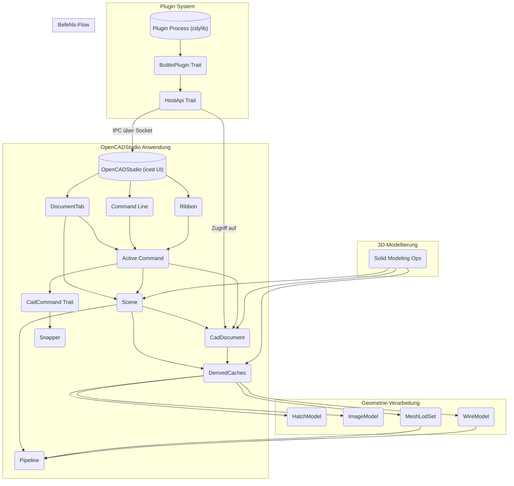

## Notes
OpenCADStudio nutzt `wgpu` für die GPU-beschleunigte Rendering-Pipeline, die 4x MSAA Anti-Aliasing unterstützt.  Die Anwendung ist in Rust geschrieben und verwendet das `iced`-Framework für die Benutzeroberfläche.  Für die 3D-Modellierung werden die Crates `truck-modeling`, `truck-meshalgo` und `truck-shapeops` eingesetzt, die B-Rep-Modelle und Boolesche Operationen ermöglichen.   Die Web-Version der Anwendung ist aufgrund von Einschränkungen in WebAssembly (z.B. fehlende `solid3d`-Funktionalität und eingeschränkte Parallelität) nicht vollständig funktionsfähig wie die native Desktop-Version.   Die Anwendung bietet auch eine headless Automatisierungs-API über JSON, die über stdin/stdout oder einen TCP-Socket gesteuert werden kann. 

Wiki pages you might want to explore:
- [Glossary (HakanSeven12/OpenCADStudio)](/wiki/HakanSeven12/OpenCADStudio#12)
- [Plugin API and Contract Crate (HakanSeven12/OpenCADStudio)](/wiki/HakanSeven12/OpenCADStudio#8.1)

View this search on DeepWiki: https://deepwiki.com/search/zielrepository-hakanseven12ope_8b3279d2-c356-400d-8178-3f211452c617

---

# pydantic/monty

## GitHub & DeepWiki
- GitHub: https://github.com/pydantic/monty
- DeepWiki: https://deepwiki.com/pydantic/monty

## Kurze Einführung
Monty ist ein in Rust geschriebener, sandboxed Python-Interpreter, der speziell für die sichere Ausführung von unvertrautem Code entwickelt wurde, der von Large Language Models (LLMs) generiert wird.   Er bietet eine sichere, schnelle und snapshotfähige Ausführungsumgebung ohne den Overhead und die Komplexität containerbasierter Sandboxing-Lösungen.  Das Hauptziel ist die Ausführung von Code, der von KI-Agenten geschrieben wurde, mit Mikrosekunden-Startzeiten und strikter Kontrolle über Systemressourcen. 

## Die 3 wichtigsten (oder komplexesten) Algorithmen

### 1. Sicherheitsmechanismus durch Aussetzung (Suspension)
1.  **Name & Verortung im Code**: Der Kern dieses Mechanismus ist in der `VM` (Virtual Machine) implementiert, die sich in `crates/monty/src/bytecode/vm.rs` befindet.  Die `RunProgress`-Enumeration, insbesondere `RunProgress::FunctionCall`, definiert die Punkte, an denen die Ausführung ausgesetzt wird. 
2.  **Detaillierte technische Funktionsweise**: Monty setzt die Ausführung aus, wenn der Code eine Operation versucht, die Host-Ressourcen erfordert, wie z.B. Dateisystem-, Netzwerk- oder Umgebungsvariablenzugriffe.  Die VM gibt die Kontrolle an die Host-Anwendung zurück, indem sie ein `FunctionCall`- oder `RunProgress`-Enum ausgibt.  Der Host kann dann entscheiden, ob er die Anforderung erfüllt und die Ausführung mit einem Ergebnis fortsetzt (`resume(value)`).  Dies stellt sicher, dass der sandboxed Code keinen direkten Systemaufrufzugriff hat und keine Container-Escape-Vektoren existieren. 
3.  **Warum prägend**: Dieser Mechanismus ist entscheidend für die Sicherheit von Monty, da er eine Zero-Trust-Ausführung von potenziell bösartigem Code ermöglicht.  Er eliminiert die Notwendigkeit von Containern und deren Latenz, was zu Mikrosekunden-Startzeiten führt.  Die Fähigkeit zum Snapshot/Resume an jedem Suspensionspunkt ist ebenfalls ein Alleinstellungsmerkmal, das die Speicherung und Wiederaufnahme des Interpreter-Zustands ermöglicht. 

### 2. HeapReader API für sicheren Heap-Zugriff
1.  **Name & Verortung im Code**: Die `HeapReader`-API ist in `crates/monty/src/heap.rs` definiert.  Sie umfasst die Typen `HeapReader<'a, T>`, `HeapRead<'a, T>` und `HeapReadOutput<'a>`. 
2.  **Detaillierte technische Funktionsweise**: Alle Heap-allokierten Python-Objekte (Listen, Dictionaries, Strings usw.) werden in einem seitenbasierten Arena-Heap (`Heap`) gespeichert.  Die `HeapReader`-API bietet einen kompilierzeitlich sicheren Zugriff auf diese Heap-Daten.  `HeapReader::with` erstellt einen scoped Borrow des Heaps, der `HeapRead`-Handles erzeugt.  `HeapRead<'a, T>` ist ein typisiertes Handle zu einem spezifischen Heap-Eintrag, das einen Reader-Zähler verfolgt, um zu verhindern, dass der Eintrag freigegeben wird, solange das Handle existiert. 
3.  **Warum prägend**: `heap.rs` ist eine kritische Sicherheitsgrenze, da es `unsafe` Code enthält, der die Korrektheit des gesamten `HeapReader`/`HeapRead`-Systems untermauert.  Dieser Mechanismus gewährleistet die Speichersicherheit und verhindert Fehler, die durch gleichzeitigen Zugriff oder vorzeitige Freigabe von Heap-Objekten entstehen könnten, was für die Stabilität eines Interpreters von größter Bedeutung ist. 

### 3. Dreiphasen-Kompilierungspipeline
1.  **Name & Verortung im Code**: Die Pipeline besteht aus Parsing (`ruff_python_parser`), Vorbereitung (`crates/monty/src/prepare.rs`) und Kompilierung (`crates/monty/src/bytecode/compiler.rs`). 
2.  **Detaillierte technische Funktionsweise**:
    *   **Parsing**: Monty nutzt den Parser von Ruff (`ruff_python_parser`) zur Generierung eines High-Fidelity Abstract Syntax Tree (AST). 
    *   **Vorbereitung**: In dieser Phase werden Namensauflösung, Bereichsanalyse (Lokal, Global, Zelle) und Closure-Erkennung durchgeführt. 
    *   **Kompilierung**: Der `Compiler` in `crates/monty/src/bytecode/compiler.rs` generiert Monty-spezifische Bytecode-Opcodes aus dem vorbereiteten AST. 
    *   **Ausführung**: Die VM (`crates/monty/src/bytecode/vm.rs`) führt den generierten Bytecode aus. 
3.  **Warum prägend**: Diese modulare Pipeline ermöglicht eine klare Trennung der Verantwortlichkeiten und eine hohe Leistung.  Die Verwendung von Ruff's Parser sorgt für eine hohe Kompatibilität mit Python-Syntax, während die eigene Bytecode-VM und die Vorbereitungsphase eine präzise Kontrolle über die Ausführung und die Einhaltung der Sicherheitsprinzipien ermöglichen.  Die Trennung von Parsing/Kompilierung und Ausführung erlaubt es, Code einmal zu parsen und zu kompilieren und dann mehrfach mit verschiedenen Eingaben auszuführen, ohne die Parsing-Kosten erneut zu tragen. 

## Architektur & Zusammenspiel

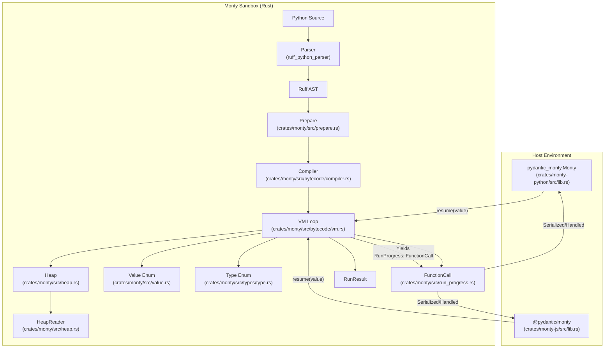
Die Architektur von Monty ist in mehrere Schlüsselkomponenten unterteilt, die eng zusammenarbeiten, um eine sichere und effiziente Ausführung von Python-Code zu gewährleisten. 

Der Prozess beginnt mit dem **Python Source Code**, der vom **Parser** (`ruff_python_parser`) in einen **Ruff AST** umgewandelt wird.  Dieser AST wird dann in der **Prepare**-Phase (`crates/monty/src/prepare.rs`) für die Kompilierung vorbereitet, indem Namensauflösung und Scope-Analyse durchgeführt werden.  Anschließend generiert der **Compiler** (`crates/monty/src/bytecode/compiler.rs`) Monty-spezifischen Bytecode. 

Die **VM Loop** (`crates/monty/src/bytecode/vm.rs`) ist das Herzstück der Ausführung, die diesen Bytecode interpretiert.  Während der Ausführung interagiert die VM mit dem **Heap** (`crates/monty/src/heap.rs`) für die Speicherverwaltung von Python-Objekten, wobei die **HeapReader**-API einen sicheren Zugriff auf diese Daten gewährleistet.  Python-Werte werden durch das **Value Enum** (`crates/monty/src/value.rs`) und Typen durch das **Type Enum** (`crates/monty/src/types/type.rs`) repräsentiert. 

Ein zentrales Merkmal ist die **Suspension-basierte Sicherheit**: Wenn der sandboxed Code eine externe Funktion aufrufen muss, gibt die VM ein **FunctionCall**-Ereignis (`crates/monty/src/run_progress.rs`) aus und setzt die Ausführung aus.  Dieses Ereignis wird an die **Host-Umgebung** (z.B. `pydantic_monty.Monty` für Python-Hosts oder `@pydantic/monty` für JavaScript-Hosts) weitergeleitet.  Der Host verarbeitet den Aufruf und setzt die VM mit einem Ergebnis fort (`resume(value)`).  Nach Abschluss der Ausführung liefert die VM ein **RunResult**. 

Die Python-Bindungen (`crates/monty-python/src/lib.rs`) stellen die Klassen `PyMonty` und `PyMontySession` bereit, die die Interaktion mit dem Rust-Core ermöglichen.  `MontyRun` (`crates/monty/src/run.rs`) ist die Rust-Struktur, die das Parsen, Kompilieren und Ausführen des Codes verwaltet. 

## Notes
Monty verwendet ein Workspace-Setup in Rust, das verschiedene Crates für spezifische Aufgaben organisiert, wie z.B. `monty-types` für gemeinsame Datentypen, `monty-fs` für das virtuelle Dateisystem und `monty-pool` für die Verwaltung von Worker-Prozessen.  Die Kommunikation zwischen dem Host und den Worker-Subprozessen erfolgt über ein Protobuf-basiertes Wire-Protokoll, das in `crates/monty-proto` definiert ist.  Dies ermöglicht eine robuste Crash-Isolation, da ein Absturz eines Workers den Host nicht beeinträchtigt. 

Die `MontyObject`-Enumeration (`crates/monty-types/src/object.rs`) ist eine zentrale Datenstruktur, die die gehostete, heap-freie Darstellung eines Python-Wertes an der Host-Grenze darstellt.  Sie unterstützt eine Vielzahl von Python-Typen, einschließlich primitiver Typen, Sammlungen und Datums-/Zeitobjekten, und ist für die Serialisierung und den binären Transport optimiert. 

Monty unterstützt auch eine begrenzte Teilmenge der Python-Standardbibliothek, darunter Module wie `sys`, `os`, `typing`, `asyncio`, `re`, `datetime`, `json` und `dataclasses`.  Die Implementierung dieser Module ist in `crates/monty/src/modules/mod.rs` zu finden. 


Wiki pages you might want to explore:
- [Overview (pydantic/monty)](/wiki/pydantic/monty#1)
- [Python Quick Start (pydantic/monty)](/wiki/pydantic/monty#2.2)

View this search on DeepWiki: https://deepwiki.com/search/zielrepository-pydanticmonty-e_fd071c34-c6cc-4034-96a2-1b063676d7ac

---

# clash-verge-rev/clash-verge-rev

## GitHub & DeepWiki
- GitHub: https://github.com/clash-verge-rev/clash-verge-rev
- DeepWiki: https://deepwiki.com/clash-verge-rev/clash-verge-rev

## Kurze Einführung
Clash Verge Rev ist eine Desktop-GUI-Anwendung, die auf dem Tauri-Framework basiert und als Schnittstelle für den Mihomo (ehemals Clash Meta) Proxy-Core dient . Sie bietet eine benutzerfreundliche Oberfläche zur Verwaltung von Proxy-Profilen, Systemproxy-Einstellungen und TUN-Modus . Die Anwendung richtet sich an Benutzer, die eine grafische Oberfläche zur Steuerung ihrer Proxy-Verbindungen und -Konfigurationen benötigen .

## Die 3 wichtigsten (oder komplexesten) Algorithmen

### 1. Konfigurations-Draft-System
Das Konfigurations-Draft-System, implementiert durch die `Draft<T>`-Struktur im `clash-verge-draft`-Crate, ermöglicht atomare und transaktionale Updates von Konfigurationen .

**Detaillierte technische Funktionsweise**: Jede Konfigurationsart (z.B. `IClashTemp`, `IVerge`, `IProfiles`, `IRuntime`) wird in einem `Draft`-Objekt gekapselt . Änderungen werden zunächst in einem Entwurf vorgenommen (`edit_draft`) und erst nach erfolgreicher Validierung und Persistenz auf die aktive Konfiguration angewendet (`apply`) . Bei Fehlern kann der Entwurf verworfen werden (`discard`), um einen Rollback zu ermöglichen . Ein globaler `CONFIG_WRITE_LOCK` stellt sicher, dass Konfigurationsschreibvorgänge serialisiert werden, um Race Conditions zu vermeiden .

**Warum prägend**: Dieses System ist entscheidend für die Stabilität und Zuverlässigkeit der Anwendung. Es verhindert inkonsistente Zustände, die durch fehlerhafte Konfigurationsänderungen entstehen könnten, und ermöglicht eine sichere Aktualisierung der Laufzeitkonfiguration des Mihomo-Cores. Die transaktionale Natur der Updates ist besonders wichtig für eine Proxy-Anwendung, bei der eine fehlerhafte Konfiguration den Netzwerkzugriff des Benutzers unterbrechen könnte.

### 2. Enhancement Pipeline
Die Enhancement Pipeline transformiert das aktive Profil in eine finale Laufzeitkonfiguration (`clash-verge-runtime.yaml`), die an den Mihomo-Core übergeben wird .

**Detaillierte technische Funktionsweise**: Die Pipeline wird durch `enhance::mod::get_config_values()` gestartet . Sie sammelt zunächst Konfigurationswerte und Profil-Items . Anschließend werden globale `Merge.yaml`-Dateien über `use_merge()` und globale `Script.js`-Dateien über `use_script()` verarbeitet . Danach folgen die Verarbeitung pro Profil-Item, die Anwendung eingebauter Skripte, die Bereinigung von Proxy-Gruppen, die Anwendung von DNS-Einstellungen und die Konfiguration des TUN-Modus . Abschließend werden Felder sortiert, um die finale `IRuntime`-Mapping zu erzeugen .

**Warum prägend**: Diese Pipeline ist das Herzstück der Flexibilität von Clash Verge Rev. Sie ermöglicht es Benutzern, komplexe Proxy-Konfigurationen durch Merging und Skripte anzupassen und zu erweitern. Die Fähigkeit, verschiedene Konfigurationsquellen zu kombinieren und dynamisch zu modifizieren, ist entscheidend für die Unterstützung vielfältiger Anwendungsfälle und die Anpassung an sich ändernde Netzwerkanforderungen.

### 3. Port Guarding und Listener Management
Das Port Guarding-System, hauptsächlich in `src-tauri/src/core/listener.rs` definiert, stellt sicher, dass die vom Mihomo-Core verwendeten Ports verfügbar und korrekt konfiguriert sind .

**Detaillierte technische Funktionsweise**: Beim Start der Anwendung oder bei Konfigurationsänderungen wird `IClashTemp::new()` aufgerufen, um die `config.yaml` zu laden . Die Methode `IClashTemp::guard()` validiert alle Portwerte und die externe Controller-Adresse . Ungültige oder Null-Werte werden durch Standardwerte ersetzt . Das Modul `listener.rs` definiert `PROXY_LISTENERS`, das Tupel von Konfigurationsschlüsseln, Listener-Namen und Transporttypen enthält . Die Funktion `probe_proxy_port_change` prüft die Verfügbarkeit von Ports, bevor Änderungen angewendet werden .

**Warum prägend**: Dieses System ist von grundlegender Bedeutung für die Betriebsfähigkeit der Proxy-Anwendung. Es stellt sicher, dass der Mihomo-Core ordnungsgemäß starten und funktionieren kann, indem es Portkonflikte vermeidet und eine korrekte Listener-Konfiguration gewährleistet. Ohne ein robustes Port Guarding könnten Benutzer häufig auf Fehler stoßen, die den Start des Proxys verhindern.

## Architektur & Zusammenspiel

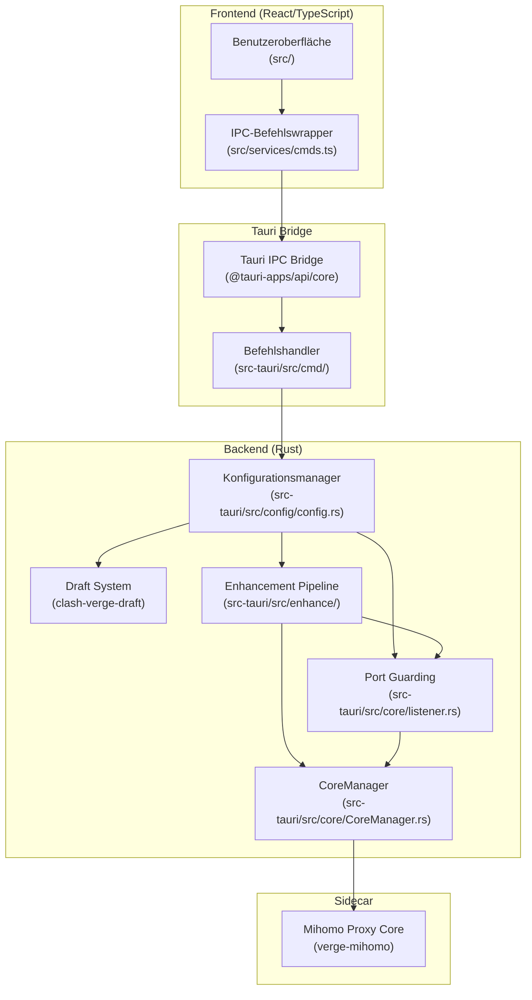

Die Benutzeroberfläche (UI)  kommuniziert über IPC-Befehlswrapper (`src/services/cmds.ts`)  mit der Tauri IPC Bridge . Diese Bridge leitet die Befehle an die Rust-Befehlshandler (`src-tauri/src/cmd/`) weiter . Die Befehlshandler interagieren mit dem `ConfigManager` , der das `DraftSystem`  zur Verwaltung von Konfigurationsentwürfen nutzt. Änderungen an der Konfiguration durchlaufen die `EnhancementPipeline` , die das Profil in eine Laufzeitkonfiguration umwandelt. Das `PortGuard`-System  stellt sicher, dass die Ports korrekt zugewiesen sind. Sowohl die `EnhancementPipeline` als auch das `PortGuard`-System beeinflussen den `CoreManager` , der für die Steuerung des `MihomoCore` (Sidecar-Binary) verantwortlich ist .

## Notes
Ein weiteres technisches Highlight ist die Unterstützung für Deep Linking, die es der Anwendung ermöglicht, `clash://` und `clash-verge://` URL-Schemata für den Import von Profilen zu verarbeiten . Die Anwendung verwendet `tokio` als asynchrone Laufzeitumgebung , was eine effiziente Handhabung von Nebenläufigkeit ermöglicht. Für die Skriptausführung innerhalb der Enhancement Pipeline wird die `boa_engine` JavaScript-Engine verwendet , die eine sichere und isolierte Ausführung von Benutzerskripten gewährleistet.

Wiki pages you might want to explore:
- [Introduction to Clash Verge Rev (clash-verge-rev/clash-verge-rev)](/wiki/clash-verge-rev/clash-verge-rev#1)
- [Architecture Overview (clash-verge-rev/clash-verge-rev)](/wiki/clash-verge-rev/clash-verge-rev#1.2)
- [Clash Configuration Backend (clash-verge-rev/clash-verge-rev)](/wiki/clash-verge-rev/clash-verge-rev#6.2)

View this search on DeepWiki: https://deepwiki.com/search/zielrepository-clashvergerevcl_43c0aad5-bad5-4504-a527-2ce8a4d718c6

---

# emilk/egui

## GitHub & DeepWiki
- GitHub: https://github.com/emilk/egui
- DeepWiki: https://deepwiki.com/emilk/egui

## Kurze Einführung
`egui` ist eine einfach zu bedienende, schnelle und hochportable Immediate-Mode-GUI-Bibliothek, die vollständig in Rust geschrieben ist. Sie ermöglicht die Entwicklung von Benutzeroberflächen, die nativ, im Web (via WebAssembly) und in verschiedenen Spiel-Engines laufen können. Das Hauptziel ist es, die Erstellung von GUIs in Rust so unkompliziert wie möglich zu gestalten, indem es ein reaktionsschnelles und erweiterbares System für 2D-Grafiken und Widgets bietet. 

## Die 3 wichtigsten (oder komplexesten) Algorithmen

### 1. Immediate Mode GUI-Verarbeitung
1.  **Name & Verortung im Code**: Die Kernlogik des Immediate Mode GUI befindet sich hauptsächlich im `egui`-Crate, insbesondere in der `Context`-Struktur  und der `Ui`-Struktur . Die Methode `Context::run_ui`  ist der zentrale Einstiegspunkt für die Verarbeitung eines Frames.
2.  **Detaillierte technische Funktionsweise**: Im Immediate Mode wird die gesamte Benutzeroberfläche in jedem Frame neu aufgebaut. Anstatt persistente Widget-Objekte zu verwalten, sind Widgets Funktionsaufrufe, die direkt gerendert werden und einen `Response`  zurückgeben, der den Interaktionsstatus enthält.  Die `Context::run_ui`-Methode nimmt `RawInput`  entgegen und führt eine Closure aus, die die UI-Definition enthält.  Während dieser Ausführung werden Widgets über `Ui::add`  hinzugefügt, die Layout und Interaktion verwalten. 
3.  **Warum prägend**: Dieser Ansatz vereinfacht die Anwendungslogik erheblich, da keine Callback-Handler oder Referenzen zu UI-Elementen gespeichert werden müssen.  Die UI spiegelt immer den aktuellen Anwendungszustand wider, da sie in jedem Frame neu gezeichnet wird.  Dies führt zu einer hohen Usability und reduziert die Komplexität und Fehleranfälligkeit des GUI-Codes. 

### 2. Multi-Pass Immediate Mode für Layout-Anpassung
1.  **Name & Verortung im Code**: Dieser Mechanismus wird durch `Context::request_discard`  und `Options::max_passes`  in der `egui`-Kiste implementiert.
2.  **Detaillierte technische Funktionsweise**: Standardmäßig führt `egui` einen einzigen Durchlauf pro Frame durch.  Für komplexe Layouts, wie z.B. `Grid` , bei denen die Größe von Elementen vor dem endgültigen Layout bekannt sein muss, kann ein Multi-Pass-Ansatz verwendet werden.  `Context::request_discard` fordert einen zusätzlichen Durchlauf an, um "First-Frame-Jitter" zu vermeiden.  Dies bedeutet, dass ein erster Durchlauf zur Größenbestimmung und ein späterer Durchlauf für das tatsächliche Layout verwendet werden kann, wodurch visuelle Fehler für den Endbenutzer unsichtbar werden. 
3.  **Warum prägend**: Dieser Algorithmus löst ein fundamentales Problem von Immediate Mode GUIs, nämlich die Schwierigkeit beim Layout, wenn die Größe von Elementen erst nach dem Layout bekannt ist.  Durch die Verwendung mehrerer Pässe kann `egui` ein korrektes Layout ohne sichtbare Verzögerungen oder Flackern erreichen, was die Benutzererfahrung erheblich verbessert, ohne die Vorteile des Immediate Mode aufzugeben. 

### 3. Plattformunabhängige Rendering-Pipeline (Tessellation)
1.  **Name & Verortung im Code**: Die Tessellation-Logik ist in der `epaint`-Kiste  implementiert, insbesondere in `epaint::tessellator` . Die `Context::tessellate`-Methode  in `egui` ist der Aufrufpunkt.
2.  **Detaillierte technische Funktionsweise**: `egui` generiert hochrangige `Shape`-Objekte , die abstrakte 2D-Formen wie Kreise, Rechtecke und Text darstellen.  Die `Context::tessellate`-Methode wandelt diese `Shape`-Objekte in dreieckige Meshes (`ClippedPrimitive`)  um, die von der GPU gerendert werden können.  Dies ermöglicht es `egui`, plattformunabhängig zu sein, da die Rendering-Backends (z.B. `egui_glow` für OpenGL oder `egui-wgpu` für WebGPU) nur die generierten Dreiecke zeichnen müssen. 
3.  **Warum prägend**: Diese Abstraktionsebene ist entscheidend für die Portabilität von `egui`.  Sie trennt die UI-Logik vollständig von der plattformspezifischen Rendering-Implementierung.  Dadurch kann `egui` auf einer Vielzahl von Plattformen und mit verschiedenen Grafik-APIs eingesetzt werden, ohne dass der Kern-UI-Code angepasst werden muss. 

## Architektur & Zusammenspiel

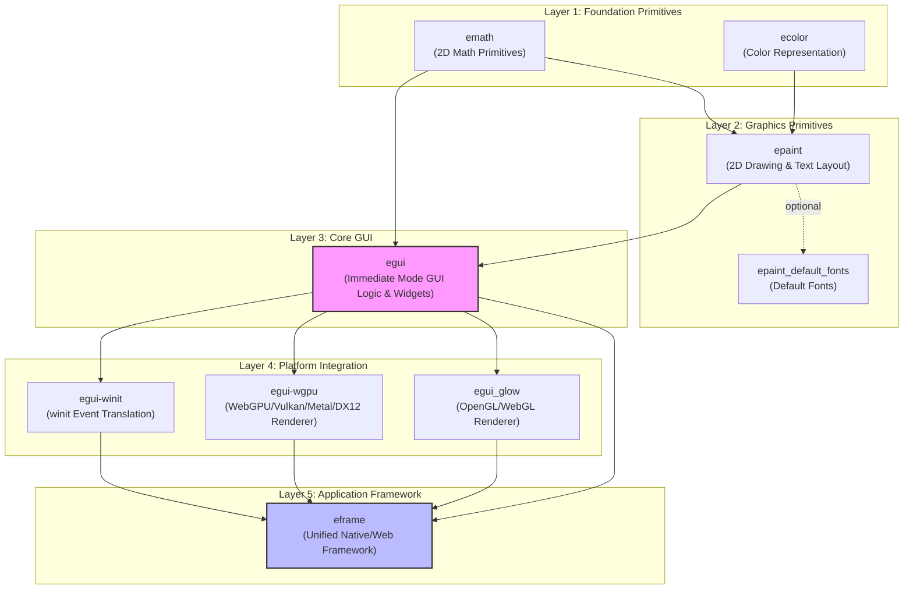
Die Architektur von `egui` ist in Schichten organisiert, die aufeinander aufbauen. 

*   **Layer 1: Foundation Primitives** (`emath`, `ecolor`) : Diese Schicht stellt grundlegende mathematische Operationen für 2D-Geometrie und Farbdefinitionen bereit. 
*   **Layer 2: Graphics Primitives** (`epaint`, `epaint_default_fonts`) : `epaint` baut auf `emath` und `ecolor` auf und bietet 2D-Zeichenprimitive und Textlayout-Funktionen.  `epaint_default_fonts` liefert Standard-Schriftarten. 
*   **Layer 3: Core GUI** (`egui`) : Dies ist die Hauptbibliothek, die die Immediate Mode GUI-Logik und Widgets implementiert.  Sie hängt von `emath` und `epaint` ab. 
*   **Layer 4: Platform Integration** (`egui-winit`, `egui-wgpu`, `egui_glow`) : Diese Crates sind für die plattformspezifische Integration zuständig. `egui-winit` übersetzt `winit`-Ereignisse in `egui`-Eingaben.  `egui_glow` und `egui-wgpu` sind Rendering-Backends, die die von `egui` ausgegebenen Dreiecke mit OpenGL/WebGL bzw. WebGPU/Vulkan/Metal/DX12 rendern. 
*   **Layer 5: Application Framework** (`eframe`) : `eframe` ist das offizielle Framework, das eine einheitliche Entwicklung für Web- und native Anwendungen ermöglicht, indem es die Integrations-Crates zusammenführt. 

Das Zusammenspiel beginnt damit, dass die Anwendung (oft über `eframe`) Eingaben von der Plattform sammelt und diese an `egui::Context` übergibt.  Die `Context` führt dann die UI-Logik aus, die Widgets über `Ui` hinzufügt.  Dabei werden `Shape`-Objekte generiert, die anschließend von der `Context` in `ClippedPrimitive` (Dreiecks-Meshes) tesselliert werden.  Diese Meshes werden dann von einem der Rendering-Backends (z.B. `egui_glow` oder `egui-wgpu`) gezeichnet. 

## Notes
`egui` verwendet ein `Arc<RwLock<ContextImpl>>`  für den zentralen Zustand, um Thread-Sicherheit zu gewährleisten und parallele UI-Logik zu ermöglichen.  Anstatt `begin/end`-Stil Funktionsaufrufe zu verwenden, bevorzugt `egui` `FnOnce`-Closures, die an eine Wrapping-Funktion übergeben werden, um Fehleranfälligkeit zu reduzieren.  Für die Performance kann die Verwendung eines benutzerdefinierten Allokators wie `mimalloc` oder `talc` die Geschwindigkeit von `egui`-Anwendungen erheblich verbessern (ca. 20%).  `egui` unterstützt auch die Instrumentierung mit dem `profiling`-Crate. 

Wiki pages you might want to explore:
- [Architecture Overview (emilk/egui)](/wiki/emilk/egui#1.1)

View this search on DeepWiki: https://deepwiki.com/search/zielrepository-emilkegui-erste_5ab5a793-821a-4bc1-a3a4-7a84cb6a200d

---

# akitaonrails/ai-memory

## GitHub & DeepWiki
- GitHub: https://github.com/akitaonrails/ai-memory
- DeepWiki: https://deepwiki.com/akitaonrails/ai-memory

## Kurze Einführung
`ai-memory` ist eine in Rust geschriebene Anwendung, die als Langzeitgedächtnis für KI-Codierungsagenten dient. Sie ermöglicht es Agenten, den Kontext über verschiedene Tools und Sitzungen hinweg beizubehalten, indem sie Lebenszyklusereignisse erfasst und in einem versionierten Markdown-Wiki speichert, das durch einen SQLite-Index unterstützt wird. Das System zielt darauf ab, den Verlust von Kontext zu eliminieren und eine nahtlose Übergabe zwischen verschiedenen KI-Agenten zu ermöglichen.  

## Die 3 wichtigsten (oder komplexesten) Algorithmen

### 1. Duales Speichermodell: Markdown-Wiki als "Source of Truth" und abgeleiteter SQLite-Index
1.  **Name & Verortung im Code**: Das Markdown-Wiki wird durch die `Wiki`-Struktur im `crates/ai-memory-wiki/src/wiki.rs` verwaltet, während der SQLite-Index in `crates/ai-memory-store/src/lib.rs` implementiert ist. Die Interaktion erfolgt über den `WriterHandleActor` in `crates/ai-memory-store/src/writer.rs`.   
2.  **Detaillierte technische Funktionsweise**: Das System speichert alle Informationen primär als Markdown-Dateien in einem Git-Repository.  Diese Dateien sind die "Source of Truth" und können manuell bearbeitet oder mit Tools wie Obsidian inspiziert werden.  Ein abgeleiteter SQLite-Index (`db/memory.sqlite`) wird für schnelle Suchvorgänge (FTS5), Entitätsabgleiche, Link-Nachbarschafts-Retrieval und optionale Vektoreinbettungen verwendet.  Schreibvorgänge erfolgen atomar über einen `WriterHandleActor`, der sowohl die Markdown-Dateien aktualisiert als auch den SQLite-Index synchronisiert. 
3.  **"Warum prägend"**: Dieses duale Speichermodell ist prägend, da es die Vorteile menschlicher Lesbarkeit und Versionskontrolle (durch Git) mit der Performance und den erweiterten Suchfunktionen einer Datenbank kombiniert.  Es stellt sicher, dass die Daten auch bei Datenbankkorruption wiederherstellbar sind und fördert die Portabilität und Inspektion der Erinnerungen. 

### 2. 3-Tupel-Scoping für Identität und Isolation
1.  **Name & Verortung im Code**: Die 3-Tupel-Scoping-Identität wird in `crates/ai-memory-core/src/ids.rs` definiert und umfasst `WorkspaceId`, `ProjectId` und `PagePath`. 
2.  **Detaillierte technische Funktionsweise**: Jedes Speicherelement, jede Seite und jede Sitzung ist an ein universelles Identitätskoordinatensystem gebunden, das aus einem `WorkspaceId`, einem `ProjectId` und einem `PagePath` besteht.  `WorkspaceId` repräsentiert den obersten Mandanten oder Benutzer, `ProjectId` isoliert einzelne Code-Repositories oder Workspaces, und `PagePath` ist der POSIX-ähnliche relative Pfad innerhalb des Wiki-Baums. 
3.  **"Warum prägend"**: Dieses Scoping-Modell ist entscheidend für die Multi-User- und Multi-Session-Sicherheit und -Isolation.  Es verhindert Kollisionen zwischen Projekten und gewährleistet eine deterministische Hierarchieabbildung über Dateisystem und Datenbankindizes hinweg, was für die Skalierbarkeit und Datenintegrität unerlässlich ist. 

### 3. Retention-Scoring und Gedächtnisverfall
1.  **Name & Verortung im Code**: Der Algorithmus für den Gedächtnisverfall wird in der Dokumentation unter "Memory tiers (M8 policy)" beschrieben  und ist inspiriert von `agentmemory`s `retention-score` Funktion. 
2.  **Detaillierte technische Funktionsweise**: `ai-memory` verwendet ein formelbasiertes System, um die Relevanz von Erinnerungen zu bewerten und ihren Verfall zu steuern. Die Formel für den Verfall von episodischen Erinnerungen lautet: `salience · exp(−λΔt) + σ · log(1+access_count) · exp(−μ · days_since_access) · (1 + breadth_weight · ln(1 + max(distinct_actors−1, 0)))`.  Dabei ist `salience` die anfängliche Relevanz, `λ` und `μ` sind Zerfallsraten, `access_count` ist die Häufigkeit des Zugriffs, `days_since_access` ist die Zeit seit dem letzten Zugriff, und `breadth_weight` berücksichtigt die Anzahl der unterschiedlichen Akteure, die auf die Erinnerung zugegriffen haben. 
3.  **"Warum prägend"**: Dieser Algorithmus ist prägend, da er eine dynamische und anpassbare Gedächtnisverwaltung ermöglicht, die über einfache TTL-Mechanismen hinausgeht.  Er stellt sicher, dass häufig genutzte oder von mehreren Benutzern referenzierte Erinnerungen länger erhalten bleiben, während ungenutzte Erinnerungen verblassen oder komprimiert werden, was die Effizienz und Relevanz des Langzeitgedächtnisses optimiert. 

## Architektur & Zusammenspiel

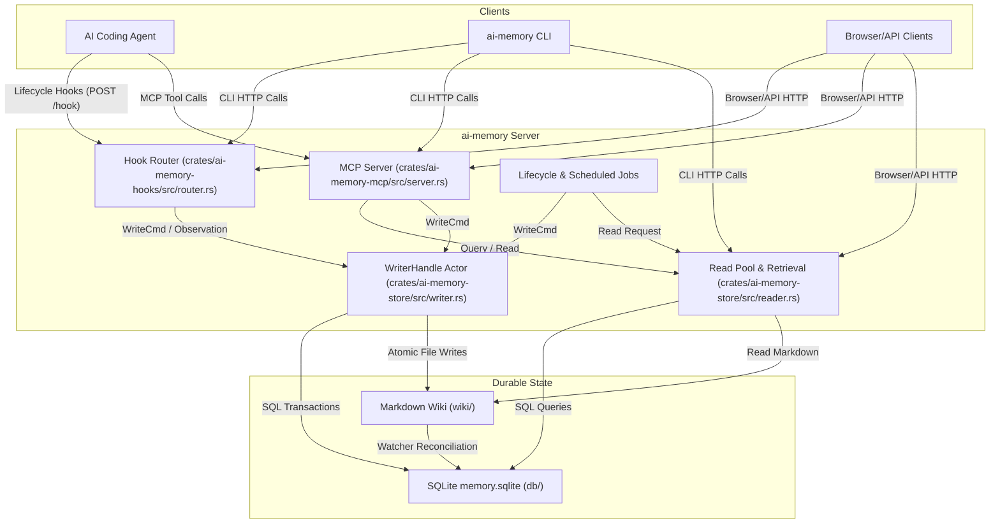
      

Die Architektur von `ai-memory` ist um einen zentralen Server herum aufgebaut, der als einzelnes Rust-Binary läuft.  Externe KI-Agenten und CLI-Tools interagieren mit diesem Server über verschiedene Schnittstellen. 

1.  **Client-Interaktion**: KI-Agenten senden Lebenszyklus-Hooks (z.B. `SessionStart`, `UserPromptSubmit`) über HTTP-POST-Anfragen an den `/hook`-Endpunkt des Servers.  Sie können auch MCP-Tool-Aufrufe tätigen.  Die `ai-memory` CLI und Browser-Clients nutzen ebenfalls HTTP-Aufrufe für Verwaltungsaufgaben und Datenabfragen. 
2.  **Ingestion und Verarbeitung**: Der `Hook Router` (`crates/ai-memory-hooks/src/router.rs`) empfängt die Hooks, bereinigt die Payloads und reiht `WriteCmd`s in den `WriterHandle Actor` ein.  Der `MCP Server` (`crates/ai-memory-mcp/src/server.rs`) verarbeitet MCP-Anfragen. 
3.  **Schreibvorgänge**: Der `WriterHandle Actor` (`crates/ai-memory-store/src/writer.rs`) ist ein Single-Writer-Actor-Modell, das alle Mutationen serialisiert.  Er schreibt sowohl in die SQLite-Datenbank (`memory.sqlite`) als auch in das Markdown-Wiki-Dateisystem. 
4.  **Lesevorgänge und Retrieval**: Der `Read Pool & Retrieval` (`crates/ai-memory-store/src/reader.rs`) ermöglicht parallele Lesezugriffe auf die SQLite-Datenbank und das Markdown-Wiki.  Er nutzt FTS5, Entitätsabgleiche und Link-Nachbarschafts-Retrieval, optional ergänzt durch Vektoreinbettungen. 
5.  **Hintergrundaufgaben**: `Lifecycle & Scheduled Jobs` führen Aufgaben wie die Zusammenfassung von Sitzungen, Handoffs, automatische Verbesserungen, Konsolidierung, Linting, Einbettung und den Verfalls-Sweep durch. 

## Notes

*   **Datenschutz**: Das System legt großen Wert auf Datenschutz. Eine `Sanitizer`-Schicht bereinigt sensible Muster (Schlüssel, Token) aus den Payloads, bevor sie gespeichert werden. 
*   **Self-Healing**: `ai-memory` ist selbstheilend. Schema-Migrationen werden beim Start ausgeführt, und periodische Integritätsprüfungen stellen die Konsistenz zwischen dem SQLite-Index und den Markdown-Dateien sicher. 
*   **Backpressure**: Der `/hook`-Endpunkt antwortet sofort (202 Accepted oder 429 Too Many Requests bei Überlastung), um sicherzustellen, dass Agent-CLIs nicht durch Persistenzlatenz blockiert werden. 
*   **LLM-Integration (optional)**: Obwohl das Kernsystem ohne LLM-Aufrufe funktioniert, kann die Konfiguration eines LLM-Providers die Sitzungszusammenfassungen verbessern und semantische Suchfunktionen ermöglichen. 
*   **Memory Tiers**: Das System verwendet vier Gedächtnisstufen (Working, Episodic, Semantic, Procedural), um die Retention und den Verfall von Informationen zu steuern. 
*   **Git-Integration**: Das Markdown-Wiki ist Git-versioniert, was eine einfache Sicherung, Wiederherstellung und Nachverfolgung von Änderungen ermöglicht. 
*   **Idempotenz**: Die Ingestion von Ereignissen ist idempotent, um Duplikate zu vermeiden und die Konsistenz der Daten zu gewährleisten. <cite repo="akitaonrails/ai-memory" path="docs/design-decisions.md

Wiki pages you might want to explore:
- [Overview (akitaonrails/ai-memory)](/wiki/akitaonrails/ai-memory#1)
- [Core Architecture (akitaonrails/ai-memory)](/wiki/akitaonrails/ai-memory#2)

View this search on DeepWiki: https://deepwiki.com/search/zielrepository-akitaonrailsaim_9b83115c-b8b3-418d-8e19-12d56492e8bb

---

# zerx-lab/FluxDown

## GitHub & DeepWiki
- GitHub: https://github.com/zerx-lab/FluxDown
- DeepWiki: https://deepwiki.com/zerx-lab/FluxDown

## Kurze Einführung
FluxDown ist ein schneller, quelloffener und kostenloser Multi-Protokoll-Download-Manager, der als Alternative zu proprietären Lösungen wie IDM dient. Er nutzt eine in Rust geschriebene Engine für hohe Leistung und bietet eine plattformübergreifende Verfügbarkeit, einschließlich Desktop-Anwendungen (Flutter, GPUI), mobiler Apps, Headless-Servern, CLI und Browser-Erweiterungen. Das Projekt zielt darauf ab, Downloads zu beschleunigen und gleichzeitig Datenschutz und Benutzerkontrolle zu gewährleisten.  

## Die 3 wichtigsten (oder komplexesten) Algorithmen

### 1. Dynamische Segmentierung (`segment_coordinator.rs`)
1.  **Name & Verortung im Code**: Der Algorithmus ist hauptsächlich in `native/engine/src/segment_coordinator.rs` implementiert und wird durch die `SegmentCoordinator`-Struktur verwaltet. 
2.  **Detaillierte technische Funktionsweise**: FluxDown verwendet eine "IDM-ähnliche" dynamische Segmentierung. Anstatt statische Blöcke herunterzuladen, werden Segmente zur Laufzeit halbiert, wenn ein Worker-Thread inaktiv wird. Dies stellt sicher, dass langsame Verbindungen den gesamten Download nicht ausbremsen. Der `SegmentCoordinator` ist für die Zuweisung von Segmenten, die Wiederverwendung von Verbindungen und die Anpassung der Verbindungsstrategie pro Domain verantwortlich.  
3.  **"Warum prägend"**: Dieser Algorithmus ist entscheidend für die hohe Download-Geschwindigkeit von FluxDown. Durch die dynamische Anpassung an die Netzwerkbedingungen und die Verteilung der Last auf mehrere Segmente kann die Software die verfügbare Bandbreite optimal nutzen und die Download-Zeiten erheblich verkürzen. 

### 2. Plugin-System (QuickJS-Sandbox)
1.  **Name & Verortung im Code**: Das Plugin-System ist in `native/engine/src/plugin` angesiedelt, wobei die Laufzeitumgebung in `quickjs.rs` und die Verwaltung in `manager.rs` zu finden sind. 
2.  **Detaillierte technische Funktionsweise**: FluxDown integriert eine QuickJS-basierte Plugin-Laufzeitumgebung, die es Drittanbieter-Skripten ermöglicht, Download-Anfragen abzufangen, direkte Links aufzulösen (z.B. für YouTube) und auf Task-Lebenszyklus-Hooks zu reagieren. Die Plugins laufen in einer Sandbox mit Speichergrenzen, CPU-Ausführungsbudgets und Netzwerk-Egress-Schutz, um SSRF-Angriffe zu verhindern. Es gibt zwei Hauptfunktionsbereiche: den Resolver-Plan, der URLs vor der Protokollbestimmung auflöst, und den Benachrichtigungsplan für Ereignisse wie `onStart`, `onDone`, `onError`. 
3.  **"Warum prägend"**: Dieses System macht FluxDown extrem flexibel und erweiterbar. Es ermöglicht die Unterstützung einer Vielzahl von Download-Quellen und -Szenarien, die über die nativen Protokolle hinausgehen, ohne den Kern der Engine zu überladen. Die Sandbox-Umgebung gewährleistet dabei die Sicherheit und Stabilität des Systems.

### 3. Persistenzschicht (Datenbank)
1.  **Name & Verortung im Code**: Die Persistenzschicht wird durch die `Db`-Struktur in `native/engine/src/db.rs` verwaltet. 
2.  **Detaillierte technische Funktionsweise**: Die Engine verwendet eine robuste Persistenzschicht, um Downloads nach einem Absturz oder Neustart der Anwendung fortsetzen zu können. Sie unterstützt sowohl SQLite (für Desktop-Anwendungen) als auch PostgreSQL (für Serverumgebungen) über `sqlx`. Das Schema wird in `db.rs` verwaltet und umfasst Tabellen für `tasks`, `task_segments` und `ed2k_blocks`. Die `task_segments`-Tabelle verfolgt genaue Byte-Bereiche und den Download-Fortschritt für eine absturzsichere Wiederaufnahme.  
3.  **"Warum prägend"**: Diese Persistenzschicht ist entscheidend für die Zuverlässigkeit von FluxDown. Sie stellt sicher, dass kein Download-Fortschritt verloren geht, selbst bei unerwarteten Systemausfällen. Die Unterstützung mehrerer Datenbank-Backends ermöglicht es, FluxDown sowohl in lokalen Desktop-Umgebungen als auch in robusten Server-Setups einzusetzen. 

## Architektur & Zusammenspiel

FluxDown ist als Monorepo organisiert und folgt einem "Ein Engine, mehrere Hosts, mehrere Clients"-Prinzip.  Die Kern-Download-Logik ist in der `fluxdown_engine` (Rust) gekapselt und entkoppelt sich über drei Traits (`EventSink`, `HostSelection`, `ApiHost`) von den Hosts und Clients. 

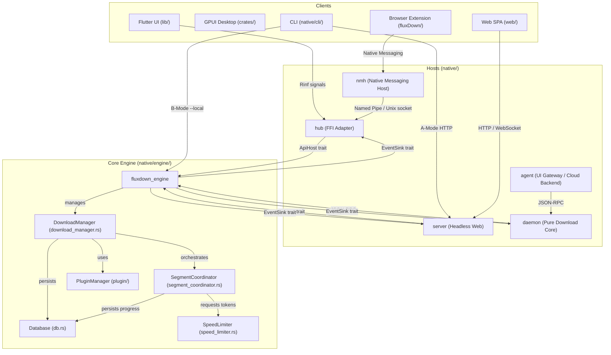
    

Die `fluxdown_engine` ist das Herzstück und enthält die gesamte Download-Logik, einschließlich Protokollunterstützung, dynamischer Segmentierung, Persistenz und Plugin-System.  Sie ist FFI-unabhängig und kann in verschiedene Hosts eingebettet werden. 

Die Hosts wie `hub` (für Flutter-Apps) und `server` (für Headless-Webserver) implementieren die von der Engine benötigten Traits, um Ereignisse zu empfangen (`EventSink`) und Entscheidungen zu treffen (`HostSelection`).  Der `fluxdown_api` Crate bietet eine einheitliche HTTP-Schnittstelle (REST, Aria2 JSON-RPC, MCP), die von verschiedenen Clients genutzt werden kann, ohne direkte Engine-Abhängigkeiten. 

Eine zukünftige Architektur sieht eine Trennung in `fluxdownd` (reiner Download-Daemon) und `fluxdown-agent` (UI Gateway, Cloud-Funktionen) vor, die über `fluxdown_protocol` kommunizieren. 

## Notes

*   **Nebenläufigkeitsmodell**: Die Engine verwendet ein Actor-ähnliches Muster, bei dem der `DownloadManager` als zentraler Orchestrator fungiert.  Schreibvorgänge werden durch einen `current_thread tokio actor` serialisiert, um Thread-Sicherheit zu gewährleisten. Jeder Download wird als separate Task mit `CancellationToken` gespawnt. 
*   **Caching-Strategien**: Für BitTorrent-DHT-Persistenz wird `dht.json` als reiner Cache verwendet, mit einem dreistufigen Fallback-Mechanismus, um Probleme bei der Portbindung zu vermeiden. 
*   **Automatische Proxy-Entscheidung**: Der `auto_proxy` Mechanismus ermöglicht eine intelligente Auswahl des besten Proxys. Er startet Downloads direkt und testet bei Bedarf parallel verfügbare Proxy-Optionen, um die schnellste Verbindung zu finden und dynamisch zu wechseln. 
*   **Zero-FFI Engine**: Die `fluxdown_engine` ist bewusst ohne FFI-Abhängigkeiten konzipiert, um maximale Portabilität und Wiederverwendbarkeit in verschiedenen Host-Umgebungen zu gewährleisten. 
*   **MCP Server**: FluxDown integriert einen Model Context Protocol (MCP) Server, der es KI-Agenten ermöglicht, Downloads zu verwalten. 
*   **Monorepo-Struktur**: Das Repository ist in logische Verzeichnisse wie `lib/` (Flutter UI), `crates/` (GPUI Client), `native/` (Rust Workspace), `fluxDown/` (Browser Extension) und `web/` (React SPA) unterteilt, um die Entwicklung und Wartung zu erleichtern. 

Wiki pages you might want to explore:
- [Repository Structure & Monorepo Layout (zerx-lab/FluxDown)](/wiki/zerx-lab/FluxDown#1.2)
- [Core Download Engine (Rust) (zerx-lab/FluxDown)](/wiki/zerx-lab/FluxDown#2)
- [Server Architecture & Configuration (zerx-lab/FluxDown)](/wiki/zerx-lab/FluxDown#7.1)

View this search on DeepWiki: https://deepwiki.com/search/zielrepository-zerxlabfluxdown_7a34e0e2-587f-40b4-bcf8-861a779bda77
