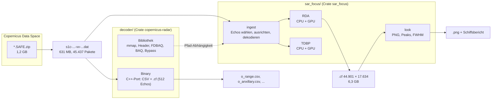
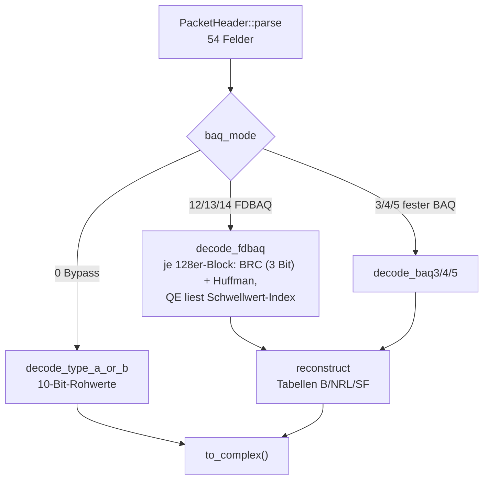
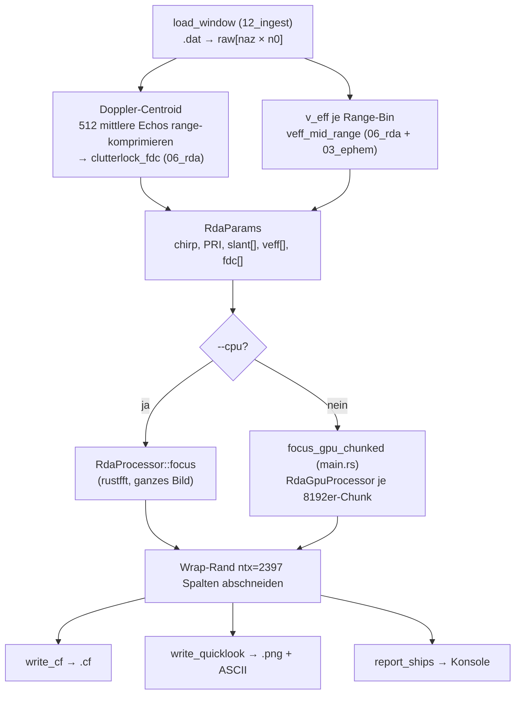
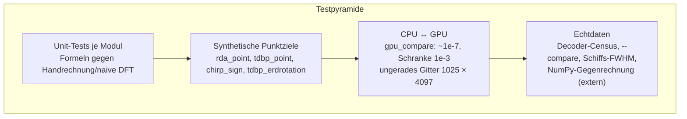
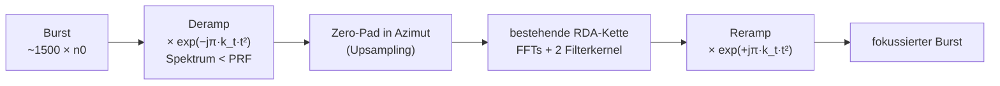
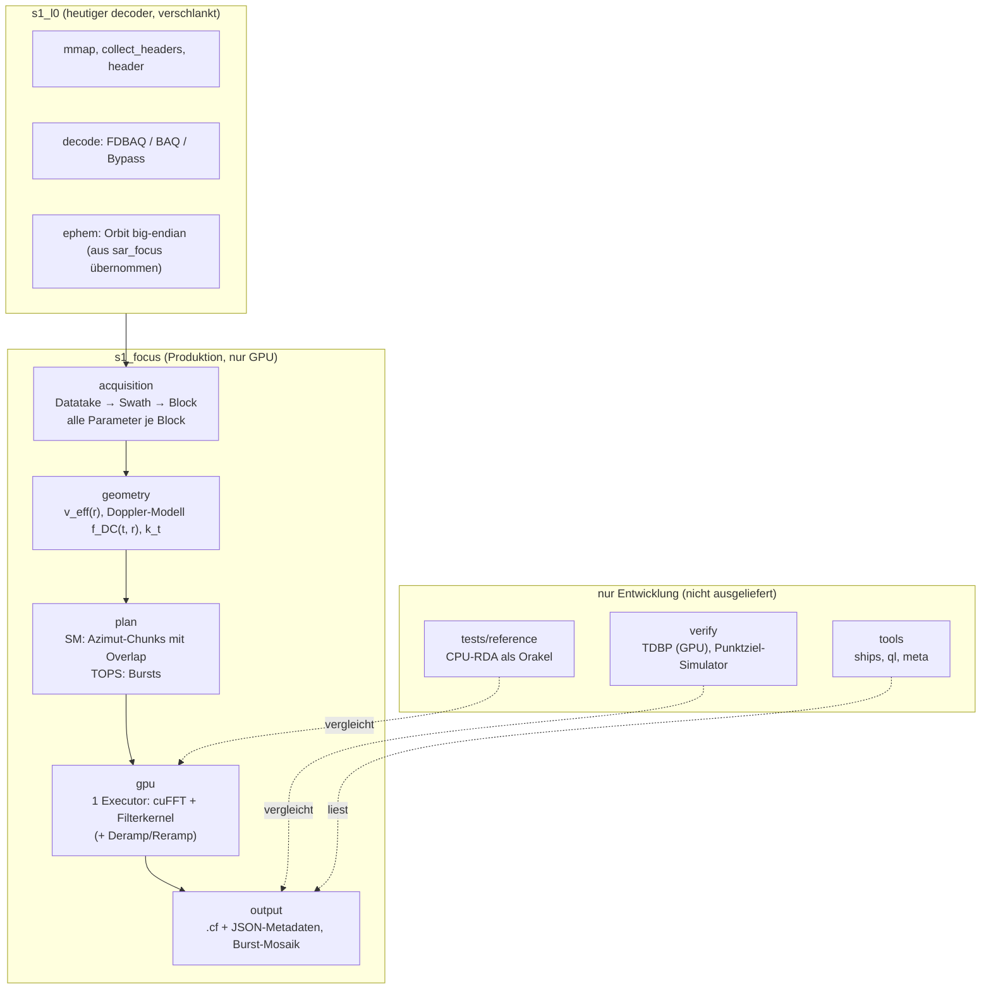

# Die Sentinel-1-Software in `34_copernicus_radar`: Überblick, Architektur, Weg zu breiteren Scan-Modi

Diese Dokumentation richtet sich an alle, die den Code verstehen und
später erweitern wollen, vor allem auf die breiten Scan-Modi IW
(Interferometric Wide Swath, ca. 250 km) und EW (Extra Wide Swath, ca.
400 km). Sie erklärt zuerst, *was* die Software tut (Abschnitte 1–2),
dann, *wie* sie gebaut ist (3–6), und bewertet schließlich, ob man für
IW/EW den bestehenden Code umbauen oder neu implementieren sollte (7–9).

Die bestehenden Walkthroughs unter `plan/` gehen bei einzelnen Themen
tiefer. Hier geht es um das Gesamtbild. Alle Zahlen beziehen sich auf
den Referenzdatensatz (Sentinel-1C, Stripmap-Beam S6, VV, 27 s über
Santos/Brasilien), Messwerte stammen aus `e2e_full.log` und den
Walkthroughs.

---

## 1. Worum es geht: vom Summen-Signal zum Bild

### 1.1 Das Grundprinzip an einem Beispiel

Sentinel-1 fliegt mit etwa 7,5 km/s und sendet 1.663-mal pro Sekunde
einen Radarpuls schräg zur Erde. Jeder Puls ist ein **Chirp**, ein Ton
mit linear steigender Frequenz (51 µs lang, 42 MHz Bandbreite). Das
Echo eines Pulses ist die Überlagerung der Antworten *aller*
beleuchteten Ziele.

Ein einzelnes Schiff in 945 km Schrägentfernung sieht im Rohsignal so aus:

```text
              Range (Schrägentfernung, Spalten, 3,2 m/Sample) →
Echo 0      ...............................................
Echo 4000   ..........[=======Chirp 2397 Samples=======]...   ← Schiff kommt in die Keule
Echo 4500   ...........[=======Chirp 2397 Samples=======]..   ← nächster Punkt (Hyperbel-Scheitel)
Echo 5000   ..........[=======Chirp 2397 Samples=======]...   ← Schiff verlässt die Keule
Echo 44900  ...............................................
Azimut ↓ (Flugrichtung, Zeilen, 4,3 m/Echo)
```

Das Schiff ist über **~1.000 Echos** (die synthetische Apertur,
≈ λ·R/L = 0,0555 m · 945 km / 12,3 m ≈ 4,3 km Flugweg) und über
**2.397 Range-Samples** (die Chirp-Länge) verschmiert. Fokussieren
heißt, diese Energie wieder auf einen Pixel zu sammeln, und zwar in
zwei Schritten:

```text
Rohdaten                 Range-komprimiert              fokussiert
(Chirp in jeder Zeile)   (1 Peak je Zeile, entlang      (1 Pixel)
                          einer flachen Hyperbel,
                          Phase ändert sich je Zeile)
   ====                      |                            
    ====                      |                            
     ====       ──Range──►    |        ──Azimut──►        •
    ====      Matched-Filter  |       Matched-Filter      
   ====       (Chirp-Replika) |       (Doppler-Verlauf)   
```

1. **Range-Kompression:** Jede Zeile wird mit der bekannten
   Chirp-Replika korreliert (FFT · konjugierte Replika-FFT · iFFT).
   Aus 2.397 Samples wird ein Peak von ~1 Sample Breite
   (Auflösung c/2B = 3,55 m).
2. **Azimut-Kompression:** Die Entfernung zum Schiff ändert sich
   während des Vorbeiflugs hyperbolisch: R(t) = √(R₀² + v²t²). Das
   erzeugt eine Phasengeschichte exp(−j·4π·R(t)/λ), also einen
   Doppler-Chirp. Ein zweites Matched-Filter sammelt ihn ein. Die
   Krümmung der Hyperbel heißt **Range Cell Migration** (RCM) und
   muss vorher gerade gezogen werden (**RCMC**).

### 1.2 Zwei Wege, die Azimut-Kompression zu rechnen

| | RDA (Range-Doppler-Algorithmus) | TDBP (Time-Domain Backprojection) |
|---|---|---|
| Idee | Im Frequenzbereich: Jede Azimut-Frequenz f_a entspricht einem Blickwinkel, dort ist RCMC eine Phasenmultiplikation | Für jeden Bildpixel: Abstand zu jeder Satellitenposition rechnen, passendes Sample holen, Phase korrigieren, aufsummieren |
| Aufwand | O(N log N) über 4 FFTs | O(Pixel × Pulse) |
| Näherungen | Hyperbel-Modell, v_eff und f_DC je Range-Bin konstant | keine (f64-Geometrie) |
| Rolle im Code | Produktionspfad (Vollbild in ~11 s auf GPU) | Schiedsrichter auf Fenstern |

Eine wichtige Größe für beide ist der **Doppler-Centroid f_DC**, die
Doppler-Frequenz in der Mitte der Antennenkeule. Bei Sentinel-1 SM
liegt er bei wenigen zehn Hz. Er wird aus den Daten geschätzt
(**Clutterlock**), weil die Antenne aktiv gesteuert wird und reine
Geometrie den falschen Wert liefert (Walkthrough 02, Fund 3).

---

## 2. Die zwei Programme im Überblick



| | `decoder/` | `sar_focus/` |
|---|---|---|
| Herkunft | 1:1-Port des C++-Projekts `plops/copernicus-radar` (inkl. CSV-Format, `%.3g`, Dateinamen-Tippfehler) | Neu entwickelt, Formeln aus SSFocus/sentinel1decoder, gegen NumPy gegengeprüft |
| Zeilen Rust | ~3.700 (inkl. Tests) | ~5.400 (inkl. Tests) |
| Sprache Kommentare | Englisch | Deutsch |
| Wird in Produktion gebraucht | Nur die **Bibliothek** | Ja |
| Tests | 41 (davon 3 Echtdaten) | 48 (synthetisch) |

Wichtig für das Verständnis: `sar_focus` nutzt **nicht** die Ausgabe des
Decoder-Binaries, sondern ruft vier Bibliotheksfunktionen direkt auf
(`collect_packet_headers`, `PacketHeader::parse`, `decode_fdbaq` &
Co., `MappedFile`). Das Decoder-Binary ist ein Diagnose- und
Kompatibilitätswerkzeug.

---

## 3. Der Decoder: vom Byte-Strom zu komplexen Samples

### 3.1 Paketaufbau

Jedes Paket hat 68 Byte Kopf (6 Byte CCSDS-Primärheader, 62 Byte
Sekundärheader) und dahinter die komprimierten Echo-Samples:

```text
Byte  0 ─ 5   Primärheader       Länge des Pakets (Byte 4–5)
Byte  6 ─ 67  Sekundärheader     Zeit, Sync 0x352EF853, BAQ-Modus, RGDEC,
                                 Chirp (TXPRR, TXPSF, TXPL), PRI, SWST, Rang,
                                 Elevation-/Azimut-Beam, Swath-Nummer,
                                 Signaltyp, Anzahl Quads, 1 SubCom-Wort
Byte 68 ─ …   Nutzdaten          IE | IO | QE | QO  (4 Kanäle, BAQ-kodiert)
```

Ein **Quad** = 2 komplexe Samples (gerade + ungerade). Aus den vier
Kanälen entsteht `s[2k] = IE[k] + j·QE[k]`, `s[2k+1] = IO[k] + j·QO[k]`.

### 3.2 Dekodierung je BAQ-Modus



FDBAQ ist der aufwendige Teil: Pro Block von 128 Symbolen wählt ein
3-Bit-Bitraten-Code (BRC 0–4) einen von fünf Huffman-Bäumen. Die
Dekodierung ist **bitseriell innerhalb eines Pakets**, aber die
**Pakete sind voneinander unabhängig** (jedes beginnt an einem
bekannten Offset). Das ist für die Beschleunigung wichtig (Abschnitt 6.4).

### 3.3 Ancillary-Daten (Orbit)

Jedes Paket trägt ein 16-Bit-„Sub-Commutated“-Wort. 64 aufeinanderfolgende
Worte bilden einen Block mit Position (3 × f64), Geschwindigkeit
(3 × f32) und Zeitstempel. Achtung: Der Decoder liest diese Worte
little-endian (C++-Erbe), korrekt ist big-endian. `sar_focus` hat dafür
in `03_ephem.rs` einen eigenen, korrekten Parser. Das ist eine der
Stellen, an denen Logik heute **doppelt** existiert.

### 3.4 Modulkarte Decoder

| Modul | Aufgabe | In Produktion gebraucht? |
|---|---|---|
| `mmap` | Datei speichereinblenden | ja |
| `collect_headers` | Pakete ablaufen, Offsets + 68-Byte-Köpfe sammeln | ja |
| `header` | 54 Header-Felder parsen | ja |
| `decode_packet`, `decode_type_c`, `decode_type_ab`, `tables`, `utils::BitReader` | Sample-Dekodierung | ja |
| `sub_commutated` | Ancillary → CSV (little-endian, fehlerhaft für Orbit) | nein (ersetzt durch `sar_focus::ephem`) |
| `process_headers`, `header_export`, `utils::fmt_g3`, `main.rs` | C++-kompatible Reports | nein (Diagnose) |

---

## 4. `sar_focus`: der Weg durch die Pipeline

Die Dateien sind nach Datenfluss nummeriert (`01_types.rs` …
`13_tdbp_geo.rs`). Der Hauptpfad ist `focus` in `main.rs`:



### 4.1 Ingest: Echos auswählen und auf ein Raster legen (`12_ingest.rs`)

`load_window` ist die Stelle, an der die **Annahmen über den
Aufnahmemodus** stecken. Sie macht in dieser Reihenfolge:

1. **Header sammeln** (Decoder-Bibliothek) und den SubCom-Strom für den
   Orbit mitschreiben.
2. **Echos filtern:** nur `signal_type == 0`, FDBAQ, keine
   Kalibrierung (`meta::is_imaging_echo`).
3. **Einen Beam wählen:** den Elevation-Beam mit den meisten Quads
   (`select_beam_echoes`). Bei SM gibt es genau einen.
4. **Pulszeiten glätten:** Die Header-Zeit ist auf ±7,6 µs quantisiert;
   da das PRI-Raster exakt ist, wird `t_k = t_mid + (k − mid)·PRI`
   benutzt (+14 % Peak in TDBP).
5. **In Range ausrichten:** Jedes Echo beginnt zur Zeit
   `Rang·PRI + SWST + 320/(8·F_REF)`. Daraus folgt ein ganzzahliger
   Sample-Versatz `base` je Echo (Rest ≤ 0,25 Samples).
6. **FFT-freundliche Breite:** `n0raw = 20.031` wird auf die nächste
   7-glatte Zahl `n0 = 20.160` aufgerundet (cuFFT scheitert an 20.015 =
   5·4003, Fund 5).
7. **Dekodieren** aller Echos in eine Matrix `raw[naz × n0]`
   (7,24 GB für das Vollbild), **sequenziell** in einer Schleife.
8. **Parameter aus dem ersten Echo** übernehmen: Chirp, PRI, fs
   (`m0 = &metas[0]`).

Zahlenbeispiel für das Ergebnis:

```text
Beam 5, Echos 44901
Range: 20031 + Pad → 20160
Rohbild: 44901 × 20160 (7.24 GB)
Slant: 913.5–977.9 km, fs 46.9184 MHz
v_eff Mitte: 7100.4 m/s, Bandbreite: 42.19 MHz
```

### 4.2 Physikalische Parameter (`02_meta.rs`, `03_ephem.rs`, `04_chirp.rs`)

Alle Header-Rohwerte sind Zählwerte eines Referenztakts
F_REF = 37,534722 MHz. Beispiele:

| Größe | Formel | S6-Wert |
|---|---|---|
| PRI | `PRI_count / F_REF` | 601,15 µs → PRF 1663,5 Hz |
| Range-Abtastrate | `(L/M)·4·F_REF` aus RGDEC-Tabelle | RGDEC 9 → 46,918 MHz |
| Chirp-Rate | `±mag·F_REF²/2²¹` (Polaritätsbit 1 = positiv!) | +8,26·10¹¹ Hz/s |
| Chirp-Länge | `TXPL / F_REF` | 51,10 µs = 2.397 Samples |
| Schrägentfernung | `(Rang·PRI + SWST + suppressed + j/fs)·c/2` | 913,5–977,9 km |

`03_ephem.rs` dekodiert die Orbit-Blöcke (big-endian), interpoliert
linear und liefert `v_eff = √(v_sat · v_boden)`. Die Orbit-Geschwindigkeit
ist erdfest (ECEF) und muss für `v_eff` erst inertial gemacht werden
(`v + ω×r`, sonst 1,1 % Fehler, Fund 2).

`04_chirp.rs` erzeugt die Replika exakt auf dem ADC-Raster
(`t_i = (i − (n−1)/2)/fs`). Die SSFocus-Variante mit `linspace` ist
nur noch für einen Vergleichstest da.

### 4.3 RDA auf der CPU (`05_range.rs`, `06_rda.rs`)

`RdaProcessor::focus` ist die lesbare Referenz des Algorithmus. Ein Chunk
`naz × nrange` durchläuft sechs Stufen:

```text
Bereich:  Zeit/Zeit          Range-Freq/Az-Freq             Range-Zeit/Az-Freq        Zeit/Zeit
          (Rohdaten)         (2D-Spektrum)                  (Range-Doppler)           (Bild)

raw ──① Range-FFT──② Az-FFT+fftshift──③ × H_range(f_r)        ──④ Range-iFFT──⑤ × H_az(f_a, R)──⑥ ifftshift+Az-iFFT──► Bild
                                          × H_rcmc(f_a, f_r)       + Rotation       (je Range-Linie)    + Skalierung 1/N
                                                                   um shift
```

Die drei Filter sind reine Phasenfaktoren, berechnet aus 1D-Vektoren:

```text
D(f_a, r)   = √(1 − λ²(f_a − f_DC[r])² / 4·v_eff[r]²)        Migrationsfaktor

H_range     = conj(FFT(Replika, eingebettet))                  Range-Matched-Filter
H_rcmc      = exp(+j·4π·f_r·R₀·(1/D − 1)/c)                   Range-Verschiebung um ΔR(f_a), als Phase
H_az        = exp(+j·4π·R[r]·D/λ)                              Azimut-Matched-Filter
```

Zwei Beobachtungen, die für die Erweiterung wichtig sind:

- RCMC ist **bulk**: Ein R₀ (Schwadmitte) für alle Range-Bins. Bei SM
  reicht das, weil die Migration nur wenige Samples beträgt (±3,7 px).
  Bei breitem Swath und schrägem Blick (TOPS) muss man das neu prüfen.
- `v_eff` und `f_DC` sind **je Range-Bin, aber konstant über Azimut**
  (Orbit der Rahmenmitte, Clutterlock aus den mittleren 512 Echos).
  Bei SM über 27 s ist das zulässig. Bei TOPS ändert sich f_DC innerhalb
  eines Bursts über mehrere PRF, damit fällt diese Annahme weg (Abschnitt 7).

### 4.4 TDBP (`07_tdbp.rs`, `13_tdbp_geo.rs`)

Pro Pixel `(a, r)` und Puls `p`:

```text
d      = |plat[p] − pixel(a, r)|                 f64!
s      = (2d/c − t0) / dt                         Sample-Index (gebrochen)
v      = lerp(rc[p, ⌊s⌋], rc[p, ⌊s⌋+1])           lineare Interpolation
acc   += v · exp(+j·4π·d/λ)
```

`13_tdbp_geo.rs` übersetzt RDA-Pixel in ein lokales kartesisches Gitter
auf einer Kugel und dreht jede Plattformposition von ECEF(t_p) in
ECEF(t_mid) zurück (Erdrotation, ±320 m, Fund 9). **Offener Befund:**
TDBP ist in Azimut 3–5× unschärfer als die Beugungsgrenze (Fund 13).
Damit taugt TDBP derzeit als Lage-, aber noch nicht als Schärfe-Schiedsrichter.

### 4.5 Ausgabe und Analyse (`11_look.rs`, `main.rs`)

- `.cf`: rohe `f32`-Paare, zeilenmajor, ohne Header (die Größe muss man
  beim Lesen mit angeben).
- `.png`: Leistung in dB, Multilook auf ≈ 2.048 px, Perzentil-Streckung.
- Schiffsbericht: 12 hellste lokale Maxima je Azimut-Viertel, FWHM in
  Range/Azimut gegen die Theorie, Kontrast gegen einen Ring-Untergrund,
  RFI-Zeilen (> 8× Median) ausgeblendet.

---

## 5. Die GPU-Pipeline

### 5.1 Werkzeuge

- **cuda-oxide** (`cargo oxide`): Kernel werden in Rust geschrieben
  (`#[kernel]` in `09_kernel.rs`) und in die Binary eingebettet.
- **cuFFT** über ein 60-Zeilen-FFI (`08_cufft.rs`): Zeilen-FFT als
  Batch, Spalten-FFT als strided Batch (Schrittweite `nrange`).

### 5.2 Ablauf je Chunk (`10_gpu.rs`)


4 FFTs und 6 elementweise Kernel, Ping-Pong zwischen zwei Puffern
`cur`/`tmp` (out-of-place, weil `DisjointSlice` in cuda-oxide nur
Schreibzugriff erlaubt). Die Filter werden **pro Thread aus den
Indizes berechnet** (keine 2D-Filtermatrix im VRAM, Walkthrough 03:
Faktor 8,5 schneller als vorher).

### 5.3 Chunking in Azimut (Overlap-Save)

Das Vollbild (7,24 GB) passt nicht auf eine 16-GB-Karte mit zwei
Puffern, deshalb wird in Azimut gekachelt:

```text
Echo   0        6144  8192     12288 14336                          44901
       |=========|xxxx|          |                                     |   Chunk 1: 0..8192
                 |xxxx|==========|xxxx|                                |   Chunk 2: 6144..14336
                                 ...                                       ...
                                                    |xxxx|============|   Chunk 7: 36709..44901
                                                                          (zurückgeschoben)
 = behalten      x = Overlap, je 1024 Zeilen verworfen (zyklischer Wrap der Azimut-FFT)
```

Der Overlap von 2.048 Zeilen muss mindestens eine synthetische Apertur
(~1.000 Echos) abdecken. VRAM-Bedarf: 2 × 8192 × 20160 × 8 B = 2,64 GB.

### 5.4 Messwerte (Vollbild, RTX A4000, 32 Kerne)

| Schritt | Zeit | Bemerkung |
|---|---|---|
| Dekodieren (CPU, sequenziell) | 27 s | **größter Block** |
| Orbit + f_DC | 0,2 s | |
| RDA GPU, 7 Chunks | ~11 s | davon PCIe ~1 s |
| RDA CPU (zum Vergleich) | 66,5 s | |
| Host-RAM-Spitze | 16–21 GB | raw + out + cropped + power gleichzeitig |

### 5.5 Korrektheitsnachweis



Diese Teststruktur ist das wertvollste Erbe des bestehenden Codes. Sie
sollte in jede Weiterentwicklung übernommen werden.

---

## 6. Bewertung des Ist-Zustands

### 6.1 Stärken

- **Physik ist korrekt und belegt:** 13 dokumentierte Funde, jeder mit
  Regressionstest. Die Formeln in `02_meta`, `03_ephem`, `04_chirp`,
  `06_rda` sind kurz und kommentiert.
- **GPU-Ansatz ist sauber:** Filter on-the-fly aus 1D-Vektoren,
  persistente Pläne und Puffer, f64-Phasen (notwendig: 4πR·D/λ ≈ 2·10⁸ rad).
- **Gute Beobachtbarkeit:** `meta`, `--compare`, `--no-rcmc` und der
  Schiffsbericht machen Fehler schnell sichtbar.

### 6.2 Schwächen gemessen an „einfach, verständlich, optimal, eine Implementierung“

| # | Befund | Ort | Folge |
|---|---|---|---|
| S1 | **Vier Implementierungen** der Fokussierung: RDA-CPU, RDA-GPU, TDBP-CPU, TDBP-GPU, alle im Produktionscode und per CLI wählbar | `06_rda`, `07_tdbp`, `10_gpu`, `09_kernel` | Jede Formeländerung an 2–3 Stellen (z. B. `D(f_a)` steht in `d_factor` *und* inline in zwei Kerneln) |
| S2 | **Modus-Annahmen verteilt:** „ein Beam“, „Parameter aus Echo 0“, „lückenlose Echos“, „f_DC und v_eff konstant über Azimut“ | `12_ingest`, `main.rs`, `RdaParams` | Für IW müssten alle Stellen gleichzeitig geändert werden |
| S3 | **`main.rs` enthält Fachlogik** (996 Zeilen): Chunk-Planung, Overlap-Save, f_DC-Ablauf, Crop, Schiffsanalyse, Tiefensuche; `ships` hat S6-Werte hartkodiert (42,19 MHz, 7100 m/s, 2397) | `main.rs` | Nicht testbar, nicht wiederverwendbar |
| S4 | **Dekodieren sequenziell** (27 s), obwohl Pakete unabhängig sind | `ingest::load_window` | Bremst die GPU-Pipeline auf ⅓ ihrer möglichen Geschwindigkeit |
| S5 | **Ganzer Rahmen im Host-RAM**, plus Kopien (`out`, `cropped`, `power`) | `main.rs` | 16–21 GB Spitze; IW-Slices mit 3 Swaths würden das verdreifachen |
| S6 | **6 elementweise GPU-Kernel, davon 4 reine Umsortierungen** (2× `shift_cols`, `rotate_rows`, `scale`) | `10_gpu`, `09_kernel` | Unnötige Speicherdurchläufe und doppelter VRAM (Abschnitt 6.3) |
| S7 | Orbit-Parser doppelt (Decoder little-endian falsch, `ephem` richtig) | `decoder/sub_commutated`, `03_ephem` | Verwirrung, welcher gilt |
| S8 | Decoder trägt C++-Kompatibilität (`State`, `%.3g`, 54-Feld-Tabellen, CSV-Tippfehler) | `decoder/` | Für die Produktion Ballast |
| S9 | Fehler als `String` | `types::Error` | Akzeptabel, aber keine Unterscheidung von Fehlerarten |

### 6.3 Konkretes Beispiel: wie die GPU-Pipeline einfacher *und* schneller wird

Vier der sechs Kernel verschieben nur Daten. Man kann sie mathematisch
exakt in die zwei Filterkernel falten:

| Heute | Ersatz | Begründung |
|---|---|---|
| `shift_cols` (fftshift) vor `range_rcmc` und `shift_cols` (ifftshift) vor der Az-iFFT | `f_a` direkt aus dem **unverschobenen** Index berechnen, wie es `range_rcmc` für `f_r` schon tut | fftshift ist nur eine Umbenennung der Indizes |
| `rotate_rows` nach der Range-iFFT | lineare Phase `exp(+j·2π·k·shift/N)` in `H_range` einrechnen | Verschiebungssatz der DFT, für ganzzahlige zyklische Verschiebung exakt |
| `scale` am Ende | Faktor `1/N` in `H_az` einrechnen | Skalar |

Ergebnis: **4 cuFFT-Aufrufe + 2 Kernel**, jeweils in-place
(`*o = *o * filt` über `DisjointSlice::get_mut`), also **ein**
Puffer statt zwei. Das halbiert den VRAM-Bedarf (Chunks von 16.384
statt 8.192 Zeilen möglich) und spart vier volle Speicherdurchläufe pro
Chunk. Der Code wird gleichzeitig kürzer: Die gesamte GPU-RDA passt dann
in etwa 40 Zeilen Host-Code.

Noch nicht geprüft habe ich, ob cuda-oxide in-place-Lesen über
`get_mut` erlaubt; das ist ein kurzer Spike. Der
`--compare`-Wert (heute 2,620·10⁻⁷) ist der Sensor dafür, ob sich
das Ergebnis dabei ändert.

---

## 7. Was breitere Scan-Modi (IW/EW) verlangen

### 7.1 Stripmap gegen TOPS

IW und EW arbeiten im **TOPS**-Verfahren (Terrain Observation with
Progressive Scans). Die Antenne springt zyklisch zwischen 3 (IW) bzw. 5
(EW) Sub-Swaths und schwenkt während jedes **Bursts** zusätzlich in
Azimut von hinten nach vorn.

```text
Stripmap (heute):                 IW-TOPS (Ziel):

Flug →                            Flug →
┌──────────────────────────┐      IW3 ┌───┐     ┌───┐     ┌───┐
│      ein Streifen S6     │      IW2   ┌───┐     ┌───┐     ┌───┐
│   lückenlose Echos       │      IW1 ┌───┐     ┌───┐     ┌───┐
└──────────────────────────┘          Burst 1   Burst 2   Burst 3
  ~80 km breit                      ~250 km breit, je Sub-Swath ~1.500 Echos
                                    pro Burst (~0,8–0,9 s), dann Lücke

Paketstrom:                         Paketstrom:
S6 S6 S6 S6 S6 S6 S6 S6 …           IW1×~1500 | IW2×~1500 | IW3×~1500 | IW1×~1500 | …
```

Die Fakten zu TOPS stammen aus der ESA-Dokumentation
(`plan/20261004_02_gpu_decode_sar/l0-processing.md`, Abschnitte
„TOPSAR Processing“) und der Fachliteratur. An einem IW-Datensatz
geprüft habe ich sie nicht; die Echo-Zahlen pro Burst sind
Größenordnungen und müssen in einem ersten Spike mit `meta` gemessen
werden.

### 7.2 Das zentrale neue Problem: Doppler über mehrere PRF

Durch den Azimut-Schwenk wandert der Doppler-Centroid während eines
Bursts linear: `f_DC(t) = f_DC0 + k_t·t`. Die gesamte Doppler-Spanne
eines Bursts ist dadurch ein Mehrfaches der PRF:

```text
Stripmap:      |<-- B_az ≈ 1,15 kHz -->|        PRF 1,66 kHz: passt, kein Aliasing
               ────────[████████]────────

TOPS-Burst:    Ziel A [███]                       jedes Ziel einzeln < PRF,
                      Ziel B [███]                aber der Burst insgesamt
                             Ziel C [███]         ≫ PRF → Azimut-FFT faltet
               |<------ k_t·T_burst + B_az ------>|  die Spektren übereinander
```

Die heutige RDA nimmt die Azimut-FFT über den ganzen Chunk und setzt
`f_DC` je Range-Bin als Konstante ein. Bei TOPS führt beides zu falschen
Ergebnissen. Das Standardverfahren in der Literatur (u. a.
Prats-Iraola et al., „TOPS Interferometry with TerraSAR-X“, IEEE TGRS
2012) arbeitet so:



Das ist eine gute Nachricht für die Architektur: **Der RDA-Kern bleibt
unverändert.** Neu kommen zwei elementweise Phasenkernel (Deramp,
Reramp) und eine azimutabhängige Doppler-Beschreibung dazu. Beides
passt in das bestehende „Filter on-the-fly“-Muster.

TDBP verarbeitet TOPS dagegen ohne jede Sonderbehandlung, weil sie nur
Geometrie rechnet und nie in den Azimut-Frequenzbereich wechselt. Bei
gemessenen 1,3·10⁹ Puls·Pixel/s (GPU) bräuchte ein IW-Burst-Swath
(≈ 1.500 Pulse × 1.500 × 22.000 Pixel) aber rund 40 s, eine ganze
IW-Slice also viele Minuten. TDBP bleibt damit Schiedsrichter und wird
für TOPS sogar wertvoller. Vorher muss allerdings Fund 13 (Azimut-Defokus)
gelöst sein.

### 7.3 Welche heutigen Annahmen brechen

| Annahme heute | Wo im Code | IW/EW-Realität | Nötige Änderung |
|---|---|---|---|
| Ein Beam, Mehrheitsentscheid | `ingest::select_beam_echoes` | 3/5 Sub-Swaths, verschachtelt im Paketstrom | Echos nach `ses_ssb_swath_number` + Burst gruppieren |
| Lückenlose Echofolge, PRI-glättbar | `ingest` (Zeitglättung, `rows = echoes`) | Bursts mit Lücken | Glättung und Raster **je Burst** |
| Parameter aus Echo 0 (Chirp, PRI, fs, SWST) | `ingest` (`m0`), `main.rs` | je Sub-Swath andere PRF, anderer Chirp, andere SWST | Parameter **je Block** |
| `f_DC(r)` konstant in Azimut | `RdaParams.fdc_range`, Kernel | `f_DC(t, r)` mit Rate `k_t` aus Antennensteuerung | Doppler-Modell `f_DC0(r) + k_t(r)·t`; Steuerung aus `sab_ssb_azimuth_beam_address` (Feld vorhanden, Bedeutung zu prüfen) |
| Clutterlock über 512 Echos Rahmenmitte | `main.rs` | über Burst variabel | Clutterlock je Burst nach Deramp |
| Chunk ≥ 2.048 Echos, Overlap-Save | `focus_gpu_chunked`, Warnung `< 2048` | Burst ~1.500 Echos, natürliche Einheit | Burst = Arbeitspaket, kein Overlap-Save |
| Ein Ausgabebild | `write_cf` | je Sub-Swath ein Bild aus Bursts, optional Deburst/Mosaik | Ausgabe-Schicht mit Burst-Metadaten |
| Ganzer Rahmen im RAM | `load_window` | 3× größer | Streaming: Burst dekodieren → GPU → schreiben |

Der Decoder selbst ist weitgehend modusneutral: Header-Felder für
Swath-Nummer und Azimut-Beam sind schon da, FDBAQ ist für alle Modi
gleich. Er braucht keine Neuentwicklung.

### 7.4 Die gute Nachricht für die GPU

Ein IW-Burst (≈ 1.500 × ≈ 22.000 komplexe Samples ≈ 260 MB) passt
mit Puffer und cuFFT-Workspace bequem in den VRAM. Damit entfällt das
Overlap-Save-Chunking. Mehrere Bursts gleichzeitig (gebatchte cuFFT-Pläne)
lasten die GPU besser aus als ein riesiger Chunk. TOPS ist für die
GPU-Architektur also *einfacher* als Stripmap-Vollbilder.

---

## 8. Empfehlung: umbauen oder neu implementieren?

### 8.1 Antwort

**Decoder: behalten und verschlanken. Fokussierung: als neues,
in sich geschlossenes Produktions-Crate neu aufbauen, dabei die bewährten
Formeln, Kernel und Tests aus `sar_focus` übernehmen.** Das alte
`sar_focus` wird eingefroren und bleibt nur so lange als Vergleichsorakel
bestehen, bis das neue Crate auf dem SM-Referenzdatensatz dasselbe Bild
liefert. Danach wird es gelöscht oder als Spike archiviert.

Das ist keine Neuentwicklung ohne Vorlage. Der größte Teil des Codes
(Formeln, Kernel, cuFFT-FFI, Tests) wandert fast unverändert mit. Neu
wird das *Gerüst*, das die Teile zusammensteckt.

### 8.2 Begründung

| Kriterium | Umbau von `sar_focus` | Neues Crate mit Übernahme |
|---|---|---|
| Modus-Annahmen (S2) | stecken in `ingest`, `main.rs`, `RdaParams`; jede muss einzeln aufgebrochen werden, mit SM-Sonderfällen als Altlast | Datenmodell von Anfang an „Swath → Burst/Block“; SM ist einfach ein Swath mit einem langen Block |
| Eine Implementierung (S1) | CPU-Pfade sind verdrahtet (`--cpu`), Entfernen bricht CLI und Tests gleichzeitig | Produktion nur GPU; CPU-RDA wandert als Test-Orakel in `tests/` |
| Fachlogik in `main.rs` (S3) | 996 Zeilen auseinandernehmen | CLI von Anfang an dünn |
| Risiko | jede Zwischenstufe muss SM weiter korrekt fokussieren | altes Crate läuft unverändert weiter; Vergleich jederzeit möglich |
| Aufwand | anfangs kleiner, wächst mit jedem Modus | einmalig höher, danach linear je Modus |

Der entscheidende Punkt ist S2: Die SM-Annahmen sind nicht in einer
Datei gekapselt, sondern über den Datenfluss verteilt. Ein schrittweiser
Umbau würde lange Zeit beide Welten gleichzeitig tragen, also genau die
Mehrfachimplementierung, die vermieden werden soll.

### 8.3 Zielarchitektur



Leitlinien für das neue Crate:

1. **Ein zentraler Datentyp `Block`** (zusammenhängende Echos mit
   konstanten Parametern: Swath, PRF, Chirp, SWST, Rang, Pulszeiten,
   Orbit, Doppler-Modell). Alles Weitere arbeitet auf `Block`s. SM liefert
   einen langen Block, IW liefert Bursts. Hier und nur hier entscheidet
   sich, welcher Modus vorliegt.
2. **Ein GPU-Executor** mit genau einer Kette (FFT → Filter → FFT → Filter
   → FFT, 2–4 Kernel). TOPS fügt Deramp/Reramp als optionale Stufen hinzu,
   kein zweiter Prozessor.
3. **Formeln einmal:** Die Phasenformeln (`d_factor`, Filterphasen,
   Deramp) stehen als `#[inline] fn` in einem gemeinsamen Modul, das
   Kernel und CPU-Orakel beide aufrufen. Ob cuda-oxide normale
   Rust-Funktionen aus Kerneln aufrufen kann, habe ich nicht geprüft;
   das ist der erste Spike. Falls nicht, bleibt der Gleichheitstest
   CPU ↔ GPU der Wächter.
4. **CLI ohne Fachlogik.** `main.rs` parst Argumente und ruft eine
   Bibliotheksfunktion auf. Analysewerkzeuge (`ships`, `ql`) bekommen
   ein eigenes Binary und lesen ihre Parameter aus Metadaten statt aus
   Konstanten.
5. **Streaming statt Vollbild im RAM:** Block dekodieren (CPU-parallel)
   → GPU → Zeilen direkt an ihre Stelle in die `.cf` schreiben. Damit
   sinkt die Host-RAM-Spitze von 16–21 GB auf wenige GB.
6. **Metadaten neben jedem `.cf`** (Größe, Raster, Slant-Range-Start,
   PRF, Swath, Burst-Grenzen) in einer kleinen JSON-Datei. Dann braucht
   `ships`/`ql` keine Kommandozeilen-Größen und keine hartkodierten
   S6-Werte mehr.

### 8.4 Was ist Produktion, was nicht

| Kategorie | Inhalt | Wo | Ausgeliefert |
|---|---|---|---|
| Produktion | `s1_l0`-Bibliothek, `s1_focus` (GPU), schlanke CLI | `crates/` | ja |
| Test-Orakel | CPU-RDA (heutiges `06_rda.rs`), naive DFT, Punktziel-Simulator | `s1_focus/tests/` oder `dev-dependency` | nein |
| Verifikation | TDBP (nur GPU-Variante behalten, CPU-TDBP als Test) | eigenes Binary `s1_verify` | nein |
| Spikes | einmalige Experimente (cuda-oxide-Fähigkeiten, IW-Census, Deramp-Prototyp) | `spikes/<datum>_<thema>/`, nach Auswertung löschen oder einfrieren | nein |
| Diagnose | C++-kompatible CSV-Ausgabe des Decoders | Feature `cpp-compat` oder eigenes Binary | optional |

Eine Konsequenz musst du entscheiden: Ohne CPU-Produktionspfad läuft
die Fokussierung **nur noch auf NVIDIA-GPUs**. Heute geht `--cpu` auf
jedem Rechner. Wenn das wichtig bleibt, wäre die saubere Alternative,
das CPU-Orakel als Feature `cpu-reference` auslieferbar zu lassen,
dann aber ausdrücklich als langsame Referenz und nicht als zweiter
Produktionspfad.

---

## 9. Vorgeschlagener Fahrplan

Jeder Schritt endet mit einem messbaren Kriterium. Das alte `sar_focus`
läuft durchgehend als Vergleich mit.

| # | Schritt | Art | Abnahme |
|---|---|---|---|
| 1 | cuda-oxide-Spike: in-place über `get_mut`, Aufruf gemeinsamer `fn` aus Kernel | Spike | Mini-Kernel läuft, Ergebnis = CPU |
| 2 | IW-Census-Spike: einen IW-RAW-Datensatz laden, mit heutigem `meta` + Decoder-CSV Swath-Nummern, Burst-Längen, PRF/Chirp je Swath, Azimut-Beam-Verlauf ausmessen | Spike | Tabelle der echten IW-Parameter; bestätigt oder korrigiert Abschnitt 7 |
| 3 | `s1_l0` schneiden: Decoder-Bibliothek + korrekter Orbit-Parser, C++-Reports hinter Feature; Dekodierung paket-parallel (`std::thread::scope`) | Umbau | Decoder-Tests grün; Dekodierzeit Vollbild deutlich unter 27 s (Erwartung wenige Sekunden auf 32 Kernen, nicht gemessen) |
| 4 | `s1_focus` mit `Block`-Modell + GPU-Executor (2 Kernel, in-place) für **SM** | neu | SM-Vollbild ↔ altes `sar_focus`: max. rel. Abw. ≤ 1e-5, gleiche Schiffs-FWHM; Fokuszeit ≤ heute |
| 5 | Streaming-Ausgabe + JSON-Metadaten; `ships`/`ql` in Tool-Binary | neu | Host-RAM-Spitze Vollbild < 4 GB |
| 6 | Altes `sar_focus` archivieren; CPU-RDA als Test-Orakel nach `tests/` | Aufräumen | ein Produktionspfad |
| 7 | TOPS-Punktziel-Simulator (synthetischer Burst mit `k_t`) | Test | Simulator erzeugt bekannte Ziele |
| 8 | Deramp/Reramp + Doppler-Modell `f_DC(t, r)`, Burst-Planung | neu | Punktziel aus Schritt 7 fokussiert auf Theorie-FWHM |
| 9 | IW-Echtdaten: ein Sub-Swath, ein Burst; dann alle Bursts und Swaths | neu | Schiffe/Punktziele scharf; TDBP-Lagevergleich (nach Fund 13) |
| 10 | Optional: Deburst/Mosaik, EW (5 Swaths, gleiche Mechanik) | neu | |

Schritte 1–2 sind klein und klären die beiden größten Unsicherheiten,
bevor Architektur festgeschrieben wird. Sollte Schritt 2 zeigen, dass
IW-Bursts sich anders verhalten als hier beschrieben (z. B. anderes
Steuergesetz), ändert sich nur Schritt 8, das `Block`-Modell bleibt.

---

## 10. Glossar (Kurzfassung)

| Begriff | Bedeutung |
|---|---|
| Azimut / Range | Flugrichtung (Bildzeilen) / Schrägentfernung (Bildspalten) |
| BAQ / FDBAQ | Block Adaptive Quantization; FDBAQ wählt je 128er-Block die Bitrate (BRC) und Huffman-Baum |
| Burst | Zeitabschnitt, in dem TOPS einen Sub-Swath beleuchtet (IW: ~0,8–0,9 s Rohdaten) |
| Chirp / Replika | Sendepuls mit linear steigender Frequenz / seine ideale Kopie für das Matched-Filter |
| Clutterlock | Schätzung von f_DC aus der Phasendrehung benachbarter Echos (auf range-komprimierten Daten) |
| Deramp / Reramp | Multiplikation mit einem Azimut-Chirp, der die TOPS-Doppler-Drift entfernt / wieder einfügt |
| f_DC, k_t | Doppler-Centroid / seine zeitliche Änderungsrate bei TOPS |
| Overlap-Save | Kacheln mit Überlappung, Ränder (zyklischer Wrap) verwerfen |
| PRF / PRI | Pulswiederholfrequenz / -intervall |
| RCM / RCMC | Range Cell Migration (hyperbolische Wanderung des Ziels über Range-Zellen) / deren Korrektur |
| RDA / TDBP | Range-Doppler-Algorithmus (FFT-basiert) / Time-Domain Backprojection (geometrisch exakt) |
| Sub-Swath | Teilstreifen eines breiten Modus (IW1–3, EW1–5) |
| TOPS | Terrain Observation with Progressive Scans: Burst-Betrieb mit Azimut-Schwenk der Antenne |
| v_eff | effektive Geschwindigkeit √(v_sat·v_boden) im Hyperbelmodell |

Ausführliche Erklärungen: `plan/20261004_02_gpu_decode_sar/walkthrough.md`
(Abschnitt 9 Glossar, Abschnitt 8 die 13 Funde) und
`plan/20261004_01_rust_port/walkthrough.md` (Paketformat und FDBAQ).
