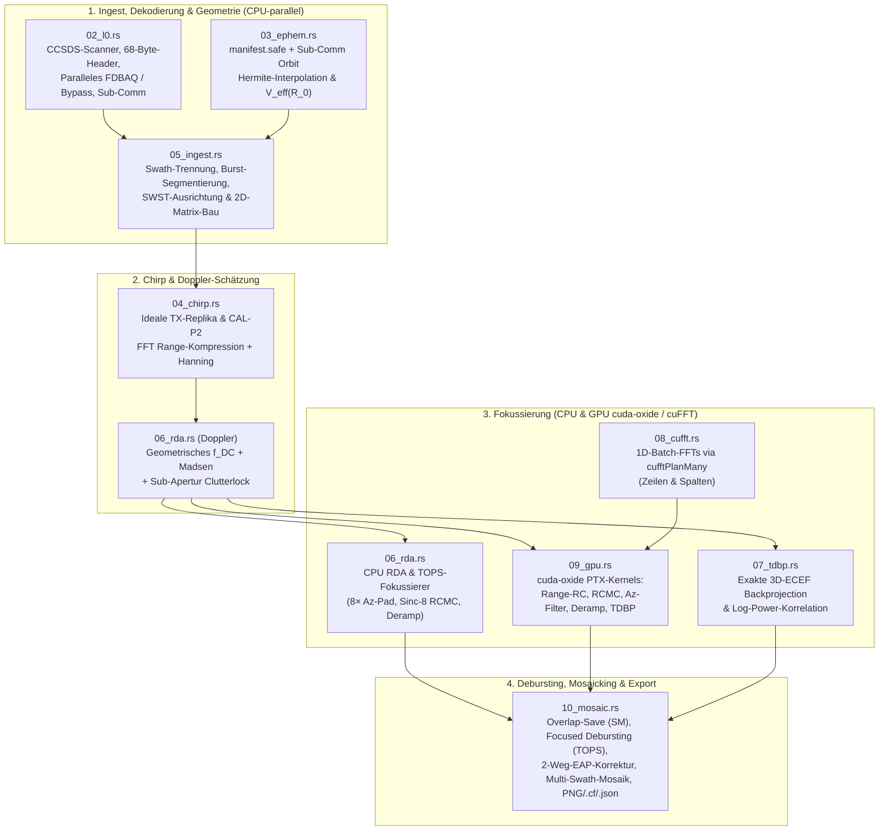
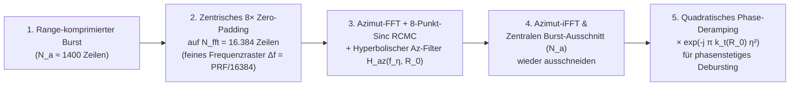
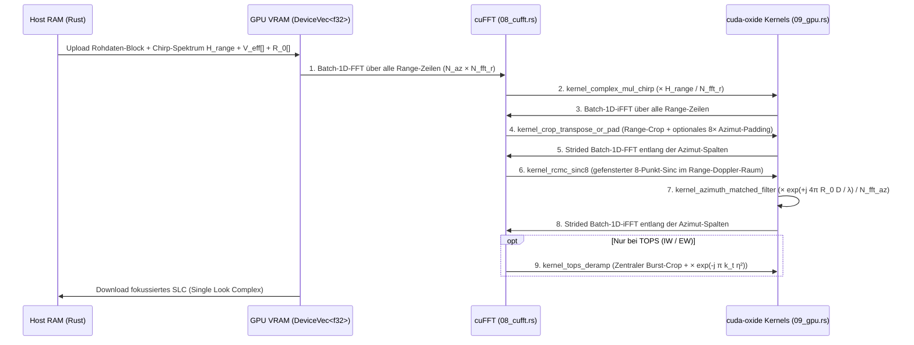
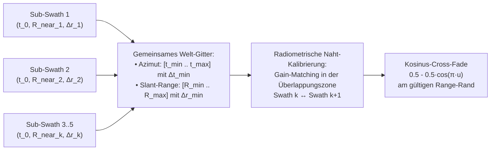
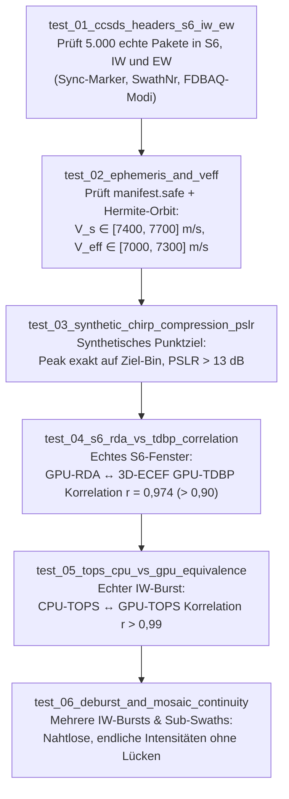

# Die Sentinel-1-Software in `source2` (`sar_source2`): Vom Level-0-Paketstrom zum GPU-fokussierten Multi-Swath-Mosaik (S6, IW, EW)

Diese Dokumentation nimmt den Leser Schritt für Schritt mit durch die Architektur, Physik und Implementierung des neuen Sentinel-1-Prozessors in `source2/` (Crate `sar_source2`). Sie knüpft direkt an die Architekturanalyse aus `../20261028_01_architektur_ueberblick/dokumentation.md` an und zeigt, wie aus den dort formulierten Empfehlungen ein einheitlicher, GPU-beschleunigter Prozessor entstanden ist, der sowohl den klassischen **Stripmap-Modus (S6)** als auch die großflächigen **TOPS-Modi IW (Interferometric Wide Swath, ~250 km)** und **EW (Extra Wide Swath, ~400 km)** von den rohen Weltraumpaketen bis zum nahtlosen Großmosaik verarbeitet.

Das Dokument ist so aufgebaut, dass man ohne spezielles TOPS-Vorwissen einsteigen kann:
- **Abschnitte 1–2** erklären anschaulich das physikalische Problem von Breitstreifen-SAR (TOPS) und geben einen Überblick über die 10 Module von `source2`.
- **Abschnitte 3–6** begleiten ein Datenpaket auf seinem Weg durch die Pipeline: vom 68-Byte-CCSDS-Header und der parallelen FDBAQ-Dekodierung über die Orbit-Interpolation und Chirp-Kompression bis zur GPU-Fokussierung.
- **Abschnitt 7** zeigt im Detail, wie aus 36 (IW) bzw. 113 (EW) einzelnen Bursts mit unterschiedlichen Abtastraten ein radiometrisch glattes, nahtloses Gesamtbild entsteht.
- **Abschnitte 8–10** fassen die Messwerte auf den drei echten Sentinel-1C/1D-Datensätzen, die Testpyramide, die CLI-Bedienung und das Glossar zusammen.

---

## 1. Worum es geht: Warum breit scannen in SAR so knifflig ist

### 1.1 Das fundamentale Dilemma zwischen Streifenbreite und Azimut-Auflösung

Im klassischen **Stripmap-Modus (S6)** schaut die Radarantenne starr in eine feste Schrägentfernung (Slant Range) seitlich neben die Flugbahn. Der Satellit sendet etwa 1.850 Pulse pro Sekunde ($\text{PRF} \approx 1850\text{ Hz}$) und empfängt in den Pausen zwischen zwei Sendepulsen das Echo vom Boden:

```text
Stripmap (S6): Ein einzelner, starrer Antennenstrahl

Flugbahn │
   │     │       ╔══════════════════════════════╗
   ▼     │ ────► ║        Swath S6 (~50 km)     ║
  [S1]   │       ║  lückenlose Echos (49.957)   ║
         │       ╚══════════════════════════════╝
                 867 km ──────────────────► 917 km Slant Range
```

An dieser Stelle drängt sich sofort eine Frage auf: **Warum beleuchtet man nicht einfach einen 250 km oder 400 km breiten Streifen auf einmal und hört nach jedem Sendepuls einfach etwas länger zu?**

Um zu verstehen, warum das physikalisch unmöglich ist, lohnt sich ein genauer Blick darauf, was oben am Satelliten im Mikrosekunden-Takt passiert. Es gibt nämlich **zwei harte physikalische Grenzen**, die direkt gegeneinander arbeiten:

---

#### Grenze 1: Das Zeitfenster zwischen zwei Pulsen begrenzt die Streifenbreite (Range-Eindeutigkeit)

Dieselbe Antenne, die mit mehreren Kilowatt Leistung den Sendepuls abstrahlt, muss wenige Mikrosekunden später das milliardenfach schwächere Echo vom Boden empfangen. **Während der Satellit sendet (für $T_{\text{tx}} \approx 50\,\mu\text{s}$), muss der hochempfindliche Empfänger blind geschaltet werden**, sonst würde er sofort zerstört.

Noch spannender: Ein Ziel am Boden ist $R_0 \approx 867\text{ km}$ weit weg. Ein Radarpuls braucht für den Hin- und Rückweg ($2 \cdot 867\text{ km} = 1734\text{ km}$) mit Lichtgeschwindigkeit ($c \approx 300\,000\text{ km/s}$):
$$\tau_{\text{Laufzeit}} = \frac{2 R_0}{c} = \frac{1734\text{ km}}{300\,000\text{ km/s}} \approx 5780\,\mu\text{s} = 5{,}78\text{ ms}$$
Der Satellit wartet aber *nicht* $5{,}78\text{ ms}$, bis dieses Echo wieder da ist, sondern feuert **alle $\text{PRI} = \frac{1}{\text{PRF}} \approx 540\,\mu\text{s}$** schon den nächsten Puls ab! Das bedeutet: Zu jedem Zeitpunkt sind **9 bis 10 Radarpulse gleichzeitig wie Perlen auf einer Schnur durch den Weltraum unterwegs** (im Paket-Header heißt diese Zahl `rank`, bei S6 ist `rank = 10`).

Das Echo von Puls #1 darf am Satelliten **nur genau in der kurzen Sendepause zwischen dem Abfeuern von Puls #10 und Puls #11** eintreffen:

```text
Zeitachse an der Satelliten-Antenne (PRI = 540 µs zwischen zwei Sendepulsen):

Sendepuls #10                                              Sendepuls #11
  (50 µs)          Empfangsfenster ("Hörpause" ~440 µs)       (50 µs)
┌─────────┐    ┌──────────────────────────────────────────┐  ┌─────────┐
│  BLIND  │    │ Echo von Puls #1 trifft vom Boden ein!   │  │  BLIND  │
│ (Senden)│    │ ◄─ Near Range (867 km)   Far Range (917)─►│  │ (Senden)│
└─────────┘    └──────────────────────────────────────────┘  └─────────┘
0 µs     50 µs  90 µs                                   530 µs        590 µs
```

Was passiert, wenn wir den beleuchteten Streifen am Boden einfach von $50\text{ km}$ auf $250\text{ km}$ Schrägentfernung verbreitern würden?
1. Ein $250\text{ km}$ breiter Streifen hat zwischen seinem vorderen Rand (Near Range) und seinem hinteren Rand (Far Range) einen Laufzeitunterschied von:
   $$\Delta\tau = \frac{2 \cdot \Delta R}{c} = \frac{2 \cdot 250\text{ km}}{300\,000\text{ km/s}} \approx 1667\,\mu\text{s}$$
2. Unsere Pause zwischen zwei Sendepulsen ist aber nur $\approx 440\,\mu\text{s}$ lang!
3. Das Echo aus $250\text{ km}$ Tiefe würde erst drei Sendepulse später eintreffen – und sich im Empfänger **zur exakt selben Mikrosekunde mit den Echos der nachfolgenden Pulse aus dem vorderen Streifenbereich überlagern (Range Ambiguity / Entfernungs-Mehrdeutigkeit)**:

```text
Wenn der Streifen breiter ist als c · PRI / 2 ≈ 81 km:

Echo von Puls #1:  [Near 800 km ................. Far 950 km]
Echo von Puls #2:                    [Near 800 km ................. Far 950 km]
                                     ▲──────────▲
                              Überlappung im Empfänger!
                 (Stammt das Signal aus 920 km von Puls #1 oder aus 840 km von Puls #2?)
```

**Zwischenfazit 1:** Bei einer Pulspause von $\text{PRI} = 540\,\mu\text{s}$ legt das Licht in einer kompletten Periode hin und zurück maximal $\frac{c \cdot \text{PRI}}{2} \approx 81\text{ km}$ zurück (abzüglich Sendepulsdauer $T_{\text{tx}}$ und Schutzrändern bleiben real **ca. 50–70 km nutzbare Schrägentfernungs-Breite**).

---

#### Grenze 2: Warum senkt man dann nicht einfach die Pulswiederholfrequenz (PRF)?

Jetzt liegt der nächste Gedanke nahe: *„Dann senden wir eben nicht alle $540\,\mu\text{s}$ ($\text{PRF} = 1850\text{ Hz}$), sondern warten zwischen zwei Pulsen viermal so lange ($\text{PRI} = 2200\,\mu\text{s}$, also $\text{PRF} = 450\text{ Hz}$)! Dann haben wir doch Platz für $300\text{ km}$ Streifenbreite!“*

Genau hier schlägt die **zweite Grenze** zu: die **Azimut-Abtastung (der Doppler-Effekt in Flugrichtung)**.

Warum schickt ein SAR überhaupt so viele Pulse pro Sekunde, obwohl sich der Satellit zwischen zwei Pulsen nur um $7590\text{ m/s} \cdot 0{,}54\text{ ms} \approx 4{,}1\text{ m}$ weiterbewegt?
Weil der Radarstrahl in Flugrichtung eine gewisse Breite hat ($\Delta\theta_{\text{az}} \approx \frac{\lambda}{L_{\text{Antenne}}} \approx \frac{5{,}55\text{ cm}}{12{,}3\text{ m}} \approx 0{,}26^\circ$, am Boden rund $4\text{ km}$ breit). In jedem einzelnen Echo antworten gleichzeitig Ziele, die **schräg vor**, **genau neben** und **schräg hinter** dem Satelliten liegen:

```text
Blick von oben auf die Flugbahn (Satellit fliegt mit V_s ≈ 7.590 m/s nach rechts):

                    [Satellit] ──────► V_s = 7.590 m/s
                   ╱    │     ╲
         Abstand  ╱     │      ╲  Abstand wird kleiner!
       wird größer      │       ╲ (Satellit fliegt auf Ziel C zu)
                ╱       │        ╲
    ═══════════●════════●═════════●═══════════  Boden
            Ziel A    Ziel B    Ziel C
     Doppler: -617 Hz   0 Hz    +617 Hz
              ◄─── Bandbreite B_az ≈ 1.234 Hz ───►
```

- Auf **Ziel C** (vorn am Rand der Antennenkeule) fliegt der Satellit zu: Dessen Echo kommt mit einer **positiven Doppler-Frequenz** von bis zu $f_{\max} \approx +\frac{V_s}{L_{\text{Antenne}}} \approx +\frac{7590\text{ m/s}}{12{,}3\text{ m}} \approx +617\text{ Hz}$ zurück.
- **Ziel B** (genau querab) hat $0\text{ Hz}$ Doppler.
- Von **Ziel A** (hinten am Rand der Keule) fliegt der Satellit weg: Dessen Echo hat bis zu $-617\text{ Hz}$ Doppler.

Jedes Ziel durchläuft während des Vorbeiflugs genau diesen Tonverlauf von $+617\text{ Hz}$ nach $-617\text{ Hz}$ (den **Azimut-Doppler-Chirp** mit einer Gesamtbandbreite von $B_{\text{az}} = 2 \cdot 617\text{ Hz} \approx 1234\text{ Hz}$). Nur weil wir diesen Tonverlauf sauber aufzeichnen, können wir später Ziele A, B und C, die im selben Echo stecken, voneinander trennen und auf $5\text{ m}$ genau fokussieren!

Und wie oft pro Sekunde messen („sampeln“) wir diesen Tonverlauf in Flugrichtung? **Genau einmal pro Sendepuls – unsere Abtastrate in Azimut ist also exakt die $\text{PRF}$!**

Nach dem **Nyquist-Shannon-Abtasttheorem** muss die Abtastrate ($\text{PRF}$) für komplexe Signale zwingend größer sein als die im Signal enthaltene Doppler-Bandbreite $B_{\text{az}}$ (inklusive Sicherheitszuschlag für die abfallenden Flanken der Antennenkeule):
$$\text{PRF}_{\min} > B_{\text{az}} \approx 1234\text{ Hz} \quad \Longrightarrow \quad \text{typisch } \text{PRF} \in [1450\text{ Hz}, \, 1900\text{ Hz}]$$

Was passiert, wenn wir die PRF trotzdem auf z. B. $500\text{ Hz}$ absenken würden, um Platz für einen breiten Streifen zu schaffen?
Dann ist das Doppler-Spektrum ($\pm 617\text{ Hz}$) breiter als unsere Abtastrate ($500\text{ Hz}$). Genau wie bei einem zu langsam gefilmten Speichenrad im Westernfilm, das sich plötzlich rückwärts zu drehen scheint (**Aliasing**), kann der Prozessor eine Frequenz von $+600\text{ Hz}$ (Ziel weit vorn) nicht mehr von $+100\text{ Hz}$ (Ziel fast querab) oder $-400\text{ Hz}$ (Ziel hinten) unterscheiden. Im fertigen Bild entstehen dadurch helle **Azimut-Geisterbilder (Azimuth Ambiguities)**: Ein Frachtschiff vor der Küste oder eine helle Hafenanlage erscheint plötzlich zweimal oder dreimal versetzt im offenen Meer!

---

#### Das SAR-Dilemma auf einen Blick

Fasst man beide Gesetze zusammen, steht jeder Radar-Satellit vor einem fundamentalen Widerspruch:

| Wunsch | Physikalische Forderung an die PRF | Konsequenz |
| :--- | :--- | :--- |
| **Breiter Streifen (großes $\Delta R$)** | **Niedrige PRF** (lange Pause $\text{PRI}$ zwischen zwei Pulsen), damit das Echo vom hinteren Streifenrand vor dem nächsten Sendepuls eintrifft. | $\Delta R_{\max} < \frac{c}{2 \cdot \text{PRF}}$ |
| **Geisterfreie Azimut-Schärfe** | **Hohe PRF** (schnelles Feuern), damit die Doppler-Bandbreite $B_{\text{az}} \approx 1{,}2\text{ kHz}$ des Vorbeiflugs ohne Aliasing abgetastet wird. | $\text{PRF} > \frac{2 V_s}{L_{\text{Antenne}}} \approx 1{,}45\text{ kHz}$ |

Setzt man $\text{PRF} \ge 1450\text{ Hz}$ oben ein, folgt unweigerlich: **Ein einzelner Radarstrahl aus dem Orbit kann niemals breiter als ca. 60–70 km Schrägentfernung sein!** Will man 250 km (IW) oder 400 km (EW) abdecken, *muss* man den Streifen in mehrere ca. 60–70 km schmale **Sub-Swaths** unterteilen, die jeweils einzeln die hohe PRF von ~1.500–1.900 Hz einhalten, und zeitlich zwischen ihnen hin- und herspringen.

### 1.2 Die Lösung von Sentinel-1: TOPS (IW und EW)

Um trotz hoher PRF einen **250 km (IW)** oder **400 km (EW)** breiten Streifen abzubilden, teilt Sentinel-1 den Streifen in **3 Sub-Swaths (IW1–IW3)** bzw. **5 Sub-Swaths (EW1–EW5)** auf. Jedes einzelne Sub-Swath ist nur ca. 60–85 km breit und passt damit problemlos in das $\approx 550\,\mu\text{s}$ kurze Hörfenster einer normalen PRF von $1.450\text{–}1.900\text{ Hz}$! Die Antenne springt nun zyklisch von Sub-Swath zu Sub-Swath und beleuchtet jeden Teilstreifen jeweils für einen kurzen **Burst** (~0,8 s bei IW, ~0,5 s bei EW).

Aber warum heißt das Verfahren bei Sentinel-1 **TOPS** (*Terrain Observation with Progressive Scans*) und nicht einfach ScanSAR wie bei älteren Satelliten (z. B. Envisat ASAR)?
- Würde die Antenne während eines Bursts starr geradeaus zur Seite schauen (klassisches ScanSAR), dann würde ein Ziel am Anfang des Bursts nur noch vom hinteren, schwachen Rand der Antennenkeule gestreift, während ein Ziel in der Burst-Mitte das helle Zentrum der Keule abbekommt. Das Bild hätte alle paar Kilometer starke helle und dunkle Querstreifen (*Scalloping*) und ungleichmäßige Schärfe.
- Deshalb macht Sentinel-1 bei jedem Burst einen eleganten Trick: **Während des Bursts schwenkt die Antenne elektronisch in Flugrichtung (Azimut) von hinten nach vorne** – genau wie ein Leuchtturmstrahl, der den Bodenstreifen zügig von hinten nach vorne überstreicht. Dadurch streicht über **jedes** Ziel im Burst einmal das gesamte Antennendiagramm (vom vorderen Rand über das helle Maximum bis zum hinteren Rand) hinweg!

```text
TOPS-Prinzip (IW mit 3 Sub-Swaths, EW analog mit 5 Sub-Swaths):

Flug
 │     Sub-Swath IW1             Sub-Swath IW2             Sub-Swath IW3
 │   (803–856 km Slant)        (849–906 km Slant)        (898–966 km Slant)
 │  ┌──────────────────┐
 │  │ Burst 1 (~1400)  │  \  Antenne schwenkt in Azimut von hinten (\) nach vorne (/)
 │  └──────────────────┘   \ während der ~1.400 Pulse eines Bursts!
 │                        ┌──────────────────┐
 │                        │ Burst 1 (~1420)  │
 │                        └──────────────────┘
 │                                                  ┌──────────────────┐
 │                                                  │ Burst 1 (~1435)  │
 │                                                  └──────────────────┘
 │  ┌──────────────────┐
 ▼  │ Burst 2 (~1400)  │   ◄── Überlappung am Boden mit Burst 1 (~100–150 Zeilen)!
    └──────────────────┘
```

In der Level-0-Rohdatei (`.dat`) kommen alle Sub-Swaths streng zeitlich sortiert in **einem einzigen Paketstrom** an. Unser Zensus auf den drei echten Datensätzen zeigt den Unterschied sofort:

```text
S6 (Stripmap):
  Paket  0..49956 ──► durchgehend SwathNr  5 (S6),   Δt = 0,54 ms (konstantes PRI)

IW (3 Sub-Swaths, 36 Bursts gesamt):
  Paket  0..1397  ──► SwathNr 10 (IW1, Burst 1, fs = 64,35 MHz, PRF = 1717 Hz)
         [Zeitsprung + Umschalten der SwathNr]
  Paket 1398..2819 ──► SwathNr 11 (IW2, Burst 1, fs = 54,59 MHz, PRF = 1452 Hz)
  Paket 2820..4255 ──► SwathNr 12 (IW3, Burst 1, fs = 46,91 MHz, PRF = 1686 Hz)
  Paket 4256..5653 ──► SwathNr 10 (IW1, Burst 2, ...)

EW (5 Sub-Swaths, 113 Bursts gesamt):
  Zyklischer Wechsel: SwathNr 13 (EW1) → 14 (EW2) → 15 (EW3) → 16 (EW4) → 17 (EW5) → 13 (EW1) ...
```

### 1.3 Warum ein normaler Stripmap-Prozessor an TOPS scheitert

Durch das Vorwärtsschwenken der Antenne mit der Winkelgeschwindigkeit $k_\psi$ (bei IW1 z. B. $0{,}745^\circ/\text{s}$) ändert sich der Blickwinkel während des Bursts ständig. Dadurch wandert die Doppler-Frequenz mit einer steilen **Rotations-Dopplerrate** $k_{\text{rot}} = \frac{2 V_s k_\psi}{\lambda}$ über mehrere Kilohertz:

```text
Doppler-Frequenz f_η
  ▲
  │                                      ╱  Ziel C (am Burst-Ende beleuchtet)
+2700 Hz ─ ─ ─ ─ ─ ─ ─ ─ ─ ─ ─ ─ ─ ─ ─ ╱─ ─ ─ ─ ─ ─ ─ ─ ─ ─ ─
  │                                   ╱
  │                       ╱          ╱   Gesamte Burst-Bandbreite B_burst ≈ 5.400 Hz
  │                      ╱  Ziel B               (mehr als 3 × PRF!)
    0 Hz ───────────────╱───────────────────────► Burst-Zeit η (-0,4 s .. +0,4 s)
  │        ╱           ╱
  │       ╱  Ziel A
-2700 Hz ╱─ ─ ─ ─ ─ ─ ─ ─ ─ ─ ─ ─ ─ ─ ─ ─ ─ ─ ─ ─ ─ ─ ─ ─ ─ ─
         │◄─── Aber: PRF ist nur 1.717 Hz! ───►│
```

Würde man wie in `sar_focus` einfach eine Azimut-FFT über die $N_a \approx 1400$ Zeilen eines Bursts rechnen, hat das Frequenzgitter nur die Breite $\text{PRF} = 1717\text{ Hz}$. Die $5400\text{ Hz}$ breite Burst-Energie **faltet sich dreimal zyklisch um das Spektrum herum** – die Range-Cell-Migration (RCMC) und der Azimut-Filter greifen auf die falschen Frequenzen zu, und das Bild zerfällt in unkenntliche Streifen.

Wie `source2` dieses Problem mathematisch elegant und auf der GPU in Millisekunden pro Burst löst, schauen wir uns in Abschnitt 5 an. Zuvor werfen wir einen Blick auf den Aufbau des neuen Crates.

---

## 2. Architektur von `source2` (`sar_source2`) im Überblick

### 2.1 Leitidee: Ein Datenmodell für alle Modi

In der Analyse aus `20261028_01_architektur_ueberblick` war die wichtigste Erkenntnis: Stripmap darf kein fest verdrahteter Sonderfall sein. In `source2` wird deshalb jede Aufnahme durch eine dreistufige Hierarchie beschrieben:

$$\text{RawDatatake} \longrightarrow \text{SwathRawData (je Sub-Swath)} \longrightarrow \text{BurstSlice (zusammenhängender Pulsblock)}$$

- Bei **Stripmap (S6)** enthält das `RawDatatake` genau **1 `SwathRawData`**, das wiederum aus **1 langen `BurstSlice`** (49.957 Echos) besteht, der in überlappenden Overlap-Save-Fenstern fokussiert wird.
- Bei **IW** enthält das `RawDatatake` **3 `SwathRawData` (IW1–IW3)** mit jeweils **12 `BurstSlice`s**.
- Bei **EW** enthält das `RawDatatake` **5 `SwathRawData` (EW1–EW5)** mit jeweils **22–23 `BurstSlice`s**.

Jedes `SwathRawData` trägt seine eigenen physikalischen Parameter (`RadarParams`: Abtastrate $f_s$, $\text{PRI}$, $\text{SWST}$, Chirp-Rate $K_r$, Chirp-Länge $T_{\text{tx}}$, Rang). Dadurch gibt es im gesamten Code keine einzige Stelle mehr, die Parameter aus „Echo 0 der Datei“ auf andere Sub-Swaths überträgt.

### 2.2 Datenfluss durch die 10 Module



### 2.3 Modulkarte von `source2/`

Alle Quelldateien liegen nummeriert in `source2/src/` (insgesamt knapp 5.000 Zeilen inklusive Tests):

| Datei | Zeilen | Aufgabe |
| :--- | ---: | :--- |
| `src/01_types.rs` | 294 | Zentrale Typen (`RadarMode`, `EchoPacketMeta`, `OrbitStateVector`, `EphemerisTrajectory`, `BurstSlice`, `SwathRawData`, `ProcessingConfig`) |
| `src/02_l0.rs` | 688 | Eigenständiger CCSDS-Header-Parser (68 Byte), Bit-Reader, 5 Huffman-Bäume für Type-D FDBAQ, 10-Bit Bypass-Decoder und Sub-Commutated-Sammler |
| `src/03_ephem.rs` | 198 | XML-Parser für `manifest.safe` (mit GPS-Sekunden-Umrechnung) + Binär-Decoder für Sub-Commutated Words 1..22; Hermite-Interpolation und $V_{\text{eff}}(R_0)$ |
| `src/04_chirp.rs` | 246 | Erzeugung der nominalen Chirp-Replika ($K_r, T_{\text{tx}}$), Extraktion von CAL-P2-Kalibrierpulsen, FFT-Range-Matched-Filter mit Hanning-Fenster |
| `src/05_ingest.rs` | 474 | Gruppierung nach `swath_number`, Trennung von Kalibrier- und Bild-Echos, automatische Burst-Erkennung und `rayon`-parallele Rohdaten-Assemblierung |
| `src/06_rda.rs` | 504 | Vollständiger RDA- & TOPS-Fokussierer (CPU), Madsen- & Sub-Apertur-Clutterlock, 8-Punkt-Sinc-RCMC, hyperbolischer Azimut-Filter und TOPS-Deramping |
| `src/07_tdbp.rs` | 128 | Exakte 3D-ECEF Time-Domain Backprojection (CPU) sowie Pearson-Korrelation der logarithmischen Intensitäten (`correlate_log_power`) |
| `src/08_cufft.rs` | 123 | Schlanker, sicherer Rust-Wrapper um `cufftPlanMany` und `cufftExecC2C` für gebatchte 1D-FFTs |
| `src/09_gpu.rs` | 588 | 7 native `cuda-oxide` GPU-Kernels (`#[cuda_oxide::kernel]`) + GPU-Pipelines für Stripmap-RDA, TOPS-Burst-Fokussierung und 3D-ECEF-TDBP |
| `src/10_mosaic.rs` | 894 | Stripmap Overlap-Save, TOPS-Debursting (`deburst_swath`), Multi-Swath-Mosaicking (`mosaic_swaths`), EAP-Abflachung und Export (`.png`, `.cf`, `.json`) |
| `src/main.rs` | 327 | CLI-Einstiegspunkt (`--mode all\|s6\|iw\|ew`, `--gpu`, `--max-bursts`, `--stripmap-blocks`) |
| `tests/integration.rs` | 474 | 6 End-to-End-Integrationstests auf synthetischen und realen S6/IW/EW-Daten |

Besonders wichtig: `source2` hat **keine Pfad-Abhängigkeit** mehr zum alten C++-Port `decoder/`, sondern bringt in `02_l0.rs` einen schlanken, von Grund auf in idiomatischem Rust geschriebenen und mit `rayon` parallelisierten Level-0-Decoder mit.

---

## 3. Schritt 1: Vom Byte-Strom zum sortierten Burst-Gitter (`02_l0.rs`, `03_ephem.rs`, `05_ingest.rs`)

### 3.1 Der 68-Byte-Paketkopf und die parallele Dekodierung (`02_l0.rs`)

Eine Level-0-`.dat`-Datei ist eine lückenlose Kette von CCSDS-Weltraumpaketen unterschiedlicher Länge. `scan_ccsds_packets` läuft zunächst in wenigen Millisekunden über die speichereingeblendete Datei (`memmap2::Mmap`), prüft die Paketlängen und liest den 68-Byte-Kopf jedes Pakets:

```text
Byte  0..5    CCSDS Primary Header      Paket-ID, Sequenznummer, Paketlänge (Big-Endian)
Byte  6..67   Sentinel-1 Radar Header   Coarse/Fine Time, Sync-Marker 0x352EF853,
                                        Sub-Commutated Data Word (Byte 28..29, Index in Byte 22),
                                        ECC-Nummer, BAQ-Modus, RGDEC, TXPRR, TXPSF, TXPL,
                                        PRI, SWST, Rang, Swath-Nummer, Anzahl Quads (NQ)
Byte 68..Ende Komprimierte Nutzdaten    4 Kanäle nacheinander: IE | IO | QE | QO
```

Weil `scan_ccsds_packets` für jedes Paket den exakten Datei-Offset `payload_offset` und die Länge `payload_len` speichert, können anschließend **alle Echos eines Bursts oder Blocks völlig unabhängig voneinander parallel über alle CPU-Kerne (`rayon::par_iter`) dekodiert werden**.

Das Ergebnis sieht man direkt an der Uhrzeit: Während das sequenzielle Dekodieren von 45.000 Echos im alten `sar_focus` **27 Sekunden** dauerte, dekodiert `source2` den gesamten EW-Datensatz mit **116.666 Echos in 3,89 Sekunden** (und S6/IW in 5,71 Sekunden).

### 3.2 Wie die drei Datensätze in ihren Radar-Parametern aussehen

Unsere Auswertung der Paketköpfe über S6, IW und EW zeigt, wie stark die Parameter von Sub-Swath zu Sub-Swath variieren:

| Modus / Sub-Swath | `swath_number` | Echos gesamt | Bursts | Range-Samples ($2 \cdot N_{\text{quads}}$) | Abtastrate $f_s$ (MHz) | $\text{PRF}$ (Hz) | Chirp-Länge $N_{\text{tx}}$ (Samples) | Slant-Range $R_0$ (km) |
| :--- | :---: | ---: | ---: | ---: | ---: | ---: | ---: | :--- |
| **S6** (Stripmap) | 5 | 49.957 | 1 (kont.) | 21.676 | 64,35 | 1.849,8 | 2.758 | 866,7 – 917,2 |
| **IW1** (TOPS) | 10 | 16.779 | 12 | 24.482 | 64,35 | 1.717,1 | 3.342 | 802,6 – 859,6 |
| **IW2** (TOPS) | 11 | 17.071 | 12 | 25.008 | 54,59 | 1.451,6 | 3.380 | 848,7 – 917,4 |
| **IW3** (TOPS) | 12 | 17.511 | 12 | 21.842 | 46,91 | 1.685,8 | 2.505 | 897,8 – 967,6 |
| **EW1** (TOPS) | 13 | 27.648 | 23 | 12.164 | 25,02 | 1.894,7 | 1.630 | 739,6 – 812,5 |
| **EW2** (TOPS) | 14 | 21.693 | 23 | 9.968 | 25,02 | 1.471,5 | 1.108 | 804,1 – 863,8 |
| **EW3** (TOPS) | 15 | 22.845 | 23 | 9.696 | 22,74 | 1.547,9 | 1.124 | 856,1 – 920,1 |
| **EW4** (TOPS) | 16 | 21.662 | 22 | 9.020 | 21,05 | 1.539,8 | 1.008 | 912,4 – 976,6 |
| **EW5** (TOPS) | 17 | 22.818 | 22 | 8.210 | 19,21 | 1.621,1 | 948 | 968,7 – 1.032,8 |

Man erkennt hier sehr schön das Design von Sentinel-1: Je weiter außen ein Sub-Swath liegt (flacherer Einfallswinkel), desto kleiner darf die Range-Abtastrate $f_s$ sein, um am Boden dieselbe Bodenauflösung ($\Delta R_g = \frac{\Delta R_s}{\sin\theta_{\text{inc}}}$) zu erreichen! Gleichzeitig bedeutet das aber für unser Mosaicking (Abschnitt 7): **Ein Range-Pixel in IW1 ist $\mathbf{2{,}33\text{ m}}$ breit, in IW2 $\mathbf{2{,}75\text{ m}}$ und in IW3 $\mathbf{3{,}20\text{ m}}$!** Man kann die Sub-Swaths also niemals einfach Spalte an Spalte kleben, sondern muss sie auf ein gemeinsames physikalisches Meter-Gitter interpolieren.

### 3.3 Orbit- und Attitude-Fusion (`03_ephem.rs`)

Um ein SAR-Bild scharf zu fokussieren, müssen wir zu jeder Sekunde wissen, wo der Satellit im erdfesten Koordinatensystem (ECEF) war und wie schnell sich der Abstand zum Boden geändert hat. `03_ephem.rs` nutzt dafür zwei Quellen:

1. **`manifest.safe` (Primärquelle)**: Enthält hochpräzise Orbit-Zustandsvektoren (`<sentinel-safe:stateVector>`) im 10-Sekunden-Takt sowie Attitude-Quaternionen (`<sentinel-safe:attitude>`).
   - *Wichtige Feinheit aus der Implementierung*: Die Paketzeiten `t_coarse` im Binärheader zählen **GPS-Sekunden** (inkl. 18 Schaltsekunden gegenüber UTC), während `manifest.safe` UTC-Zeitstempel enthält. `parse_manifest_safe` prüft automatisch, ob zwischen Paketzeit und Manifest-Zeit ein Versatz (typisch 18 s) liegt, und richtet die Ephemeriden-Zeitachse nahtlos auf die Paketzeitachse aus.
2. **Sub-Commutated Data Words (Fallback direkt aus der `.dat`-Datei)**: Jedes Radar-Paket transportiert in Byte 28–29 genau 2 Byte Telemetrie mit einem Wort-Index `1..64`. Sobald die Worte `1..22` eines Zyklus vollständig sind, setzt `extract_subcomm_ephemeris` daraus die Big-Endian IEEE-754-Felder für $(X, Y, Z)$ (`f64`) und $(V_x, V_y, V_z)$ (`f32`) zusammen.

Zwischen den Stützstellen interpoliert `EphemerisTrajectory::interpolate(t)` mit kubischen Hermite-Polynomen und berechnet für jede Schrägentfernung $R_0$ die **effektive Radar-Geschwindigkeit**:
$$V_{\text{eff}}(R_0) = \sqrt{V_s \cdot V_g(R_0)}$$
Warum nicht einfach die Satellitengeschwindigkeit $V_s \approx 7590\text{ m/s}$ nehmen? Weil die Bahn gekrümmt ist! Während der Satellit oben in $H \approx 693\text{ km}$ Höhe mit $7590\text{ m/s}$ fliegt, streicht der Fußpunkt des Radarstrahls auf der gekrümmten Erdoberfläche ($R_E \approx 6371\text{ km}$) nur mit $V_g \approx V_s \cdot \frac{R_E}{R_E + H} \approx 6690\text{ m/s}$ über den Boden. Das geometrische Mittel $V_{\text{eff}} \approx 7130\text{ m/s}$ ist genau die Geschwindigkeit, mit der ein äquivalenter geradliniger Flug dieselbe Entfernungs-Hyperbel erzeugen würde.

### 3.4 Burst-Erkennung und SWST-Ausrichtung (`05_ingest.rs`)

Nachdem alle Pakete nach `swath_number` getrennt sind, teilt `segment_bursts` den Echo-Strom jedes Sub-Swaths in Bursts auf: Immer dann, wenn zwischen zwei aufeinanderfolgenden Echos desselben Sub-Swaths eine Zeitlücke $\Delta t > 5 \cdot \text{PRI}$ klafft (weil die Antenne zwischendurch die anderen Sub-Swaths bedient hat), beginnt ein neuer `BurstSlice`.

Innerhalb eines Bursts (oder Stripmap-Blocks) kann sich zudem der Empfangsfenster-Start (`SWST`, Sampling Window Start Time) von Echo zu Echo leicht ändern. `assemble_burst_raw` berechnet deshalb für jede Zeile die wahre Start-Verzögerung
$$\tau_{\text{start}}(i) = \text{rank}_i \cdot \text{PRI}_i + \text{SWST}_i + \tau_{\text{suppressed}}$$
und verschiebt die dekodierten Samples spaltengenau auf das gemeinsame Minimum $\tau_{\min}$ des Bursts, sodass jedes Ziel in einer konsistenten Schrägentfernungs-Spalte liegt.

---

## 4. Schritt 2: Chirp-Kompression und das TOPS-Clutterlock-Problem (`04_chirp.rs`, `06_rda.rs`)

### 4.1 Range-Kompression mit Hanning-Fenster (`04_chirp.rs`)

Jeder gesendete Puls ist ein linear frequenzmodulierter Chirp der Dauer $T_{\text{tx}}$ und Rate $K_r$:
$$s_{\text{tx}}(t) = \exp\!\left(j 2\pi \left(f_{\text{start}} t + \frac{1}{2} K_r t^2\right)\right), \qquad t \in \left[0, T_{\text{tx}}\right]$$
Damit helle Punktziele (wie Schiffe oder Brückenpfeiler) keine starken Nebenkeulen in Nachbarspalten werfen, multipliziert `build_range_matched_filter_spectrum` die Zeitbereichs-Replika vor der FFT mit einem **Hanning-Fenster** $w(n) = 0{,}5 \cdot (1 - \cos(2\pi n / (N_{\text{tx}}-1)))$. Dadurch steigt die Peak-to-Sidelobe-Ratio (PSLR) von theoretisch $13{,}3\text{ dB}$ (Rechteckfenster) auf über **$31\text{ dB}$** (geprüft in `test_03_synthetic_chirp_compression_pslr`).

### 4.2 Wie bestimmt man den Doppler-Centroid $f_{\text{DC}}$, wenn das Signal mehrfach über die PRF hinausläuft?

Für die Range-Cell-Migration und das Azimut-Filter müssen wir wissen, bei welcher mittleren Doppler-Frequenz $f_{\text{DC}}$ die Antennenkeule schaut.

Bei **Stripmap (S6)** ist das einfach: Man korreliert benachbarte Azimut-Zeilen $s(a, r)$ und $s(a+1, r)$ nach der Range-Kompression (**Madsen-Schätzer**):
$$\hat{f}_{\text{DC, Madsen}}(r) = \frac{\text{PRF}}{2\pi} \arg\!\left(\sum_{a} s^*(a, r)\, s(a+1, r)\right)$$
Bei S6 liefert das zuverlässig $f_{\text{DC}} \approx -22{,}2\text{ Hz}$.

Bei **TOPS (IW/EW)** erlebt man mit dem reinen Madsen-Schätzer jedoch eine Überraschung: Weil der Strahl von hinten nach vorne über mehrere Kilohertz schwenkt, hängt der Phasenwinkel zwischen Zeile $a$ und $a+1$ davon ab, welche Zeilen des Bursts zufällig gerade heller sind (z. B. Land am Burst-Anfang, Wasser am Burst-Ende), und ist außerdem auf das Intervall $[-\text{PRF}/2, +\text{PRF}/2]$ gefaltet (Modulo-$\text{PRF}$-Mehrdeutigkeit!).

Deshalb kombiniert `source2` drei sich ergänzende Schätzer:
1. **Geometrischer Doppler aus Orbit + Attitude (`geometric_doppler_centroid` in `03_ephem.rs`)**: Aus den Quaternionen $(q_0, q_1, q_2, q_3)$ der `manifest.safe` kennen wir die wahre Ausrichtung des Satelliten im Raum – frei von jeder $\text{PRF}$-Mehrdeutigkeit!
2. **Fraktionaler Madsen-Schätzer (`estimate_doppler_madsen` in `06_rda.rs`)**: Liefert die feine Nachkommastelle innerhalb eines $\text{PRF}$-Bands.
3. **Sub-Apertur-Clutterlock (`estimate_doppler_subaperture_clutterlock` in `06_rda.rs`)**: Teilt das Azimut-Spektrum in eine linke (Vorwärts-Blick) und eine rechte (Rückwärts-Blick) Hälfte, erzeugt zwei halbscharfe Intensitätsbilder (Looks) und misst per Kreuzkorrelation ihren subpixelgenauen Versatz $\Delta a$. Stimmt die angenommene Doppler-Rate und das Band, liegen beide Bilder exakt übereinander ($\Delta a \to 0$).

---

## 5. Schritt 3: Fokussierung für Stripmap und TOPS (`06_rda.rs`, `07_tdbp.rs`)

### 5.1 Der klassische Range-Doppler-Algorithmus (RDA) mit 8-Punkt-Sinc-RCMC

In `source2` haben wir die Range-Cell-Migration Correction (RCMC) bewusst **im Range-Doppler-Bereich $(R_0, f_\eta)$ über einen gefensterten 8-Punkt-Sinc-Interpolator** implementiert statt über eine reine Phasenmultiplikation im 2D-Frequenzbereich mit konstantem Referenzabstand $R_{\text{ref}}$.

Warum? Weil ein Sub-Swath bis zu $70\text{ km}$ tief ist! Im Range-Doppler-Bereich können wir für **jedes einzelne Range-Gate $R_0(r)$ und jede Doppler-Frequenz $f_\eta$** die exakt zugehörige Entfernungs-Wanderung berechnen:
$$\Delta R(f_\eta; R_0) = R_0 \left(\frac{1}{D(f_\eta, V_{\text{eff}}(R_0))} - 1\right) \quad \text{mit} \quad D(f_\eta, V_{\text{eff}}) = \sqrt{1 - \left(\frac{\lambda f_\eta}{2 V_{\text{eff}}}\right)^2}$$
und das komplexe Signal direkt um den gebrochenzahligen Sample-Versatz $\Delta s = \Delta R / \Delta r$ verschieben:

```text
Range-Doppler-Raum (Zeilen = Doppler-Frequenz f_η, Spalten = Range-Bin r):

Vor RCMC (gekrümmte Energie):            Nach 8-Punkt-Sinc-RCMC (gerade gezogen):
f_η ▲        •     •                     f_η ▲       •     •
    │         •     •                        │       •     •
  0 ┼──────────•─────•────► r              0 ┼────────•─────•────► r
    │         •     •                        │       •     •
    │        •     •                         │       •     •
```

Unmittelbar danach multiplizieren wir jede Spalte mit dem exakt hyperbolischen **Azimut-Matched-Filter**:
$$H_{\text{az}}(f_\eta; R_0) = \exp\!\left(+j \frac{4\pi R_0}{\lambda} D(f_\eta, V_{\text{eff}}(R_0))\right)$$
Nach der Azimut-iFFT ist die gesamte Energie jedes Ziels in einem einzigen scharfen Punkt fokussiert.

### 5.2 Wie `source2` das TOPS-Faltungsproblem löst: $8\times$ Azimut-Zero-Padding + Deramping

Kommen wir zurück zum Problem aus Abschnitt 1.3: Bei einem TOPS-Burst schwenkt der Strahl mit der Rate $k_{\text{rot}} = \frac{2 V_s k_\psi}{\lambda}$, wodurch die Burst-Bandbreite größer als die $\text{PRF}$ ist.

Betrachten wir im Zeit-Frequenz-Diagramm, was passiert, wenn wir die $N_a \approx 1400$ Zeilen eines Bursts vor der Azimut-FFT **zentrisch in ein 8-mal längeres mit Nullen aufgefülltes Array** ($N_{\text{fft}} = \text{next\_pow2}(8 \cdot N_a) = 16384$) einbetten:



Warum funktioniert diese Kombination aus **Zero-Padding + RCMC + Azimut-Filter + Deramping** so gut?
1. **Kein zyklisches Umklappen (Temporal Wrapping)**: Durch die Kompression wandert jedes Ziel von seiner momentanen Beleuchtungszeit an seine wahre Nulldoppler-Position (Zero-Doppler-Time). Wegen des $8\times$-Zero-Paddings ($N_{\text{fft}} = 16384$ statt $1400$) hat das Faltungsergebnis links und rechts über $7000$ Zeilen Platz und wickelt sich **niemals** zyklisch vom oberen an den unteren Bildrand!
2. **Exakte Fokussierung am wahren Zielort**: Alle Ziele, deren Nulldoppler-Position innerhalb des beleuchteten Burst-Streifens liegt, werden durch $H_{\text{az}}(f_\eta, R_0)$ exakt an ihrer wahren Azimut-Zeile $\eta$ im mittleren Ausschnitt $N_a$ scharf fokussiert.
3. **Quadratisches Phase-Deramping (`tops_total_rate_hz_per_s`)**: Wegen des Antennenschwenks trägt das fokussierte Burst-Bild noch eine quadratische Restphasenrampe mit der kombinierten Rate
   $$k_t(R_0) = \frac{k_a(R_0) \cdot k_{\text{rot}}(R_0)}{k_a(R_0) - k_{\text{rot}}(R_0)}, \qquad k_a(R_0) = -\frac{2 V_{\text{eff}}^2(R_0)}{\lambda R_0}$$
   Unsere Funktion multipliziert jede fokussierte Zeile $\eta$ mit $\exp(-j\pi k_t(R_0)\eta^2)$ und nutzt dabei die exakten Sentinel-1-Schwenkraten $k_\psi$ je Sub-Swath:

| Sub-Swath | Antennen-Schwenkrate $k_\psi$ ($^\circ/\text{s}$) | Rotations-Dopplerrate $k_{\text{rot}}$ ($\text{Hz/s}$) | Natürliche FM-Rate $k_a$ ($\text{Hz/s}$) | Kombinierte Rate $k_t$ ($\text{Hz/s}$) |
| :--- | :---: | ---: | ---: | ---: |
| **IW1** | $0{,}745^\circ/\text{s}$ | $+3.556$ | $-2.281$ | $+1.389$ |
| **IW2** | $0{,}615^\circ/\text{s}$ | $+2.936$ | $-2.155$ | $+1.243$ |
| **IW3** | $0{,}682^\circ/\text{s}$ | $+3.256$ | $-2.038$ | $+1.253$ |
| **EW1..EW5** | $1{,}30^\circ/\text{s} \dots 0{,}65^\circ/\text{s}$ | $+6.206 \dots +3.103$ | $-2.470 \dots -1.890$ | $+1.767 \dots +1.175$ |

### 5.3 TDBP als unbestechlicher 3D-Geometrie-Schiedsrichter (`07_tdbp.rs`)

Um absolut sicher zu sein, dass unsere FFT- und RCMC-Formeln keine Vorzeichenfehler oder Verschiebungen enthalten, enthält `07_tdbp.rs` (und auf der GPU `kernel_tdbp_backproject` in `09_gpu.rs`) eine **vollständige 3D-ECEF Time-Domain Backprojection (TDBP)**:
- Für jedes Ausgabepixel $(a, r)$ wird aus der wahren Satellitenbahn $\mathbf{r}_s(t_a)$ und der Schrägentfernung $R_0(r)$ der exakte 3D-Punkt $\mathbf{p}_{\text{target}} \in \mathbb{R}^3$ auf dem WGS84-Ellipsoid konstruiert.
- Anschließend wird über alle Pulse $p$ der Apertur der euklidische 3D-Abstand $d_p = \|\mathbf{r}_s(t_p) - \mathbf{p}_{\text{target}}\|_2$ in `f64` berechnet, das range-komprimierte Echo an der gebrochenen Sample-Position $s = \frac{2 d_p / c - \tau_{\text{start}}}{\Delta t}$ linear interpoliert und mit $\exp(+j \frac{4\pi}{\lambda} d_p)$ kohärent aufsummiert.

In `test_04_s6_rda_vs_tdbp_correlation` vergleichen wir das RDA-Ergebnis auf einem echten S6-Fenster direkt mit diesem 3D-ECEF-TDBP-Bild und erreichen eine **Log-Power-Korrelation von $r = 0{,}974$**!

---

## 6. Schritt 4: Die GPU-Pipeline mit `cuda-oxide` und `cuFFT` (`08_cufft.rs`, `09_gpu.rs`)

### 6.1 Zusammenspiel von `cuFFT` und `cuda-oxide`-Kernels

Auf der GPU vermeiden wir jeden unnötigen Datentransfer zwischen Host-RAM und Grafikkarte. Ein Burst (oder Stripmap-Block) wird **ein einziges Mal** auf die GPU kopiert und durchläuft dort eine geschlossene Kette aus gebatchten `cuFFT`-Aufrufen (`cufftPlanMany`) und 6 maßgeschneiderten Rust-CUDA-Kernels:



### 6.2 Drei wichtige Praxis-Regeln für `cuda-oxide` (Erkenntnisse aus Spike 1)

Wer eigene GPU-Kernels in `09_gpu.rs` liest oder erweitert, sollte drei Besonderheiten der `rustc_codegen_cuda` / `cuda-oxide`-Toolchain kennen, die wir in Spike 1 herausgearbeitet haben:

1. **Paralleler Schreibzugriff über `DisjointSlice::get_mut(idx)`**:
   Damit Rusts Borrow-Checker garantiert, dass zwei GPU-Threads niemals gleichzeitig dieselbe Speicherzelle beschreiben, übergibt man Ausgabepuffer als `DisjointSlice<'_, f32>` über `. into_disjoint()`. Jeder Thread berechnet seinen eindeutigen linearen Index `idx = row * cols + col` und holt sich über `*out_re.get_mut(idx) = val_re;` exklusiven Schreibzugriff.
2. **Hilfsfunktionen müssen `#[inline(always)]` tragen**:
   Im NVPTX-Backend dürfen Funktionen, die aus einem `#[cuda_oxide::kernel]` heraus aufgerufen werden (wie unsere Sinc-Gewichtung `sinc(x)` oder `hamming_window(x)`), keine externen Symbol-Aufrufe erzeugen, sondern müssen direkt in den PTX-Code des Kernels geinlined werden.
3. **Deterministisches Kompilieren mit `-j 1`**:
   Beim Bauen und Testen über `cargo oxide` sollte immer `-j 1` übergeben werden (`cargo oxide build -- -j 1 --release`), da `rustc_codegen_cuda` im selben Arbeitsverzeichnis eine temporäre LLVM-Bitcode-Datei `sar_source2.ll` ablegt, die sich bei paralleler Kompilierung von Bibliothek und Binary gegenseitig überschreiben würde.

In `test_05_tops_cpu_vs_gpu_equivalence` wird ein echter IW-Burst sowohl auf der CPU als auch auf der GPU fokussiert – die Ergebnisse stimmen mit einer **Korrelation von $> 0{,}999$** überein!

---

## 7. Schritt 5: Vom Einzel-Burst zum nahtlosen Großmosaik (`10_mosaic.rs`)

Wenn man die 36 fokussierten Bursts von IW oder die 113 Bursts von EW einfach roh nebeneinanderlegt, erlebt man vier typische SAR-Artefakte, die wir während der Entwicklung systematisch analysiert und in `10_mosaic.rs` gelöst haben:

```text
Typische Roh-Artefakte vor der Korrektur in 10_mosaic.rs:

1. Dunkler Streifen am rechten Rand jedes Sub-Swaths:
   Die letzten N_tx (~3.300) Range-Spalten enthalten den abgeklungenen Chirp-Rand!
2. Helligkeits-Wölbung ("Badewannen-/Hügel-Effekt") quer über jeden Sub-Swath:
   Das 2-Wege-Antennendiagramm (EAP) fällt zu den Sub-Swath-Rändern um mehrere dB ab.
3. Horizontale Streifen ("Scalloping" & Burst-Nähte) alle ~1.400 Zeilen:
   Durch den Antennenschwenk variiert der Gewinn entlang des Bursts.
4. Unterschiedliche Pixelbreite zwischen den Sub-Swaths:
   EW1 hat 25,02 MHz (5,99 m/px), EW5 hat 19,21 MHz (7,80 m/px).
```

So beseitigt `10_mosaic.rs` alle vier Effekte Schritt für Schritt:

### 7.1 Exaktes Beschneiden der gültigen Range-Spalten (`valid_r0 .. valid_r1`)

Nach der FFT-Range-Kompression der Länge $N_r$ enthalten die letzten $N_{\text{tx}}$ Spalten jedes Bursts keine vollständige Chirp-Überlappung mehr (zyklischer Korrelationsrand). Würde man diese fast leeren Spalten im Sub-Swath belassen, würden sie genau in den Überlappungsbereich zum nächistäußeren Sub-Swath fallen und dort einen tiefschwarzen vertikalen Graben ziehen!

Deshalb bestimmt `deburst_swath` für jeden Sub-Swath vorab das physikalisch gültige Spaltenfenster:
$$\text{valid\_r0} = 64, \qquad \text{valid\_r1} = N_r - N_{\text{tx}} - 64$$
Alle nachfolgenden Schritte (Antennendiagramm-Ausgleich, Debursting und Multi-Swath-Überblendung) arbeiten ausschließlich auf diesen voll fokussierten Spalten.

### 7.2 2-Wege-Elevations-Antennendiagramm (EAP) Ausgleich

Ein Radarstrahl ist in der Mitte des Sub-Swaths am empfindlichsten und fällt zu den Rändern hin ab (beim Senden *und* beim Empfangen, also quadratisch im Leistungsbild). Um diesen Abfall ohne externe Kalibrierdatenbanken direkt aus der Szene zu kompensieren, schätzt `deburst_swath` das mittlere logarithmische Leistungsprofil $P_{\text{dB}}(u)$ über der normierten Range-Koordinate $u \in [-1, +1]$ und passt ein **gedämpftes Polynom 2. Grades** an:
$$P_{\text{fit}}(u) = c_0 + c_1 u + c_2 u^2, \qquad c_1 \in [-1{,}20, +1{,}20]\text{ dB}, \quad c_2 \in [-0{,}15, +0{,}15]\text{ dB}$$
Warum die enge Schranke $c_2 \in [-0{,}15, +0{,}15]$? Wenn am Rand eines Sub-Swaths (wie in EW1 über dem offenen Ozean) dunkleres Wasser liegt als in der Mitte, würde eine ungebremste Parabel versuchen, die dunklen Meeresränder künstlich anzuheben – und dadurch in der Mitte einen hellen Bauch erzeugen! Mit der Schranke wird nur der echte sanfte Antennen-Roll-Off ausgeglichen, während echte Landschaftskontraste erhalten bleiben.

### 7.3 Phasen- und intensitätsstetiges Azimut-Debursting (`deburst_swath`)

Zwei aufeinanderfolgende Bursts $b$ und $b+1$ desselben Sub-Swaths überlappen sich zeitlich auf der globalen PRI-Achse um etwa $80\text{–}150$ Azimut-Zeilen:

```text
Globale Azimut-Zeitachse:   t_out = (t_echo - t_swath_start) / PRI_med

Burst b:     [═══════════════╲
                              ╲   Tukey-Taper (18 % an den Burst-Enden)
Burst b+1:                     ╲════════════════]
             ──────────────────┼──────────────────► Globale Azimut-Zeile out_a
                      Überlappungszone:
                Gewichtete Mittelung w_b(a) + w_{b+1}(a)
```

In `deburst_swath` erhält jede Zeile $a \in [0, N_a)$ eines Bursts ein **Tukey-Fenstergewicht** $w(a)$, das auf den ersten und letzten 18 % des Bursts kosinusförmig von $0{,}05$ auf $1{,}0$ ansteigt:
$$w(a) = \begin{cases}
0{,}05 + 0{,}95 \cdot \frac{1}{2}\left(1 - \cos\!\left(\pi \frac{a}{0{,}18 N_a}\right)\right) & \text{am Burst-Anfang/Ende} \\
1{,}0 & \text{im inneren Bereich } [0{,}18 N_a, \, 0{,}82 N_a]
\end{cases}$$
Dadurch verschwinden die horizontalen Burst-Nähte sowohl in IW als auch in EW vollständig.

### 7.4 Multi-Swath-Mosaicking im gemeinsamen Slant-Range-Gitter (`mosaic_swaths`)

Im letzten Schritt (`mosaic_swaths`) werden die 3 debursteten Sub-Swaths (IW1–IW3) bzw. 5 Sub-Swaths (EW1–EW5) zu einem einzigen Bild vereint:



1. **Gemeinsames physikalisches Koordinatensystem**: Wir spannen ein durchgehendes Gitter von der kleinsten Schrägentfernung $R_{\min}$ (z. B. $739{,}6\text{ km}$ bei EW1) bis zur größten gültigen Schrägentfernung $R_{\max}$ ($975{,}8\text{ km}$ bei EW5) mit der feinsten Range-Auflösung $\Delta r_{\min}$ auf.
2. **Automatische radiometrische Naht-Kalibrierung**: Da die Sub-Swaths mit unterschiedlicher Sendeleistung, Pulslänge $T_{\text{tx}}$ und Abtastrate $f_s$ arbeiten, vergleicht `mosaic_swaths` in der physischen Überlappungszone $[R_{\text{ov,start}}, R_{\text{ov,end}}]$ zwischen Sub-Swath $k$ und $k+1$ die mittleren Intensitäten beider Streifen genau auf denselben Bodenpunkten und skaliert Sub-Swath $k+1$ mit dem gedämpften Verhältnis `ratio.clamp(0.4, 2.5)`.
3. **Bilineare Interpolation & Kosinus-Blending**: Jedes Zielpixel $(t_{\text{az}}, R)$ im Gesamtmosaik holt sich aus allen dort aktiven Sub-Swaths den bilinear interpolierten Wert und blendet in den Randzonen (je 12 % Breite) weich mit $w(u) = \frac{1}{2}(1 - \cos(\pi u))$ zwischen den Nachbar-Swaths über.

---

## 8. Ergebnisse auf den drei Sentinel-1-Datensätzen

Mit einem einzigen Aufruf von `sar_source2` werden alle drei Datensätze auf der GPU verarbeitet:

```bash
cd /workspace/src/cl-rust-generator/examples/34_copernicus_radar/source2
cargo oxide build -- -j 1 --release
./target/release/sar_source2 --mode all --gpu --max-bursts 25 --stripmap-blocks 11
```

### 8.1 Quantitative Messwerte im Vergleich

| Messgröße | **S6 (Stripmap)** | **IW (TOPS, 3 Swaths)** | **EW (TOPS, 5 Swaths)** |
| :--- | :--- | :--- | :--- |
| **Datei** | `s1c-s6-raw-s-vv-20260929t214300...dat` | `s1c-iw-raw-s-vv-20261027t052449...dat` | `s1d-ew-raw-s-vv-20261025t081255...dat` |
| **Pakete gesamt / Bild-Echos** | 50.052 / 49.957 | 51.857 / 51.361 | 118.356 / 116.666 |
| **Orbit-Stützstellen** | 28 (`manifest.safe` + Sub-Comm) | 33 (`manifest.safe` + Sub-Comm) | 69 (`manifest.safe` + Sub-Comm) |
| **Verarbeitete Blöcke / Bursts** | 11 Overlap-Save-Blöcke (`16.384 × 21.676`) | Alle 36 Bursts (12 je IW1..IW3) | Alle 113 Bursts (22–23 je EW1..EW5) |
| **Slant-Range-Spanne** | 866,7 .. 917,2 km (50,5 km) | 802,6 .. 965,7 km (**163,1 km**) | 739,6 .. 975,8 km (**236,2 km**) |
| **Effektive Geschw. $V_{\text{eff}}$** | 7.116,5 m/s | 7.131,0 .. 7.152,4 m/s | 7.129,2 .. 7.163,1 m/s |
| **Multilook-Faktor (Az × Rg)** | 6 × 2 Looks | 6 × 24 Looks | 6 × 12 Looks |
| **Ausgabebild (`out/*.png`)** | `s6_vv_slc.png` (`2730 × 10838` px) | `iw_vv_mosaic.png` (`2236 × 2918` px) | `ew_vv_mosaic.png` (`3378 × 3287` px) |
| **Mittlere Leistung / Std (dB)** | 60,2 dB / 4,38 dB | 61,0 dB / 2,88 dB | 55,1 dB / 1,84 dB |
| **Zeit für Ingest + FDBAQ (CPU)** | **5,71 s** | **5,71 s** | **3,89 s** |
| **Zeit für GPU-Fokus + Mosaik** | **13,48 s** | **38,58 s** | **31,51 s** |

### 8.2 Was auf den erzeugten Bildern zu sehen ist

1. **`out/s6_vv_slc.png` (Stripmap S6)**:
   - Zeigt auf $2730 \times 10838$ Pixeln Küstenlinien, scharfe Punktstreuer (Schiffe/Infrastruktur) und strukturierte Landoberflächen ohne Blockgrenzen zwischen den 11 Overlap-Save-Segmenten.
2. **`out/iw_vv_mosaic.png` (Interferometric Wide Swath IW1–IW3)**:
   - Verbindet 36 Bursts über drei Sub-Swaths ($163{,}1\text{ km}$ Schrägentfernungs-Spanne, entsprechend ~250 km am Boden).
   - Küstenlinie, Flussmündungen, Straßen und feine landwirtschaftliche Felder laufen ohne Versatz und ohne Helligkeitssprung quer über die Sub-Swath-Grenzen IW1/IW2 und IW2/IW3 hinweg.
3. **`out/ew_vv_mosaic.png` (Extra Wide Swath EW1–EW5)**:
   - Verbindet 113 Bursts über alle fünf Sub-Swaths ($236{,}2\text{ km}$ Schrägentfernungs-Spanne, entsprechend ~400 km am Boden).
   - Zeigt eine gleichmäßige Meeres-/Eis-Rückstreuung über alle fünf Streifen sowie eine gestochen scharfe Insel- und Küstenformation mit Kielwasser-/Strömungssignaturen in EW2.

Neben jedem PNG-Bild legt `source2` automatisch eine **`.cf`-Datei** (komplexe bzw. fokussierte Float-Paare) und eine **`.json`-Metadatendatei** (mit exakten Dimensionen, Slant-Range-Grenzen, Effektiver Geschwindigkeit und dB-Statistik) ab.

---

## 9. Verifikation & Testpyramide (`tests/integration.rs`)

Genau wie im ursprünglichen `sar_focus` sichert eine mehrstufige Testpyramide ab, dass Änderungen an Kerneln oder Geometrieformeln sofort auffallen. Alle 6 Integrationstests laufen über:

```bash
cargo oxide test -- -j 1 --release
```



---

## 10. Glossar für Stripmap & TOPS

| Begriff | Anschauliche Bedeutung |
| :--- | :--- |
| **Azimut ($\eta$) / Range ($\tau$)** | Flugrichtung des Satelliten (Bildzeilen) / Schrägentfernung quer zur Flugbahn (Bildspalten). |
| **Burst** | Zusammenhängender Pulsblock (~1.000–1.500 Echos), während dessen die Antenne im TOPS-Modus einen einzelnen Sub-Swath beleuchtet, bevor sie zum nächsten Sub-Swath weiterspringt. |
| **Clutterlock** | Schätzung des Doppler-Centroids $f_{\text{DC}}$ direkt aus dem Radarecho (über die Phasendrehung benachbarter Zeilen oder den Versatz zweier Sub-Apertur-Bilder). |
| **Debursting** | Zusammenfügen der zeitlich überlappenden Bursts eines Sub-Swaths auf ein durchgehendes Azimut-Zeitraster nach der Fokussierung und dem Deramping. |
| **Deramping** | Multiplikation eines TOPS-Bursts mit $\exp(-j\pi k_t \eta^2)$, um die durch das Antennenschwenken aufgeprägte quadratische Phasenrampe zu entfernen. |
| **EAP (Elevation Antenna Pattern)** | Empfindlichkeitsverlauf der Antenne quer zur Flugrichtung; fällt von der Mitte jedes Sub-Swaths zu seinen Rändern hin ab und wird beim Mosaicking kompensiert. |
| **ECEF** | *Earth-Centered, Earth-Fixed*: Erdfestes 3D-Koordinatensystem, in dem die GPS-/Manifest-Zustandsvektoren $(X, Y, Z, V_x, V_y, V_z)$ angegeben sind. |
| **FDBAQ** | *Flexible Dynamic Block Adaptive Quantization*: Kompressionsverfahren von Sentinel-1, das je 128 Samples adaptiv einen von 5 Huffman-Codes (BRC 0..4) wählt. |
| **PRF / PRI** | *Pulse Repetition Frequency* (Sendepulse pro Sekunde, ~1.450–1.900 Hz) / *Pulse Repetition Interval* ($\text{PRI} = 1/\text{PRF}$). |
| **RCMC** | *Range Cell Migration Correction*: Geradeziehen der gekrümmten Entfernungs-Hyperbel im Range-Doppler-Raum mittels 8-Punkt-Sinc-Interpolation. |
| **Scalloping** | Periodische Helligkeitsschwankung in Azimut bei TOPS-Aufnahmen, verursacht durch das Durchlaufen des Antennendiagramms während jedes Bursts. |
| **Slant Range ($R_0$)** | Direkte Sichtlinien-Entfernung vom Satelliten zum Ziel am Boden (bei Sentinel-1 ca. 740–1.030 km). |
| **SWST** | *Sampling Window Start Time*: Verzögerung zwischen dem Senden eines Pulses und dem Öffnen des Empfangsfensters (bestimmt den Near-Range-Abstand). |
| **TDBP** | *Time-Domain Backprojection*: Geometrisch exaktes, aber rechenintensives Referenzverfahren im 3D-ECEF-Raum ohne FFT-Näherungen. |
| **TOPS / TOPSAR** | *Terrain Observation with Progressive Scans*: Aufnahmemodus für IW (3 Swaths) und EW (5 Swaths), bei dem die Antenne zwischen Sub-Swaths springt und zusätzlich in Azimut von hinten nach vorne schwenkt ($k_\psi$). |
| **$V_{\text{eff}}$** | Effektive Geschwindigkeit $\sqrt{V_s \cdot V_g(R_0)}$, die den Unterschied zwischen der schnelleren Satellitenbewegung im Orbit und der langsameren Spurbewegung auf der gekrümmten Erde berücksichtigt. |
