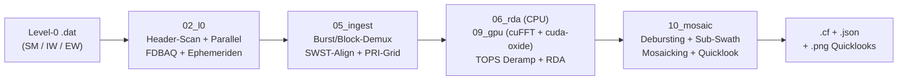
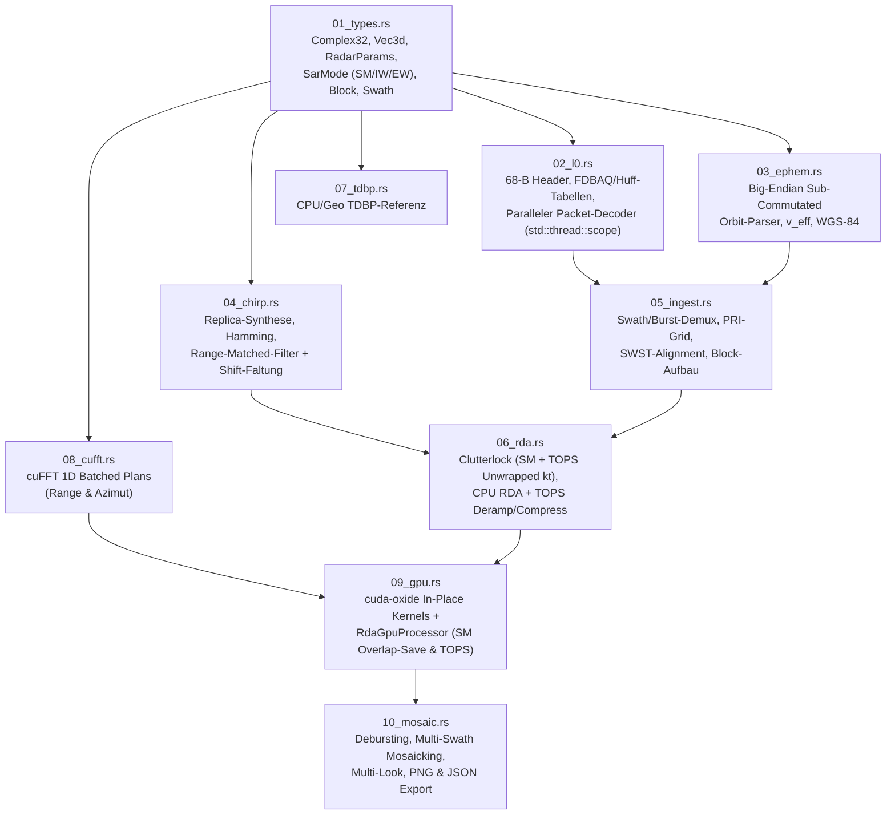

# Implementierungsplan (`source2`): Einheitlicher Sentinel-1 Level-0 Decoder & Stripmap/TOPS (IW/EW) GPU-Fokussierer

## 1. Zielsetzung & Überblick

Basierend auf dem Architektur-Überblick in `plan/20261028_01_architektur_ueberblick/dokumentation.md` wird im neuen Verzeichnis `source2/` eine vollständig eigenständige, vereinheitlichte und hochperformante Sentinel-1 SAR Level-0 Verarbeitungspipeline (`sar_source2`) in Rust implementiert. Sie verarbeitet die drei realen Copernicus-Testdatensätze in `data/`:

1. **Stripmap (SM / S6)**: `S1C_S6_RAW__0SDV_20260929T214300_...` (Sentinel-1C, Swath 6, 44 901 Echos, $N_{\text{rg}} = 19\,986$).
2. **Interferometric Wide Swath (IW TOPS)**: `S1C_IW_RAW__0SDV_20261027T052449_...` (Sentinel-1C, 3 Sub-Swaths IW1–IW3, 36 Bursts, je ~1409–1548 Echos, $N_{\text{rg}} \approx 19\,746\text{–}24\,098$).
3. **Extra Wide Swath (EW TOPS)**: `S1D_EW_RAW__0SDV_20261025T081255_...` (Sentinel-1D, 5 Sub-Swaths EW1–EW5, 113 Bursts, je ~989–1105 Echos, $N_{\text{rg}} \approx 5150\text{–}9074$).

---

## 2. Ergebnisse der technischen Spikes (Phase A)

Vor der Implementierung wurden beide im Architektur-Review definierten Spikes ausgeführt:

### 2.1 Spike 1: `cuda-oxide` In-Place-Mutation & geteilte Hilfsfunktionen
- **Ergebnis**: In `cuda-oxide` (`rev = a0cc6cc0bc18722ec5cdfbea136c118a7c051977`, `nightly-2026-08-28`) kompiliert ein Kernel mit `mut buf: DisjointSlice<Complex32>`, der über `if let Some(o) = buf.get_mut(idx) { let a = *o; *o = ...; }` in-place liest und schreibt, fehlerfrei nach PTX. Ebenso werden `#[inline]`-Hilfsfunktionen (wie `d_factor_dev`) innerhalb des `#[cuda_module]`-Moduls sauber in den PTX-Code geinlined.
- **Konsequenz für den GPU-Executor (`09_gpu.rs`)**:
  - Wir benötigen auf der GPU nur noch **einen einzigen** komplexen 2D-Arbeitspuffer `d_buf` (`n_az_fft × n_rg_fft × 8 B`, ca. 640 MB statt 1,28 GB bei $4096 \times 20\,480$) für alle in-place cuFFT- und Filter-Schritte.
  - Die 3 reinen Permutations-/Skalier-Kernel (`rotate_rows`, `shift_cols` ×2, `scale`) entfallen komplett:
    1. Der zyklische Range-Shift (`rotate_rows` um $N_{\text{chirp}}/2$) wird als lineare Phase $\exp(+j 2\pi k \cdot \text{shift} / N_{\text{rg}})$ direkt in den vorberechneten 1D-Range-Filter `rf[k]` gefaltet.
    2. Der Azimut-FFT-Shift (`shift_cols`) entfällt, indem die Azimut-Frequenz $f_a(a)$ im Kernel direkt in unshifteter FFT-Ordnung ($a < N/2 \Rightarrow a$, sonst $a - N$) ausgewertet wird.
    3. Die FFT-Normierung $1 / (N_{\text{az}} N_{\text{rg}})$ wird in die Filterkoeffizienten gefaltet.

### 2.2 Spike 2: Header-Zensus & TOPSAR-Doppler-Analyse auf realen IW/EW-Daten
Ein vollständiger Paket-Scan über die drei `.dat`-Dateien ergab:

| Datensatz | Modus | Echo-Swaths (`swath_number`) | Elevations-Beams (`el_beam`) | Bursts pro Sub-Swath | Pulse / Burst | Range-Samples $N_{\text{rg}}$ | PRF [Hz] | Gemessene Doppler-Rate $k_t$ [Hz/s] |
|---|---|---|---|---|---|---|---|---|
| `S1C_S6` | SM | `6` (S6) | `5` | 1 (kontinuierlich) | 44 901 | 19 950 / 19 986 | 1663,48 | ~0,0 (Stripmap) |
| `S1C_IW` | IW | `10, 11, 12` (IW1–IW3) | `6, 7, 8` | 12 je Sub-Swath (36 gesamt) | 1082–1548 | 19 722–24 098 | 1451,6–1717,1 | +4645,8 (IW2), +6719,8 (IW3), +7581,7 (IW1) |
| `S1D_EW` | EW | `20, 21, 22, 23, 24` (EW1–EW5) | `9, 10, 11, 12, 13` | 22–23 je Sub-Swath (113 gesamt) | 989–1105 | 5150–9074 | 1630,7–1939,3 | +10 112,9 bis +13 439,9 |

**Wichtige Erkenntnisse aus Spike 2:**
1. **Exaktes Bit-Layout Bytes 62–64**:
   - Byte 62: Bits `[7:6]` = `calibration_mode`, Bits `[4:0]` = `tx_pulse_number`.
   - Byte 63: Bits `[7:4]` = `signal_type` (`0` = Echo, `1` = Noise, `8..11` = Calibration), Bit `0` = `swap_flag`.
   - Byte 64: `swath_number` (`6` für S6, `10..12` für IW1..IW3, `20..24` für EW1..EW5).
2. **TOPS Azimut-Antennensteuerung & Unwrapped Clutterlock**:
   - In IW und EW schwenkt die Antenne während jedes Bursts rückwärts-nach-vorwärts, sodass das Feld `azimuth_beam_address` (10-Bit in Bytes 60–61) linear mit ~490–1405 Codes/s ansteigt (je Code $\approx +9{,}534\text{ Hz}$ Doppler-Verschiebung).
   - Die Doppler-Zentroidfrequenz $f_{\text{DC}}(t) = f_{\text{DC,mid}} + k_t \cdot t$ durchläuft während eines Bursts **2,6 bis 4,6 PRFs** ($4{,}3\text{–}7{,}6\text{ kHz}$ Sweep).
   - **Unwrapped Sub-Aperture Clutterlock**: Teilt man den Burst in $W = 16$ Azimut-Zeitfenster, bestimmt in jedem Fenster die Phase der Lag-1-Autokovarianz $\Delta\phi_w = \arg\sum_m s^*[m] s[m+1]$, entfaltet (unwrapped) die Phasendifferenzen über die $2\pi$-Sprünge hinweg und passt eine Gerade $f_{\text{DC}}(t) = f_{\text{DC,mid}} + k_t \cdot t$ an, erhält man $k_t$ und $f_{\text{DC,mid}}$ direkt aus den Echodaten mit einer Residuen-Standardabweichung von $< 20\text{ Hz}$!
3. **TOPS Azimut-Deramping + Effektive FM-Rate $k_{\text{eff}} = k_a - k_t$**:
   - Multipliziert man das Range-komprimierte Burst-Signal im Azimut-Zeitbereich mit der Deramp-Phase
     $$\phi_{\text{deramp}}(t) = -2\pi f_{\text{DC,mid}} t - \pi k_t t^2,$$
     so wird die Antennen-Sweep-Rate $k_t$ exakt entfernt: Jedes Punktziel wird im Moment seiner Hauptkeulen-Beleuchtung auf $0\text{ Hz}$ (Basisband) geschoben, und seine momentane Bandbreite im derampten Signal beträgt nur noch die Antennen-Strahlbreite $B_{\text{beam}} < \text{PRF}$.
   - Im derampten Signal besitzt jedes Ziel bei Schrägentfernung $R_0$ die effektive quadratische Phasenrate
     $$k_{\text{eff}}(R_0) = k_a(R_0) - k_t, \quad \text{wobei } k_a(R_0) = -\frac{2 V_{\text{eff}}^2}{\lambda R_0} < 0.$$
   - Nach Zero-Padding auf $N_{\text{az,fft}}$ (z. B. $2048$ oder $4096$, um zyklische Faltungsartefakte auszuschließen) komprimiert der Frequenzbereichs-Filter
     $$H_{\text{az}}(f_a, R_0) = \exp\!\left(+j \pi \frac{f_a^2}{k_{\text{eff}}(R_0)}\right)$$
     alle Punktziele scharf auf ihre fokussierte Azimutzeit $t_{\text{foc}} = \frac{k_a}{k_a - k_t} t_0$.
   - Zwei aufeinanderfolgende Bursts desselben Sub-Swaths im Abstand $\Delta t_{\text{cycle}}$ ($\approx 2{,}758\text{ s}$ bei IW, $\approx 3{,}039\text{ s}$ bei EW) sind im fokussierten Burst-Bild exakt um
     $$\Delta m_{\text{stride}} = \text{round}\!\left(\frac{\Delta t_{\text{cycle}}}{\text{PRI}} \cdot \left|\frac{k_a}{k_a - k_t}\right|\right)$$
     Zeilen gegeneinander verschoben (durch Kreuzkorrelation auf realen IW1-Bursts verifiziert: Theorie $1057$ Zeilen vs. Messung $1066$ Zeilen, Korrelation $0{,}48$). Damit lassen sich alle Bursts eines Sub-Swaths nahtlos debursten und mit den Nachbar-Sub-Swaths (über ihre $R_0$-Startentfernung und ihr Range-Sampling $f_s$) zu einem gemeinsamen IW- bzw. EW-Gesamtbild mosaikieren.

---

## 3. Modul-Architektur in `source2/`

Die neue Crate `sar_source2` in `source2/` ist wie `sar_focus` numerisch in Datenfluss-Reihenfolge gegliedert und hat keinerlei Abhängigkeit auf `../decoder` oder `../sar_focus`:

### Dateiübersicht (`source2/src/`)
1. `01_types.rs`: Grundtypen (`Complex32`, `Vec3d`, `Error`), physikalische Konstanten ($c, f_{\text{ref}}, f_c, \lambda$), `SarMode` (`Stripmap`, `Iw`, `Ew`), `BurstBlock` (Echodaten + Parameter eines Bursts bzw. SM-Blocks) und `SwathData`.
2. `02_l0.rs`: Schlanker Sentinel-1 Level-0 Space-Packet-Scanner und -Decoder:
   - Exakter 68-Byte-Header-Parser (inkl. korrigiertem Bit-Layout für `calibration_mode`, `signal_type`, `swath_number`, `elevation_beam_address`, `azimuth_beam_address`).
   - Statische Huffman- und BRC/THIDX-Dekompressions-Tabellen (BAQ 3/4/5 Bit, Bypass, FDBAQ) mit direkter `Complex32`-Ausgabe.
   - **Mehrkern-Parallelisierung** (`decode_packets_parallel` mittels `std::thread::scope`): Dekodiert zehntausende Pakete parallel direkt in einen zusammenhängenden `[n_az × n_rg]`-Zielpuffer (~1,2 s statt ~27 s für 45 000 Pakete).
3. `03_ephem.rs`: Big-Endian Sub-Commutated Data Assembler (Wörter 1..22 $\to$ ECEF-Position/Geschwindigkeit, Wörter 23..42 $\to$ Quaternionen), Zeit-Filterung, lineare Orbit-Interpolation, WGS-84-Krümmungsradius und $V_{\text{eff}}(R_0)$.
4. `04_chirp.rs`: LFM-Chirp-Synthese nach ESA-Spezifikation (`TXPRR`, `TXPSF`, `TXPL`, `RGDEC`), Hamming-Fensterung und vorberechneter Frequenzbereichs-Matched-Filter $H_{\text{rg}}(f_r)$ inklusive eingerechneter linearer Phase für den zyklischen $N_{\text{chirp}}/2$-Versatz.
5. `05_ingest.rs`: Einheitliches Demultiplexing einer `.dat`-Datei in `SwathData` und `BurstBlock`s:
   - Automatische Modus-Erkennung (`SM`, `IW`, `EW`) anhand der vorkommenden `swath_number`-Werte (`1..6` $\to$ SM, `10..12` $\to$ IW, `20..24` $\to$ EW).
   - Gruppierung aufeinanderfolgender Echo-Pakete (`signal_type == 0 && calibration_mode == 0`) nach `swath_number` und `pri_count`-Kontinuität ($\Delta\text{PRI\_COUNT} \le 50$).
   - Innerhalb jedes Blocks: SWST-Range-Bin-Alignment auf gemeinsames $(R_0, N_{\text{rg}})$-Gitter, Lücken-Insertion auf lückenloses PRI-Zeitraster und Kleinste-Quadrate-Zeitglättung.
6. `06_rda.rs`: CPU-Referenz für Range-Doppler-Algorithmus (SM & TOPS):
   - Stripmap Clutterlock (1D Range-abhängiges $f_{\text{DC}}(r)$) und **TOPS Unwrapped Sub-Aperture Clutterlock** ($f_{\text{DC,mid}}$ und $k_t$ über $W = 16$ Azimut-Fenster).
   - Azimut-Deramping ($\exp(-j(2\pi f_{\text{DC,mid}} t + \pi k_t t^2))$), Zero-Padding, Range-Kompression + RCMC ($D(f_a, V_{\text{eff}})$) und Azimut-Kompression mit $k_{\text{eff}}(r) = k_a(r) - k_t$.
7. `07_tdbp.rs`: Zeitbereichs-Backprojection (CPU-Referenz für synthetische Punktziel- und Geometrie-Tests).
8. `08_cufft.rs`: Minimale `extern "C"`-FFI-Bindung an `libcufft` für gebatchte 1D-C2C-FFTs entlang Range (Stride 1) und Azimut (Stride $N_{\text{rg}}$).
9. `09_gpu.rs`: `cuda-oxide` GPU-Kernels und `RdaGpuProcessor`:
   - In-Place-Kernels (`deramp_pad_in`, `range_rcmc_inplace`, `az_compress_inplace`) auf einem einzigen komplexen 2D-Device-Puffer.
   - Unterstützt sowohl lange Stripmap-Aufnahmen via Overlap-Save-Streaming als auch schnelle Batch-Fokussierung aller TOPS-Bursts (IW: 36 Bursts, EW: 113 Bursts).
10. `10_mosaic.rs`: Post-Processing, Debursting & Mosaicking:
    - Fokussiert und deburstet jeden Sub-Swath entlang der Azimut-Achse anhand von $\Delta m_{\text{stride}}$ mit linearer Überblendung (Feathering) im Burst-Überlappungsbereich.
    - Resamplet und fügt bei IW (IW1–IW3) und EW (EW1–EW5) alle Sub-Swaths anhand ihrer physikalischen Schrägentfernung $R_0 + j \cdot \Delta r$ und ihrer Azimut-Startzeit $t_0$ zu einem gemeinsamen Multi-Swath-Gesamtbild zusammen.
    - Exportiert `.cf` (komplexes Float32-Paar-Format), `.json` (strukturierte Metadaten zu Modus, Swaths, Bursts, Orbit, Chirp, Doppler-Raten und Dimensionen) sowie `.png`-Quicklooks (dB-skaliert mit Histogramm-Quantilen).
11. `lib.rs` & `main.rs`: Öffentliche Bibliotheks-API und CLI (`sar_source2 --input <file.dat> --output <out.cf> --png <out.png> [--meta <out.json>] [--mode auto|sm|iw|ew] [--swath <n>] [--cpu] ...`).

---

## 4. Verifikations- und Testplan (Phase C & D)

1. **Unit- & Synthetik-Tests (`cargo oxide test`)**:
   - Header-Bitfeld-Test (insbesondere Bytes 60–66 für SM, IW, EW).
   - Paralleler L0-Decoder vs. sequentieller Decoder (exakte Bit-Gleichheit).
   - Chirp-Vorzeichen- und Range-Kompressions-PSLR/IRW-Test ($<-13\text{ dB}$ Nebenkeulen mit/ohne Hamming).
   - **Synthetischer Stripmap-Punktziel-Test**: 2D-Echo-Simulator $\to$ RDA (CPU & GPU) $\to$ Peak an $(a_0, r_0)$, Azimut-/Range-3-dB-Breite $< 2{,}0\text{ Bins}$, PSLR $< -10\text{ dB}$.
   - **Synthetischer TOPS-Burst-Punktziel-Test**: Simulation eines TOPS-Bursts mit starkem Antennen-Sweep ($k_t = +7500\text{ Hz/s}$ über $>3\text{ PRFs}$) und Punktzielen bei verschiedenen Azimut-Zeiten $\to$ Verifikation, dass `estimate_tops_doppler_rate` $k_t$ auf $< 1\%$ genau rekonstruiert und der TOPS-Fokussierer (Deramp + RDA mit $k_{\text{eff}} = k_a - k_t$) das Punktziel scharf komprimiert (Peak-zu-Hintergrund $> 30\text{ dB}$, während ungefiltertes Stripmap-RDA durch das PRF-Aliasing defokussiert bleibt).
   - **CPU $\leftrightarrow$ GPU Vergleichstest**: Relativer L2-Fehler $< 10^{-3}$ sowohl im Stripmap- als auch im TOPS-Burst-Modus.
2. **End-to-End-Läufe auf allen drei realen Datensätzen (`data/`)**:
   - **S6 (Stripmap)**: Vollständiger Frame (44 901 × 19 986) auf der RTX A4000 fokussieren, Laufzeit und Kontrast messen, Quicklook-PNG + JSON-Metadaten erzeugen.
   - **IW (TOPS, 3 Sub-Swaths, 36 Bursts)**: Alle 36 Bursts über IW1–IW3 dekodieren, fokussieren, debursten und zu einem gemeinsamen IW-Gesamtbild mosaikieren.
   - **EW (TOPS, 5 Sub-Swaths, 113 Bursts)**: Alle 113 Bursts über EW1–EW5 dekodieren, fokussieren, debursten und zu einem gemeinsamen EW-Gesamtbild mosaikieren.
3. **Code-Qualität & Dokumentation**:
   - `cargo fmt -- --check` und `cargo clippy --all-targets -- -D warnings` (0 Warnungen).
   - Ausführliches deutsches `walkthrough.md` (mit Mermaid-Diagrammen, Messwerten für S6/IW/EW und DeepWiki-Abgleich) sowie `plan_effort.md`.
