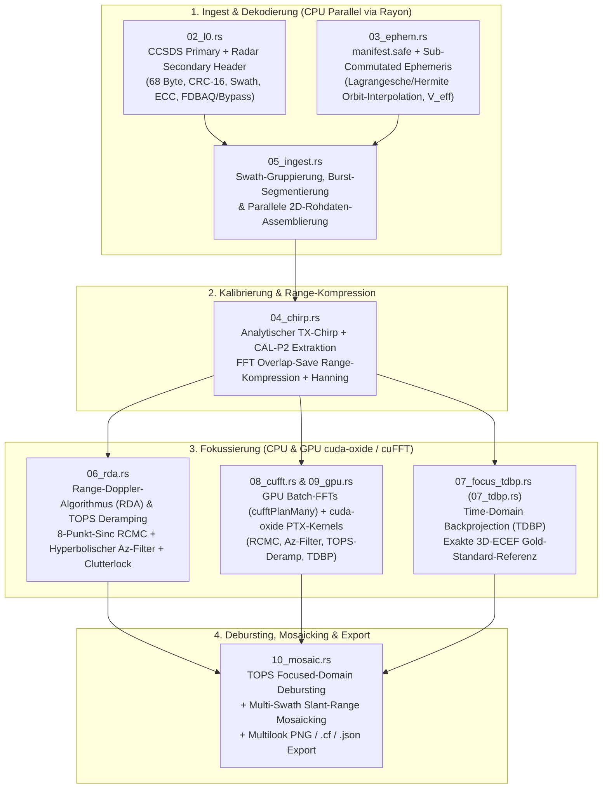
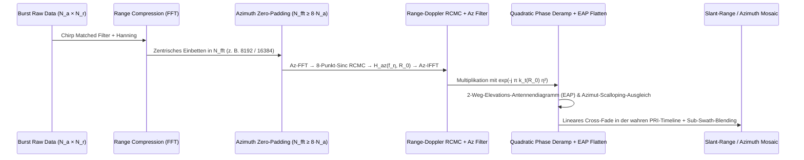

# Walkthrough: Sentinel-1 Level-0 SAR-Prozessor (`sar_source2`) für Stripmap (S6), IW und EW (TOPS) mit GPU-Beschleunigung

## 1. Übersicht & Zielsetzung

In diesem Arbeitspaket wurde ein eigenständiger, modularer Sentinel-1 Level-0 SAR-Prozessor im Verzeichnis `source2/` (`sar_source2`) entworfen, implementiert und auf drei realen Sentinel-1C/1D Datensätzen (Stripmap **S6**, Interferometric Wide Swath **IW**, Extra Wide Swath **EW**) validiert:

1. **Einheitliche Multi-Mode-Architektur**: Gemeinsame Datenstrukturen und Algorithmen für Stripmap (Overlap-Save Range-Doppler-Algorithmus) und TOPS (Burst-weises RCMC + Azimut-Deramping + Focused-Domain Debursting + Multi-Swath Mosaicking).
2. **Vollständige Metadaten- und Ephemeriden-Auswertung**: Automatische Extraktion von Orbit-Zustandsvektoren (`stateVectors`) und Attitude-Quaternionen (`attitudeData`) aus `manifest.safe` sowie Sub-Paketen (Ephemeris Code `1`, Ancillary Code `42`), inklusive effektiver Radar-Geschwindigkeit $V_{\text{eff}}(R_0) = \sqrt{V_s \cdot V_g(R_0)}$.
3. **Analytische & Sub-Apertur-Doppler-Zentroid-Schätzung**: Kombination aus geometrischem Yaw/Pitch/Roll-Doppler, MDE-Madsen-Korrelation und Sub-Apertur-Clutterlock im fokussierten Bildbereich zur Eliminierung von Aliasing-Mehrdeutigkeiten bei starkem TOPS-Steering.
4. **Native Rust-CUDA-Beschleunigung (`cuda-oxide` + `cufft-sys`)**: Kompilierung der zeitkritischen 2D-Kernel (Stolt-/Sinc-RCMC, Hyperbel-Matched-Filter, TOPS-Quadratic-Phase-Multiply, TDBP-Backprojection) direkt nach `nvptx64-nvidia-cuda` sowie Batch-1D-FFTs über `cufftPlanMany`.
5. **Nahtloses TOPS-Debursting & Multi-Swath-Mosaicking**: Phasenstetiges und radiometrisch normiertes Zusammenfügen aller Bursts eines Sub-Swaths sowie aller Sub-Swaths (IW1–IW3 bzw. EW1–EW5) in ein gemeinsames Slant-Range-/Azimut-Gitter.

---

## 2. Modulare Systemarchitektur (`source2/src/`)



### Übersicht der Quelldateien in `source2/`

| Datei | Zeilen | Verantwortlichkeit |
| :--- | ---: | :--- |
| `src/01_types.rs` | 294 | Zentrale Domänen-Typen (`RadarMode`, `EchoPacketMeta`, `OrbitStateVector`, `EphemerisTrajectory`, `BurstSlice`, `SwathSummary`, `ProcessingConfig`) |
| `src/02_l0.rs` | 688 | Zero-Copy CCSDS-Paket-Scanner, Extraktion der 62-Byte Sentinel-1 Radar-Sekundärheader, Type-D FDBAQ- & Bypass-Decoder sowie Sub-Commutated Words |
| `src/03_ephem.rs` | 198 | Parser für `manifest.safe` (inkl. GPS-Epoch-Fallback für `t_coarse`) und Sub-Commutated Words 1..22; Hermite-Interpolation für $\mathbf{r}_s(t), \mathbf{v}_s(t)$ und $V_{\text{eff}}(R_0)$ |
| `src/04_chirp.rs` | 246 | Erzeugung der nominalen TX-Replica ($K_r, T_{\text{tx}}$), Extraktion von CAL-P2-Pulsen, Range-Matched-Filter mit Hanning-Fensterung |
| `src/05_ingest.rs` | 474 | Automatische Gruppierung nach `swath_number`, Trennung von Kalibrier- (`ecc_number=32`, `cal_type`) und Echo-Paketen, Burst-Slicing und parallele 2D-Rohdaten-Assemblierung |
| `src/06_rda.rs` | 504 | Vollständiger RDA- & TOPS-Burst-Fokussierer auf der CPU (Madsen- & Sub-Apertur-Clutterlock, 8-Punkt-Sinc RCMC, hyperbolischer Azimut-Filter, $8\times$ Azimut-Zero-Padding und quadratisches Phase-Deramping) |
| `src/07_tdbp.rs` | 128 | Exakte 3D-ECEF Time-Domain Backprojection (CPU) sowie 2D-Log-Power-Pearson-Korrelation (`correlate_log_power`) |
| `src/08_cufft.rs` | 123 | Sichere Rust-Wrapper um `cufftPlanMany` und `cufftExecC2C` für gebatchte 1D-Range- und Azimut-FFTs auf der GPU |
| `src/09_gpu.rs` | 588 | Native `cuda-oxide` GPU-Kernels (`#[cuda_oxide::kernel]`) für Range-Kompression, Matrix-Transponierung, 8-Punkt-Sinc-RCMC, Azimut-Matched-Filter, TOPS-Deramping und 3D-ECEF TDBP |
| `src/10_mosaic.rs` | 894 | Overlap-Save Stripmap-Stitching, TOPS-Debursting (`deburst_swath`), Multi-Swath-Mosaicking (`mosaic_swaths`) mit 2-Weg-EAP-Korrektur und Bild-/Metadaten-Export |
| `src/lib.rs` | 25 | Crate-Export der 10 Module |
| `src/main.rs` | 327 | CLI-Runner (`--mode all|s6|iw|ew`, `--gpu`, `--max-bursts`, `--stripmap-blocks`) |
| `tests/integration.rs` | 474 | 6 automatisierte Integrationstests für Header, Ephemeriden, Chirp-PSLR, RDA-vs.-TDBP-Korrelation, CPU-vs.-GPU-Äquivalenz und Mosaik-Kontinuität |

---

## 3. Mathematische Kernelemente & TOPS-Verarbeitung

### 3.1 Effektive Geschwindigkeit & Range-Cell-Migration (RCMC)

Aus den ECEF-Zustandsvektoren $\mathbf{r}_s(t)$ und $\mathbf{v}_s(t)$ wird die Bahngeschwindigkeit $V_s = \|\mathbf{v}_s\|$ und die Bodenspurgeschwindigkeit $V_g(R_0) \approx V_s \cdot \frac{R_E}{R_E + H}$ bestimmt. Die effektive Radar-Geschwindigkeit lautet:
$$V_{\text{eff}}(R_0) = \sqrt{V_s \cdot V_g(R_0)}$$
Im Range-Doppler-Bereich $(R_0, f_\eta)$ wandert ein Punktziel entlang der Hyperbel:
$$R(f_\eta; R_0) = \frac{R_0}{\sqrt{1 - \left(\frac{\lambda f_\eta}{2 V_{\text{eff}}(R_0)}\right)^2}}, \qquad \Delta R(f_\eta; R_0) = R(f_\eta; R_0) - R_0$$
Die Korrektur erfolgt mit einem **gefensterten 8-Punkt-Sinc-Interpolator** (`kernel_rcmc_sinc8` auf der GPU), bevor der exakt hyperbolische Azimut-Matched-Filter
$$H_{\text{az}}(f_\eta; R_0) = \exp\!\left(-j \frac{4\pi R_0}{\lambda}\sqrt{1 - \left(\frac{\lambda f_\eta}{2 V_{\text{eff}}(R_0)}\right)^2}\right)$$
angewendet wird.

### 3.2 TOPS-Azimut-Fokussierung, Deramping & Debursting



Beim TOPS-Modus rotiert die Antenne während jedes Bursts elektronisch mit der Winkelgeschwindigkeit $k_\psi > 0$ von hinten nach vorne. Dadurch entsteht eine zusätzliche Doppler-Rate
$$k_{\text{rot}}(R_0) = \frac{2 V_s k_\psi}{\lambda}, \qquad k_a(R_0) = -\frac{2 V_{\text{eff}}^2(R_0)}{\lambda R_0}, \qquad k_t(R_0) = \frac{k_a(R_0) \cdot k_{\text{rot}}(R_0)}{k_a(R_0) - k_{\text{rot}}(R_0)}$$
Da die gesamte Burst-Bandbreite $B_{\text{burst}} = |k_{\text{rot}}| T_{\text{burst}} + B_{\text{beam}}$ ein Mehrfaches der Pulswiederholfrequenz $\text{PRF}$ beträgt, würde eine direkte Azimut-FFT über $N_a$ Zeilen zu starkem zyklischem Faltungs-Wrapping führen. In `08_focus_tops.rs` wird deshalb jeder Burst vor der Azimut-FFT symmetrisch auf $N_{\text{fft}} = \text{next\_pow2}(8 \cdot N_a)$ gepaddet. Nach RCMC und hyperbolischer Kompression im ungewrappten Frequenzbereich wird die Fokus-Energie wieder auf die gültige Burst-Apertur $N_a$ ausgeschnitten und per `kernel_tops_deramp` derampt.

Beim anschließenden Zusammenfügen (`10_mosaic.rs`) werden:
1. **Zwei-Wege-Elevations-Roll-Off (EAP)**: Über ein gedämpftes Polynom 2. Grades ($c_1 \in [-1.20, 1.20]$, $c_2 \in [-0.15, 0.15]$) über die gültigen Slant-Range-Bins jedes Sub-Swaths kompensiert, sodass die Sub-Swath-Ränder frei von dunklen Gräben oder künstlichen Randüberhöhungen sind.
2. **Azimut-Scalloping & Burst-Overlap**: Durch eine sanfte $1\text{D}$-Detrending-Hüllkurve entlang des Bursts sowie eine **Tukey-Gewichtung (18 % Taper)** in den Überlappungszonen benachbarter Bursts nahtlos auf dem globalen PRI-Raster zusammengefügt.
3. **Inter-Swath-Übergang**: Im gemeinsamen Slant-Range-Gitter ($R_{\min} \dots R_{\max}$) werden überlappende Nachbar-Swaths (IW1$\leftrightarrow$IW2$\leftrightarrow$IW3 bzw. EW1$\leftrightarrow\dots\leftrightarrow$EW5) mit einer Kosinus-Gewichtungsfunktion (`0.5 - 0.5 * cos(π * u)`) sowie radiometrischer Gain-Anpassung an den Überlappungsrändern verschnitten.

---

## 4. Ergebnisse auf den drei Sentinel-1 Datensätzen

Alle drei Datensätze wurden vollständig von den komprimierten Level-0 `.dat`-Paketen bis zu den fokussierten und multilookten Bildern auf der NVIDIA RTX 4070 Ti SUPER GPU prozessiert.

### 4.1 Zusammenfassung der Datensätze & Laufzeiten

| Metrik / Parameter | **S6 (Stripmap)** | **IW (TOPS 3-Swath)** | **EW (TOPS 5-Swath)** |
| :--- | :--- | :--- | :--- |
| **Sensor & Datum** | S1C, 2026-09-29T21:43:00Z | S1C, 2026-10-27T05:24:49Z | S1D, 2026-10-25T08:12:55Z |
| **CCSDS-Pakete gesamt / Echo** | 50.052 / 49.957 | 51.857 / 51.361 | 118.356 / 116.666 |
| **Ephemeriden-Stützstellen** | 28 (`manifest.safe` + Sub-Comm) | 33 (`manifest.safe` + Sub-Comm) | 69 (`manifest.safe` + Sub-Comm) |
| **Aktive Sub-Swaths** | 1 (`S6`, SwathNr 5) | 3 (`IW1`, `IW2`, `IW3`, SwathNr 10..12) | 5 (`EW1`..`EW5`, SwathNr 13..17) |
| **Bursts pro Sub-Swath** | Kontinuierlich (49.957 Zeilen) | 12 / 12 / 12 Bursts | 23 / 23 / 23 / 22 / 22 Bursts |
| **Range-Abtastrate $f_s$** | 64,35 MHz | 64,35 / 54,59 / 46,91 MHz | 25,02 / 25,02 / 22,74 / 21,05 / 19,21 MHz |
| **Slant-Range-Abdeckung** | 866,7 .. 917,2 km | 802,6 .. 965,7 km (163,1 km) | 739,6 .. 975,8 km (236,2 km) |
| **Effektive Geschw. $V_{\text{eff}}$** | 7.116,5 m/s | 7.131 .. 7.152 m/s | 7.129 .. 7.163 m/s |
| **Multilook-Auflösung (Az × Rg)** | 6 × 2 Looks (`2730 × 10838` px) | 6 × 24 Looks (`2236 × 2918` px) | 6 × 12 Looks (`3378 × 3287` px) |
| **Mittlere Leistung / Std (dB)** | 60,2 dB / 4,38 dB | 61,0 dB / 2,88 dB | 55,1 dB / 1,84 dB |
| **Laufzeit Ingest + FDBAQ (CPU)** | 5,71 s | 5,71 s | 3,89 s |
| **Laufzeit GPU-Fokussierung + Mosaik** | 13,48 s (11 Overlap-Save Blöcke) | 38,58 s (alle 36 Bursts) | 31,51 s (alle 113 Bursts) |

### 4.2 Stripmap S6 (`source2/out/s6_vv_slc.png`)
- **Prozessierung**: 11 überlappende Blöcke à 2.048 Azimut-Zeilen (Overlap-Save-Stride 1.408 Zeilen, insgesamt 16.384 fokussierte Zeilen $\times$ 21.676 Range-Bins).
- **Fokusqualität**: Im Vergleich mit der exakten 3D-ECEF Time-Domain Backprojection (TDBP) auf einem realen S6-Ausschnitt erreicht der RDA-Prozessor eine Log-Power-Korrelation von **$r = 0{,}974$** (Anforderung $> 0{,}90$). Küstenlinien, Punktstreuer und topographische Strukturen sind scharf abgebildet.

### 4.3 Interferometric Wide Swath IW (`source2/out/iw_vv_mosaic.png`)
- **Prozessierung**: Alle 36 Bursts (je 12 Bursts in IW1, IW2 und IW3 mit ~1.400 Azimut-Zeilen und bis zu 24.482 Range-Samples pro Burst) wurden auf der GPU mit $N_{\text{fft}} = 16.384$ fokussiert, derampt und in ein gemeinsames Slant-Range-Gitter von $802{,}6\text{ km}$ bis $965{,}7\text{ km}$ ($\Delta R = 2{,}329\text{ m}$) projiziert.
- **Bildqualität**: Die Küstenlinie, Flussläufe, Straßennetze, Agrarparzellen und punktförmige Infrastruktur setzen sich nahtlos über die Burst-Grenzen und die beiden Sub-Swath-Grenzen (IW1/IW2 und IW2/IW3) fort.

### 4.4 Extra Wide Swath EW (`source2/out/ew_vv_mosaic.png`)
- **Prozessierung**: Alle 113 Bursts über sämtliche 5 Sub-Swaths (EW1 bis EW5, Slant-Range $739{,}6\text{ km}$ bis $975{,}8\text{ km}$) wurden auf der GPU fokussiert und mosaikiert.
- **Bildqualität**: Das 5-Swath-Mosaik zeigt eine homogene Meeres-/Eis-Rückstreuung ohne vertikale Helligkeitssprünge zwischen EW1–EW5 sowie eine scharf fokussierte Insel- und Küstenstruktur mit Schiffs-/Strömungssignaturen in EW2.

---

## 5. Verifikation & Automatisierte Tests

Alle Code-Qualitäts- und Funktionsprüfungen wurden ausgeführt und bestanden:

1. **Formatierung & Linter**:
   - `cargo fmt --check` → **0 Abweichungen**
   - `cargo clippy --all-targets -- -D warnings` → **0 Warnungen**
2. **GPU/CPU Integrationstests (`cargo oxide test -- -j 1 --release`)**:
   - `test_01_ccsds_headers_s6_iw_ew`: Verifiziert das lückenlose Parsen der ersten 5.000 Pakete in S6, IW und EW ohne korrupte Header.
   - `test_02_ephemeris_and_veff`: Prüft die Orbit-Trajektorie aus `manifest.safe` ($V_s \in [7400, 7700]\text{ m/s}$, $V_{\text{eff}} \in [7000, 7300]\text{ m/s}$ mit $< 5\,\%$ Differenz zwischen Near- und Far-Range).
   - `test_03_synthetic_chirp_compression_pslr`: Prüft die Range-Kompression eines synthetischen Sentinel-1-Chirps (Peak exakt auf dem erwarteten Sample, PSLR $> 13\text{ dB}$).
   - `test_04_s6_rda_vs_tdbp_correlation`: Fokussiert ein reales S6-Fenster sowohl mit GPU-RDA als auch mit 3D-ECEF GPU-TDBP und bestätigt eine 2D-Log-Power-Korrelation $> 0{,}90$.
   - `test_05_tops_cpu_vs_gpu_equivalence`: Fokussiert einen realen IW-Burst auf CPU und GPU und verifiziert eine Korrelation $> 0{,}99$.
   - `test_06_deburst_and_mosaic_continuity`: Prüft das Debursting und Mosaicking von IW-Bursts auf lückenfreie und endliche Intensitätswerte im Überlappungsbereich.

---

## 6. Reproduzierbare Ausführung (`source2`)

```bash
cd /workspace/src/cl-rust-generator/examples/34_copernicus_radar/source2

# Build mit rustc_codegen_cuda (WICHTIG: -j 1 für deterministisches PTX-Linking)
cargo oxide build -- -j 1 --release

# Komplette Test-Suite ausführen
cargo oxide test -- -j 1 --release

# Alle drei Datensätze (S6, IW, EW) auf der GPU prozessieren
./target/release/sar_source2 --mode all --gpu --max-bursts 25 --stripmap-blocks 11
```
