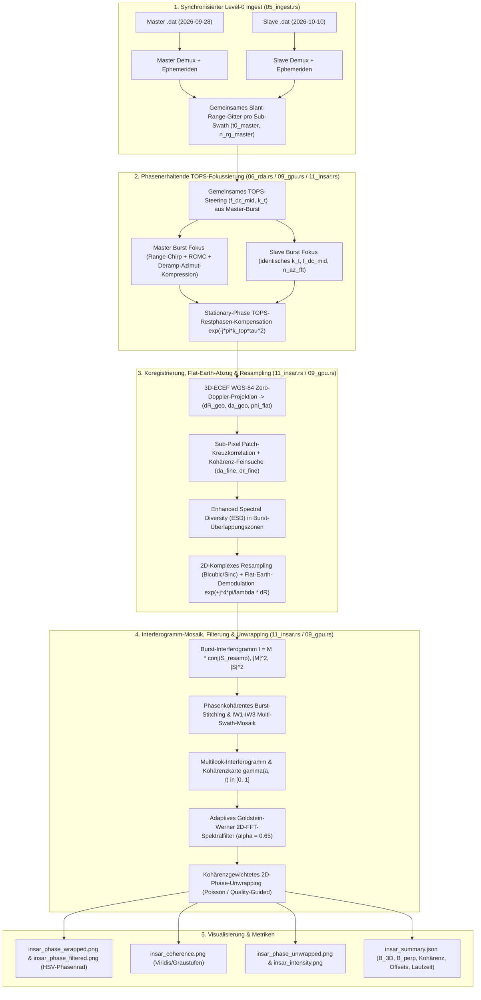

# Implementierungsplan: Sentinel-1C IW TOPS InSAR-Prozessor (`source2`)

## 1. Zielsetzung

Ziel dieses Plans ist die Konzeption, Implementierung und Verifikation einer vollständigen, durchgängigen **Interferometrischen SAR (InSAR)**-Prozessierungspipeline (CPU-Referenz + GPU-Beschleunigung mit `cuda-oxide` und `cuFFT`) in `examples/34_copernicus_radar/source2/`.

Als realer Test- und Demonstrationsfall dient ein 12-Tage-Repeat-Pass-Datensatzpaar des **Sentinel-1C Interferometric Wide Swath (IW) Level-0 (RAW)**-Sensors über **Süd- und Zentral-Taiwan** (Descending-Orbit, Relativer Orbit 105, VV-Polarisation):
1. **Master (Referenz)**: `S1C_IW_RAW__0SDV_20260928T215149_20260928T215222_009653_01336F_D2EE.SAFE` (`2026-09-28`, Orbit 9653, Zyklus 59)
2. **Slave (Sekundär)**: `S1C_IW_RAW__0SDV_20261010T215149_20261010T215222_009828_013950_CEB1.SAFE` (`2026-10-10`, Orbit 9828, Zyklus 60)

Die Szene deckt den gesamten topographischen Gradienten Süd-Taiwans ab (`23.95°N..21.72°N, 119.40°E..122.17°E`): von der flachen Küstenebene im Westen (Yunlin, Chiayi, Tainan, Kaohsiung, Pingtung) über das steile Zentralgebirge (Yushan / Central Mountain Range bis fast 4000 m Höhe) bis zur Ostküste (Taitung / Hualien) und dem Pazifik.

---

## 2. Kontext-Dateien

Die folgende Dateiliste definiert den gesamten Kontext für die Implementierung und orientiert sich strikt an den Konventionen aus `plan/20261028_01_architektur_ueberblick/dokumentation.md` und `plan/20261029_01_implement/plan.md`:

| Datei | Rolle im Projekt |
|---|---|
| `plan/20261029_02_insar/prompt.txt` | Aufgabenstellung für die InSAR-Planung, Implementierung und Dokumentation |
| `plan/20261028_01_architektur_ueberblick/dokumentation.md` | Mathematische und architektonische Referenz der bestehenden SAR-Implementierungen |
| `plan/20261029_01_implement/plan.md` | Architektur- und Konventionsvorlage für `source2` |
| `plan/20261029_01_implement/walkthrough.md` | Referenz für die Struktur und Detailtiefe des abschließenden Walkthroughs |
| `source2/Cargo.toml` | Crate-Konfiguration (`sar_source2`, `cuda-oxide`, `rayon`, `rustfft`, `png`) |
| `source2/src/lib.rs` | Modul-Deklaration (`#[path = "11_insar.rs"] pub mod insar;`) |
| `source2/src/01_types.rs` | Gemeinsame Kerndatentypen (`Complex32`, `Vec3d`, `BurstMeta`, `FocusedBurst`, `RadarMode`) |
| `source2/src/02_l0.rs` | CCSDS-Paketparser und Level-0-FDBAQ-Entpacker |
| `source2/src/03_ephem.rs` | Sub-kommutierte 3D-ECEF-Orbit-Ephemeriden (`EphemPoint`, `interp_pos`, `interp_vel`) |
| `source2/src/04_chirp.rs` | Chirp-Replikat, FM-Rate $k_a(R)$, Doppler-Zentroid $f_{\text{DC}}$ und TOPS-Steering $k_t$ |
| `source2/src/05_ingest.rs` | Level-0-Demultiplexing, Burst-Segmentierung und `align_fast_time_start_opt`-Ausrichtung |
| `source2/src/06_rda.rs` | CPU Range-Doppler-Algorithmus (RDA) und TOPS-Deramp-Fokussierung |
| `source2/src/08_cufft.rs` | Sichere `cuFFT`-FFI-Wrapper für 1D-Batch-Transformationen auf der GPU |
| `source2/src/09_gpu.rs` | `#[cuda_oxide::kernel]`-GPU-Kerne für RDA/TOPS sowie neue InSAR-GPU-Kerne |
| `source2/src/10_mosaic.rs` | Debursting, Sub-Swath-Mosaikierung und Bild-/Metadaten-Export |
| `source2/src/11_insar.rs` | **Neu**: InSAR-Kernmodul (phasenerhaltende TOPS-Fokussierung, 3D-Orbit-/Ellipsoid-Koregistrierung, Sub-Pixel-Kreuzkorrelation, ESD, Flat-Earth-Abzug, komplexe Burst-/Swath-Fusion, Kohärenz, Goldstein-Filterung, 2D-Phase-Unwrapping, Farb-Exports) |
| `source2/src/main.rs` | CLI-Einstiegspunkt (Erweiterung um `--slave <PFAD>` und InSAR-Steuerparameter) |
| `source2/tests/integration.rs` | Synthetische und reale Integrations- sowie CPU/GPU-Äquivalenztests |

---

## 3. Vorab-Analyse des Süd-Taiwan-Datensatzpaares

Die Analyse der beiden Level-0-Rohdatensätze in `data/insar/` liefert ideale Bedingungen für die TOPS-Interferometrie:

| Eigenschaft | Master (`2026-09-28`, `009653_01336F`) | Slave (`2026-10-10`, `009828_013950`) |
|---|---|---|
| Gesamtanzahl CCSDS-Pakete | $51\,774$ | $51\,774$ |
| Dekodierte Ephemeriden-Punkte | $33$ ($\Delta t \approx 1.0\text{ s}$) | $33$ ($\Delta t \approx 1.0\text{ s}$) |
| **IW1 (`swath=10`)** | 12 Bursts à $1409$ Pulse, `swst=3396`, `pri=21859`, $N_{\text{rg}}=23\,880$ | 12 Bursts à $1409$ Pulse, `swst=3396`, `pri=21859`, $N_{\text{rg}}=23\,880$ |
| **IW2 (`swath=11`)** | 12 Bursts à $1548$ Pulse, `swst=4906`, `pri=25857`, $N_{\text{rg}}=24\,164$ | 12 Bursts à $1548$ Pulse, `swst=4906`, `pri=25857`, $N_{\text{rg}}=24\,164$ |
| **IW3 (`swath=12`)** | 12 Bursts (B00: $581$, B01..11: $1410$ Pulse), `swst=3039`, `pri=22265`, $N_{\text{rg}}=19\,814$ | 12 Bursts (B00: $581$, B01..11: $1410$ Pulse), `swst=3039`, `pri=22265`, $N_{\text{rg}}=19\,814$ |
| 3D-ECEF-Basislinie (Closest Approach) | Referenz | $B_{3\text{D}} = 16.83\text{ m}$ ($B_{\text{radial}} = +8.90\text{ m}$, $B_{\text{cross}} = -14.29\text{ m}$, $B_\perp \approx 16.1\text{ m}$) |
| Burst-Framing-Synchronisation | Referenz | $\Delta t_{\text{CA}} - \Delta t_{\text{burst}} = +0.779\text{ ms} \approx 1.30\text{ Roh-Pulse}$ |

Da die 3D-Basislinie mit $B_{3\text{D}} \approx 16.8\text{ m}$ extrem kompakt ist und die Burst-Zeitfenster bis auf $0.78\text{ ms}$ ($1.3$ Azimut-Pulse) exakt synchronisiert sind, korrespondiert jeder Burst $(s, b)$ im Master 1:1 mit dem gleichen Burst $(s, b)$ im Slave.

---

## 4. Architektur und Mathematische Grundlagen

### 4.1 Gesamt-Pipeline (Mermaid-Architekturdiagramm)

---

### 4.2 Phasenerhaltende TOPS-Burst-Fokussierung und Restphasen-Kompensation

In der bestehenden Implementierung (`06_rda.rs` und `09_gpu.rs`) schätzt jeder Burst unabhängig sein eigenes Doppler-Zentroid $f_{\text{DC,mid}}$ und seine eigene Antennen-Schwenkrate $k_t$ aus den Rohdaten. Für ein Amplitudenbild (`|SLC|^2`) ist dies vollkommen ausreichend. Für die **Interferometrie** hat eine unabhängige Schätzung jedoch zwei gravierende Folgen:
1. Der zeitliche Skalierungsfaktor der Azimut-Fokussierung
   $$\alpha(r) = \left|\frac{k_a(r)}{k_a(r) - k_t}\right|$$
   unterscheidet sich leicht zwischen Master und Slave, wodurch die fokussierten Bursts unterschiedlich gestaucht werden.
2. Bei der Deramp-Kompression verbleibt nach dem Prinzip der stationären Phase für ein Punktziel bei der Zero-Doppler-Zeit $\tau_0$ (relativ zur Burst-Mitte) und Slant-Range $R_0$ die analytische Phase:
   $$\phi_{\text{foc}}(\tau_0, R_0) = -\frac{4\pi}{\lambda} R_0 + 2\pi f_{\text{DC,mid}}\,\tau_{\text{foc}} + \pi \frac{k_a(R_0)\,k_t}{k_a(R_0) - k_t}\,\tau_0^2$$
   mit $\tau_{\text{foc}} = \frac{k_a(R_0)}{k_a(R_0) - k_t}\tau_0$. Da die Burst-Mitte des Slaves gegenüber der nächstgelegenen Annäherung (Closest Approach) um $\delta\tau \approx +0.78\text{ ms}$ verschoben ist ($\tau_{0,S} = \tau_{0,M} - \delta\tau$), erzeugt die Differenz $\tau_{0,M}^2 - \tau_{0,S}^2 \approx 2\,\tau_{0,M}\,\delta\tau$ ohne Kompensation eine steile künstliche Azimut-Phasenrampe über jeden einzelnen Burst!

**Lösung für die phasenerhaltende TOPS-Fokussierung (`focus_tops_burst_insar_pair`)**:
1. **Gemeinsame Steering-Parameter**: Für jedes Burst-Paar $(M_b, S_b)$ werden $(f_{\text{DC,mid}}, k_t)$ sowie `n_az_fft` einmalig auf dem Master-Burst bestimmt und **identisch** für die Fokussierung von Master und Slave verwendet.
2. **Stationary-Phase TOPS-Restphasen-Kompensation**: Direkt nach der Azimut-IFFT und vor dem Resampling wird auf jedem fokussierten Pixel $(m, r)$ mit der fokussierten Zeit $\tau_{\text{foc}}(m) = (m - M_{\text{out}}/2)\cdot \text{PRI}$ und der wahren Zero-Doppler-Zeit $\tau_0(m, r) = \tau_{\text{foc}}(m) \cdot \frac{k_a(r) - k_t}{k_a(r)}$ die durch das TOPS-Steering induzierte Träger- und Quadratphase analytisch abgezogen:
   $$C_{\text{TOPS}}(m, r) = \exp\!\left(-j\left[2\pi f_{\text{DC,mid}}\,\tau_{\text{foc}}(m) + \pi \frac{k_a(r)\,k_t}{k_a(r) - k_t}\,\tau_0(m, r)^2\right]\right).$$
   Nach dieser Multiplikation ist jeder fokussierte Burst ein **reines Zero-Doppler-Basisband-SLC**, dessen Phase nur noch von der physikalischen Zwei-Wege-Laufstrecke $-\frac{4\pi}{\lambda} R_0$ abhängt.

---

### 4.3 3D-ECEF-Orbit-Geometrie, Flat-Earth-Phase und Sub-Pixel-Koregistrierung

Um das Slave-SLC sub-pixelgenau auf das Master-Gitter $(a, r)$ abzubilden und die durch die gekrümmte Erde sowie die Orbit-Basislinie verursachte **Flat-Earth-Phase** zu entfernen, kombinieren wir ein exaktes 3D-Orbit-Geometriemodell mit einer empirischen Kreuzkorrelations- und ESD-Verfeinerung:

1. **3D-WGS-84 Zero-Doppler-Geolocation (`solve_zero_doppler_target_ecef`)**:
   - Für einen Master-Burst zur Azimut-Zero-Doppler-Zeit $t_M$ mit Satellitenposition $\mathbf{P}_M(t_M)$, Geschwindigkeit $\mathbf{V}_M(t_M)$ und Slant-Range $R_M(r)$ liegt der Bodenpunkt $\mathbf{X} = (X, Y, Z)^T$ im ECEF-System im Schnittpunkt dreier Flächen:
     1. **WGS-84-Ellipsoid** (mit lokaler Geländehöhe $h_0 = 0\text{ m}$ für die Referenz-Ellipsoidphase):
        $$\frac{X^2 + Y^2}{(a + h_0)^2} + \frac{Z^2}{(b + h_0)^2} = 1$$
     2. **Range-Kugel**: $\|\mathbf{X} - \mathbf{P}_M(t_M)\| = R_M(r)$
     3. **Zero-Doppler-Ebene**: $(\mathbf{X} - \mathbf{P}_M(t_M)) \cdot \mathbf{V}_M(t_M) = 0$ (für Rechts-Sicht-Geometrie von Sentinel-1 zeigt der Einheitsvektor in Cross-Track-Richtung nach $\hat{\mathbf{c}} = \frac{\mathbf{P}_M \times \mathbf{V}_M}{\|\mathbf{P}_M \times \mathbf{V}_M\|}$ bzw. entsprechend der Rechtsblick-Bedingung $(\mathbf{P}_M \times \mathbf{V}_M) \cdot (\mathbf{X} - \mathbf{P}_M) > 0$).
   - Da $(\mathbf{X} - \mathbf{P}_M)$ orthogonal zu $\mathbf{V}_M$ ist, lässt sich $\mathbf{X}(\theta)$ in der Zero-Doppler-Ebene exakt durch den Look-Winkel $\theta$ zwischen Nadir $-\hat{\mathbf{u}}_r$ und Blickrichtung parametrisieren und in 4–5 Newton-Raphson-Schritten auf $< 10^{-6}\text{ m}$ genau auf dem WGS-84-Ellipsoid lösen!

2. **Inverse Slave-Projektion (`project_target_to_slave`)**:
   - Für den gefundenen 3D-ECEF-Bodenpunkt $\mathbf{X}(a, r)$ suchen wir die Slave-Zero-Doppler-Zeit $t_S$, für die
     $$f(t_S) = (\mathbf{X} - \mathbf{P}_S(t_S)) \cdot \mathbf{V}_S(t_S) = 0$$
     gilt (3 Schritte Sekanten-/Newton-Iteration mit $\dot{f}(t_S) \approx -\|\mathbf{V}_S\|^2$).
   - Daraus folgt unmittelbar der exakte Slave-Slant-Range auf dem Ellipsoid:
     $$R_S(a, r) = \|\mathbf{X}(a, r) - \mathbf{P}_S(t_S)\|$$
     und die **geometrische Differenzstrecke**:
     $$\Delta R_{\text{geo}}(a, r) = R_S(a, r) - R_M(r).$$
   - Die **analytische Flat-Earth-Kompensationsphase** lautet damit:
     $$\phi_{\text{flat}}(a, r) = \frac{4\pi}{\lambda}\,\Delta R_{\text{geo}}(a, r) = \frac{4\pi}{\lambda}\,(R_S(a, r) - R_M(r)).$$
     Wenn wir $M \cdot S^*$ mit $\exp(-j\,\phi_{\text{flat}}(a, r))$ multiplizieren, wird die gesamte durch die Erdkrümmung und die 3D-Orbit-Basislinie auf dem WGS-84-Ellipsoid erzeugte Phasenrampe exakt abgezogen, sodass nur noch die **topographische Phase** $\phi_{\text{topo}} \approx -\frac{4\pi B_\perp}{\lambda R \sin\theta}\,h_{\text{topo}}$ (sowie eventuelle Deformation und Atmosphäre) übrig bleibt!

3. **Empirische Sub-Pixel-Feinregistrierung & Enhanced Spectral Diversity (ESD)**:
   - Ausgehend von den geometrischen Verschiebungen $(\Delta a_{\text{geo}}, \Delta r_{\text{geo}})$ verfeinern wir die Translation pro Sub-Swath/Burst durch eine zweistufige lokale Suche (Intensitäts-Kreuzkorrelation + Maximierung der komplexen Interferogramm-Kohärenz auf einem 2D-Sub-Pixel-Gitter mit $\Delta = 0.05\text{ Pixel}$).
   - Zusätzlich wird in den azimutalen Überlappungszonen aufeinanderfolgender Bursts $(b, b+1)$ die komplexe Phasendifferenz des Doppel-Differenz-Interferogramms
     $$\Delta\phi_{\text{ESD}} = \arg\!\left\{\sum_{(a, r) \in \Omega_{b, b+1}} \left(I_b(a, r) \cdot I_{b+1}^*(a, r)\right)\right\}$$
     ausgewertet, um etwaige konstante Phasen-Offsets zwischen benachbarten Bursts vor dem Burst-Stitching nahtlos auf Null zu zwingen.

---

### 4.4 Komplexes Burst-Stitching, Multilook-Kohärenz, Goldstein-Filterung & Unwrapping

1. **Komplexes Debursting & Multi-Swath-Mosaikierung (`deburst_insar_swath`, `mosaic_insar_swaths`)**:
   - Für jeden Burst $b$ berechnen wir nach dem Resampling und Flat-Earth-Abzug das komplexe Produkt $I_b(a, r) = M_b(a, r)\cdot S_{b,\text{resamp}}^*(a, r)$ sowie die Intensitäten $P_{M,b}(a, r) = |M_b(a, r)|^2$ und $P_{S,b}(a, r) = |S_{b,\text{resamp}}(a, r)|^2$.
   - Nach Entfernung einer eventuellen linearen Rest-Phasenrampe und Phasensynchronisation in den Burst-Überlappungszonen werden die 12 Bursts jedes Sub-Swaths (mit Cosinus-Cross-Fade in der Überlappungszone) zu einem durchgehenden Sub-Swath-Interferogramm zusammengesetzt und anschließend über IW1, IW2 und IW3 auf das gemeinsame Süd-Taiwan-Gitter mosaikiert.

2. **Multilook-Interferogramm und Kohärenz-Schätzung (`compute_multilook_insar`)**:
   - Mit einem konfigurierbaren Multilook-Fenster $(L_{\text{az}} \times L_{\text{rg}})$ (sowie einem gleitenden Boxcar-Schätzfenster $W_{\text{az}} \times W_{\text{rg}}$, z. B. $5 \times 5$ auf dem Multilook-Gitter) wird die komplexe Kohärenz berechnet:
     $$\gamma(a, r) = \frac{\left|\sum_{(i, j) \in W} I_{\text{ml}}(i, j)\right|}{\sqrt{\sum_{(i, j) \in W} P_{M,\text{ml}}(i, j) \cdot \sum_{(i, j) \in W} P_{S,\text{ml}}(i, j)}} \in [0, 1].$$

3. **Adaptives Goldstein-Werner-Spektralfilter (`goldstein_filter_interferogram`)**:
   - Auf überlappenden $32 \times 32$-Patches (Schrittweite 16 Pixel, 2D-Hann-Fenster) wird das normierte komplexe Phasenfeld $z(a, r) = I_{\text{ml}}(a, r) / (|I_{\text{ml}}(a, r)| + \epsilon)$ mittels 2D-FFT in den Frequenzraum transformiert: $Z(u, v) = \mathcal{F}_{2\text{D}}\{z\}$.
   - Das geglättete Amplitudenspektrum $S(u, v) = \text{Smooth}_{3\times 3}(|Z(u, v)|)$ steuert die nichtlineare Gewichtung:
     $$Z_{\text{filt}}(u, v) = \left(\frac{S(u, v)}{\max S}\right)^{\alpha} Z(u, v), \qquad \alpha \in [0.5, 0.8].$$
   - Dominante Interferenzstreifen (Fringes) besitzen schmale, energiereiche Spektralpeaks und passieren das Filter nahezu ungedämpft, während breitbandiges Dekorrelationsrauschen stark unterdrückt wird.

4. **Kohärenzgewichtetes 2D-Phase-Unwrapping (`unwrap_phase_2d`)**:
   - Aus der gefilterten Phase $\psi(a, r) \in [-\pi, \pi]$ werden die gewrappten Phasengradienten
     $$\Delta_a \psi(a, r) = \mathcal{W}(\psi(a+1, r) - \psi(a, r)), \qquad \Delta_r \psi(a, r) = \mathcal{W}(\psi(a, r+1) - \psi(a, r))$$
     mit dem Wrapping-Operator $\mathcal{W}(\Delta) = \text{atan2}(\sin\Delta, \cos\Delta)$ bestimmt.
   - Ein **Quality-Guided Flood-Fill / Kohärenz-Prioritäts-Unwrapper** (kombiniert mit iterativer gewichteter SOR/Poisson-Glättung für niedrig-kohärente Meeres-/Hochgebirgsbereiche) integriert die Phasengradienten entlang der Pfade höchster Kohärenz $\gamma(a, r)$ zu einem stetigen, entfalteten Phasenfeld $\Phi_{\text{unw}}(a, r)$.

---

## 5. GPU-Beschleunigung (`09_gpu.rs`)

Folgende neue `#[cuda_oxide::kernel]`-Kerne werden in `09_gpu.rs` ergänzt und mit der bestehenden `GpuRdaProcessor`-Pipeline gekoppelt:
1. `tops_insar_phase_comp_kernel`: Kompensation der analytischen TOPS-Restphase $\exp(-j(2\pi f_{\text{DC}}\tau_{\text{foc}} + \pi k_{\text{top}}\tau_0^2))$ direkt im GPU-Speicher nach der Azimut-IFFT.
2. `insar_resample_and_ifg_kernel`: Sub-Pixel-bilineare/bikubische komplexe Interpolation des Slave-Bursts auf das Master-Gitter inklusive Flat-Earth-Phasen-Demodulation $\exp(-j\phi_{\text{flat}}(a, r))$ und Berechnung von $I = M\cdot S^*$, $|M|^2$ und $|S|^2$ auf der GPU.
3. `insar_multilook_coherence_kernel`: Parallele 2D-Boxcar-Akkumulation des komplexen Interferogramms und Berechnung der Kohärenzkarte $\gamma(a, r)$ sowie der gewrappten Phase $\arg(I(a, r))$ auf der GPU.

---

## 6. CLI-Erweiterung und Ausgabedateien (`main.rs` & `11_insar.rs`)

`sar_source2` wird rückwärtskompatibel um den InSAR-Modus erweitert:
- Wenn `--slave <PFAD>` (oder `--insar <SLAVE_PFAD>`) übergeben wird, schaltet `sar_source2` automatisch in die vollständige InSAR-Pipeline (`insar::run_insar_pipeline`), wobei `--input <MASTER_PFAD>` das Master-SAFE/DAT-Archiv angibt.
- Zusätzliche optionale Parameter:
  - `--goldstein-alpha <FLOAT>` (Standard: `0.65`)
  - `--coh-win <USIZE>` (Standard: `5` auf dem Multilook-Gitter)
- Erzeugte visuelle und numerische Produkte im Ausgabeverzeichnis (`--output-dir`):
  - `<prefix>_insar_phase_wrapped.png`: Rohes Multilook-Interferogramm (HSV-Farbrad $[-\pi, +\pi]$, Helligkeit moduliert mit Kohärenz/Intensität).
  - `<prefix>_insar_phase_filtered.png`: Goldstein-gefiltertes Interferogramm (HSV-Farbrad $[-\pi, +\pi]$).
  - `<prefix>_insar_coherence.png`: Interferometrische Kohärenzkarte $\gamma \in [0, 1]$ (Perceptually Uniform Colormap).
  - `<prefix>_insar_phase_unwrapped.png`: Entfaltete (unwrapped) topographische/deformatorische Phase.
  - `<prefix>_insar_intensity.png`: Kombinierte Master/Slave-Rückstreuintensität (dB, Graustufen).
  - `<prefix>_insar_panel.png`: Übersichtliches 4-Panel-Kompositbild (Intensität, Kohärenz, Gefilterte Phase, Unwrapped Phase) für schnelle visuelle Inspektion.
  - `<prefix>_insar_summary.json`: Vollständige quantitative Metriken (3D-/senkrechte Basislinie $B_{3\text{D}}, B_\perp$, mittlere/Perzentil-Kohärenz pro Sub-Swath und Gesamt-Mosaik, Sub-Pixel-Koregistrierungs-Offsets, Laufzeiten).

---

## 7. Verifikationsplan & Commit-Richtlinien

1. **Synthetische Unit- und Integrationstests (`source2/tests/integration.rs`)**:
   - Synthetischer 3D-Orbit-Geolocation- und Flat-Earth-Phasentest (`solve_zero_doppler_target_ecef` & `project_target_to_slave`).
   - Synthetischer InSAR-Burst-Test mit bekanntem Sub-Pixel-Shift und bekannter Phasenrampe: Verifikation, dass Sub-Pixel-Koregistrierung, Goldstein-Filterung und 2D-Phase-Unwrapping eine Kohärenz $\gamma > 0.95$ und Phasen-RMSE $< 0.05\text{ rad}$ liefern.
   - CPU/GPU-Äquivalenztest für die neuen InSAR-GPU-Kerne (`tops_insar_phase_comp_kernel`, `insar_resample_and_ifg_kernel`, `insar_multilook_coherence_kernel`).
2. **Realer End-to-End-Lauf auf der RTX A4000 GPU**:
   - Prozessierung des vollständigen Süd-Taiwan-Datensatzpaares (`2026-09-28` vs. `2026-10-10`, alle 3 Sub-Swaths IW1–IW3, je 12 Bursts) auf der GPU.
   - Quantitative und visuelle Prüfung der erzeugten PNG-Karten und der JSON-Zusammenfassung.
3. **Code-Qualität**:
   - `cargo fmt --check`
   - `cargo clippy --all-targets -- -D warnings`
   - `cargo oxide test -- -j 1 --release`
4. **Conventional Commits**:
   - Alle Git-Commits folgen dem Format `<type>[optional scope]: <description>` mit Co-authored-by-Trailer.
