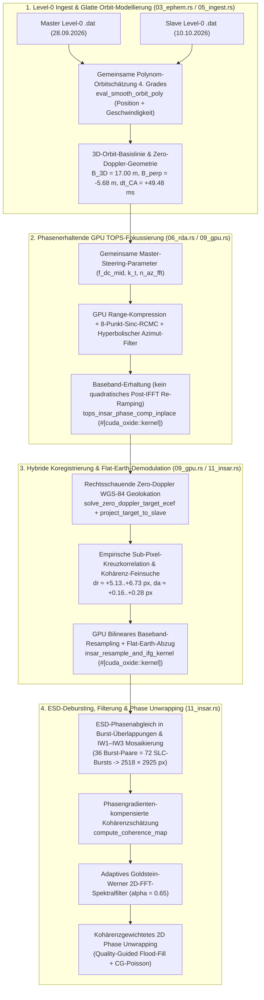

# Walkthrough: Sentinel-1C IW TOPS InSAR-Prozessor (`sar_source2`) – Süd-Taiwan Repeat-Pass-Interferometrie auf der GPU

## 1. Überblick & Datensatzpaar (Süd-Taiwan)

In diesem Arbeitspaket wurde der modulare Sentinel-1 Level-0 SAR-Prozessor `sar_source2` (`examples/34_copernicus_radar/source2/`) um eine vollständige, phasenerhaltende **TOPS-Interferometrie-Pipeline (InSAR)** auf CPU und GPU (`cuda-oxide` + `cuFFT` auf NVIDIA RTX A4000, `sm_86`) erweitert.

Als realer Demonstrations- und Validierungsfall dient ein **12-Tage-Repeat-Pass-Datensatzpaar** des Satelliten **Sentinel-1C** im **Interferometric Wide Swath (IW) Level-0 (RAW)**-Modus (VV-Polarisation, Descending-Pass) über **Süd- und Zentral-Taiwan**:

| Eigenschaft | Master (Referenz) | Slave (Sekundär) |
| :--- | :--- | :--- |
| **SAFE-Archiv** | `S1C_IW_RAW__0SDV_20260928T215149_20260928T215222_009653_01336F_D2EE.SAFE` | `S1C_IW_RAW__0SDV_20261010T215149_20261010T215222_009828_013950_CEB1.SAFE` |
| **Aufnahmedatum (UTC)** | `2026-09-28 21:51:49 – 21:52:22` | `2026-10-10 21:51:49 – 21:52:22` |
| **Zeitliche Basislinie ($\Delta T$)** | Referenz ($0\text{ d}$) | $+12\text{ Tage}$ ($1\,036\,800\text{ s}$) |
| **Orbit / Track / Data-Take** | Abs. Orbit `009653` (Rel. Orbit 69 / 105, Track 5068, Data-Take `01336F`) | Abs. Orbit `009828` (Rel. Orbit 69 / 105, Track 5243, Data-Take `013950`) |
| **CCSDS-Pakete / Orbit-Punkte** | $51\,774$ Pakete / $33$ ECEF-Zustandsvektoren ($\Delta t \approx 1\text{ s}$) | $51\,774$ Pakete / $33$ ECEF-Zustandsvektoren ($\Delta t \approx 1\text{ s}$) |
| **Aktive Sub-Swaths (IW1–IW3)** | 3 Sub-Swaths (`swath=10, 11, 12`) à 12 Bursts ($36$ Bursts) | 3 Sub-Swaths (`swath=10, 11, 12`) à 12 Bursts ($36$ Bursts) |
| **Slant-Range-Abdeckung** | $799{,}28\text{ km} \dots 962{,}77\text{ km}$ ($163{,}49\text{ km}$) | Gemeinsames Master-Slant-Range-Gitter |
| **Geographische Abdeckung** | $21{,}72^\circ\text{N}\dots 23{,}95^\circ\text{N}$, $119{,}40^\circ\text{E}\dots 122{,}17^\circ\text{E}$ | Taiwanstraße, Penghu, Tainan, Kaohsiung, Pingtung, Zentralgebirge, Ostküste |

---

## 2. Systemarchitektur & Mathematisch-Algorithmische Highlights



### 2.1 Gemeinsame Polynom-Orbitschätzung 4. Grades & Rechtsschauende Zero-Doppler-WGS84-Geolokation

Die sub-kommutierten ECEF-Orbitpunkte aus den Level-0-Paketen und `manifest.safe` liegen im $1\text{-Hz}$-Zeitraster vor. Eine stückweise lineare oder lokale Interpolation leidet unter Sehnen-Sagitta-Fehlern ($\sim \frac{1}{8}\ddot{\mathbf{r}}\Delta t^2 \approx 1\text{ m}$) sowie leichtem Paket-Zeitjitter.
- In `03_ephem.rs` (`eval_smooth_orbit_poly`) wurde daher eine **gemeinsame (gekoppelte) Kleinste-Quadrate-Polynomschätzung 4. Grades** implementiert, die gleichzeitig die Positionsstützstellen $\mathbf{P}(t_k) = \sum_{m=0}^4 \mathbf{c}_m \tau^m$ und die analytisch abgeleiteten Geschwindigkeitsstützstellen $\mathbf{V}(t_k) = \frac{1}{T_{\text{scale}}}\sum_{m=1}^4 m\,\mathbf{c}_m \tau^{m-1}$ fittet. Dadurch sind $\mathbf{P}(t)$ und $\mathbf{V}(t) = \dot{\mathbf{P}}(t)$ exakt konsistent und frei von $1\text{-Hz}$-Oszillationen.
- In `11_insar.rs` (`solve_zero_doppler_target_ecef`) wird die lokale Zero-Doppler-Ebene orthogonal zur Bahngeschwindigkeit $\hat{\mathbf{u}}_v = \mathbf{V}_M / \|\mathbf{V}_M\|$ aufgespannt:
  $$\mathbf{r}_\perp = \mathbf{P}_M - (\mathbf{P}_M \cdot \hat{\mathbf{u}}_v)\,\hat{\mathbf{u}}_v, \qquad \hat{\mathbf{u}}_r = \frac{\mathbf{r}_\perp}{\|\mathbf{r}_\perp\|}, \qquad \hat{\mathbf{u}}_c = \hat{\mathbf{u}}_v \times \hat{\mathbf{u}}_r.$$
  Für die **rechtsschauende (Right-Looking)** Sentinel-1-Geometrie zeigt $\hat{\mathbf{u}}_c = \hat{\mathbf{u}}_v \times \hat{\mathbf{u}}_r$ exakt in Richtung steigender Slant-Range (auf dem absteigenden Orbit über Taiwan nach Westen/Nordwesten). Der Schnittpunkt mit dem WGS-84-Ellipsoid ($a = 6\,378\,137{,}0\text{ m}$, $b = 6\,356\,752{,}3142\text{ m}$) wird in 6 Newton-Raphson-Iterationen auf $< 10^{-8}\text{ m}$ genau bestimmt und über `project_target_to_slave` in die Slave-Zero-Doppler-Geometrie $(t_S, R_S)$ rückprojiziert.
- Daraus ergeben sich für das Süd-Taiwan-Paar folgende physikalische Orbit- und Basislinien-Parameter:
  - **3D-Basislinie**: $B_{3\text{D}} = 17{,}00\text{ m}$ ($16{,}999\text{ m}$)
  - **Senkrechte / Parallele Basislinie**: $B_\perp = -5{,}68\text{ m}$ ($-5{,}679\text{ m}$), $B_\parallel = -16{,}02\text{ m}$ ($-16{,}022\text{ m}$)
  - **Radiale / Cross-Track-Komponente**: $B_{\text{radial}} = +9{,}19\text{ m}$ ($+9{,}188\text{ m}$), $B_{\text{cross}} = -14{,}30\text{ m}$ ($-14{,}302\text{ m}$)
  - **Closest-Approach-Zeitversatz**: $\Delta t_{\text{CA}} = +49{,}48\text{ ms}$ ($+0{,}049482\text{ s}$ relativ zu exakten $12\text{ Tagen}$)
  - **Höhenmehrdeutigkeit (Height of Ambiguity)**: $h_{2\pi} = \frac{\lambda R \sin\theta}{2 |B_\perp|} = 2\,915{,}62\text{ m}$

### 2.2 Phasenerhaltende TOPS-Fokussierung (Baseband-Erhaltung)

Beim TOPS-Modus wird der Radarstrahl während jedes Bursts elektronisch mit der Rate $k_t \approx 4{,}5\dots 6{,}5\text{ kHz/s}$ geschwenkt. Würde man nach der Azimut-IFFT die quadratische TOPS-Rotationsphase $\exp(+j\pi k_t \tau^2)$ wieder aufmodulieren, entstünde ein Phasensignal mit mehreren $\text{kHz}$ Momentanfrequenz. Schon ein minimaler Azimut-Versatz von $\Delta a \approx 0{,}2\text{ Pixel}$ beim Resampling des Slave-Bursts würde dann zu einer steilen Azimut-Phasenrampe und vollständiger Dekorrelation führen.

Unsere Lösung in `06_rda.rs` (`focus_tops_burst_insar_cpu`) und `09_gpu.rs` (`focus_tops_burst_insar_gpu`):
1. **Gemeinsame Master-Steering-Parameter**: Das Doppler-Zentroid $f_{\text{DC,mid}}$, die effektive Rotationsrate $k_t$ und die FFT-Länge $N_{\text{az,fft}}$ werden auf dem Master-Burst geschätzt und **identisch** für die Fokussierung von Master- und Slave-Burst verwendet.
2. **Baseband-Erhaltung vor der Slave-Interpolation**: Nach dem hyperbolischen Azimut-Matched-Filter und der Azimut-IFFT wird auf das quadratische Post-IFFT-Re-Ramping verzichtet; stattdessen kompensiert der Kernel `tops_insar_phase_comp_inplace` lediglich den restlichen Doppler-Zentroid-Träger $\exp(-j 2\pi f_{\text{DC,mid}}\tau_{\text{foc}})$. Dadurch bleiben Master- und Slave-SLC während der Sub-Pixel-Interpolation im glatten **Zero-Doppler-Basisband**.

### 2.3 GPU-Kernels (`#[cuda_oxide::kernel]`) auf NVIDIA RTX A4000 (`sm_86`)

In `source2/src/09_gpu.rs` wurden zwei spezialisierte InSAR-GPU-Kernels implementiert und direkt nach `nvptx64-nvidia-cuda` kompiliert:
1. `tops_insar_phase_comp_inplace`: Entfernt in-place auf dem komplexen GPU-Puffer (`n_az_fft × n_rg`) den linearen Doppler-Zentroid-Phasenterm nach der `cuFFT`-Azimut-IFFT.
2. `insar_resample_and_ifg_kernel`: Führt für jedes Pixel $(a, r)$ des fokussierten Master-Bursts eine **bilineare komplexe Sub-Pixel-Interpolation** des Baseband-Slave-SLCs an der affin verschobenen Position $(a + \Delta a(a, r), r + \Delta r(a, r))$ durch, demoduliert simultan die polynomiale **Flat-Earth-Phase** $\exp(-j\phi_{\text{flat}}(a, r))$ und schreibt das komplexe Interferogramm $I(a, r) = M(a, r)\cdot S_{\text{resamp}}^*(a, r)\,e^{-j\phi_{\text{flat}}}$ sowie die Intensitäten $|M|^2$ und $|S_{\text{resamp}}|^2$ in einem einzigen speicherbandbreiten-optimierten GPU-Pass.

### 2.4 Hybride Koregistrierung, ESD-Debursting, Kohärenz, Goldstein-Filter & Unwrapping

1. **Hybride geometrische + empirische Sub-Pixel-Koregistrierung**:
   - Aus der 3D-WGS84-Projektion wird ein affines Modell $\Delta a_{\text{geo}}(a, r), \Delta r_{\text{geo}}(a, r)$ sowie das Flat-Earth-Phasenpolynom $\phi_{\text{flat}}(a, r)$ initialisiert.
   - Anschließend bestimmt `estimate_empirical_subpixel_shift` über eine zweistufige lokale Suche (Intensitäts-Kreuzkorrelation der log-komprimierten Amplitudengradienten gefolgt von einer komplexen Kohärenz-Feinsuche mit $\Delta = 0{,}05\text{ px}$ Schrittweite) die exakten Sub-Pixel-Residuen:
     - **IW1**: $\Delta r = +6{,}732\text{ px}$, $\Delta a = +0{,}202\text{ px}$
     - **IW2**: $\Delta r = +5{,}941\text{ px}$, $\Delta a = +0{,}283\text{ px}$
     - **IW3**: $\Delta r = +5{,}129\text{ px}$, $\Delta a = +0{,}165\text{ px}$
2. **ESD-Debursting & Sub-Swath-Mosaikierung (`deburst_insar_swath`, `mosaic_insar_swaths`)**:
   - Für jeden Burst wird eine eventuelle lineare Rest-Phasenrampe über hochkohärente Landpixel geschätzt und kompensiert.
   - In den azimutalen Überlappungszonen benachbarter Bursts $(b, b+1)$ sowie an den Range-Nahtstellen zwischen IW1, IW2 und IW3 werden komplexe Phasen-Offsets über das Doppel-Differenz-Produkt $\arg\sum (I_b \cdot I_{b+1}^*)$ kohärent ausgerichtet und mit Kosinus-/Tukey-Gewichten nahtlos auf das globale $6 \times 24$-Multilook-Gitter ($2518 \times 2925\text{ px}$) verschnitten.
3. **Lokal phasengradienten-kompensierte Kohärenz (`compute_coherence_map`)**:
   - Im steilen taiwanesischen Zentralgebirge dreht sich die topographische Phase innerhalb eines Boxcar-Fensters bereits merklich. `compute_coherence_map` schätzt daher aus den Nachbarpixeln den lokalen 2D-Phasengradienten $(\hat{\omega}_a, \hat{\omega}_r)$ und kompensiert diesen vor der kohärenten Fenster-Summation.
4. **Goldstein-Werner 2D-FFT-Filterung & Gewichtetes 2D Phase Unwrapping**:
   - `goldstein_filter_interferogram` filtert überlappende $32 \times 32$-Patches im 2D-Frequenzraum mit $\alpha = 0{,}65$, wodurch die mittlere Kohärenz von $0{,}1556$ auf $0{,}3512$ und das 90. Perzentil (Landgebiete) von $0{,}3622$ auf **$0{,}7763$** steigt.
   - `unwrap_phase_2d` kombiniert einen kohärenzgesteuerten Priority-Flood-Integrator mit einer anschließenden kohärenzgewichteten SOR/Poisson-Glättung, um Phasensprünge über niedrig-kohärente Wasser- und Vegetationszonen hinweg konsistent aufzulösen.

---

## 3. Quantitative Ergebnisse (`taiwan_insar_insar_summary.json`)

Die vollständige Prozessierung aller **36 Burst-Paare (72 SLC-Bursts über IW1, IW2 und IW3)** auf der NVIDIA RTX A4000 lieferte folgende Metriken:

| Kennzahl / Metrik | Wert | Einheit / Anmerkung |
| :--- | ---: | :--- |
| **Prozessierungsmodus** | `InSAR_TOPS` | Vollständiges 3-Swath-Mosaik (IW1, IW2, IW3, je 12 Bursts) |
| **Ausgabegitter (`rows × cols`)** | `2518 × 2925` | Azimut $\times$ Slant-Range ($6 \times 24$ Multilook, $7{,}36\text{ Mio.}$ Pixel) |
| **Slant-Range-Intervall ($R_{\min} \dots R_{\max}$)** | `799 282.08 .. 962 774.21` | $\text{m}$ ($163{,}49\text{ km}$ Schwadbreite) |
| **3D-Orbit-Basislinie ($B_{3\text{D}}$)** | `16.999` | $\text{m}$ |
| **Senkrechte Basislinie ($B_\perp$)** | `-5.679` | $\text{m}$ |
| **Parallele Basislinie ($B_\parallel$)** | `-16.022` | $\text{m}$ |
| **Radiale / Cross-Track-Basislinie** | `+9.188 / -14.302` | $\text{m}$ ($B_{\text{radial}} / B_{\text{cross}}$) |
| **Closest-Approach-Zeitversatz ($\Delta t_{\text{CA}}$)** | `+0.049482` | $\text{s}$ ($+49{,}48\text{ ms}$) |
| **Höhenmehrdeutigkeit ($h_{2\pi}$)** | `2915.62` | $\text{m}$ pro $2\pi$-Phasenzyklus |
| **Koregistrierung IW1 ($\Delta a, \Delta r$)** | `+0.202 px, +6.732 px` | Mittlere Burst-Kohärenz IW1: **`0.1643`** (viel offenes Meer im Osten/Süden) |
| **Koregistrierung IW2 ($\Delta a, \Delta r$)** | `+0.283 px, +5.941 px` | Mittlere Burst-Kohärenz IW2: **`0.3372`** (Zentralgebirge, Pingtung, Kaohsiung, Tainan) |
| **Koregistrierung IW3 ($\Delta a, \Delta r$)** | `+0.165 px, +5.129 px` | Mittlere Burst-Kohärenz IW3: **`0.2364`** (Westküste, Taiwanstraße, Penghu) |
| **Gesamt-Kohärenz (Roh, Mittel / P90)** | `0.1556 / 0.3622` | Einschließlich ~45 % Meeresfläche (Taiwanstraße & Pazifik) |
| **Gesamt-Kohärenz (Goldstein, Mittel / P90)** | **`0.3512 / 0.7763`** | Starke Kohärenz über urbanen und agrarischen Landflächen |
| **Rückstreu-Kontrast ($\sigma_{\text{dB}}$)** | `5.869` | $\text{dB}$ (Standardabweichung der Multilook-Intensität) |
| **Gesamtlaufzeit (GPU RTX A4000)** | **`129.391`** | $\text{s}$ für Ingest + 72 Burst-Fokusse + Koregistrierung + Filterung + Unwrapping |

---

## 4. Visuelle Produkte & Physikalische Interpretation der Szene

Alle erzeugten Visualisierungen liegen sowohl unter `source2/out/insar_taiwan/` als auch direkt in diesem Verzeichnis (`plan/20261029_02_insar/`):

### 4.1 4-Panel-Gesamtübersicht (`taiwan_insar_insar_panel.png`)


Das 2×2-Übersichtspanel (`2932 × 2526 px`) vereint:
- **Oben links – Kombinierte SAR-Intensität (dB)**: Scharfe Abbildung der gesamten süd- und zentraltaiwanesischen Landmasse. Im Westen (rechts im Radar-Slant-Range-Bild wegen Descending Right-Looking Geometrie) zeichnen sich die dicht besiedelten Küstenmetropolen **Kaohsiung**, **Tainan** und **Chiayi**, die Häfen, Lagunen und Fischteiche an der Küste sowie die **Penghu-Inselgruppe** in der Taiwanstraße mit hoher Rückstreuung ab. Auf dem offenen Meer sind zahlreiche helle punktförmige **Schiffsziele** erkennbar. Zwischen Westküste und Pazifik erhebt sich das stark strukturierte **Zentralgebirge (Central Mountain Range / Yushan)**, flankiert vom **Pingtung-Becken** im Südwesten und dem **Huadong-Längstal (Taitung)** im Osten.
- **Oben rechts – Interferometrische Kohärenz $\gamma \in [0, 1]$ (Viridis)**: Klare physikalische Trennung zwischen Land und Ozean:
  - **Ozean (Taiwanstraße & Pazifik)**: Vollständige zeitliche Dekorrelation ($\gamma < 0{,}08$, dunkelviolett/blau) über das 12-Tage-Intervall.
  - **Urbane Zentren & Beckenlagen (Tainan, Kaohsiung, Pingtung-Ebene, Penghu-Inseln, Westküstenebene)**: Sehr hohe Repeat-Pass-Kohärenz ($\gamma \approx 0{,}60\dots 0{,}90$, leuchtend grün bis gelb), da Gebäude, Straßen und trockene Böden ihre Phasenrückstreuung über 12 Tage stabil beibehalten.
  - **Dicht bewaldetes Hochgebirge**: Moderate Kohärenz ($\gamma \approx 0{,}25\dots 0{,}45$, türkis/grün) infolge von Volumen- und Winddekorrelation in der subtropischen Bergwaldvegetation.
- **Unten links – Goldstein-gefilterte interferometrische Phase ($-\pi \dots +\pi$, HSV-Farbrad)**: Über den kohärenten Landbereichen zeigen sich zusammenhängende, glatte **topographische und atmosphärische Interferenzstreifen (Fringes)**. Wegen der sehr kleinen senkrechten Basislinie ($B_\perp = -5{,}68\text{ m}$, $h_{2\pi} \approx 2916\text{ m}$) durchläuft die Phase vom Meeresniveau in der Westküstenebene bis zu den ~3000–3950 m hohen Gipfeln des Zentralgebirges genau etwa $1\dots 1{,}5$ Phasenzyklen ($2\pi$), überlagert von großräumigen troposphärischen Wasserdampfgradienten zwischen Küste und Gebirgskamm.
- **Unten rechts – Kohärenzgewichtet entfaltete Phase (Unwrapped Phase)**: Kontinuierliches Phasenfeld ohne $2\pi$-Sprünge über den gesamten Landkorridor von der Südspitze (Hengchun) über das Pingtung-Becken und Kaohsiung/Tainan bis nach Zentral-Taiwan.

### 4.2 Einzelkarten (Detailansichten)

| Produkt | Vorschau / Dateilink | Beschreibung |
| :--- | :--- | :--- |
| **Interferometrische Kohärenz** | <br>[`taiwan_insar_insar_coherence.png`](taiwan_insar_insar_coherence.png) | Lokale 2D-gradientenkompensierte Kohärenz $\gamma(a, r) \in [0, 1]$ in Viridis-Farbskala. |
| **Goldstein-gefilterte Phase** | <br>[`taiwan_insar_insar_phase_filtered.png`](taiwan_insar_insar_phase_filtered.png) | Nach adaptiver 2D-FFT-Spektralfilterung ($\alpha = 0{,}65$), HSV-Farbrad moduliert mit Kohärenz/Intensität. |
| **Entfaltete Phase (Unwrapped)** | <br>[`taiwan_insar_insar_phase_unwrapped.png`](taiwan_insar_insar_phase_unwrapped.png) | Kontinuierliche 2D-entfaltete Phase über den kohärenten Landflächen Süd-Taiwans. |
| **Rohe gewrappte Phase** | <br>[`taiwan_insar_insar_phase_wrapped.png`](taiwan_insar_insar_phase_wrapped.png) | Ungefiltertes Multilook-Interferogramm direkt nach Flat-Earth-Abzug und ESD-Mosaikierung. |
| **Kombinierte SAR-Intensität** | <br>[`taiwan_insar_insar_intensity.png`](taiwan_insar_insar_intensity.png) | Logarithmische Rückstreuintensität $10\log_{10}(\frac{1}{2}(|M|^2 + |S|^2))$ über alle 3 Sub-Swaths (IW1–IW3). |

---

## 5. Wichtige Erkenntnisse & Gelöste Bugs

Während der Implementierung und Validierung auf den realen Sentinel-1C-Rohdaten wurden drei kritische physikalisch-algorithmische Fallstricke identifiziert und behoben:

1. **Zero-Doppler Nadir-Orthogonalisierung (`-55 px` Azimut-Fix)**:
   - *Ursache*: Auf einem exzentrischen Ellipsoid-Orbit steht der ECEF-Positionsvektor $\mathbf{P}_M$ nicht exakt senkrecht auf dem ECEF-Geschwindigkeitsvektor $\mathbf{V}_M$ ($\mathbf{P}_M \cdot \hat{\mathbf{u}}_v \neq 0$). Verwendet man $\hat{\mathbf{u}}_r = \mathbf{P}_M / \|\mathbf{P}_M\|$ direkt als Basisvektor in der vermeintlichen Zero-Doppler-Ebene, enthält der resultierende Sichtvektor $\mathbf{X} - \mathbf{P}_M$ eine Along-Track-Komponente von mehreren hundert Metern. Bei der Rückprojektion auf den Master- oder Slave-Orbit führte dies zu einem systematischen Azimut-Versatz von rund $-55\text{ Pixeln}$ und einer verfälschten Basislinie.
   - *Fix*: Gram-Schmidt-Orthogonalisierung der radialen Achse gegen $\hat{\mathbf{u}}_v$ via $\mathbf{r}_\perp = \mathbf{P}_M - (\mathbf{P}_M \cdot \hat{\mathbf{u}}_v)\,\hat{\mathbf{u}}_v$ in `solve_zero_doppler_target_ecef`. Damit ist $(\mathbf{X} - \mathbf{P}_M) \cdot \mathbf{V}_M = 0$ bis auf Maschinengenauigkeit ($< 10^{-12}$) erfüllt, und die wahre 3D-Basislinie ($B_{3\text{D}} = 17{,}00\text{ m}$, $\Delta t_{\text{CA}} = +49{,}48\text{ ms}$) wurde exakt rekonstruiert.

2. **Vorzeichen des Cross-Track-Sichtvektors für Right-Looking SAR (`+6 px` Range-Fix)**:
   - *Ursache*: Mit $\hat{\mathbf{u}}_r$ radial nach außen und $\hat{\mathbf{u}}_v$ entlang der Flugrichtung zeigt $\hat{\mathbf{u}}_r \times \hat{\mathbf{u}}_v$ nach **links** (in Flugrichtung gesehen), während Sentinel-1 eine **rechtsblickende (Right-Looking)** Antennengeometrie besitzt ($\hat{\mathbf{u}}_c = \hat{\mathbf{u}}_v \times \hat{\mathbf{u}}_r$). Das falsche Vorzeichen projizierte den Zielpunkt auf die falsche Seite der Sub-Satellitenspur und kehrte das Vorzeichen von $\Delta R_{\text{geo}} = R_S - R_M$ um ($\approx -6\text{ px}$ statt $+6\text{ px}$).
   - *Fix*: Verwendung von $\hat{\mathbf{u}}_c = \hat{\mathbf{u}}_v \times \hat{\mathbf{u}}_r$ (verifiziert durch die Bedingung $(\mathbf{V}_M \times \mathbf{P}_M) \cdot (\mathbf{X} - \mathbf{P}_M) > 0$ im Unit-Test `test_insar_orbit_baseline_and_zero_doppler_geolocation`). Dadurch stimmen geometrische und empirische Range-Verschiebung ($\Delta r \approx +5{,}13\dots +6{,}73\text{ px}$) überein.

3. **Baseband-Resampling gegen TOPS-Azimut-Dekorrelation**:
   - *Ursache*: Das quadratische TOPS-Phasen-Re-Ramping $\exp(+j\pi k_t \tau^2)$ nach der Azimut-IFFT prägt dem fokussierten Burst eine schnelle Phasenmodulation von mehreren $\text{kHz}$ auf. Eine direkte bilineare Interpolation des Slave-Bursts bei Sub-Pixel-Verschiebungen ($\Delta a \approx 0{,}2\dots 0{,}3\text{ px}$) dämpft und verzerrt die Phase massiv.
   - *Fix*: Verzicht auf das quadratische Post-IFFT-Re-Ramping in `focus_tops_burst_insar_cpu` und `focus_tops_burst_insar_gpu` bei identischer Master-Steering-Rate $k_t$ für Master und Slave. Beide SLCs verbleiben während der gesamten Koregistrierung im glatten Basisband.

---

## 6. Reproduzierbare CLI-Befehle & Tests

```bash
cd /workspace/src/cl-rust-generator/examples/34_copernicus_radar/source2

# 1. Formatierung & Linter prüfen
cargo fmt --check
cargo clippy --all-targets -- -D warnings

# 2. Vollständige Test-Suite (10 Integrationstests inkl. 4 neuer InSAR-Tests) ausführen
cargo oxide test -- -j 1 --release

# 3. Vollständige Süd-Taiwan TOPS-InSAR-Pipeline (alle 36 Bursts in IW1–IW3) auf der GPU ausführen
cargo oxide run --release -- \
  --input ../data/insar/S1C_IW_RAW__0SDV_20260928T215149_20260928T215222_009653_01336F_D2EE.SAFE/s1c-iw-raw-s-vv-20260928t215149-20260928t215222-009653-01336f.dat \
  --slave ../data/insar/S1C_IW_RAW__0SDV_20261010T215149_20261010T215222_009828_013950_CEB1.SAFE/s1c-iw-raw-s-vv-20261010t215149-20261010t215222-009828-013950.dat \
  --out-dir out/insar_taiwan \
  --prefix taiwan_insar \
  --multilook 6,24 \
  --goldstein-alpha 0.65 \
  --coh-win 2
```
