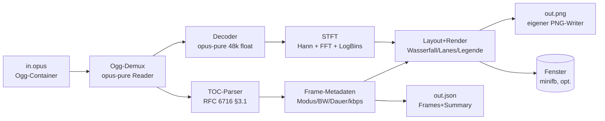

# Plan: Opus-Visualisierung (`36_opus/source1`, Stand 2026-10-11)

Ziel: Eine `.opus`-Datei so visualisieren, dass man **sieht, was der
Encoder erkannt und entschieden hat** — pro Frame: Sprach/ Musik-Modus
(SILK/CELT/Hybrid), codierte Bandbreite, Bitrate — plus Wasserfall des
Spektrums und Kompressionsgewinn gegenueber Roh-PCM.

Direkt-Rust (kein Lisp-Transpiler-Input), Edition 2024, minimaler Code,
minimale Abhaengigkeiten.

## 1. Empfehlung: Was bauen wir?

Aus `opus-vis.md` (Google-AI-Recherche des Auftraggebers) und dem
Prompt destilliert der Auftraggeber zwei offene Richtungsfragen:

1. Desktop-App vs. Web-Interface? — **Empfehlung: keines von beiden
   fuer den Anfang.** Ein CLI-Werkzeug `opus-vis`, das aus `in.opus`
   ein statisches `out.png` (Wasserfall + Overlays) und optional ein
   `out.json` (Frame-Metadaten) erzeugt. Begruendung: keine Browsing-
   oder GUI-Frameworks noetig, Ausgabe ist ohne Server betrachtbar,
   alles ist headless testbar. Ein X11-Fenster (`--show`) gibt es als
   duenne Option obendrauf (eine Zusatz-Dep, Feature-gated).
2. Echtzeit-Streaming vs. Datei-Analyse? — **Empfehlung: Datei-Analyse
   zuerst.** Die Pipeline ist streaming-faehig aufgebaut (Paket fuer
   Paket), sodass ein Live-Modus spaeter ohne Umbau moeglich ist.

### 1.1 MVP-Umfang (wird umgesetzt)

- Einlesen beliebiger `.opus`-Dateien (Ogg-Container, RFC 7845),
  mono/stereo, inkl. echter `libopus`-Dateien (`opusenc`-kompatibel).
- Pro Paket: TOC-Byte (RFC 6716 §3.1) parsen → Modus (SILK/CELT/
  Hybrid), Audio-Bandbreite (NB/MB/WB/SWB/FB), Frame-Dauer, Kanaele;
  Momentan-Bitrate = Paketgroesse / Dauer; kumulierte Zeitachse.
- PCM-Decodierung (48 kHz float) + STFT-Wasserfall (Hann-Fenster,
  Radix-2-FFT, Log-Frequenzachse).
- PNG-Ausgabe mit Ebenen (statisch, aber alle Infos aus `opus-vis.md`):
  - Wasserfall-Heatmap (Zeit=X, Frequenz=Y, Pegel=Farbe),
  - Modus-Toenung pro Zeitspalte (SILK=blau/gruen, Hybrid=violett,
    CELT=amber),
  - Bandbreiten-Grenzlinie (bis wohin codiert der Modus tatsaechlich),
  - Bitraten-Lane unter dem Spektrogramm (Balken pro Paket + Ø-Linie),
  - Kopfzeile: Dauer, Ø-Bitrate, Roh-vs.-Opus-Faktor, Modusanteile;
    Legende + Achsenbeschriftung mit eigenem 5x7-Bitmap-Font.
- JSON-Ausgabe (`--json`): pro Frame `{t_ms, mode, bandwidth_hz,
  frame_ms, bytes, kbps, channels}` + `summary` (Dauer, Ø-Bitrate,
  Roh-Bitrate, Kompressionsfaktor, Modusanteile, Overhead).
- `--show`: PNG zusaetzlich in einem X11-Fenster anzeigen (Feature
  `show`, Smoke-Objeekt unter `xvfb`).
- Tests: Unit (alle 32 TOC-Configs, FFT-vs.-DFT, PNG-CRC/Roundtrip),
  Integration (selbst encodierte Fixtures + eine committete
  `libopus`-Referenzdatei), Smoke-Skript (`scripts/smoke.sh`).

### 1.2 Bewusst nicht (spaetere Erweiterungen)

- Kein interaktives Zoomen/Scrollen, keine Web-UI.
- Kein Echtzeit-Mikrofon-/Netzwerk-Modus (Pipeline ist vorbereitet).
- Nur 1–2 Kanaele; Multistream (>2ch, Mapping-Familien) → klarer
  Fehler statt falscher Grafik.
- Keine DTX/Lücken-Visualisierung ueber das hinaus, was leere Pakete
  hergeben (kommt gratis mit, falls vorhanden).

### 1.3 Fehlende Requirements — Rueckfragen an wol pumba

Diese Punkte standen weder im Prompt noch in `opus-vis.md`; der Plan
trifft je eine Annahme (fett), Widerspruch willkommen:

1. **Eingabe:** nur Datei (`opus-vis in.opus`), keine stdin-Pipe? —
   **Annahme: Datei + stdin (`-`), billig zu haben.**
2. **Farben/Barrierefreiheit:** farbenblind-sichere Palette
   erforderlich? — **Annahme: nein, dokumentierte Standardpalette.**
3. **Max. Dateigroesse:** Sollen Stunden-Dateien gehen? —
   **Annahme: Minuten-Bereich, Bildbreite auf 4096 px resampelt.**
4. **Frequenzachse:** linear oder logarithmisch? —
   **Annahme: logarithmisch (Musik/Sprache lesbarer).**
5. **Roh-Referenz:** PCM s16 stereo 48 kHz als „roh“? —
   **Annahme: ja, plus Kanal-Anpassung aus dem Header.**

## 2. Architektur

Datenfluss ist strikt vorwaerts, streaming-faehig: Ogg-Pakete werden
einzeln gelesen, decodiert und in Spektrum-Spalten verwandelt; nur die
Spaltenmatrix (Zeit × 256 Bins) liegt komplett im Speicher.

### 2.1 Datei-Aufteilung (`source1/src/`, verbindlich nummeriert)

| Datei | Zustaendigkeit | Haengt ab von |
|---|---|---|
| `lib.rs` | nur Modul-Deklarationen + Re-Exporte | – |
| `main.rs` | nur `run()`-Aufruf + Exit-Code | lib |
| `01_types.rs` | Fehlertyp, `Mode`, `Bandwidth`, `FrameMeta`, `Summary`, CLI-Config | – |
| `02_toc.rs` | TOC-Tabelle (32 Configs → Modus/BW/Dauer) | 01 |
| `03_analyze.rs` | Ogg lesen, Zeitachse, Bitraten, Summary (ohne Decode) | 01, 02 |
| `04_decode.rs` | PCM-Decode + Trim + Mono-Mix-Iterator | 01, 03 |
| `05_spectrum.rs` | Hann-Fenster, Radix-2-FFT, Log-Binning, STFT | 01 |
| `06_render.rs` | Bildpuffer, Colormap, 5x7-Font, Layout, Lanes, Legende | 01 |
| `07_png.rs` | minimaler PNG-Writer (stored-deflate, CRC32) | 01 |
| `08_cli.rs` | Arg-Parsing, `run()`: Datei→PNG/JSON/show | alle |
| `09_show.rs` | `minifb`-Fenster (nur Feature `show`) | 01 |

Regel-Einhaltung: Nummern folgen dem Datenfluss (Typen → TOC →
Analyse → Decode → Spektrum → Render → PNG → CLI → Show);
`lib.rs`/`main.rs` ohne Verhalten; jede Datei < 600 Zeilen mit genau
einer Zustaendigkeit; Tests stehen bei ihren Typen bzw. in `tests/`.

## 3. Kontext-Dateien fuer einen unabhaengigen Agenten

| Datei (rel. zu `examples/36_opus/`) | Warum lesen |
|---|---|
| `plan/20261011_01_init/prompt.txt` | Original-Auftrag, Code-Regeln, Doku-Pflichten |
| `plan/20261011_01_init/opus-vis.md` | Fach-Recherche: TOC-Byte, SILK/CELT, UI-Ebenen |
| `plan/20261011_01_init/plan.md` | dieser Plan (Architektur, Entscheidungen) |
| `plan/20261011_01_init/task.md` | serielle Tasks mit Verifikation je Schritt |
| `source1/Cargo.toml` | einzige Abhaengigkeiten + `show`-Feature |
| `source1/deps.md` | alle Deps in `<org>/<repo>`-Notation + DeepWiki-Notizen |
| `source1/src/02_toc.rs` | Herz der Analyse: RFC-6716-Tabelle, Referenz-Tests |
| `source1/src/08_cli.rs` | End-zu-End-Verdrahtung (Einstieg zum Verstehen) |
| `source1/tests/*.rs` | Integrations-Vertraege (Fixtures, Referenzdatei) |
| `source1/scripts/smoke.sh` | HIL-Nachweis (Render + `ffprobe` + xvfb-Show) |
| `../30_wgpu/deps.md` | Vorbild fuer Dep-Doku-Stil im Repo |
| `../29_lowbandwidth/plan/20261010_01_instrumentation/task.md` | Vorbild fuer Task-Stil (T0…T8, „endet gru
...[truncated 5433 chars]