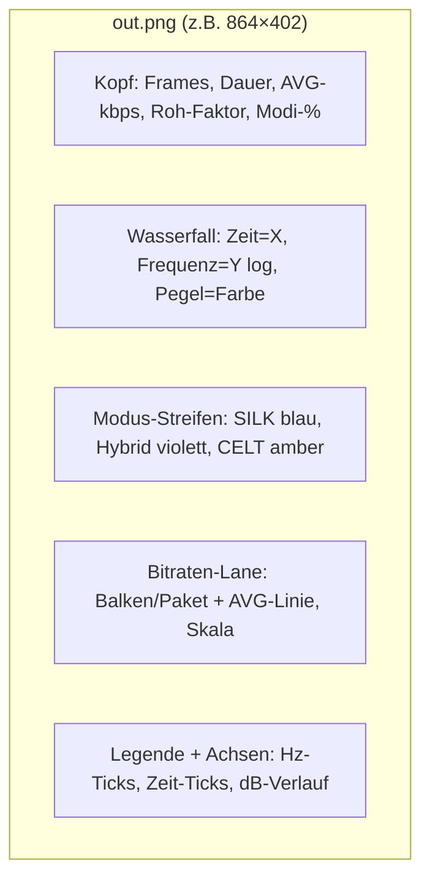
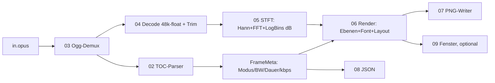

# Walkthrough: Opus-Visualisierung (`36_opus/source1`)

Stell dir vor, du koenntest einem Opus-Encoder bei der Arbeit zusehen:
Hier erkennt er Sprache und schaltet auf SILK, dort auf Musik (CELT),
dazu dreht er staendig an Bandbreite und Bitrate. Genau das zeigt
`opus-vis` — als Bild (`PNG`, Portable Network Graphics) und als
Zahlen (`JSON`, JavaScript Object Notation). Dieses Dokument erzaehlt,
was gebaut wurde, was die Tests dabei veraendert haben und wie es
weitergehen kann.

## Glossar (Kuerzel bei Erstgebrauch)

- **Opus**: moderner Audio-Codec (Kodierer/Dekodierer), RFC 6716.
- **SILK**: Opus-Sprachmodus (lineare Vorhersage, Skype-Erbe).
- **CELT**: Opus-Musikmodus (MDCT, Constrained-Energy Lapped Transform).
- **Hybrid**: Modus-Mix (SILK unten, CELT oben).
- **TOC** (Table of Contents): erstes Byte jedes Opus-Pakets — enthaelt
  Modus, Bandbreite, Dauer und Kanalzahl.
- **Ogg**: Container-Format, in dem `.opus`-Dateien stecken (RFC 7845).
- **STFT** (Short-Time Fourier Transform): Spektrum im Zeitverlauf —
  unser „Wasserfall“.
- **FFT** (Fast Fourier Transform): schneller Algorithmus dafuer.
- **PCM** (Pulse-Code Modulation): rohes Digital-Audio (hier: 48 kHz).
- **VBR** (Variable Bitrate): Bitrate schwankt pro Paket.
- **HIL** (Hardware-in-the-Loop): Test mit echter Umgebung (hier: X11).
- **dBFS** (Dezibel Full Scale): Pegel relativ zur Vollaussteuerung.

## 1. Was exakt implementiert wurde

### 1.1 Das Werkzeug

`opus-vis` liest eine `.opus`-Datei und erzeugt ein PNG (Wasserfall +
Encoder-Entscheidungen) sowie optional JSON (alle Frame-Metadaten):

```sh
opus-vis song.opus -o song.png --json song.json   # Datei
opus-vis --help                                   # alle Flaggen
opus-vis song.opus --show                         # plus X11-Fenster
```

Beispiel (selbst gebaute Demo, 3 s Sprache + 3 s Sweep): 300 Pakete,
davon 150 SILK und 150 CELT, Ø 59,8 kbit/s, Faktor 12,6x gegen Roh-PCM,
Overhead 1,6 %. Die echte YouTube-Datei (12,9 min, Stereo) rendert in
2 Sekunden: 38655 Pakete, alles CELT, Ø 119,7 kbit/s, 12,7x.

### 1.2 Das Bild (fuenf Ebenen)



- **Wasserfall**: 256 Log-Bins (50 Hz–20 kHz), Hann-Fenster, 20-ms-Hops.
- **Toenung**: jede Spalte traegt 22 % Modus-Farbe ueber der Heatmap.
- **Weisse Punkte**: codierte Bandgrenze je Paket (z.B. Linie bei 8 kHz
  im SILK-Teil, bei 20 kHz im CELT-Teil) — man sieht direkt, wie viel
  Spektrum der Encoder jeweils „bezahlt“.
- **Lane**: Balkenhohe = Momentan-Bitrate, Skala = max(2×AVG, Peak).

### 1.3 Die Pipeline



Module (`src/`, groesstes 524 Zeilen, alle < 600):

| Datei | Zeilen | Aufgabe |
|---|---|---|
| `01_types.rs` | 223 | Fehler, Modus, Frames, Summary, CLI-Config |
| `02_toc.rs` | 189 | 32er-TOC-Tabelle + Packing-Codes |
| `03_analyze.rs` | 188 | Zeitachse, Bitraten, Summary, `frame_at` |
| `04_decode.rs` | 43 | PCM-Decode + Trim + Mono-Mix |
| `05_spectrum.rs` | 228 | FFT, Log-Achse, STFT-Spalten in dB |
| `06_render.rs` | 524 | Bild, Colormap, 5x7-Font, alle Ebenen |
| `07_png.rs` | 153 | PNG-Writer (stored-deflate, CRC32) |
| `08_cli.rs` | 292 | Argumente, JSON, End-zu-End-`run` |
| `09_show.rs` | 51 | X11-Fenster (nur Feature `show`) |

Abhaengigkeiten: genau zwei Crates (`source1/deps.md`) — `opus-pure`
(Ogg + Codec, null transitive Deps) und optional `minifb` (nur X11).
TOC-Parser, FFT, PNG-Writer, Bitmap-Font und CLI-Parsing sind eigener
`std`-only-Code mit `#![forbid(unsafe_code)]`.

### 1.4 Das JSON (Ausschnitt, echte Demo-Daten)

```json
{"frames": [{"i": 0, "t_ms": 0.000, "dur_ms": 20.000, "mode": "SILK",
  "bw": "WB", "ch": 1, "bytes": 64, "kbps": 25.600}, ...],
 "summary": {"frames": 300, "dur_ms": 6000.0, "avg_kbps": 59.809,
  "raw_kbps": 768.0, "ratio": 12.637, "overhead_pct": 1.59,
  "silk": 0.5, "hybrid": 0.0, "celt": 0.5, "channels": 1}}
```

### 1.5 Tests (33, alle gruen) und Smoke

- **Unit (22)**: alle 32 TOC-Configs gegen RFC-Tabelle, Summary-Mathe,
  FFT gegen naive DFT (N=64, 1e-4), Sinus-Peak im richtigen Bin,
  Parseval (±5 %), PNG-Header/CRC/Roundtrip, Colormap, Font, Parse-Flags.
- **Integration (11)**: SILK-/CELT-Fixtures aus eigenem Encoder,
  `opusenc`-Referenz (`tests/data/ref.opus`), Sweep-Peak steigt,
  Rausch-Mittenband flach, Pegel-nach-Trim, Render-Pixel, CLI-Lauf,
  Stereo, 6-Kanal-Fehler, defekte Eingaben.
- **Smoke (`scripts/smoke.sh`)**: Release-Build, Demo-Render, PNG per
  `ffprobe` (864×402), JSON per `json.tool`, stdin/stdout-Pfad,
  `--show` unter `xvfb` (30 Frames, Exit 0), 30-s-YouTube-Ausschnitt.

## 2. Architektur-Entscheidungen durch Tests

1. **Decoder-Wahl per Kreuzvergleich**: Vor dem Bau wurden drei
   rein-Rust-Decoder gegeneinander getestet — `opus-pure` vs.
   `rusty-opus` Bit-identisch, vs. `opus-decoder` 1e-5, Sinus-RMS exakt.
   Erst dieser Spike machte `opus-pure` (inkl. Ogg-Schicht) zur
   einzigen Kern-Dep; `RustAudio/ogg` und `SpaceManiac/opus-rs`
   fielen weg.
2. **Frame-Packing parsen**: Der TOC-Test erzwang Packing-Codes 0–3
   (Multi-Frame-Pakete) statt „1 Paket = 1 Frame“ — sonst waeren
   Dauer, kbps und Zeitachse bei solchen Dateien falsch. Plus Guard:
   Count 0 → `BadPacket` statt Division durch null.
3. **Rausch-Test wurde Physik**: „Mittenband flach“ scheiterte erst
   (22 dB Spreizung) — kein Bug, sondern Rayleigh-Streuung einzelner
   FFT-Bins. Der Test mittelt nun ueber die Zeit und vergleicht
   Band-Quartale (±4 dB); der Pegel (~−40 dB) folgt aus
   Fenster-Verstaerkung und Referenz. Dabei flog nebenbei ein
   Generator-Bug auf (31-Bit-Wert durch 2^32-Maximum geteilt).
4. **Demo-Aliasing im Bild sichtbar**: Der erste Sweep nutzte
   Phase = 2π·f·t statt des Frequenz-Integrals — das Bild zeigte
   gespiegelte Geisterkurven statt einer Linie. Gefixt (Integral),
   im Bild verifiziert: saubere Linie + Oktave.
5. **`show` hinter Feature**: Damit Headless-Builds ohne X11 gehen,
   ist `minifb` optional (`show = ["dep:minifb"]`, nur `x11`-Backend);
   ohne Feature gibt `--show` einen Hinweis-Fehler statt zu brechen.
6. **`opusenc`-Flush-Paket**: Die Referenzdatei hat 51 statt 50
   Paketen (1 s + Flush) — der Test toleriert 50–52 statt starr 50.
7. **Achse endet bei 20 kHz**: Der Test erwartete erst Nyquist (513),
   die Achse deckt per Design nur das Hoerbare ab (Bin 427) — Test
   korrigiert, Design bestaetigt.

## 3. Learnings und Erweiterungen

**Learnings.**

- Reine-Rust-Opus-Decoder sind 2026 echt: Bit-identitaet dreier
  unabhaengiger Ports ist staerker als jede Doku-Behauptung.
- Visualisierer brauchen Realitaets-Anker: `ffprobe` (PNG),
  `json.tool` (JSON) und echte `libopus`-Dateien fangen Fehler, die
  Unit-Tests nie sehen (Flush-Paket, VBR-Spitzen bis 273 kbit/s).
- Kleine Alphabete reichen: Ein 5x7-Font mit 48 Glyphen traegt alle
  Achsen und Kennzahlen; Kleinbuchstaben → Gross, Rest → `?`.

**Moegliche Erweiterungen.**

- Interaktiv: Zoomen/Scrollen im Fenster (derzeit statisches Bild).
- Live-Modus: Pipeline ist paketweise streaming-faehig (Mic/RTP).
- Multistream (>2 Kanaele) statt Fehler; DTX-Pausen-Bänder.
- Voller Zeichensatz + Dateiname im Kopf; Emoji-Icons wie in
  `opus-vis.md` skizziert (braucht echten Font-Atlas).
- Komprimiertes PNG (echtes Deflate) — derzeit unkomprimiert
  (5 MB bei 12 min, dafuer schnell und simpel).

## 4. Pakete fuers Dockerfile

| Paket (apt) | Wofuer | Pflicht? |
|---|---|---|
| `opus-tools` | `opusenc`/`opusinfo`: Referenzdateien, Gegenprobe | Test/Demo |
| `ffmpeg` | Fixture-Signale, WebM→Opus-Extrakt, `ffprobe`-PNG-Check | Test/Demo |
| `xvfb` | `--show`-HIL-Nachweis ohne echten X-Server | Test |
| `python3` | JSON-Validierung (`json.tool`), Kennzahl-Checks | Test |
| `libx11-6` | Laufzeit-Bib fuer `minifb`/x11 (Build braucht nur Rust) | nur `show` |
| `cargo-edit` | `cargo upgrade`-Check (einmalig, kein Laufzeit-Bedarf) | Bauzeit |

Laufzeit des Werkzeugs selbst: keine System-Deps (nur `libx11-6` bei
`--show`); Build: stabiles Rust ≥ 1.88 (Edition 2024).

