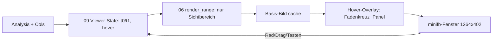

# Plan: Interaktiver Show-Viewer (`02_interactive`, 2026-10-11)

## 1. Ziel

Das `--show`-Fenster wird vom Standbild zum Werkzeug: Zoomen und
Scrollen in der Zeitachse, Hover zeigt Frame-Details (Zeit, Frequenz,
Pegel, Modus, Bandbreite, Bitrate). PNG/JSON-Pfad bleibt unberuehrt.

## 2. Bedienung (verbindlich)

| Eingabe | Wirkung |
|---|---|
| Mausrad | Zeit-Zoom um Cursor (×1.25/Stufe, min. 200 ms) |
| Links-Drag | Pan (Verschieben der Zeitachse) |
| `+`/`-` | Zoom um Fenstermitte |
| `←`/`→` | Pan um 10 % der Sichtbreite |
| `R` | Reset auf Gesamtansicht |
| `ESC`/Schliessen | Ende (wie bisher) |

Hover (Maus ueber Wasserfall): Fadenkreuz + Panel mit `T=12.340S`,
`F=880HZ`, `PEGEL=-12DB`, `SILK WB 20MS 61B 24.4KBPS`.
Ausserhalb des Wasserfalls: kein Panel (stabile Basis).

## 3. Architektur

- `06_render`: neu `render_range(a, cols, t0_ms, t1_ms, plot_w)`;
  `render()` wird duenner Wrapper (Vollbereich). Achsen relativ zum
  Bereich; Kopf zeigt bei Zoom `SICHT 12.0-18.0S`. Neu pub:
  `freq_of_bin()`. Abschaetzung +60 Zeilen (bleibt < 600).
- `09_show`: neu `show_interactive(a, cols, titel, max_frames)` mit
  `View`-Math (rein/testbar: `zoom_around`, `pan_by`, `clamp`) und
  `hover_text()` (rein/testbar). Render nur bei Aenderung (dirty-Flag);
  Hover malt auf gecachte Basis (Clone + Overlay).
- `08_cli`: `--show` uebergibt Analysis+Cols; Hilfe listet Steuerung.
  Fensterbreite fix 1200 Plot-px (unabhaengig von `--width`, das nur
  das PNG steuert).
- Keine neuen Deps. `minifb`-Input: `get_mouse_pos`,
  `get_scroll_wheel`, `get_mouse_down`, `is_key_down`.

## 4. Kontext-Dateien

| Datei | Warum |
|---|---|
| `source1/src/09_show.rs` | wird zum Viewer (alt: 51 Zeilen Standbild) |
| `source1/src/06_render.rs` | bekommt `render_range` (Refaktor, kein Rewrite) |
| `source1/src/08_cli.rs` | `--show`-Verdrahtung + Hilfe-Text |
| `source1/deps.md` | DeepWiki-Update zu `opus-pure` |
| `plan/20261011_01_init/walkthrough.md` | Stand v1 (Module, Tests, Bilder) |

## 5. DeepWiki `stephenberry/opus-pure` (jetzt indexiert)

Abfrage 2026-10-11 bestaetigt unser Muster 1:1: `OggOpusReader::new`
→ `head()` → `head.decoder(rate)` + `Trim::new` → `read_packet()` →
`decode()` → `trim.keep()`. Neu genau: `OpusMSDecoder` fuer
Multistream (unser Fehlerpfad bleibt), `read_packet_into()` fuer
alloc-freies Lesen (Performance-Reserve, nicht noetig),
`Error::InvalidStream` bei defektem Header. Folge: nur `deps.md`
aktualisieren (Ausnahme streichen), kein Code-Umbau.

## 6. Tests

- Unit (show09): Zoom um Cursor (Anker stabil), Pan-Clamping an
  Raendern, min. 200-ms-Breite, `hover_text`-Format.
- Unit (render06): `render_range` Vollbereich == `render()` (Byte-ident);
  gezoomter Bereich zeigt andere Ticks, Streifen passt zum Bereich.
- HIL (`scripts/interact.sh`, neu): xvfb + `xdotool` (Rad, Drag,
  Tasten, Screenshots zur Sichtpruefung); `smoke.sh` ruft es auf, wenn
  `xdotool` vorhanden ist (sonst Skip mit Hinweis).
- Bestand: alle 33 Tests muessen ohne Aenderung gruen bleiben.

## 7. Commits (Conventional Commits, je Task einer)

`feat(36_opus): ... (U1)` etc., Stil wie 01_init.
