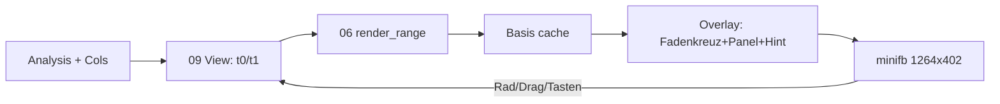

# Walkthrough: Interaktiver Viewer (`02_interactive`)

Das `--show`-Fenster war ein Standbild — jetzt ist es ein Werkzeug:
hineinzoomen in eine interessanten Stelle, verschieben, und per Hover
ablesen, was der Encoder dort entschieden hat. Dieses Dokument folgt
der bekannten Struktur (was/geaendert/learnings/Pakete).

Glossar-Ergänzung zu 01_init: **HIL** (Hardware-in-the-Loop, hier X11
unter Xvfb), **Anker** (der Zeitpunkt unter dem Cursor, der beim Zoom
stabil bleibt), **Dirty-Render** (nur bei Aenderung neu zeichnen).

## 1. Was exakt implementiert wurde

### 1.1 Bedienung

Rad = Zeit-Zoom um den Cursor (×1.25/Stufe, min. 200 ms), Links-Drag
= Pan, `+`/`-` und Pfeile ebenso, `R` = Gesamtansicht, `ESC` = Ende.
Hover ueber dem Wasserfall zeigt Fadenkreuz plus Panel, z.B.:

```text
T=3.000S F=977HZ PEGEL=-72DB
CELT FB 20MS 477B 190.8KBPS
```

Der Kopf nennt bei Zoom die Sicht (`SICHT 2.0-4.0S`), die Legende die
Steuerung. Das PNG bleibt unveraendert (gleiche Ebenen, kein Overlay).

### 1.2 Architektur



- `06_render`: `render_range(t0,t1)` (Wrapper `render()` byte-identisch
  zum Altstand), Achsen relativ, Fein-Ticks bis 0,1 s, `freq_of_bin`.
  Split nach 600er-Regel: Grafikgrundlagen → `06a_canvas` (216 Zeilen),
  Ebenen bleiben in `06_render` (420 Zeilen).
- `09_show` (389 Zeilen): `View`-Math und `hover_lines` rein/testbar,
  Event-Schleife mit Dirty-Render (Basis nur bei Sicht-Wechsel neu).
- `08_cli`: `--show` bekommt Analysis+Cols; `--help` listet Steuerung.
- Keine neuen Deps. GUI-Evaluation (s. §3) bestaetigte `minifb`.

### 1.3 Tests und HIL

42 Tests gruen (31 Unit + 11 Integration): Anker-Stabilitaet beim Zoom,
Pan-Clamping, 200-ms-Minimum, Pixel↔Zeit-Mapping, Hover-Format,
Bereichs-Render (Vollbereich byte-identisch, Zoom zeigt nur sichtbare
Modi). HIL (`scripts/interact.sh`, neu): Xvfb + `xdotool` faehrt Hover,
5x Rad-Zoom, Drag-Pan, R-Reset und Escape; Screenshots + `cmp`-Asserts
je Schritt; `smoke.sh` ruft es auf (Skip ohne `xdotool`/`scrot`).
Verifiziert: `SICHT 2.0-4.0S` nach Zoom, `2.5-4.5S` nach Pan, Reset auf
Gesamt, Exit 0.

## 2. Architektur-Entscheidungen durch Tests

1. **Drag relativ zur Vorframe-Position**: Instantane Maus-Spruenge
   (xdotool, Flicks) gingen verloren, weil der Startpunkt erst im
   gedrueckten Zustand erfasst wurde. Jetzt zaehlt die Differenz zur
   letzten Frame-Position — Spruenge und menschliche Drags gehen.
2. **Pressed-Events statt nur Halten**: minifb-X11 kann Tastentips
   unter ~2 Frames verlieren (`update()` vor Event-Verarbeitung).
   `R` und `ESC` nutzen zusaetzlich `get_keys_pressed`; das Skript
   haelt Tasten per `keydown/up` (0,4 s) — deterministisch.
3. **Geometrie statt Annahmen**: Das Fenster steht ohne WM nicht bei
   (0,0) — der erste HIL-Lauf klickte daneben (identische Shots).
   `interact.sh` fragt die Geometrie ab und rechnet die Plot-Mitte aus.
4. **Canvas-Split**: `render_range` trieb `06_render` auf 636 Zeilen —
   nach 600er-Regel in Grundlagen (`06a_canvas`) und Ebenen getrennt,
   ohne Verhaltens-Aenderung (alle Tests weiter gruen).
5. **Nebenbei**: `M:SS`-Bug (`1.5:30`) gefunden und gefixt; Tick-Dichte
   auf ~1/100 px beruhigt (sonst Dezimal-Labels schon in Gesamtansicht).

## 3. Learnings und Erweiterungen

**Learnings.**

- **GUI-Evaluation**: `minifb` (12 Pakete, kein GL) vs. `macroquad`
  (32, GL) vs. `eframe` (165, GL) — gemessen per `cargo tree`.
  Ergebnis: Die Interaktions-Logik (View-Math, Hover-Mapping) ist in
  jeder Lib gleich viel eigener Code; `minifb`-spezifisch sind nur
  ~30 Zeilen (Fenster, Input-Abfrage, Puffer-Upload). `egui` haette
  ~150 Zeilen gespart und 150+ Pakete plus GL-Pflicht gekostet —
  gegen die Projekt-Maxime (wenig Deps). Bonus: PNG und Fenster
  teilen einen Renderer (konsistentes Bild).
- **DeepWiki `opus-pure`** ist jetzt indexiert und bestaetigt unser
  Muster 1:1 (`deps.md` aktualisiert, kein Code-Umbau).
- **HIL braucht Asserts**: Screenshots ohne `cmp`-Vergleich haetten
  den wirkungslosen ersten Lauf (alle Shots identisch) als „gruen“
  durchgehen lassen.

**Moegliche Erweiterungen.**

- Frequenz-Zoom (derzeit nur Zeit), Marker/Lesezeichen, Frame-Export.
- Tasten-Repeat fuer `R` ist absichtlich aus (ein Reset pro Druck).
- `read_packet_into()` (alloc-frei) als Performance-Reserve ungenutzt.

## 4. Pakete fuers Dockerfile (Ergaenzung zu 01_init)

| Paket (apt) | Wofuer | Pflicht? |
|---|---|---|
| `xdotool` | HIL-Interaktion (Maus/Tasten synthetisch) | Test |
| `scrot` | HIL-Screenshots | Test |
| `mesa-utils` | `glxinfo`-Gegenprobe (nur Evaluation, nicht HIL) | nein |

Laufzeit/Build unveraendert (Rust ≥ 1.88, `libx11-6` nur bei `show`).
