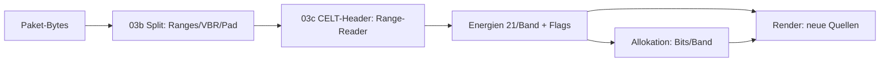

# Plan: Bitstrom-Sicht (`03_bitstream`, 2026-10-11)

## 1. Ziel

Zwei neue Sichten neben dem PCM-Wasserfall: (a) **Bitstrom-Spektrum**
(21 CELT-Bark-Baender aus dem Header) plus **Divergenz** (PCM minus
Bitstrom) — „was man hoert“ vs. „was der Encoder modellierte“;
(b) **Informationsdichte** (exakte Bits/Band aus der CELT-Allokation).
Dazu Paket-Anatomie (Packing, VBR, Padding, Frame-Groessen) in Hover.

## 2. Views und Bedienung

`--view SPEKTRUM|BITSTROM|DIVERGENZ|DICHTE` (Default SPEKTRUM);
Viewer-Tasten `1`–`4` schalten um. Alle Views teilen Layout/Achsen:

| View | Wasserfall-Quelle | Y-Achse | Colormap |
|---|---|---|---|
| SPEKTRUM | PCM-STFT (256 Log-Bins) | Hz log | Heat (wie bisher) |
| BITSTROM | Coarse-Energie (21 Baender) | Band-Mitten | Heat |
| DIVERGENZ | PCM dB − Bitstrom dB | Hz log | Divergierend (±) |
| DICHTE | Bits/Band/Frame (Allokation) | Band-Mitten | Heat (Bits) |

Hover zeigt zusaetzlich: Packing (`CODE3 M=4 VBR`), Padding, Transient,
Band-Energie und Band-Bits am Cursor, Divergenz-Wert.

## 3. Architektur (keine neuen Deps)

- `03b_split.rs`: Frame-Ranges, VBR/CBR, Padding-Bytes, Groessen
  (§3.2). Validierung: Partition (lueckenlos), echte Dateien.
- `03c_celt.rs`: Range-Reader + Header (transient/intra/Energien/
  Trim/Stereo/Dynalloc) + Allokations-Port. Validierung: Allokations-
  Summe ≈ verfuegbare Bits (exakt, hochsensitiv), Energie↔Spektrum-
  Korrelation auf Musik, Fehler-Sweep ueber alle Demo-Pakete.
- SILK-Pakete: als `SILK` markiert, Details spaeter (B3, offen).
- Hybrid: SILK/CELT-Grenze aus Decoder-Quelle uebernommen (s. §6).

## 4. Kontext-Dateien

| Datei | Warum |
|---|---|
| `source1/src/03b_split.rs` | neu: Paket-Anatomie |
| `source1/src/03c_celt.rs` | neu: Header + Allokation |
| `source1/src/06_render.rs` | View-Quellen, 2. Colormap |
| `source1/src/09_show.rs` | Tasten 1–4, Hover-Plus |
| `~/.cargo/.../opus-pure-0.2.2/src/{range_coder,celt/*}.rs` | Referenz |

## 5. Library-Recherche (Entscheidungsgrundlage)

- `opus-pure` (`probe`): nur Hybrid SILK/Total-Bits + Bandkanten.
  Internals `pub(crate)`. Quelle als lesbare Referenz ideal.
- `rusty-opus`: `repacketizer::{parse_packet,nb_frames}` pub;
  `unquant_coarse_energy`/`clt_compute_allocation` pub, aber
  `#[doc(hidden)]` (kein SemVer), Felder privat. Treiben braeuchte
  trotzdem Splitter + Range-Reader + Hybrid-Grenze (80 % selbst).
- `opus-decoder`: nur `last_is_transient/_had_redundancy/_celt_to_silk`
  nach Decode; kein Energie-Zugriff; Dopple-Decode noetig.
- `libopus`/`opus`-Crate: keine Header-APIs (nur Final-Range).
Fazit: Eigene ~350 Zeilen sind simpler als zweite Codec-Dep plus
instabile APIs. Keine neuen Deps (auch nicht dev).

## 6. Offene Detailfrage (beim Bau klaeren)

Hybrid SILK/CELT-Grenze: Entnahmestelle in `opus-pure/src/decoder.rs`
identifizieren und Prozedur portieren (vermutlich Laengen-Byte +
Selbst-Terminierung); Test: Hybrid-Fixture parst fehlerfrei und
Allokations-Summe stimmt.

## 7. Commits je Task (B0–B4), Stil wie bisher.
