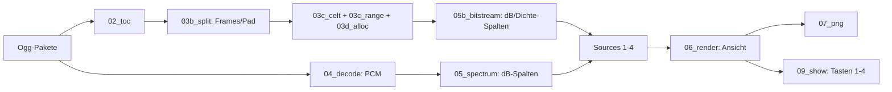

# Walkthrough: Bitstrom-Sicht (`03_bitstream`)

Ausgangspunkt war der Wunsch, nicht nur zu sehen, *dass* ein Frame
CELT ist, sondern *was* der Encoder pro Frequenzband entschieden hat —
plus Divergenz zum decodierten Spektrum und spektrale
Informationsdichte. Ergebnis: ein eigener minimaler CELT-Bitstrom-Parser
(keine neuen Deps) und vier umschaltbare Wasserfall-Ansichten. Dieses
Dokument folgt der bekannten Struktur (was/Entscheidungen/learnings/
Pakete) und deckt B0–B5 ab.

Glossar-Ergänzung zu 02_interactive: **Range-Coder**
(Opus-Entropiecodec: vorwaerts Symbole, rueckwaerts Roh-Bits),
**Allokation** (`clt_compute_allocation`: Budget → Bits/Band),
**Overhead** (von Header-Reads verbrauchte Reserven), **Drain**
(Bilanz-Reservoir, das `quant_all_bands` per `Rest/min(3,Restbaender)`
an die Baender verteilt), **Quelle** (`Source`: eine der vier
Ansichten), **Orakel** (unabhaengiger Richtigkeits-Nachweis — der
Range-Coder meldet nie Fehler, nur Werte beweisen Sync).

## 1. Was exakt implementiert wurde

### 1.1 Pipeline

- **B0:** Library-Survey (DeepWiki + Quellen): keine Rust-Opus-Lib legt
  Band-Energien/Allokation offen (`opus-pure/probe` nur Hybrid-SILK-Bits,
  `rusty-opus` privat, `opus-decoder` nur Flags) → eigener Parser (~1100
  Zeilen, spaeter gedrittelt), dokumentiert in `plan.md` §5.
- **B1 (`03b_split.rs`):** Packet-Splitter (Codes 0–3, 1-/2-Byte-Laengen,
  CBR/VBR, 255er-Padding, Guards). Referenz: kein Frame traegt ein
  eigenes TOC-Byte (alle teilen das Paket-TOC).
- **B2 (Parser):** `03c_range.rs` (bit-exakter Range-Decoder),
  `03d_alloc.rs` (Grid, Dynalloc/Trim, Allokations-Port),
  `03c_celt.rs` (Header-Walk, Coarse-+Fine-Energien, Stereo-Zustand,
  Reset bei Moduswechsel). Hybrid/SILK wird markiert, nicht geparst
  (gemeinsamer Range-Coder — ohne SILK-Decode unrekonstruierbar).
- **B3 (Modell, `05b_bitstream.rs`):** Energien → kalibrierte dB-Spalten
  (CAL −76,5 dB + De-Emphasis, Pre-Skip beachtet), Bits/Band inkl.
  Drain → Dichte-Spalten (Summe = Allokation − Overhead), Divergenz =
  STFT − Bitstrom (NaN wo unverfuegbar).
- **B4 (Views):** `Source`/`Sources`, `--view` + Tasten 1–4, Pooling
  (Max / betrags-groesst), divergierende Colormap (±12 dB), NaN-Grau,
  lineare Dichte-Norm, CELT-Bandgitter, 3-zeiliges Hover (Wert,
  Packing/Pad, Transient/Signal-Bits).
- **B5 (HIL + Hygiene):** `interact.sh` um Tasten 1–4 erweitert (8/8
  Asserts), alle Views headless + `ffprobe`-geprueft, `fmt`/`clippy
  -D warnings` sauber, Deps aktuell, README + dieser Walkthrough.

### 1.2 Orakel-Kette (warum die Werte stimmen)

1. Allokations-Identitaet exakt (Baender + Rest + Overhead = Input):
   LCG-Fuzz (2000 Budgets) + 18 784 echte Frames, 0,00 Bit Abweichung.
2. Puls-fuer-Puls gegen instrumentiertes `opus-pure` (ein Frame, danach
   Registry pristine wiederhergestellt): 21/21 Coarse-, alle Fine-Bits,
   Bilanz identisch.
3. Korrelation Energie↔PCM r = 0,936; Sweep-Peak ±1 Band; Sinus-Anker ±2 dB.
4. Divergenz-Spitzen-Median −3,3 dB (methodisch: Fenster + Smear, s. §3).

Gates: 71 Tests (`--all-features`), `fmt --check`, `clippy -D warnings`,
`smoke.sh` (inkl. HIL) gruen.

## 2. Architektur-Entscheidungen durch Tests

- **Drei Parser-Module statt einem:** 1142 Zeilen → `range`/`alloc`/
  `celt` (250/587/409), zyklenfrei (`celt` → `alloc` → `range`). Der
  Plan (`task.md`, B3) wurde an den Ist-Stand angepasst.
- **Dichte = Bits/Log-Bin (exakt summierend), linear normiert:** Log-Norm
  fraß die Zeitdynamik (2:1 Bits → 20 % Helligkeit); Bits/Hz wuerde die
  1:1-Bin-Korrespondenz zur Spektrum-Ansicht brechen.
- **Divergenz-NaN statt 0:** Unverfuegbar rendert neutral-grau — 0 dB
  wuerde Uebereinstimmung vortaeuschen.
- **Analyse bleibt robust:** Split-Fehlschlag → TOC-Code + Pad 0
  (striktes RFC darf keine Datei unlesbar machen).
- **Bilanz ist Reservoir, kein Abfall:** `quant_all_bands` verteilt sie
  per Drain-Regel — die Dichte bildet das exakt ab (Summe erhalten).

## 3. Learnings und Erweiterungen

- **`nbits_total` 10 statt 9:** Silence-Bit nie gelesen → jeder Frame
  ab Bit 1 verschoben — sah trotzdem „plausibel" aus. Gefangen nur
  durch Orakel 1+3. Lehre: Bei fehlerfreien Parsern zuerst
  Unabhaengigkeits-Tests, nie Plausibilitaet. Regressions-Test
  `tell()==1` pinnt die Invariante.
- **Cap-`<< lm` fehlte:** Caps 8× zu klein → alles in die Bilanz.
  Gefangen durch die Dichte-Ansicht selbst (statisch trotz Bitraten-
  halbierung) + Trace-Orakel. Lehre: Die neue Ansicht hat ihren
  eigenen Bug gefunden — Visualisierung als Test.
- **Skala ist Arbeit:** CELT misst `√(ΣMDCT²)` auf preemphasiertem
  int16-Signal (+69,6 dB roh). Kalibrierung = De-Emphasis/Band +
  globale Konstante (Sinus-Fixture). Rest-Offset −3,3 dB belegt
  methodisch (Sine- vs. Hann-Fenster 2,1 dB + Sweep-Smear ~1 dB).
- **Fixture-Falle:** `fr*960+off` statt `(fr, off)` → Sweep aliasiert →
  r = 0,28 trotz korrektem Parser. Peak-Tracking fing ihn.

**Moegliche Erweiterungen.**

- SILK-Layer parsen (dann auch Hybrid-CELT exakt + SILK-Ansicht).
- PVQ-Banddaten lesen (Puls-Counts, Collapse-Masken als 5. Ansicht).
- `total_rsv`/`balance` als Hover-Details (ungenutzte Bits/Frame).
- Per-Paket-Drain statt Ideal-Drain (braucht Band-Decode-Simulation).

## 4. Pakete fuers Dockerfile (keine Aenderung)

Keine neuen Pakete: weder Build- noch Laufzeit- noch Test-Abhaengigkeit
(`cargo upgrade --dry-run`: alles aktuell). HIL-Werkzeuge (`xvfb`,
`xdotool`, `scrot`, `ffmpeg`, `opus-tools`) waren vorhanden und bleiben
Test-only. Die libopus-Testvektoren (`/tmp/tv`, ~65 MB) werden nicht
committet; CI nutzt Fixtures + `ref.opus`.
