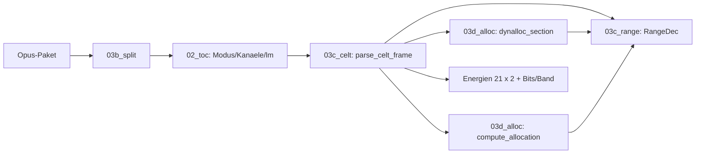

# Walkthrough: CELT-Bitstrom-Parser (`04_celt_parser`)

Der Decoder wusste bisher nur, *dass* ein Frame CELT ist — jetzt liest
er auch, *was* der Encoder pro Frequenzband entschieden hat: 21
Band-Energien plus Bit-Allokation (Coarse/Fine) direkt aus den
Paket-Bytes. Dieses Dokument folgt der bekannten Struktur
(was/Entscheidungen/learnings/Pakete).

Glossar-Ergänzung zu 03_bitstream: **Range-Coder** (Opus-Entropiecodec,
liest vorwaerts, Roh-Bits rueckwaerts vom Paket-Ende), **`tell()`**
(gelesene Bit-Position, steuert alle Budget-Gatter), **Allokation**
(`clt_compute_allocation`: verteilt das Frame-Budget auf Baender),
**Overhead** (Reserven, die Header-Reads verbrauchen: Skip-,
Intensitaets-, Dual-Bits), **Intra** (Energie ohne Vorhersage vom
Vorgaenger-Frame, Encoder-Flag an scharfen Kanten).

## 1. Was exakt implementiert wurde

### 1.1 Module

Drei neue Dateien, zyklenfrei geschichtet (`celt` → `alloc` → `range`):

- **`03c_range.rs`** (250): Decode-Subset des Range-Coders
  (`new`, `tell`/`tell_frac`, `dec_uint`/`dec_bits`, `decode_bit_logp`,
  `decode_icdf`, `laplace_decode`). Bit-exakt zum Original.
- **`03d_alloc.rs`** (546): Baender-Grid (`EBANDS`), Trim-Tabelle,
  Dynalloc-Mid-Section (Caps, Boosts, Trim, Anti-Collapse-Reserve),
  Allokations-Port (`interp_bits2pulses`, `compute_allocation`).
- **`03c_celt.rs`** (409): Frame-Walk (silence/prefilter/transient/
  intra, Coarse-+Fine-Energien, Zustands-Buchhaltung, Reset bei
  Moduswechsel) plus `CeltState`, `CeltFrame`, `energy_db`.
- **`tests/celt.rs`** (315): 6 Integrationstests (Details in 1.3).

### 1.2 Lesereihenfolge pro Frame

Silence-Bit → Prefilter → Transient → Intra → Coarse-Energien →
TF → Spread → Caps/Dynalloc → Trim → Allokation (Skip-/
Intensitaets-/Dual-Reads) → Fine-Energien. Die PVQ-Banddaten werden
uebersprungen; die Coarse-Bits stehen trotzdem exakt fest (die
Allokation schreibt sie nach `pulses[]`, Einheit 1/8 Bit).

### 1.3 Tests und Orakel

Der Range-Coder meldet nie Fehler — jedes Byte „parst". Deshalb beweisen
nur unabhaengige Orakel die Synchronisation:

- **Summen-Identitaet (exakt):** Baender + Rest + Overhead = Input,
  in 1/8-Bit-Einheiten, ohne Toleranz. Geprueft per LCG-Fuzz
  (2000 synthetische Budgets) und auf echten Frames.
- **Korrelation Energie↔PCM:** r = 0,936 (819 Paare, Sweep-Fixture),
  gefordert > 0,7. Der Sweep-Peak wandert ±1 Band mit der Soll-Frequenz.
- **Vektor-Sweep (lokal):** 18 784 CELT-Frames aus 6 offiziellen
  libopus-Testvektoren, 0,00 Bit Abweichung, Energien endlich.
  (Gated auf `/tmp/tv`, skippt in CI.)
- **Determinismus:** zweimal parsen = bitidentisch. **Charaktertest:**
  `ref.opus` ist rein hybrid → 0 CELT-Frames (dokumentiert die Grenze).
- **Invarianten:** `tell()==1` nach Init (Regressions-Test),
  Laplace-Golden-Byte aus `opus-pure`s eigenem Test.

Gates: 53 Tests (default) + 59 (`--all-features`) gruen, `fmt --check`
sauber, Clippy 0 Warnungen.

## 2. Architektur-Entscheidungen durch Tests

- **Drei Module statt einem:** Der erste Wurf (`03c_celt.rs`, 1142
  Zeilen) sprengte die 600er-Regel. Split nach Verantwortung
  (Entropie/Allokation/Frame-Logik) statt nach Plan-Nummer — der Plan
  (`task.md`, B3) wurde an den Ist-Stand angepasst, nicht umgekehrt.
- **Hybrid/SILK wird markiert, nicht geparst:** Die Referenz-Analyse
  zeigte, dass sich SILK und CELT im Hybrid-Frame *einen* Range-Coder
  teilen — die CELT-Startposition ist ohne SILK-Decode nicht
  rekonstruierbar (auch `opus-pure/probe` liefert nur eine Bit-Zahl,
  keinen Coder-Zustand). Exakt parsen ginge nur mit SILK-Nachbau:
  gegen die Maxime „so einfach wie moeglich".
- **Bewusste Luecken, begrenzt:** kein Energie-Finalise (< 0,06
  log2-Einheiten, Bits liegen hinter den uebersprungenen Banddaten),
  kein Loss-Concealment (Dateien haben keinen Loss), kein
  Redundanz-Priming (nur mit In-Band-FEC relevant — opusenc-Default
  und Testvektoren sind exakt).
- **Overhead ist ein Budget-Begriff:** Die Identitaet gilt gegen den
  Allokations-*Input*, nicht gegen das Zwischen-Budget — Skip-/
  Intensitaets-/Dual-Reserven werden von Header-Reads verbraucht
  (als `CeltFrame.overhead` exponiert, spaeter Hover-tauglich).

## 3. Learnings und Erweiterungen

- **Der `nbits_total`-Bug:** Init mit 10 statt 9 → `tell()` nie 1 →
  Silence-Bit nie gelesen → jeder Frame ab Bit 1 verschoben. Werte
  sahen trotzdem „plausibel" aus (glatt, begrenzt, exakte Allokation).
  Enttarnt nur durch die Orakel (Bilanz +19 Bit, r = 0,09). Lehre:
  Bei fehlerfreien Parsern ist der erste Test ein Unabhaengigkeits-
  Test, kein Plausibilitaets-Test.
- **Fixture-Bug gleicher Klasse:** `fr*960+off` statt `(fr, off)` in
  der Sweep-Fixture → Phase ins Aliasing-Nirwana → r = 0,28 trotz
  korrektem Parser. Der Peak-Tracking-Test (Soll vs. Ist) fing ihn.
- **Heisse Frames waren Desync-Artefakte:** Die fruehen ±47…±74
  dB-Spikes verschwanden mit dem Sync-Fix restlos (Vektor-Max jetzt
  29) — ein weiterer Beleg, dass Plausibilitaet allein nichts beweist.

**Moegliche Erweiterungen.**

- Bitstrom-Spektrum + Dichte-Modell (B3), dann 4 Views (B4).
- Hybrid-Markierung in Analyse/Hover (`SILK`, B4).
- `total_rsv`/`balance` als Hover-Details (ungenutzte Bits pro Frame).

## 4. Pakete fuers Dockerfile (keine Aenderung)

Keine neuen Pakete: weder Build- noch Laufzeit- noch Test-Abhaengigkeit.
Die Testvektoren (`/tmp/tv/opus_testvectors`, ~65 MB) werden nicht
committet und nur lokal genutzt; CI nutzt Fixture + `ref.opus`.
Referenziert: `opus-pure` 0.2.2 (einzige Codec-Dep, Survey-Quelle).
