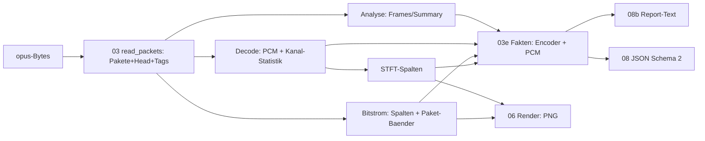

# Walkthrough: Verstehen statt nur Ansehen (`05_verstehen`)

Bisher zeigte `opus-vis` nur Bilder: Wasserfall, Modus-Streifen,
Bitraten-Lane. Wer wissen wollte, *was* in der Datei steckt — welcher
Encoder, welche Bitraten-Streuung, wo Pausen sind, ob etwas clippt —
musste Pixel und JSON-Kuerzel selbst deuten. Jetzt erklaert das
Werkzeug jede Datei in Worten und Zahlen: als deutscher Text-Report
bei jedem Lauf, als neu entworfenes JSON und aus denselben Fakten.
Dieses Dokument folgt der bekannten Struktur (was/Entscheidungen/
learnings/Pakete).

Glossar-Ergaenzung zu 04_celt_parser: **Fakten** (`03e_fakten.rs`:
reine Auswerte-Funktionen ueber Analyse, PCM und Bitstrom),
**Report** (`08b_report.rs`: Text-Ausgabe plus Regel-Tabelle),
**Run-Length** (aufeinanderfolgende Pakete gleichen Modus als ein
Abschnitt), **VBR-Index** (Streuung / Mittel der Paket-Bitraten;
0 = CBR-artig), **DTX** (Encoder sendet in Pausen fast nichts),
**Orakel** (hier: Zahlen, die schon vor dem Umbau feststanden).

## 1. Was exakt implementiert wurde

### 1.1 Pipeline (ein Ogg-Durchlauf)

- **V1 (`03_analyze`, `04_decode`, `05b_bitstream`, `08_cli`):**
  `read_packets` demuxt genau einmal und liefert `PacketSet`
  (volle `OggPacket`s — inkl. Granule-Metadaten fuer `Trim` — plus
  `OpusHead` und `OpusTags`). Analyse, Decode und Bitstrom
  konsumieren die Liste (`analyze_packets`, `decode_packets`,
  `analyze_packets`); TOC wird je Paket nur noch einmal geparst.
  `Sources::build` uebernimmt Vektoren per Move statt sechs
  `to_vec`-Kopien. `analyze_path` (toter Code) ist geloescht,
  Split-Fehlschlaege zaehlt `Analysis.split_fallbacks` statt sie per
  `unwrap_or(0)` zu verschweigen. Semantik geprueft: PNG byte-identisch,
  JSON-Summary/Frames gleich (Demo: 300 Frames, SILK/CELT je 50 %).
- **V2 (`03e_fakten.rs`, neu, ~330 Zeilen):** `head_fakten`
  (Pre-Skip in ms, Gain Q8→dB), `tag_fakten` (Vendor + Kommentare
  woertlich), `encoder_fakten` (Modus-Runs, BW-Anteile, kbps-Min/Max/
  p50/p95, VBR-Index, DTX-Zaehler, Transient-Zeiten aus den
  Bitstrom-Hops), `pcm_fakten` (Peak/RMS je Kanal, Clipping-Zaehler,
  Stereo-Korrelation, Stille-Abschnitte ab 200 ms/−60 dB,
  Spektral-Schwerpunkt). Dazu `ChannelStats` in `04_decode`
  (vor dem Mono-Mix gemessen) und `centroid_db` in `05_spectrum`.
- **V3 (`08_cli::json`, neu entworfen):** Schema 2 mit Einheiten im
  Namen (`duration_ms`, `avg_kbps`, `rms_db`): `head`, `tags`,
  `summary` (inkl. `silk_frac`, `split_fallbacks`), `encoder`,
  `pcm` (inkl. `stereo_corr: null` bei Mono), `frames` mit `config`,
  `packing`, `pad_bytes` und `celt`-Banddaten (`bands_db`, `bits`)
  bzw. `null` bei SILK/Hybrid. Hand-gerollter Writer plus `esc()`
  (Anfuehrung, Backslash, Steuerzeichen, Nicht-ASCII roh).
- **V4 (`08b_report.rs`, neu):** Jeder Lauf druckt den Report
  (stdout; bei `-o -`/`--json -` nach stderr; `--quiet` schaltet ab).
  Zwoelf Abschnitte von `opus-report:` bis `einordnung:` mit 3–5
  Saetzen aus der Regel-Tabelle („spricht fuer …", nie als Befund
  verkauft). Demo-Beispiel: `SILK 0.0–3.0 s, CELT 3.0–6.0 s`,
  Transiente exakt beim Wechsel bei 3,0 s, VBR-Index 0,670.
- **V5 (Doku):** README (Report-Standard, Schema 2, `--quiet`),
  `deps.md` (weiter zwei Crates), `smoke.sh` (neue Feldnamen,
  Report- und Quiet-Asserts). Bewusst entfallen: PNG-Kopf um Vendor
  erweitern (Platzregel bei schmalen Plots) und Hover-Zeit
  „Pre-Skip-versetzt" anzeigen — geprueft: Zeiten sind bereits
  Audio-wahr (PCM ist getrimmt, Bitstrom-Hops pre-skip-aligniert);
  eine Verschiebung waere falsch gewesen.

### 1.2 Tests (89, alle gruen)

- **Neu (19):** 7 Fakten-Units (Runs, Perzentile/VBR, BW-Summe/DTX,
  Transient-Mapping, Stille-Fenster, Leer-Eingaben, Q8-Gain),
  1 Schwerpunkt-, 1 JSON-Escaping-, 7 Report-Regel- plus
  Abschnitts-Tests, 2 Report-Host-Tests (Abschnitte, Gold-Snapshot
  `tests/data/report_gold.txt`), 1 Schema-Host-Test (`tests/cli.rs`).
- **Angepasst:** alle `FrameMeta`-/`Bitstream`-Konstruktoren
  (`config`-, `packets`-Felder), `Sources::build`-Aufrufer,
  Smoke-Asserts (`silk_frac`, `celt_frac`, Schema 2, Report, Quiet).
- Gates: `cargo test --all-features` (63 Unit + 26 Integration),
  `fmt --check`, `clippy -D warnings`, Smoke-Subset (Build, Demo,
  JSON-Validierung, Report, Quiet, stdin/stdout-PNG-Magie) gruen.
  Nicht lauffaehig hier: `ffprobe`/`xvfb`-Teile und `interact.sh`-HIL
  (kein X11 in dieser Umgebung; Viewer-Code bis auf Feld-Umzuege
  unberuehrt, Unit-Tests gruen).

## 2. Architektur-Entscheidungen durch Tests

1. **Volle `OggPacket`s statt Byte-Vektoren:** Der erste V1-Wurf
   behielt nur `packet.data` und fütterte `Trim` mit synthetischen
   Paketen (Granule 0) — das haette den End-Trim still gebrochen.
   Der Blick in `opus-pure/src/ogg/trim.rs` (`keep` nutzt
   `page_granule`/`end_of_stream`) erzwang `Vec<OggPacket>`; die
   Demo-Gegenprobe (Frames/Summary gleich) bestaetigt die Treue.
2. **`Sources` besitzt den Bitstrom statt ihn zu kopieren:** Sechs
   `to_vec`-Kopien fielen weg, indem `Sources.bitstream: Bitstream`
   per Move uebernommen wird (`show.rs`-Zugriffe laufen ueber
   `src.bitstream.*`, `cols()` mappt um). Alle Render-Tests
   unveraendert gruen — Speicherersparnis ohne Verhaltensdelta.
3. **Fakten sind reine Funktionen ueber fremde Structs:** Kein
   Umbau von `Analysis`/`Decoded` ausser den zwei streng noetigen
   Feldern (`split_fallbacks`, `stats`); Perzentile, Runs und Stille
   lassen sich an Hand-Fixtures testen statt an Encoder-Zufall.
4. **Gold-Snapshot nur nach Sichtung:** `tests/data/report_gold.txt`
   wurde erst committet, nachdem jede Zahl (0,5 s, 441-Hz-Schwerpunkt
   bei 440-Hz-Sinus, VBR-Index, Vendor) geprueft war — ein Snapshot,
   den niemand gelesen hat, beweist nichts.
5. **Kompatibilitaet gestrichen, Tests ersetzt:** Kein Alt-Feld
   ueberlebt aus Ruecksicht (`bw`→weg, `silk`→`silk_frac`,
   `CELT`→`"celt"`); betroffene Tests wurden umgeschrieben statt
   beide Schemata zu pflegen. Die Orakel-Tests (Allokations-Identitaet,
   Korrelation, Pegel) bleiben die einzigen Traditions-Besitztuemer.

## 3. Learnings und Erweiterungen

- **Der teuerste Fund war ein verhinderter Bug:** Ohne den
  `trim.rs`-Blick waere der synthetische-Paket-Trick als „sauberer
  Refaktor" durchgegangen — End-Trim-Fehler hoert man erst am
  Datei-Ende. Lehre: Wer Container-Metadaten wegwirft, muss beim
  Besitzer (hier `Trim`) nachlesen, nicht raten.
- **Erklaeren ist billig, wenn die Daten schon da sind:** Saemtliche
  Report-Zahlen stammen aus Bytes, die vorher schon im Speicher
  lagen (Head, Tags, PCM, Bitstrom) — der Report kostet zur Laufzeit
  nur Formatierung.
- **Regel-Tabellen brauchen eine Obergrenze und einen Fallback:**
  `MAX_SAETZE = 5` plus „keine auffaelligkeiten" halten den Report
  lesbar, wenn nichts oder alles feuert.

**Moegliche Erweiterungen.**

- Bandbreiten-Verlauf als eigene Lane im PNG (Wechsel-Zeilen gibt es
  erst im Text).
- `--format json|text` statt getrennter Schalter; CSV-Frame-Export
  fuers Tabellenkalk.
- WAV-Export eines Zeitbereichs („hoeren, was man sieht", `std`-only,
  ~30 Zeilen).
- SILK-Seite bleibt blind (gemeinsamer Range-Coder, s. 04_walkthrough).

## 4. Pakete fuers Dockerfile (keine Aenderung)

Keine neuen Pakete: weder Build- noch Laufzeit- noch Test-Abhaengigkeit
(`cargo tree` ohne `show`: nur `opus-pure 0.2.2`). `opus-tools`
(`opusinfo` als Gegenprobe) und `ffmpeg`/`xvfb` bleiben Test-only und
fehlten in dieser Umgebung — Smoke lief als Subset, HIL steht aus.
