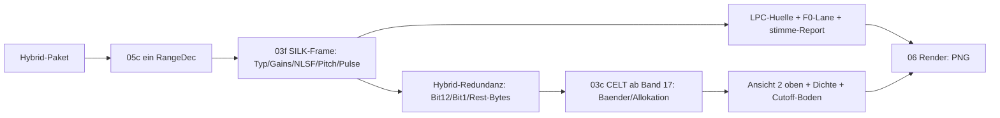

# Walkthrough: SILK-Vokal-Modell sehen (`06_silk`)

Ausgangslage: `silk.opus` oeffnete zwar und zeigte das Spektrum —
Ansichten 2–4 blieben leer, weil jedes Paket Hybrid (Config 15) war
und der Bitstrom-Walk nur CELT-only konnte. Jetzt walkt ein eigener
SILK-Header-Walk das Vokal-Modell (Signaltyp, Gains, Pitch, NLSF),
Hybrid-Frames laufen auf einem Coder weiter (SILK unten, CELT ab
Band 17 oben), und alle drei Ansichten tragen. Dieses Dokument folgt
der bekannten Struktur (was/Entscheidungen/Learnings/Pakete).

Glossar: **SILK** (sprach-optimierte Schicht, Range-Coder vorwaerts),
**Hybrid** (SILK-Praefix + CELT-Oberband in einem Paket),
**NLSF** (Netz-Spektral-Frequenzen — Huellkurven-Form des Vokaltrakts),
**LPC-Huelle** (aus NLSF über LSF→LPC→Frequenzgang, Peak-0-normiert),
**Cutoff** (`coded_from`: erstes Band ohne Ausbau — Decoder versucht
dort kein PVQ), **PVQ-Skip** (Puls-Werte werden gezaehlt-verworfen,
nicht decodiert), **Orakel** (unabhaengige Referenz statt Plausibilitaet).

## 1. Was exakt implementiert wurde

### 1.1 Pipeline (SILK-Zweig)

- **S0 (Fixture):** `tests/data/silk_sample.opus` (501 Pakete Config 9,
  SILK WB 20 ms mono, ~10 s ab Minute 1) plus Voll-Datei-Rezept
  (`silk_silk.opus`, 3,3 MB, ungecommittet); neu
  `tests/data/hybrid_sample.opus` (501 Pakete Config 15, 100 % Hybrid).
- **S1 (`03f_silk.rs` + `03f_silk_dq/pulse/tab.rs`):** Header-Walk nach
  CELT-Vorbild (Seiteninfo lesen, Excitation nur zaehlen). Orakel:
  130-Hz-Anker 129,0 Hz, Autokorrelation Median 0,996 (167/185 ±10 %),
  Determinismus, NLSF-Invarianten, Bilanz-Regel.
- **S2a:** `Bitstream` + Hops tragen SILK (`silk_available/signal/
  pitch/gain`), F0-/Voicing-Lane (amber/blau/grau), Hover-Zeile 3
  SILK-bewusst, JSON-`silk`-Objekt, Report-`stimme:`-Zeile.
- **S2b:** NLSF-Interpolation wortwoertlich nach Referenz, `lpc_envelope_db`
  (LSF→LPC→Frequenzgang, gamma=0,99), Ansicht 2 = Huelle,
  Ansicht 3 = STFT−Huelle. Orakel: 1-kHz- + Zwei-Formanten-Position,
  Vokal End-zu-End 19/19, Hop-Permutation (eigen 0,52 vs. fremd 0,31).
- **S3 (`05c_hybrid.rs`, neu, Puls-Fix):** ein Coder je Frame
  (VAD/LBRR → SILK → Hybrid-Redundanz → CELT ab 17 auf demselben
  `RangeDec`); Ansicht 2 kombiniert Huelle+CELT, Dichte traegt
  SILK-Bits, Hover zeigt SILK-Anteil, `PacketCelt.coded_from` markiert
  den Ausbau-Cutoff. Uncodierte Baender liegen am Boden (statt
  Geister-Pegel aus der Prediction).
- **S4:** README (Hybrid-Absatz, Plan-Link), `deps.md` (Hybrid-Fixture,
  weiter 2 Crates), Smoke um SILK/Hybrid-Asserts erweitert (alle
  Ansichten, 501/501 Frames mit SILK+CELT bzw. SILK).

### 1.2 Tests (113, alle gruen)

| Orakel | Was es beweist | Ergebnis |
|---|---|---|
| 130-Hz-Anker | Tonhoehe absolut | 129,0 Hz |
| Autokorrelation | F0-Verlauf stimmt | Median 0,996 |
| Vokal 19/19 | Huellen-Form je Vokal | 19/19 |
| Hop-Permutation | Huelle hopspezifisch | 0,52 vs. 0,31 |
| Split-Identitaet | SILK-Anteil je Paket | 0,05–0,98 |
| Cutoff-Stille | Baender ab Cutoff still im Referenz-PCM | < −70 dB |
| Bilanz | Rest im Terminierungs-Band | Median ±5 |
| Determinismus | zwei Laeufe bitidentisch | exakt |

Gates: `cargo test --all-features` (74 Unit + 39 Integration),
`fmt --check`, `clippy --all-features --tests` (0), Smoke-Teile
(Build, Demo, JSON, Report, Quiet, Fixtures, stdin) gruen. Nicht
lauffaehig hier: `xvfb`-Teil (kein X11; vorbestehende Luecke).

## 2. Architektur-Entscheidungen durch Tests

1. **Eigener Walk statt `opus-pure`-Aufruf:** Dessen `silk`-Modul ist
   nicht `pub` — also Port nach CELT-Vorbild (Header lesen, Rest
   zaehlen). Die Bit-Exaktheit beweist das S3-Orakel etappenweise
   (SILK-Symbole, Coarse-Energien, Offsets, Ebits, Cutoff, Balance,
   Rest — alle identisch zur Referenz).
2. **Puls-Reihenfolge-Fix:** Unser Walk verzahnte Shell/LSB/Signs pro
   Block; die Referenz liest erst alle Shells, dann alle LSBs, dann
   alle Signs. Der Unterschied (2–9 Bits) verschob jeden CELT-Start —
   gefunden, weil das Hybrid-Orakel +33 dB Geister meldete. Die alte
   S1-Bilanz (30–90 Redundanz-Schwaenze) waren Fehlalarme auf der
   verschobenen Position; korrekt ausgerichtet sagt das Bit
   ueberall 0 (reines SILK, keine Wechsel) — Regel auf 0–5 geeicht.
3. **Tracker statt Output, ehrlich begrenzt:** Bei ausgehungertem CELT
   (Hybrid, ~90 Bits) decodiert der Decoder teils null Pulse —
   Ausgang Stille, Tracker auf Coarse-Prediction. Der Walk (PVQ-Skip
   per Design) zeigt die Tracker-Energie; jenseits des Cutoffs
   (Decoder versucht dort gar kein PVQ) liegt Boden. Das Pegel-Orakel
   (Tracker gegen PCM) wurde ersetzt durchs Cutoff-Stille-Orakel —
   eine Zahl, die der Walk garantieren kann.
4. **Peak-0-Huelle, Naht-Stufe sichtbar:** Der Naht-Pegelabgleich
   (Huelle an CELT-Band 17 haengen) saettigte die Ansicht (weiss) —
   ein einzelner Bin traegt keine Pegelentscheidung. Die Huelle
   bleibt relativ (Form aus NLSF), die Stufe an der Naht ist ehrlich.
5. **Neues Modul statt 600er-Split-Schmerz:** Der Hybrid-Arm wanderte
   als Ganzes nach `05c_hybrid.rs` (178 Zeilen); `05b` fiel von 604
   auf ~500. `coded_from` steht zusaetzlich in `PacketCelt`.

## 3. Learnings und Erweiterungen

- **Absolute Tells vergleichen sich nicht:** `tell()` traegt
  RNG-Normierungs-Jitter (±Bits) — positions-exakte Vergleiche
  brauchen Symbole oder Zustaende (`rng/val/offs` waren identisch:
  67076015/703660/39/313). Lehre: Orakel in der Einheit der Sache
  (Symbole, dB, Anteile), nie in Implementierungs-Zaehlern.
- **Drei Decoder sind sich einig:** `opus-pure`, `ffmpeg`/`libopus`
  und `opusdec` messen dieselbe Stille; `opusinfo`/`ffprobe`
  bestaetigen parallel Paketebene (501/501 Groessen identisch,
  Pre-Skip 312, 23,68 kbit/s). Unabhängige Messung schlägt
  Selbstkonsistenz — jedes Mal.
- **Ein Orakel kann selbst falsch sein:** Die erste DFT-Fassung
  verglich Summe gegen Mittel (+24 dB Artefakt). Erst Hochpass- und
  Hann-Gegenmessung zeigten den echten Rest (+33 dB Tracker-Luecke).

**Moegliche Erweiterungen.**

- Huellen-Pegel aus SILK-Gains (offen: Referenz streut; Messung fehlt).
- K-Bestimmung je Band via Restbuchhaltung (braucht PVQ-Cache-Tabellen).
- Stereo-Hybrid und LBRR statt `unsupported` (Referenz-Sequenz bekannt).
- WAV-Export eines Zeitbereichs („hoeren, was man sieht").

## 4. Pakete (keine Aenderung)

Keine neue Crate, auch nicht dev (`cargo tree`: nur `opus-pure`
0.2.2; `minifb` optional, deaktiviert). `cargo upgrade --dry-run`:
beide auf `latest`. `opus-tools` (`opusinfo`/`opusdec` als Gegenprobe)
per `apt` nachinstalliert — Test-only, kein Build-Bedarf. `ffmpeg`
vorbestehend. Ungecommittet bleibt nur `silk_silk.opus` (3,3 MB)
plus Rezept in `deps.md`.
