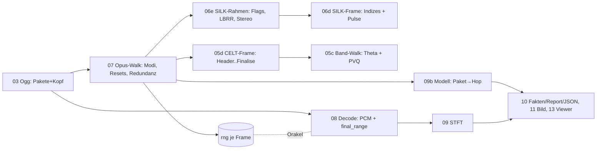

# Plan: Bis zum letzten Bit (`07_review`, source2, 2026-10-31)

## Goal

`source2` ist das verbesserte `opus-vis`: gleiche Bedienung (PNG, JSON,
Report, X11-Viewer), aber ein Bitstrom-Walk, der **jedes Bit jedes
Pakets** in Decoder-Reihenfolge liest — SILK (mono/stereo, LBRR,
10–120 ms), CELT (inkl. PVQ-Banddaten, Anti-Collapse, Finalise),
Hybrid und die Redundanz-Frames bei Moduswechseln. Beweis ist das
`final_range`-Orakel: Der Range-Coder-Endzustand des Walks muss je
Paket gleich `OpusDecoder::final_range()` (opus-pure) bzw.
`OPUS_GET_FINAL_RANGE` (libopus) bzw. dem Encoder-Wert aus
`opusenc --save-range` sein. Daraus folgen exakte Bit-Budgets je
Paket (wohin jedes 1/8 Bit ging) und eine *gemessene* statt
geschaetzte Dichte-Ansicht. Keine neue Crate.

Befunde und Begruendung: `review.md` (A1–A11, B1–B5, C1–C3).

## Success Criteria

1. `final_range` gleich fuer 100 % der nicht-leeren Pakete auf allen
   Real-Dateien (`silk_silk.opus`, `silk.opus`, Audio aus `silk.webm`
   und `rpQs3m5jtIM.webm`) und auf einer Fixture-Matrix, die jeden
   Decoder-Pfad treibt (Stereo-SILK, FEC/LBRR, 2,5/5/10/20/40/60/120 ms,
   NB/MB/WB/SWB/FB, SILK↔Hybrid↔CELT-Wechsel mit Redundanz, DTX).
2. Drittes, von opus-pure unabhaengiges Orakel: libopus-Decoder (per
   `ctypes`-Skript) und libopus-Encoder (`opusenc --save-range`).
3. Bit-Budget je Opus-Frame summiert exakt auf `Bytes × 64` (1/8 Bit).
4. Dichte-Ansicht = gelesene Bits je Band (Summe = Frame-Verbrauch);
   neue Budget-Lane im PNG; JSON-Schema 3 mit `final_range`, Budget,
   Pulsen je Band; Report mit Budget- und FEC/Redundanz-Zeilen.
5. Gates: `cargo test --all-features`, `fmt --check`,
   `clippy --all-targets --all-features -D warnings`, `scripts/smoke.sh`
   inkl. Xvfb-HIL; `cargo tree` = nur `opus-pure` (+ optional `minifb`);
   jede Datei < 600 Zeilen.
6. `HANDBUCH.md` (Nutzer: Bedienung, Lesen der Bilder, Opus-Grundlagen)
   und `walkthrough.md` (Entwickler: was/warum/Learnings) auf Deutsch,
   Mermaid, Glossar.

## Approach

Gleiche Schichtung wie `source1`, aber der Kern wird *vollstaendig*:



- **Kern** (`05c`, `05d`, `06d`, `06e`, `07`): Port der Decoder-Lesepfade
  aus `opus-pure` (Bit-Fluss ohne Synthese). Der Band-Walk braucht nur
  Allokation, Theta und `V(N,K)`; Signalwerte beeinflussen den
  Bitverbrauch nicht (Folding/Collapse/Seeds sind Synthese).
  `V(N,K)` per Rekursion in `u32` (mod 2³² exakt) statt 1272er-Tabelle.
- **Opus-Walk** (`07`): eine `Walker`-Struktur mit `prev_mode`,
  `prev_redundancy`, CELT- und SILK-Zustand; Reset-Regeln 1:1 nach
  Referenz (`decoder.rs`); liefert `PacketWalk { toc, frames }` mit
  `rng`, Budget und allen Schicht-Daten.
- **Modell** (`09b`): ersetzt `Bitstream`/`Sources` mit 13 parallelen
  Vektoren durch `Vec<HopInfo>` (ein Struct je Hop) + Spalten; Hybrid
  ist kein Sonderfall mehr (Schichten sind `Option`s im Frame).
- **Darstellung**: bestehender Renderer/Viewer/Report bleiben, werden
  auf das neue Modell umgestellt; neu: Budget-Lane, JSON-Schema 3.
  `CliConfig` wandert nach `12_cli.rs` (B2).

Nicht-Ziele: PCM-Synthese aus dem Walk, Multistream (> 2 Kanaele),
Web-UI, PNG-Deflate, neue Crates.

## Kontext-Dateien fuer einen unabhaengigen Agenten

| Datei | Warum lesen |
|---|---|
| `plan/20261031_07_review/review.md` | Befunde mit Belegen (Was ist falsch, warum) |
| `plan/20261031_07_review/task.md` | Serielle Schritte R0–R8 mit Verifikation |
| `plan/20261013_06_silk/walkthrough.md` | Stand vor dem Umbau (SILK/Hybrid, Orakel-Kultur) |
| `plan/20261011_04_celt_parser/walkthrough.md` | CELT-Header-Walk, `tell()==1`-Lehre |
| `source2/src/07_walk.rs` | Herz: Modus-Logik, Redundanz, Budget |
| `source2/src/05c_celt_bands.rs` | Band-Walk (Theta, PVQ, `V(N,K)`) |
| `source2/src/06e_silk_dec.rs` | SILK-Rahmen (Flags, LBRR, Stereo) |
| `source2/tests/oracle.rs` | Orakel-Tests (opus-pure, opusenc-rng) |
| `source2/scripts/mkfixtures.sh` | Rezept der Fixture-Matrix |
| `source2/scripts/libopus_oracle.py` | libopus-Gegenprobe per `ctypes` |
| `~/.cargo/registry/src/*/opus-pure-0.2.2/src/decoder.rs` | Referenz Modus-Logik (Zeilen 1040–1700) |
| `~/.cargo/registry/src/*/opus-pure-0.2.2/src/celt/bands.rs` | Referenz `quant_all_bands` (Z. 893–2040) |
| `~/.cargo/registry/src/*/opus-pure-0.2.2/src/silk/dec_api.rs` | Referenz `silk_Decode` |
| `source2/deps.md` | Deps + DeepWiki-Abfragen |

## Steps (Details in `task.md`)

1. **R0** Basis: `source2` aus `source1` kopieren, Module nach
   Datenfluss umnummerieren, Fixture-Matrix erzeugen.
2. **R1** CELT vollstaendig: Band-Walk, Anti-Collapse, Finalise,
   1/8-Bit-Buchhaltung je Gruppe und Band.
3. **R2** SILK vollstaendig: Flags je Opus-Frame, LBRR, Stereo,
   drei Kodier-Stufen, 1/8-Bit.
4. **R3** Opus-Walk: Modus-Logik, Resets, Redundanz (beide Richtungen,
   Storage-Kuerzung), Budget; Orakel-Tests.
5. **R4** Modell: `HopInfo`, Paket→Hop, Spalten (Bitstrom, Dichte gemessen).
6. **R5** Darstellung: Render (Budget-Lane), Viewer-Hover, JSON 3, Report.
7. **R6** Gegenproben: libopus-`ctypes`, `opusenc --save-range`, grosse Dateien.
8. **R7** Hygiene + Smoke/HIL (Xvfb, xdotool).
9. **R8** Handbuch + Walkthrough, Commits.

## Validation Plan

- Je Schritt `cargo test --all-features`, `fmt --check`, `clippy -D
  warnings`.
- Orakel-Hierarchie (staerkstes zuerst): Encoder-`rng` (libopus) >
  Decoder-`rng` (libopus, opus-pure) > Bit-Budget-Identitaet >
  bestehende Werte-Orakel (Pitch, Huelle, Korrelation) aus `source1`.
- Real-Dateien > 60 000 Pakete als `#[ignore]`-Tests
  (`cargo test --release -- --ignored`), Fixtures immer.

## Commits

Conventional Commits, je Schritt einer, deutscher Text mit Was/Warum/
Wie getestet, z. B.:

```text
feat(36_opus): CELT-Walk bis zum letzten Bit mit final_range-Orakel (07_review R1)

Band-Walk (Theta, PVQ-Index, Vorzeichen), Anti-Collapse und Finalise
portiert; Bit-Buchhaltung in 1/8 Bit je Gruppe und Band. ...
Getestet: tests/oracle.rs (opus-pure final_range, 100 %), ...
```

## Risks / Open Questions

- PLC/DTX-Frames (≤ 1 Byte): libopus meldet `rangeFinal = 0`, opus-pure
  decodiert leer — Orakel klammert sie aus, JSON meldet `0`.
- Bitverbrauch haengt nicht von Signalwerten ab — Annahme, belegt durch
  das Orakel (ein Gegenbeispiel wuerde sofort als Desync auffallen).
- Grosse Fixtures blaehen das Repo: Matrix bleibt < 1 MB (kurze Clips).
