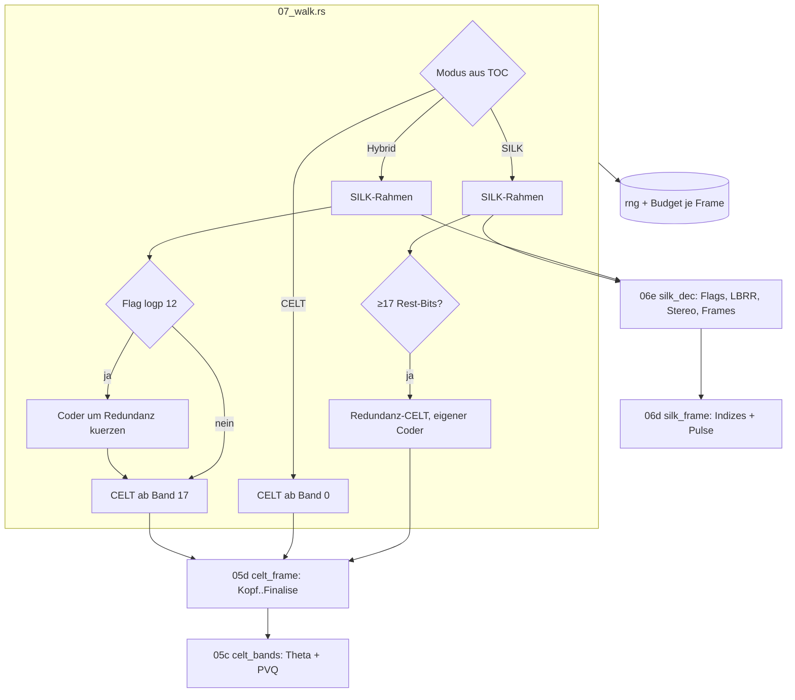

# Walkthrough: Bis zum letzten Bit (`07_review`, source2)

Ausgangsfrage war ein Review: Was taugt `source1` nach sechs
Entwicklungsrunden, und wie saehe eine bessere Umsetzung aus? Die
Antwort fiel klarer aus als erwartet. Die Architektur von `source1`
war gut — aber beide Bitstrom-Walks hoerten *vor dem Ende des Pakets*
auf. Damit fehlte das staerkste Orakel, das es fuer Opus gibt: der
Endzustand des Range-Coders (`final_range`). `source2` liest jetzt jedes
Bit, und dieses Orakel stimmt fuer **alle 255 360 Pakete** aus echten
Dateien, Fixtures und den offiziellen RFC-Testvektoren. Dieses Dokument
folgt der bekannten Struktur (was / Entscheidungen durch Tests /
Learnings / Pakete).

Wer das Werkzeug *benutzen* will, liest `source2/HANDBUCH.md`; hier
geht es um das *Wie* und *Warum*.

## Glossar-Ergaenzung zu `06_silk`

- **Final Range (`rng`)**: 32-Bit-Zustand des Range-Coders nach dem
  letzten gelesenen Bit eines Frames; Encoder und jeder korrekte
  Decoder haben denselben Wert. libopus: `OPUS_GET_FINAL_RANGE`.
- **Walk**: unser Lesepfad durch den Bitstrom — liest alles, was der
  Decoder liest, erzeugt aber keinen Ton.
- **PVQ** (Pyramid Vector Quantization): CELT-Feinstruktur als K Pulse
  auf N Positionen; gelesen wird ein Index `< V(N,K)`.
- **Theta**: Stereo-/Split-Winkel, der Bits zwischen zwei Haelften
  verteilt.
- **LBRR** (Low Bit-Rate Redundancy): SILK-Kopie des Vorgaenger-Frames
  fuer Verlustfaelle (In-Band-**FEC**, Forward Error Correction).
- **Redundanz-Frame**: 5-ms-CELT-Frame am Ende eines SILK/Hybrid-Frames,
  der Moduswechsel glaettet.
- **Bit-Budget**: Aufteilung der Nutzlast eines Frames auf Posten
  (SILK-Kopf, Pulse, FEC, CELT-Kopf, Energie, PVQ, Redundanz, Rest) in
  1/8 Bit.
- **PLC** (Packet Loss Concealment): Verschleiern; hier: Frames ≤ 1 Byte.

## 1. Was exakt implementiert wurde

### 1.1 Review (`review.md`)

Elf Kern-Befunde (A1–A11), fuenf Modell-Befunde (B1–B5), drei
Test-Befunde (C1–C3), jeweils mit Beleg. Die wichtigsten, mit Messung:

| Befund | Messung an `source1` | Folge |
|---|---|---|
| A1/A2 CELT-Walk endet vor PVQ, `final_range` ungenutzt | `grep final_range` = 0 | kein exakter Sync-Beweis |
| A4 SILK-Flags nur im 1. Payload | `silk_120ms.opus`: Tonhoehe in 39/67 Paketen anders als in `source2` (z. B. Paket 3: Gain 81,9 dB statt 52,6 dB) | Werte aus verschobenen Bits |
| A6 LBRR → grau | `silk_fec.opus`: nur 167/401 Pakete mit SILK-Daten | FEC-Streams fast leer |
| A7 Stereo → grau | `silk_stereo_wb`, `hybrid_stereo`: 0/401 | Stereo-Sprache unsichtbar |
| A8 Hybrid-Redundanz ohne Storage-Kuerzung | Referenz + DeepWiki `xiph/opus` | falsche Roh-Bits bei Wechseln |
| A10 Reset bei jedem Moduswechsel | Referenz `decoder.rs:521, 1356, 1581` | Zustandsfehler nach Wechseln |

### 1.2 Neue Kern-Module



- **`05c_celt_bands.rs`** (544 Zeilen): `quant_all_bands` als reiner
  Bit-Walk. Kernidee: Der Bitverbrauch haengt nur von Allokation,
  Theta und Pulszahl ab — nicht von Signalwerten. Lowband-Folding,
  Collapse-Masken und Rausch-Seeds koennen also wegfallen. Gelesen
  werden Theta (drei Verteilungen: Stufe, uniform, Dreieck), das
  Intensitaets-Inversionsbit, PVQ-Indizes und N=1-Vorzeichen; Splits
  mit Rebalance wie im Original.

  ```rust
  // Leaf einer Partition: Pulszahl aus dem Budget, dann ein Index < V(N,K).
  let k = get_pulses(q) as usize;
  let _index = self.rc.dec_uint(pvq_v(n, k));
  self.pulses += k as u32;
  ```

  `V(N,K)` kommt aus der Rekursion `V(N,K)=V(N−1,K)+V(N,K−1)+V(N−1,K−1)`
  in `u32` mit Wrap — modulo 2³² linear, also fuer alle gueltigen Paare
  exakt; das spart die 1272er-Tabelle (Test gegen die geschlossene
  Formel nach Fischer).
- **`05d_celt_frame.rs`**: plus Anti-Collapse-Bit,
  `unquant_energy_finalise`, Prefilter-Periode/Gain und Buchhaltung je
  Lese-Gruppe (`CeltBits`) und je Band (`band_bits8`).
- **`06e_silk_dec.rs`** (neu): Spiegel von `silk_Decode` — VAD/LBRR je
  Kanal, LBRR-Muster bei 40/60 ms, LBRR-Frames (nur Indizes + Pulse, kein
  Eingriff ins Gain-/NLSF-Gedaechtnis), Stereo-Praediktor, Mid-only,
  Seitenkanal-Reset, drei Kodier-Stufen.
- **`07_walk.rs`** (neu): Modus-Logik und Reset-Regeln 1:1 nach
  Referenz; Redundanz beidseitig; Hybrid→SILK-Ausblendframe
  (`[0xFF, 0xFF]`, 16 Bit); PLC; `Budget` je Frame.
- **`08_decode.rs`**: sammelt `final_range` je Paket.

### 1.3 Modell und Darstellung

- **`09b_model.rs`**: `PacketInfo` (je Paket) + `HopInfo` (je 20-ms-Hop)
  statt 13 paralleler Vektoren; Hybrid ist kein Sonderpfad mehr
  (Schichten sind `Option`s). Dichte = *gelesene* Bits.
- **`11b_lanes.rs`** (aus dem Renderer ausgelagert, 600er-Regel): neue
  **Budget-Lane** und zweite Legendenzeile.
- **Viewer**: vierte Hover-Zeile `BITS SILK x% CELT y% REST z%` plus
  Marker `FEC`, `RED:…`, `MID-ONLY`.
- **JSON-Schema 3**: `final_range`, `budget_bits`, `pulses`,
  `prefilter_period`, Datei-`bits`; Writer aus `obj()`/`arr()`-Helfern
  statt Hand-Kommas (B4).
- **Report**: Zeilen `bits:`, `schutz:`, `pruefung:` und Saetze zu FEC,
  PVQ-/Puls-Dominanz und Desync; `Fakten`-Buendel statt acht Parametern;
  `CliConfig` nach `12_cli.rs` (B2).

### 1.4 Tests und Orakel

| Orakel | Daten | Ergebnis |
|---|---|---|
| opus-pure `final_range` | 25 Fixtures (`tests/oracle.rs`) | 100 % |
| libopus-Encoder (`opusenc --save-range`) | `opusenc_60ms` | 201/201 |
| libopus-Encoder (RFC-Testvektoren) | 12 Dateien (`tests/celt.rs`) | 20 075/20 075 |
| libopus 1.6.1 Decoder (`scripts/libopus_oracle.py`) | Fixtures + 4 Real-Dateien | 11 707 + 223 578 |
| Bit-Budget-Identitaet | jeder Frame | exakt |
| Werte: Pitch vs. Autokorrelation | 120-ms-Pakete (Code 3) | 114/120 ±10 % |
| Werte: Energie vs. PCM | Sinus, Sweep | Divergenz-Median −0,8 dB |

Die Fixture-Matrix (`scripts/mkfixtures.sh`, 660 KB) treibt jeden
Decoder-Pfad: Stereo-SILK (Mid-only), FEC mono/stereo, NB 60 ms, MB 40 ms,
SILK 10 ms und 120 ms, Hybrid 60 ms/stereo/SWB 10 ms, CELT 2,5/5/10 ms,
NB, CBR 40 ms, Intensity-Stereo, 256 kbit/s, Wechsel SILK↔CELT,
Hybrid↔CELT (mit Redundanz in beide Richtungen), Wechsel mit FEC, DTX.

Gates: `cargo test --all-features` 126 Tests (+1 `--ignored` fuer die
grossen Dateien), `fmt --check`, `clippy --all-targets --all-features
-D warnings` = 0, `scripts/smoke.sh` inkl. Xvfb-HIL (8/8 Asserts),
`cargo upgrade --dry-run` = latest, `cargo tree` = nur `opus-pure`.

## 2. Architektur-Entscheidungen durch Tests

1. **Orakel zuerst, dann Darstellung.** Der Kern (05c–07) wurde gegen
   `final_range` gebaut, bevor eine Zeile Renderer angefasst wurde. Das
   Beispiel `examples/oracle.rs` lief nach dem ersten Kompilieren auf
   allen 223 578 Real-Paketen gruen — die Gegenprobe kam also nicht als
   Nachweis am Ende, sondern als Bauwerkzeug.
2. **Bit-Budget mit negativem Rest.** Die erste Budget-Version klemmte
   „ungenutzt" auf ≥ 0 und verletzte die Identitaet auf SILK-Frames um
   1–23 Achtelbits. Ursache ist kein Fehler: Der Range-Coder darf ueber
   das Payload-Ende „lesen" (implizite Nullen), der Encoder spart so die
   letzten Bytes. `unused` darf jetzt negativ sein und ist dokumentiert.
3. **Kalibrierung neu messen statt erben.** Mit Finalise stiegen die
   Bandenergien gegenueber `source1` um 5 dB, der Skalen-Test fiel.
   Analyse: `source1` mittelte bei Mono den leeren zweiten Kanal mit
   (−3 dB) und lief ohne Finalise (~2 dB Drift der Energie-Historie).
   `CAL_DB` −76,5 → −81,5 dB; danach Sinus-Anker exakt (−6,9/−6,9 dB) und
   Divergenz-Median −3,3 → −0,8 dB. Der alte „methodische Rest" aus
   `03_bitstream` war also zur Haelfte ein Bug.
4. **Dichte-Skala robust machen.** Die gemessene Dichte zeigte zunaechst
   fast nur Schwarz: ein einziger SILK-Formant-Bin trug 195 Bit, weil
   die Verteilung mit der rohen Huellen-Leistung (40+ dB Dynamik)
   gewichtete. Gewichtung jetzt mit der 4. Wurzel, Farbskala am
   99-%-Perzentil — danach sind CELT-Tonbaender und SILK-Formanten
   gleichzeitig lesbar.
5. **`bitexact_cos` nur im Definitionsbereich testen.** Die Funktion
   laeuft fuer `x = 0` und `16384` in i16-Ueberlauf; der Decoder ruft sie
   dort nie auf (Theta 0/16384 hat eigene Zweige). Der Test prueft
   cos(π/4) und x→16383 statt der Randwerte.
6. **PLC unterschiedlich je Referenz.** libopus meldet fuer Frames
   ≤ 1 Byte `rangeFinal = 0` (DeepWiki `xiph/opus`), opus-pure
   decodiert sie leer (DeepWiki `stephenberry/opus-pure`). `source2`
   folgt libopus (JSON `0`), der opus-pure-Vergleich klammert PLC aus;
   so sind beide Orakel gruen (`dtx.opus`: 342 bzw. 401 Pakete).
7. **Nebenbei gefunden:** Stille-Abschnitte standen in `source1` als
   ms mit Einheit „s" im Report („800.0 s" statt 0,8 s); Zeitachse lag
   nach Einfuehrung der Budget-Lane in der Lane — beides mit Test/
   Sichtpruefung behoben.

## 3. Learnings und Erweiterungen

**Learnings.**

- *Das staerkste Orakel lag die ganze Zeit in der Dependency.*
  `OpusDecoder::final_range()` ist eine Zeile; sechs Runden lang wurden
  stattdessen indirekte Orakel gebaut (Bilanz, Korrelation, Pitch).
  Lehre: vor eigenen Plausibilitaets-Tests die Referenz nach
  eingebauten Pruefsummen absuchen.
- *Bitverbrauch ist signalunabhaengig* — das machte den vollstaendigen
  CELT-Walk billig (544 Zeilen statt eines Decoder-Ports mit MDCT und
  Folding). Die Annahme ist nicht geglaubt, sondern durch das Orakel
  auf 255 360 Paketen belegt; ein Gegenbeispiel waere sofort ein Desync.
- *Echte Daten finden echte Pfade.* Erst die Matrix aus ffmpeg/opusenc
  brachte LBRR, Mid-only, Redundanz und 120-ms-Pakete in die Tests;
  die drei committeten Fixtures von `source1` beruehrten keinen davon.
- *Was das Budget erzaehlt:* Sprache in SILK gibt ~90 % fuer Pulse aus,
  Musik in CELT ~91 % fuer PVQ, das eigentliche Modell (Energien, NLSF,
  Pitch) ist billig. FEC bei 20 % Verlustannahme kostet 22–30 % der Datei.

**Moegliche Erweiterungen.**

- Budget-Ansicht als fuenfte Wasserfall-Quelle (Posten × Frequenz).
- PVQ-Vektoren decodieren (`cwrsi`) und Pulsmuster je Band zeigen.
- Pitch-Prefilter-Periode von CELT in die F0-Lane uebernehmen.
- Multistream (> 2 Kanaele) ueber mehrere `Walker`.
- Live-Modus: der Walk ist paketweise und zustandsbehaftet — RTP-faehig.
- `10b_report.rs` (597 Zeilen) bei der naechsten Erweiterung in
  Report + Regeln teilen.

## 4. Pakete fuers Dockerfile

| Paket (apt) | Wofuer | Pflicht? |
|---|---|---|
| `ffmpeg` | Fixture-Matrix (`mkfixtures.sh`), WebM→Ogg, `ffprobe` | Test |
| `opus-tools` | `opusenc --save-range`, DTX-Fixture, `opusinfo` | Test |
| `libopus0` (bringt ffmpeg mit) | `scripts/libopus_oracle.py` per ctypes | Test |
| `xvfb`, `xdotool`, `scrot` | HIL des Viewers (`interact.sh`) | Test |
| `python3` | JSON-Pruefung, libopus-Orakel | Test |
| `curl` | RFC-Testvektoren nach `/tmp/tv` laden | optional |
| `cargo-edit` (cargo install) | `cargo upgrade --dry-run` | Bauzeit |

Laufzeit unveraendert: keine System-Deps ausser `libx11-6` fuer
`--show`; Build mit stabilem Rust ≥ 1.88 (getestet 1.99.1). In diesem
Container fehlten anfangs `ffmpeg`, `opus-tools`, `xvfb`, `xdotool`,
`scrot` und `cargo-edit` — alle per `apt`/`cargo install` nachgeruestet.
