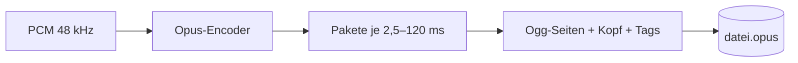
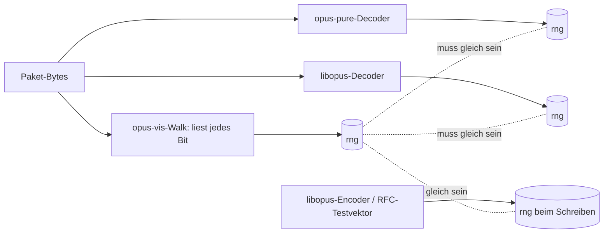
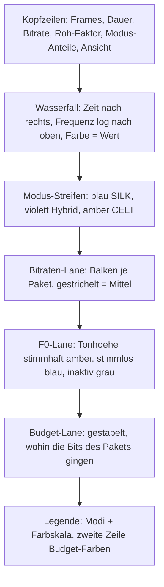

# Handbuch: `opus-vis` — Opus-Dateien lesen, sehen und verstehen

Dieses Handbuch erklaert in drei Schritten, was in einer `.opus`-Datei
steckt (Teil A), wie man das Werkzeug bedient (Teil B) und wie man
seine Ausgaben liest (Teil C). Am Ende stehen die Pruefwege (Teil D)
und ein Glossar. Alle Zahlenbeispiele stammen aus echten Laeufen auf
den Dateien in `tests/data/` bzw. den Quell-Dateien neben `source2/`.

## Teil A — Was steckt in einer Opus-Datei?

### A.1 Vom Ton zur Datei

**Opus** ist ein Audio-Codec (Coder/Decoder, RFC 6716): Er macht aus
rohem Ton (**PCM**, Pulse-Code-Modulation — z. B. 48 000 Zahlen pro
Sekunde und Kanal) einen kleinen Bitstrom und zurueck. Eine `.opus`-Datei
ist dieser Bitstrom, verpackt in den **Ogg**-Container (RFC 7845), der
nur Pakete aneinanderreiht und einen Kopf (Kanalzahl, Vorlauf) mitgibt.



Ein Beispiel: `silk_silk.opus` dauert 20:32 min. Roh waeren das
768 kbit/s × 1 233 s ≈ 118 MB (Mono, 48 kHz, 16 Bit); die Datei hat
3,4 MB — Faktor 35. Wo diese Ersparnis herkommt, ist genau die Frage, die
`opus-vis` beantwortet.

### A.2 Das Paket: TOC-Byte und Frames

Jedes Paket beginnt mit dem **TOC-Byte** (Table of Contents). Es nennt
Modus, Bandbreite, Frame-Dauer, Kanalzahl und wie viele Frames im
Paket stecken (Packing-Code 0–3). Danach folgen die Frame-Nutzdaten.

| Modus | Wofuer | Technik in einem Satz |
|---|---|---|
| **SILK** | Sprache, schmale Bandbreite | Sagt jedes Sample aus den vorigen voraus (**LPC**, lineare Praediktion) und codiert nur den Rest |
| **CELT** | Musik, volle Bandbreite | Zerlegt den Klang in 21 Frequenzbaender (**MDCT**) und codiert Energie + Feinstruktur je Band |
| **Hybrid** | Sprache in hoher Qualitaet | SILK fuer 0–8 kHz, CELT ab Band 17 (8 kHz) aufwaerts — *in einem* Bitstrom |

### A.3 Der Range-Coder: warum „bis zum letzten Bit" wichtig ist

Opus schreibt fast alle Werte mit einem **Range-Coder** (arithmetische
Codierung): Haeufige Werte kosten Bruchteile eines Bits, seltene mehr.
Das spart viel, hat aber eine Tuecke: Liest man *einen* Wert mit der
falschen Wahrscheinlichkeitstabelle, liest man danach zwar weiter
„etwas" — aber Unsinn. Der Range-Coder meldet nie einen Fehler.

Darum gibt es den **Final Range** (`final_range`): den 32-Bit-Zustand des
Coders nach dem letzten gelesenen Bit eines Frames. Encoder und Decoder
muessen hier exakt denselben Wert haben. `opus-vis` liest jedes Paket
vollstaendig (ohne Ton zu erzeugen) und vergleicht diesen Wert mit drei
unabhaengigen Referenzen. Stimmt er, ist **jedes einzelne Bit** an der
richtigen Stelle gelesen worden — und damit jede Zahl, die das Werkzeug
anzeigt, eine echte Encoder-Entscheidung und keine Schaetzung.



### A.4 Was in einem SILK-Frame steht

Ein SILK-Frame (10 oder 20 ms) traegt ein kleines „Stimmmodell":

1. **Flags**: Sprachaktivitaet (**VAD**, Voice Activity Detection) und ob
   eine **LBRR**-Kopie (Low Bit-Rate Redundancy, eingebettete
   Fehlerkorrektur = In-Band-**FEC**) des *vorigen* Pakets mitreist.
2. **Signaltyp**: inaktiv, stimmlos (Zischlaut) oder stimmhaft (Vokal).
3. **Gains**: Lautstaerke je 5-ms-Teilframe.
4. **NLSF** (Normalized Line Spectral Frequencies): die Form des
   Vokaltrakts — daraus wird die Huellkurve (Formanten) berechnet.
5. **Pitch/LTP** (nur stimmhaft): Tonhoehe und Langzeit-Vorhersage.
6. **Pulse** (Excitation): der Rest, den die Vorhersage nicht erklaert —
   meist der groesste Posten.

Bei Stereo kommt je Frame ein **Mid/Side-Praediktor** dazu; ist der
Seitenkanal still, wird nur Mid codiert (**Mid-only**).

### A.5 Was in einem CELT-Frame steht

1. Kopf-Flags: Stille, Prefilter (Kammfilter auf der Tonhoehe),
   Transient (kurze Bloecke fuer Schlaege), Intra.
2. **Coarse-Energie** je Band (Laplace-codiert, vorhergesagt).
3. TF-Aufloesung, Spread, **Dynalloc** (Extra-Bits fuer einzelne Baender),
   Trim — daraus berechnet der Decoder die **Allokation**: wie viele Bits
   jedes Band bekommt.
4. **Fine-Energie**: Nachkommastellen der Energie.
5. **PVQ** (Pyramid Vector Quantization): die Feinstruktur je Band als
   „K Pulse auf N Positionen". Bei Stereo vorher ein **Theta**-Winkel
   (wie viel Mid, wie viel Side).
6. Anti-Collapse-Bit und **Finalise** (uebrige Bits verfeinern Energien).

### A.6 Moduswechsel und Redundanz

Wechselt der Encoder zwischen SILK/Hybrid und CELT, wuerde es knacken.
Darum haengt er einen 5-ms-**Redundanz-Frame** (CELT) an: entweder zum
Ausblenden der alten CELT-Schicht (CELT→SILK) oder zum Vorwaermen der
neuen (SILK→CELT). Im Bit-Budget erscheint er als eigener Posten.

## Teil B — Bedienung

### B.1 Bauen

```sh
cd source2
cargo build --release                  # Kern (nur opus-pure)
cargo build --release --features show  # plus X11-Viewer (minifb)
```

### B.2 Aufrufe

```sh
opus-vis datei.opus                       # Report (stdout) + datei.png
opus-vis datei.opus -o bild.png --width 1200
opus-vis datei.opus --view dichte -o d.png   # Ansicht 1–4 (s. C.2)
opus-vis datei.opus --json daten.json --quiet
opus-vis - -o - < datei.opus > bild.png   # Pipe; Report geht dann nach stderr
opus-vis datei.opus --show                # Fenster (Feature show)
```

WebM von YouTube enthaelt oft Opus; ohne Neukodierung umpacken:

```sh
ffmpeg -i video.webm -vn -c:a copy audio.opus
```

### B.3 Viewer-Steuerung

| Eingabe | Wirkung |
|---|---|
| Mausrad | Zeit-Zoom um den Cursor |
| Links ziehen, Pfeile | verschieben |
| `+` / `-` | Zoom um die Mitte |
| `1`–`4` | Ansicht wechseln |
| `R` | Gesamtansicht |
| `ESC` | Ende |

Hover ueber dem Wasserfall zeigt vier Zeilen, z. B. (Demo, 3,0 s):

```text
T=3.000S F=977HZ PEGEL=-72DB
CELT FB 20MS 477B 190.8KBPS C0 P0
TRANS 1 SIG 3760B
BITS SILK 0% CELT 99% REST 1%
```

Zeile 1: Ort und Wert; Zeile 2: Paket (Modus, Bandbreite, Dauer, Bytes,
Bitrate, Packing-Code, Padding); Zeile 3: Stimme (SILK) oder
Transient + gelesene Bits (CELT); Zeile 4: Bit-Budget des Pakets plus
Marker `FEC`, `RED:SILK-CELT`/`RED:CELT-SILK`, `MID-ONLY`.

## Teil C — Ausgaben lesen

### C.1 Der Report, Zeile fuer Zeile

Echter Lauf auf `tests/data/gen/silk_fec_stereo.opus` (Sprache, Stereo,
16 kHz, FEC an, 20 % erwarteter Verlust), gekuerzt:

```text
modi: silk 100.0 %, hybrid 0.0 %, celt 0.0 % (1 abschnitt)
stimme: stimmhaft 29.9 % von 8.0 s SILK, tonhoehe median 193 hz (104-243), gain-dynamik 44 db
bits: silk-kopf 12.3 %, silk-puls 64.9 %, fec 22.3 %, ungenutzt 0.5 %
schutz: fec in 235 paketen (235 lbrr-kopien), redundanz 0 celt->silk / 0 silk->celt, mid-only 396, plc 0
pruefung: final range 401/401 pakete bit-exakt (walk endet wie der decoder)
einordnung:
- in-band-fec aktiv: 22 % der bits sind lbrr-kopien fuer verlorene vorgaenger-pakete
```

So liest man das:

- **bits:** Mehr als ein Fuenftel der Datei ist Versicherung (FEC) —
  bei verlustfreier Uebertragung verschenkt. Zwei Drittel sind
  SILK-Pulse: der Rest, den das Stimmmodell nicht vorhersagen konnte.
- **schutz:** 396 Frames nur Mid — der Seitenkanal war still (die Quelle
  ist im Grunde mono). Ein Hinweis, dass `-ac 1` hier billiger waere.
- **pruefung:** Alle 401 Pakete enden mit dem Final Range des Decoders.
  Steht hier `ACHTUNG`, laufen Walk und Decoder auseinander — dann die
  Werte der Datei nicht verwenden und einen Fehlerbericht schreiben.

Zum Vergleich drei echte Dateien (gleiche Sprache, drei Kodierungen):

| Datei | Modus | `bits:` (gerundet) |
|---|---|---|
| `silk_silk.opus` (16 kHz, voip, 24k) | SILK | Kopf 10 %, Pulse 90 % |
| `silk.opus` (48 kHz, voip, 24k) | Hybrid | SILK 75 %, CELT-Energie 4 %, PVQ 19 % |
| YouTube-Audio (CELT, 137 kbit/s) | CELT | Kopf 2 %, Energie 7 %, PVQ 91 % |

Man sieht direkt: Bei Musik steckt fast alles in der Feinstruktur (PVQ),
bei Sprache in der Anregung (SILK-Pulse); das Modell selbst (Kopf,
Energien, NLSF) ist billig.

### C.2 Das Bild



Die vier Ansichten des Wasserfalls (`--view` oder Tasten `1`–`4`):

| Ansicht | Zeigt | Lesetipp |
|---|---|---|
| 1 SPEKTRUM | was man *hoert* (decodiertes PCM, STFT) | Referenz fuer alles andere |
| 2 BITSTROM | was der Encoder *modelliert* hat: CELT-Bandenergien (dBFS), bei SILK die LPC-Huelle (relativ, Spitze = 0 dB) | Formanten als helle Baender; uncodierte Baender bleiben dunkel |
| 3 DIVERGENZ | Spektrum minus Bitstrom (±12 dB, grau = kein Modell) | Rot/Blau = Encoder hat dort mehr/weniger Energie angenommen |
| 4 DICHTE | *gelesene* Bits je Frequenz-Bin | Wo der Encoder sein Budget ausgibt |

Die Dichte ist bei CELT exakt gemessen (Bits je Band, durch die Zahl der
Bins des Bands geteilt). SILK kennt keine Frequenzbaender; seine Bits
werden nach der (gedaempften) Huellkurve bis zur SILK-Nyquistfrequenz
verteilt — das ist die einzige Modellannahme der Ansicht. Die Farbskala
endet am 99-%-Perzentil, damit einzelne Spitzen nicht alles abdunkeln.

Die **Budget-Lane** stapelt von unten: SILK-Kopf (dunkelblau),
SILK-Pulse (hellblau), FEC (gruen), CELT-Kopf (braun), Energie (orange),
PVQ (gelb), Redundanz (magenta); die Restluecke oben ist ungenutzt.
In `switch_voip.opus` (Sprache → Toene → Sprache) sieht man den Wechsel
Hybrid→CELT als Farbsprung von Blau nach Gelb. Das letzte Hybrid-Paket
vor dem Wechsel (Paket 219, 4,38 s) traegt einen SILK→CELT-Redundanz-
Frame: 352 von 952 Bit (37 %) — ein deutlicher magenta Strich. Beim
Rueckweg (Paket 544, 10,88 s) dasselbe in Gegenrichtung (CELT→SILK).

### C.3 JSON (Schema 3)

```text
{ "schema": 3, "head": {...}, "tags": {...}, "summary": {...},
  "encoder": {...}, "pcm": {...},
  "bits": {"shares": {"silk_kopf": 0.1227, "silk_puls": 0.6489, "fec": 0.2233,
                      "celt_kopf": 0.0, "energie": 0.0, "pvq": 0.0,
                      "redundanz": 0.0, "unused": 0.0051},
           "lbrr_frames": 235, "mid_only_frames": 396, "plc_frames": 0,
           "final_range_compared": 401, "final_range_equal": 401, ...},
  "frames": [ ...,
    {"index": 5, "mode": "silk", "bw": "WB", "channels": 2, "bytes": 83,
     "kbps": 33.2, "final_range": 348306948, "redundancy": null,
     "budget_bits": {"init": 1.0, "silk_flags": 4.0, "silk_lbrr": 187.75,
                     "silk_stereo": 21.0, "silk_side": 44.125,
                     "silk_pulses": 393.75, "unused": 4.375, ...},
     "celt": null,
     "silk": {"signal": 1, "gains_db": 52.9, "pitch_hz": 0.0,
              "lbrr_frames": 1, "mid_only_frames": 1, ...}}, ...] }
```

Beispiel-Frame 5 (echter Lauf, `silk_fec_stereo.opus`): 83 Byte Paket =
1 TOC-Byte + 82 Byte Nutzlast = 656 Bit, und genau 656 Bit ergeben die
Posten von `budget_bits`: 188 Bit FEC-Kopie, 394 Bit Pulse, 44 Bit
Seiteninfo, 21 Bit Stereo, 4 Bit Flags, 1 Bit Coder-Start, 4,4 Bit Rest.

Felder tragen ihre Einheit im Namen (`_ms`, `_kbps`, `_db`, `_hz`);
`budget_bits` ist in Bit (drei Nachkommastellen, weil der Range-Coder in
1/8 Bit rechnet). `final_range` kann man mit jedem eigenen Decoder
gegenpruefen (siehe D.2).

## Teil D — Pruefen und Vertrauen

### D.1 Was „bit-exakt" hier bedeutet

| Referenz | Wie | Ergebnis (31.10.2026) |
|---|---|---|
| opus-pure-Decoder | `cargo test --test oracle` | 25 Fixtures, alle Pakete |
| libopus-Encoder | `opusenc --save-range`, RFC-Testvektoren | 201 + 20 075 Pakete |
| libopus-Decoder 1.6.1 | `scripts/libopus_oracle.py` | 11 707 + 223 578 Pakete |
| Bit-Budget | Summe aller Posten = Nutzlast-Bytes × 8 (ohne TOC/Laengen) | jeder Frame |

### D.2 Selbst nachpruefen

```sh
cargo run --release --example oracle -- meine.opus
python3 scripts/libopus_oracle.py meine.opus
```

Die Ausgabe nennt je Datei Pakete, Moduswechsel, Redundanz-Frames,
LBRR-Kopien, PLC-Frames und wie viele Final Ranges gleich sind.

### D.3 Grenzen

- Mehr als 2 Kanaele (Multistream) werden abgelehnt.
- Leere Frames (DTX, ≤ 1 Byte) sind „Verschleierung" (**PLC**, Packet
  Loss Concealment): libopus meldet dort `0`, `opus-vis` ebenso.
- Werte, die erst die Synthese erzeugt (Rauschfuellung, gefaltete
  Baender), zeigt `opus-vis` nicht — es zeigt Encoder-Entscheidungen.

## Glossar

| Begriff | Bedeutung |
|---|---|
| CELT | Constrained-Energy Lapped Transform, Musik-Schicht von Opus |
| dBFS | Dezibel relativ zur Vollaussteuerung |
| DTX | Discontinuous Transmission: in Pausen (fast) nichts senden |
| FEC | Forward Error Correction, hier In-Band per LBRR |
| Final Range | 32-Bit-Endzustand des Range-Coders eines Frames |
| HIL | Hardware-in-the-Loop, hier: Viewer-Test unter Xvfb |
| Hybrid | SILK unten + CELT ab 8 kHz in einem Frame |
| LBRR | Low Bit-Rate Redundancy: Kopie des vorigen Frames in schlechterer Qualitaet |
| LPC | Linear Predictive Coding, Vorhersage aus vergangenen Samples |
| LTP | Long-Term Prediction, Vorhersage ueber eine Tonhoehen-Periode |
| MDCT | Modified Discrete Cosine Transform, Frequenzzerlegung von CELT |
| Mid/Side | Summe/Differenz der Kanaele statt Links/Rechts |
| NLSF | Normalized Line Spectral Frequencies, kompakte Form der LPC-Huelle |
| Ogg | Container-Format, in dem `.opus` steckt |
| PCM | Pulse-Code Modulation, rohe Abtastwerte |
| PLC | Packet Loss Concealment, Verschleiern fehlender Pakete |
| PVQ | Pyramid Vector Quantization: K Pulse auf N Positionen |
| Range-Coder | arithmetischer Entropie-Coder von Opus |
| SILK | Sprach-Schicht von Opus (aus Skype) |
| STFT | Short-Time Fourier Transform, Spektrum im Zeitverlauf |
| Theta | Stereo-Winkel: Bitverteilung zwischen Mid und Side |
| TOC | Table of Contents, erstes Byte jedes Pakets |
| VAD | Voice Activity Detection |
