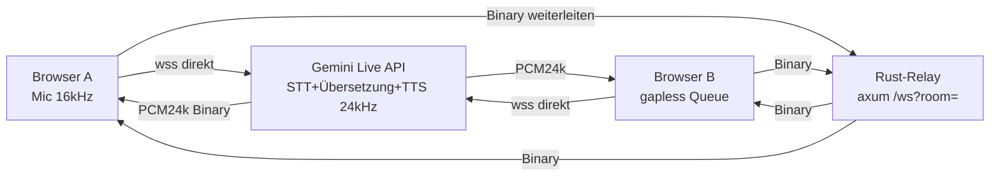

# Implementierungsplan — Live-AI-Dolmetscher (37_live/source1)

Stand: 2026-10-23. Auftrag: wol pumba. Kernidee aus [live.md](../../plan/misc/live.md):
Browser ↔ Gemini-Live direkt (Audio), Rust-Relay nur für Raum-Vermittlung.

## 1. Requirements-Bewertung

Gegeben (aus prompt.txt + live.md): übersetzende Website für Linux/Android/iPhone,
Rust-Relay + statisches Frontend, Gemini-Key lokal im Browser, Räume, wenige Deps.

Lücken / Zusatzvorschläge (priorisiert):

1. **HTTPS-Pflicht (P0):** Mikrofon geht mobil nur über sichere Kontexte.
   Vorschlag: `smoke.sh` + README dokumentieren `localhost` vs. Tunnel
   (`cloudflared`/`ngrok`), Server bindet `0.0.0.0`.
2. **Kein Key über Relay (P0):** Key nie an `/ws` senden, nur `localStorage`.
   Test: Relay-Logs enthalten nie `key=`.
3. **Binärvertrag (P0):** PCM16 mono, Out 24 kHz / In 16 kHz, Opcode Binary.
   Text-Frames nur für `{type:"hello"}`-Handshake, sonst ignorieren.
4. **Rückkopplung (P1):** kein lokales Echo (nur Partner hört TTS),
   `echoCancellation:true` im Frontend (aus live.md übernommen).
5. **Räume isoliert (P0):** `?room=`-Query, leere Räume werden gelöscht,
   unbekannter Raum = neuer Raum.
6. **Beobachtbarkeit (P1):** `/healthz` + `/api/rooms` (Anzahl Räume/Peers),
   `tracing`-Logs mit Raum-Namen, kein Audio-Inhalt.
7. **TUI (P2, nach Modi):** Terminal-Status (`--check`, Perioden-Abfrage von
   `/api/rooms`) ohne Extra-Dep (nur `std`), für HIL am Docker-X-Server.
8. **Lastgrenzen (P1):** pro Peer `mpsc`-Puffer 64, Slow-Consumer wird
   übersprungen statt blockiert; Limit `max_peers_per_room = 8`.

Nicht-Ziele: STT/TTS im Relay (macht Gemini), Persistenz, Auth, TLS im Relay
(macht Reverse-Proxy/Tunnel).

## 2. Architektur



Relay-Regel: **Sender nie zurückbeliefern**, nur Peers im gleichen Raum.
Gemini-Kontakt hat der Relay nie (kein Key, kein Audio-Parsing).

## 3. Datei-Kontext für Folge-Agenten

| Datei | Worum geht es |
|---|---|
| `20261023_01_first/prompt.txt` | Originalauftrag, Dateisplitting-Regeln, Doku-Sprache |
| `plan/misc/live.md` | Referenz: Node-Relay + Frontend-Prototyp, Gemini-Setup-Tabelle, Latenztricks |
| `source1/Cargo.toml` | 4 Deps: `axum`, `tokio`, `tower-http`, `tracing` (+`futures-util`, `serde`) |
| `source1/deps.md` | GitHub-Pfade `org/projekt` + DeepWiki-Muster |
| `source1/src/main.rs` | nur Modul-Deklaration + `serve()`-Verdrahtung |
| `source1/src/01_config.rs` | CLI/Env (`--listen`, `--dir`), `MODES`-Tabelle (4 Sprachpaare) |
| `source1/src/02_state.rs` | `Rooms`-Registry (`HashMap<Raum, HashMap<PeerId, Sender>>`) |
| `source1/src/03_relay.rs` | WS-Handler + Broadcast (ohne Echo an Sender) |
| `source1/src/04_serve.rs` | Router (`/`, `/ws`, `/healthz`, `/api/rooms`, `/api/modes`) |
| `source1/public/index.html` | Frontend: Mic→Gemini→Relay→Partner (aus live.md portiert) |
| `source1/tests/*.rs` | Host-Tests: Relay-Broadcast, Modi-Tabelle, Health |
| `source1/scripts/smoke.sh` | Smoke: build + healthz + 2-Client-Broadcast |

## 4. Commit-Konvention (Conventional Commits, deutsch erklärt)

Format: `<typ>(<scope>): <kurz>` + Body (Was/Warum) + `Tests:`-Zeile.
Typen: `feat` (neu), `fix` (Fehler), `test`, `docs`, `refactor`, `chore`.
Jeder Task-Schritt = genau ein Commit, erst nach grünem Nachweis
(`cargo fmt --check && cargo clippy -- -D warnings && cargo test`).
Beispiel:

```text
feat(relay): raum-broadcast ohne sender-echo

Rooms-Registry leitet Binaer-Frames nur an Peers weiter.
Der Sender ist ausgeschlossen, leere Raeume werden geloescht.

Tests: cargo test --test ws_relay (3/3 gruen)
```

## 5. Validierungs-Gates (jedes Gate muss grün sein)

1. `cargo fmt --check` 2. `cargo clippy --all-targets -- -D warnings`
3. `cargo test` 4. `scripts/smoke.sh` 5. HIL: 2 Browser-Tabs,
   Tab A hört Tab-B-Audio (manuell, im Walkthrough protokolliert).
