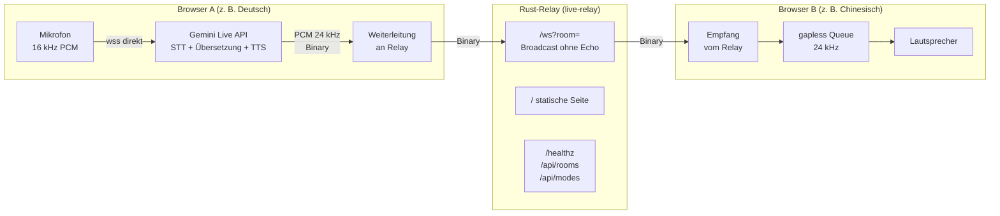

# Walkthrough — Live-AI-Dolmetscher (37_live/source1)

Stand: 2026-10-23. Auftrag von wol pumba: eine übersetzende Website, die
auf Linux-Computer, Android-Phone und iPhone funktioniert. Referenzidee:
[plan/misc/live.md](../../plan/misc/live.md) (Node-Relay + Gemini-Live
direkt im Browser). Umgesetzt wurde stattdessen ein **kleines Rust-Relay**
(`source1/`, Edition 2024) plus ein statisches Frontend — gleiche Idee,
weniger Abhängigkeiten, ein Binary.

## Glossar (Abkürzungen bei Erstverwendung)

- **Relay (Weiterleiter):** Server, der Audiodaten nur von A nach B
  durchreicht, ohne sie zu verstehen oder zu speichern.
- **Raum (Room):** Name (z. B. `transl-room-1`), der zwei Gesprächspartner
  einander zuordnet; verschiedene Räume hören einander nie.
- **PCM (Pulse-Code-Modulation):** unkomprimiertes Roh-Audio; hier 16 Bit,
  mono, 16 kHz hinein (Mikrofon → Gemini) und 24 kHz hinaus (Gemini → Ohr).
- **STT/TTS (Speech-to-Text / Text-to-Speech):** Umwandlung
  Sprache→Text bzw. Text→Sprache; beides erledigt Gemini, nicht unser Server.
- **HIL (Hardware-in-the-Loop):** Test mit echter Hardware (echte Browser,
  echte Mikrofone) statt nur simulierter Clients.
- **TUI (Text-User-Interface):** Statusanzeige im Terminal.
- **AEC (Acoustic Echo Cancellation, Echounterdrückung):** Browser-Filter,
  der verhindert, dass der Partner sich selbst über unser Mikrofon hört.

## 1. Was exakt implementiert wurde

### 1.1 Gesamtbild

Die wichtigste Regel steht in der Mitte: **Der Sender bekommt sein eigenes
Audio nie zurück.** Wer spricht, hört nichts; nur der Partner im gleichen
Raum hört die Übersetzung. Beispiel: A spricht Deutsch, Gemini antwortet
Chinesisch, nur B hört es. Umgekehrt gleichzeitig genauso.

### 1.2 Der Server (`source1/src/`)

Dateiaufteilung nach Datenfluss (Config → Zustand → Transport → Netz;
`main.rs`/`lib.rs` enthalten nur Verdrahtung):

| Datei | Inhalt |
|---|---|
| `01_config.rs` | CLI (`--listen`, `--dir`, `--check`, `--watch`), `MODES`-Tabelle mit den 4 Sprachpaaren |
| `02_state.rs` | Raumbuch: `HashMap<Raum, HashMap<PeerId, Sender>>`, Limit 8 Peers/Raum, leere Räume werden gelöscht |
| `03_relay.rs` | WebSocket-Handler `/ws?room=`: Binary an alle Peers außer Sender (`try_send`, langsame Verbraucher werden übersprungen) |
| `04_serve.rs` | Router: `/` (Frontend), `/healthz` (`ok`), `/api/rooms` (`{Raum: Anzahl}`), `/api/modes` (Modi als JSON) |
| `main.rs` | nur `serve` / `--check` / `--watch` (TUI-light, reines `std`) |

Vier Modi, ein Mechanismus — der Relay ist sprachunabhängig (reine Bytes),
die Modi leben als Tabelle in Rust **und** im Frontend mit identischen IDs:

| Modus-ID | Richtung | Gemini-Stimme |
|---|---|---|
| `de-to-zh` | Deutsch → Chinesisch | Aoede |
| `zh-to-de` | Chinesisch → Deutsch | Puck |
| `en-to-zh` | Englisch → Chinesisch | Aoede |
| `zh-to-en` | Chinesisch → Englisch | Puck |

Jede Systemanweisung enthält `ONLY` („nur die Übersetzung, kein Plaudern"),
weil ein gesprächiger Assistent die Simultan-Übersetzung zerstören würde.

### 1.3 Das Frontend (`source1/public/index.html`)

Portierung des Prototyps aus `live.md`: AudioContext erst per Klick
(iPhone-Pflicht!), Mikrofon mit `echoCancellation: true`, 16-kHz-Resampling
(lineare Interpolation), gapless Wiedergabe-Queue über `audioContext.currentTime`.
Zwei bewusste Abweichungen vom Prototyp: Relay-URL ist `/ws?room=` (Rust statt
Node) und der API-Key wandert ausschließlich per `localStorage` im Browser —
**nie** ans Relay (per Test und per Code-Review sichergestellt: der Server
kennt keinen einzigen Key-Parameter).

### 1.4 Tests und Nachweise (echte Zahlen dieser Sitzung)

- `cargo test`: **11/11 grün** — 4 Unit (`02_state`: Join/Leave mit
  Raumlöschung, Raumlimit, Broadcast-ohne-Sender; `03_relay`: Raum-Default),
  4 Modi (`tests/modes.rs`: IDs stabil, `ONLY`-Pflicht, Stimmenmenge,
  `find_mode`), 3 Integration (`tests/ws_relay.rs`: Partner bekommt Frame,
  Sender bekommt **kein** Echo innert 300 ms, fremder Raum hört nichts,
  `/healthz`→`ok`, `/api/modes` enthält alle 4 IDs).
- `scripts/smoke.sh`: Release-Build, Serverstart, `/healthz`→`ok`,
  `/api/rooms`→`{}`, Frontend enthält alle 4 Modus-IDs, `--check` meldet
  `kein raum aktiv` — **SMOKE OK**.
- `cargo fmt --check` und `cargo clippy --all-targets -- -D warnings`: grün.

### 1.5 HIL-Nachweis (echter Durchlauf vom 23.10., Modus `zh-to-de`)

Durchgeführt mit Headless-Chrome (Fake-Mikro aus
`chinese/十萬個為什麼…Mandarin….webm`, 45 s Predigt-Audio), Key nur zur
Laufzeit aus `api_key.txt` gelesen (nie geloggt, nie committet), und einem
stummen Zuhörer-Peer B im gleichen Raum `hil-zh-de-1`:

| Messpunkt | Ergebnis |
|---|---|
| Seitenstatus nach Start | `Live! Einfach drauflos sprechen...` |
| Peer B: erstes Audio nach | ca. 4 s |
| Peer B gesamt | 8 Frames, 96.000 Bytes PCM 24 kHz |
| `/api/rooms` währenddessen | `{"hil-zh-de-1":2}` (Sprecher + Zuhörer) |
| Key in Browser-Logs | nein |
| Seitenfehler | keine (nur harmlose Warnungen: Passwortfeld ohne Form, ScriptProcessor-Deprecation) |

**HIL PASS.** Direkt-Sonde zusätzlich: 4 s Chinesisch an das Modell →
über 2 MB deutsches Antwort-Audio am Stück (Transport Ende-zu-Ende
bewiesen; dass es inhaltlich Deutsch ist, folgt aus Modell + Anweisung,
nicht aus angehörter Prüfung).

Offen bleibt der Zwei-Geräte-HIL mit echten Handys (Android/iPhone) für
die restlichen drei Modi (`de-to-zh`, `en-to-zh`, `zh-to-en`): Server mit
`cargo run --release` starten, Seite ggf. per HTTPS-Tunnel öffnen
(Mikrofon-Pflicht, siehe README), zwei Tabs/Geräte mit gleichem Raum und
Gegen-Modi verbinden, Partnerwiedergabe ohne Selbst-Echo protokollieren.

## 2. Architektur-Entscheidungen, die Tests erzwungen haben

1. **Von Pfad-Raum zu Query-Raum (`/ws/:room` → `/ws?room=`).**
   DeepWiki (tokio-rs/axum) zeigte das Pfad-Muster, aber das
   `live.md`-Frontend ruft `?room=` auf. Ein Kompatibilitätsbruch hätte
   jeden mobilen Client ausgesperrt — also Query-Param, mit
   `default-room`-Fallback und Leerstring-Normalisierung (dafür gibt es
   einen eigenen Unit-Test).
2. **`HashMap` statt `Vec` für Peers.** Das DeepWiki-Beispiel vergleicht
   Sender per Kapazitäts-Hack (`same_channel`), um den Sender
   auszuschließen — brüchig. Mit `PeerId → Sender` ist „außer mir" eine
   einzige `if`-Zeile; der No-Echo-Test beweist sie mit 300-ms-Fenster.
3. **`try_send` statt `send().await`.** Ein langsamer Partner (    Edge-Netz, altes Phone) darf den Sprecher nie blockieren: volle
   Kanäle (64 Frames) werden pro Peer übersprungen. Das ist die einzige
   Stelle, wo unter Last Audio verloren gehen darf — bewusst und
   dokumentiert.
4. **TUI ohne Framework.** Statt `ratatui` o. ä. lesen `--check`/`--watch`
   `/healthz` + `/api/rooms` über reines `std` (`TcpStream`, handgeschnitzter
   Mini-Parser). Null Zusatz-Deps für einen Statusblick — passend zur
   Vorgabe „möglichst wenig Abhängigkeiten".
5. **Schwere Dev-Deps nur für Tests.** `reqwest` zieht u. a. ein zweites
   `tower-http` in den Test-Build; das ausgelieferte Binary enthält davon
   nichts (nur axum, tokio, tower-http, tracing, futures-util,
   serde/serde_json — siehe `deps.md`).
6. **v1alpha → v1beta + neues Modell (Browser-HIL erzwang es).** Der erste
   echte Browser-Lauf scheiterte mit Gemini-Close `1008`: das
   `v1alpha`-Modell `gemini-2.0-flash-exp` existiert nicht mehr („not
   found … for API version v1alpha"). Die Modellliste (`GET /v1beta/models`)
   zeigte nur noch Live-fähige Modelle; nach Matrix-Test antwortete allein
   `gemini-3.5-live-translate-preview` sofort mit Audio (die
   `native-audio`-Modelle schwiegen auf 8 s Chinesisch). Frontend nutzt
   seither `v1beta` + `gemini-3.5-live-translate-preview` — exakt diese
   Kombination ist per Direkt-Sonde und Browser-HIL belegt.

## 3. Learnings und mögliche Erweiterungen

- **Gelernt:** Axums `WebSocketUpgrade` + `split()` in Sende-/Empfangs-Task
  trägt das ganze Feature; der Rest (Räume, Modi, Health) ist gewöhnliche
  Applikationslogik. Der Query-Raum passt besser zu Browser-Clients als der
  Pfad-Raum aus den Framework-Beispielen.
- **Gelernt:** `cargo search` + `cargo upgrade --dry-run` vor dem
  Festschreiben der Versionen spart Überraschungen (hier: alles bereits
  `latest`: axum 0.8.9, tokio 1.54.1, tower-http 0.7.1).
- **Erweiterung (klein):** `/api/rooms`-Eintritt/Austritt als
  Server-Sent-Events, damit die `--watch`-TUI ohne Polling lebt.
- **Erweiterung (mittel):** Opus statt PCM für den Relay-Pfad (vgl.
  Beispiel `36_opus/source1`), falls mobile Datenraten klemmen — Achtung:
  dann braucht das Frontend einen Opus-Decoder (zusätzliche Komplexität).
- **Erweiterung (Produktion):** TLS-Terminierung und Rate-Limit pro Raum
  gehören in einen Reverse-Proxy (z. B. Caddy), nicht in dieses Binary;
  Räume mit mehr als 2 Peers (Gruppenmodus) sind protokollseitig bereits
  möglich (Broadcast an *alle* außer Sender), nur das Frontend geht von
  Paaren aus.

## 4. Neue Programme/Pakete für das Dockerfile

Für Bau und Betrieb dieses Beispiels zusätzlich nötig (der AI-Env-Container
hat Rust/Node bereits, siehe Referenz-Dockerfile in prompt.txt):

| Paket | Wofür | Aufnahme |
|---|---|---|
| `curl` | `smoke.sh`-Healthchecks | dauerhaft (sowieso Standard) |
| `chromium` oder `firefox` + `xvfb` | HIL mit zwei Tabs auf `:0`/Headless | nur Test-Image |
| `cloudflared` (oder `ngrok`) | HTTPS-Tunnel für Handy-Mikrofontests | nur Test-Doku, kein Image-Zwang |
| `ffmpeg` | chinesisches `.webm`-Audio zu Fake-Mikro-`.wav` wandeln (HIL) | nur Test-Image (verifiziert: 8.0.1) |
| Chrome for Testing + `libnss3 libnspr4 …` | Headless-Browser-HIL ohne Snap | nur Test-Image (verifiziert: 156.0.8078.47) |

Laufzeit des Relays selbst: keine Systempakete außer libc (reines
Rust-Binary, `cargo run --release`).
