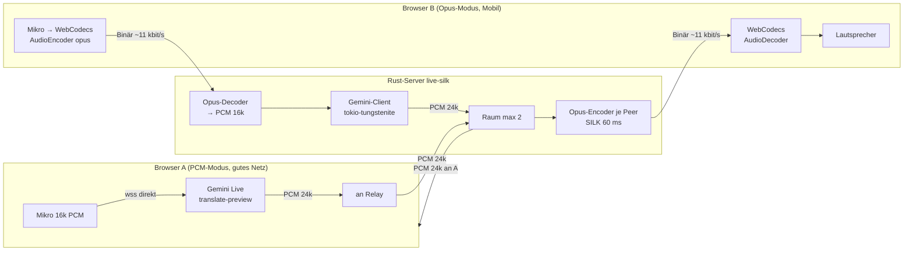

# Plan — 37_live/source2: Dolmetscher mit Opus-SILK-Sparmodus

Stand 2026-10-27. Auftrag (prompt.txt): wie `source1`, aber jeder Nutzer
wählt beim Verbinden, ob sein Mikrofon-Audio **und** das ankommende
Partner-Audio als stark komprimierter **Opus-SILK**-Strom laufen
(langsame Mobilverbindung). Alle Sprachen des Live-Übersetzungsmodells
wählbar, Default Deutsch ↔ Chinesisch, höchstens **2 Clients pro Raum**.

## 1. Ausgangslage (source1) und Messungen aus Spikes

`source1` (Rust-Relay, axum) leitet nur Binärframes weiter; der Browser
spricht selbst mit Gemini. Bandbreite je Nutzer im `source1`-Modell
(gerechnet, PCM = 16 Bit mono):

| Strecke | Inhalt | Rate |
|---|---|---|
| Browser → Gemini | PCM 16 kHz als Base64-JSON | 256 kbit/s × 4/3 ≈ **341 kbit/s** |
| Gemini → Browser | eigene Übersetzung PCM 24 kHz Base64 | ≈ **512 kbit/s** |
| Browser → Relay | eigene Übersetzung PCM 24 kHz binär | **384 kbit/s** |
| Relay → Browser | Partner-Übersetzung PCM 24 kHz | **384 kbit/s** |

Summe ≈ 725 kbit/s hoch, ≈ 900 kbit/s runter — auf Edge/3G unbrauchbar.
Im Sparmodus hält **der Server** die Gemini-Sitzung; der Browser schickt
nur Opus-SILK hoch und bekommt nur Opus-SILK runter:

Spike `/tmp/spike` (opus-pure 0.2.2, Voip, 12 kbit/s, `max_bandwidth =
Wideband`, 60-ms-Frames): 3 s Signal → 4013 Bytes = **10,7 kbit/s**,
50/50 Pakete `SilkOnly`, Encode+Decode 3 s in **20 ms** CPU. Eingang
24 kHz wird direkt akzeptiert, Decoder liefert direkt 16 kHz → **kein
Resampler nötig** (24 kHz Gemini-Ausgabe → SILK; SILK → 16 kHz
Gemini-Eingabe).

Spike Gemini (Python-Sonde, echter Key): `translationConfig` funktioniert
— **Achtung, Doku-Abweichung**: `inputAudioTranscription` /
`outputAudioTranscription` gehören auf `setup`-Ebene, nicht in
`generationConfig` (sonst Close `1007 Unknown name`). Ergebnis: in
„Guten Morgen. Heute ist ein schöner Tag. Wie geht es dir?" → out
„早上好。今天是个美好的日子。你好吗？", 552 000 Bytes Audio.

Spike Rust-TLS: `tokio-tungstenite` 0.30 mit `rustls-tls-webpki-roots`
**panict ohne Crypto-Provider** (DeepWiki behauptete das Gegenteil).
Lösung: `rustls = { default-features = false, features = ["ring","std"] }`
→ genau ein Provider aktiv, `setupComplete` kommt an.

## 2. Architektur



Kernidee: Der Raum transportiert intern immer **PCM 24 kHz
„Übersetzungs-Audio"**. Woher es kommt (Browser im PCM-Modus oder
Server-Gemini im Opus-Modus) und wie es ausgeliefert wird (PCM roh oder
pro Peer Opus-kodiert), entscheidet allein der jeweilige Peer.

### Protokoll `/ws?room=R&transport=pcm|opus&lang=de&target=zh-Hans`

- `transport=pcm` (Default): wie source1; Binär rein = eigene
  Übersetzung PCM24 → an Partner; Binär raus = Partner-PCM24.
- `transport=opus`: Binär rein = Opus-Pakete vom Mikro (16 kHz mono);
  Binär raus = Opus-Pakete (SILK, 24-kHz-Encoder, Decoder im Browser
  mit `sampleRate: 24000`). Erste Textnachricht `{"type":"hello",
  "key":"…"}` (Key optional, sonst `--key-file` des Servers). Key nie
  in der URL, nie im Log.
- Server → Client Text-JSON: `{"type":"ready"}`, `{"type":"peers",
  "peers":[{"lang","target","transport"}]}`,
  `{"type":"error","msg"}`, `{"type":"text","who":"me|partner",
  "dir":"in|out","text"}` (Untertitel aus Gemini-Transkripten,
  Opus-Modus; PCM-Clients schicken ihre Transkripte als Text an den
  Relay, der sie an den Partner weiterreicht).
- 3. Client im Raum → `{"type":"error","msg":"raum voll"}` + Close.

### Sprachen

78 Sprachen aus der offiziellen Tabelle (ai.google.dev …/live-translate,
„Supported languages"), Defaults `de` (ich spreche) und `zh-Hans`
(Partner hört). Gemini erkennt die Quellsprache selbst; konfiguriert
wird nur `translationConfig.targetLanguageCode`. Tabelle lebt in
`src/02_languages.rs`, wird über `/api/languages` an das Frontend
ausgeliefert (eine Quelle der Wahrheit, kein Duplikat im JS).

## 3. Dateien, die der ausführende Agent lesen soll

| Datei | Warum |
|---|---|
| `plan/20261027_01_silk/prompt.txt` | Auftrag, Code-/Doku-Regeln |
| `plan/20261023_01_first/walkthrough.md` | was source1 kann, Learnings (v1beta, Modellname, HIL) |
| `source1/src/02_state.rs`, `03_relay.rs`, `04_serve.rs` | Vorlage Raumbuch/WS-Handler/Router |
| `source1/src/main.rs` | TUI-light `--check/--watch` (wird nach `08_status.rs` verschoben) |
| `source1/public/index.html` | Frontend-Vorlage (Mikro, Resampling, gapless Queue, Gemini-WS) |
| `source1/scripts/hil-setup.sh`, `hil-driver.js` | Chrome-for-Testing + Playwright-HIL, Fake-Mikro |
| `source1/tests/ws_relay.rs` | Muster für WS-Integrationstests (Port 0) |
| `../36_opus/source1/deps.md` | opus-pure API-Muster, SILK-Erzwingung |
| `~/.cargo/registry/src/*/opus-pure-0.2.2/src/encoder.rs` | Felder `bitrate_bps`, `max_bandwidth`, `signal_type`, `use_inband_fec`, `packet_loss_perc`, `use_dtx` |
| `/tmp/spike/src/main.rs`, `/tmp/spike/probe.py`, `/tmp/spike/examples/ws.rs` | funktionierende Spikes (Opus, Gemini-Setup, rustls) |

## 4. Abhängigkeiten (alle per `cargo add` = neueste) mit Usage

`axum 0.8.9 (ws)`, `tokio 1.54`, `tower-http 0.7 (fs)`, `tracing`,
`tracing-subscriber`, `futures-util`, `serde`, `serde_json` (wie source1),
neu: `opus-pure 0.2.2`, `tokio-tungstenite 0.30 (rustls-tls-webpki-roots)`,
`rustls 0.23 (ring, std, ohne default)`, `base64 0.23`.

```rust
// opus-pure: SILK-Encoder (Spike-verifiziert)
use opus_pure::{Application, Bandwidth, OpusDecoder, OpusEncoder, Signal, packet};
let mut enc = OpusEncoder::new(24_000, 1, Application::Voip)?;
enc.bitrate_bps = 12_000;
enc.max_bandwidth = Bandwidth::Wideband;   // ≤ WB ⇒ SILK-only
enc.signal_type = Some(Signal::Voice);
let n = enc.encode(&pcm_f32_1440, 1440, &mut out)?; // 60 ms @ 24 kHz
assert_eq!(packet::mode(&out[..n])?, opus_pure::OpusMode::SilkOnly);
let mut dec = OpusDecoder::new(16_000, 1)?;          // direkt 16 kHz
let got = dec.decode(&pkt, 5760, &mut pcm_f32)?;

// tokio-tungstenite + rustls(ring): Gemini-Client
let (ws, _) = tokio_tungstenite::connect_async(url).await?;
let (mut tx, mut rx) = futures_util::StreamExt::split(ws);
tx.send(Message::Text(setup_json.into())).await?;

// base64
use base64::{Engine, engine::general_purpose::STANDARD};
let s = STANDARD.encode(bytes); let v = STANDARD.decode(s)?;
```

Browser (keine Deps): WebCodecs `AudioEncoder({output, error})
.configure({codec:"opus", sampleRate:16000, numberOfChannels:1,
bitrate:12000, opus:{application:"voip", signal:"voice",
frameDuration:60000}})`, Eingabe `new AudioData({format:"s16",
sampleRate:16000, numberOfFrames, numberOfChannels:1, timestamp, data})`;
`AudioDecoder.configure({codec:"opus", sampleRate:24000,
numberOfChannels:1})`, Ausgabe `audioData.copyTo(f32,{planeIndex:0,
format:"f32-planar"})`. Fehlt WebCodecs (alte Browser) → Opus-Option
deaktiviert mit Hinweis.

## 5. Zusätzliche Anforderungen (Vorschläge, übernommen = ✔)

- ✔ **60-ms-Frames** statt 20 ms: pro WS-Frame ~70 B TCP/TLS-Overhead;
  bei 50 Frames/s wären das 28 kbit/s Overhead > Nutzlast.
- ✔ **Untertitel** (Gemini-Transkripte) als Text: wenige Bytes, hilft
  bei Aussetzern enorm.
- ✔ **Bandbreiten-Anzeige** im Frontend (kbit/s hoch/runter) und
  `/api/rooms` mit Transport je Peer → messbarer Nachweis.
- ✔ **Server-Key** (`--key-file`) optional: Opus-Nutzer brauchen dann
  keinen eigenen Key; ohne Server-Key muss der Opus-Client seinen Key
  senden (Hinweis im UI: „Key geht im Sparmodus an den Server").
- ✔ **Fake-Gemini** (`--gemini-url`) für deterministische Tests ohne
  Netz/Kosten.
- Später: Ephemeral Tokens (Server mintet Kurzzeit-Token statt Key im
  Browser), Opus-FEC/`packet_loss_perc` bei Paketverlust, Auto-Target
  (Zielsprache = Sprache des Partners), Reconnect mit
  `sessionResumptionUpdate`-Handle, WASM-Opus-Fallback für Browser ohne
  WebCodecs, TLS/Rate-Limit im Reverse-Proxy.

## 6. Tests

- Unit: Sprachen (78, Defaults, eindeutig), Setup-JSON (Ebene der
  Transkription!), Codec (Roundtrip, SILK-only, Bitrate < 16 kbit/s,
  60-ms-Framing aus beliebigen PCM-Stückelungen), Raum (max 2,
  Broadcast ohne Echo, Peer-Infos), Query-Parsing.
- Integration (`tests/`, Port 0): PCM↔PCM wie source1; 3. Client
  abgewiesen; Opus-Client ↔ Fake-Gemini ↔ PCM-Partner; PCM-Partner →
  Opus-Client bekommt dekodierbare SILK-Pakete; Untertitel-Weiterleitung.
- Smoke: `scripts/smoke.sh` (Build, Health, `/api/languages` ≥ 80,
  Frontend lädt).
- Browser (automatisch, Headless-Chrome + Playwright, Fake-Mikro):
  `scripts/browser-fake.sh` — zwei Tabs, A Opus, B PCM, gegen
  Fake-Gemini: WebCodecs läuft, Bytes hoch/runter gemessen, Status
  „Live". `scripts/hil-real.sh` — gleich, aber echtes Gemini + Key,
  Untertitel-Inhalt geprüft (z. B. Chinesisch rein → deutscher Text).

## 7. Commit-Konvention

Conventional Commits, Scope `37_live`, Betreff Deutsch klein, Body mit
Was/Warum/Wie getestet, z. B.:

```text
feat(37_live): opus-silk-codec fuer sparmodus in source2

Fuegt src/03_codec.rs hinzu: Downlink-Encoder (PCM 24 kHz -> Opus SILK
60 ms, 12 kbit/s, max. Wideband) und Uplink-Decoder (Opus -> PCM
16 kHz fuer Gemini). Warum: mobile Nutzer brauchen ~11 statt ~900
kbit/s. Getestet: cargo test codec (Roundtrip, SilkOnly, Bitrate
10,7 kbit/s), fmt, clippy -D warnings.
```

Nur eigene Dateien stagen (`git add examples/37_live/source2 …`), nie
`api_key.txt`; Git-Aufrufe mit `git -c safe.directory='*'`.

## 8. Regeln für walkthrough.md (strikt)

Zwingend Deutsch, didaktisch, flüssig; Abkürzungen bei Erstverwendung
einführen + Glossar; Fachbegriffe kurz erklären; reichlich Beispiele mit
echten Test-/Spike-Daten; viele Mermaid-Diagramme. Struktur: 1. Was
exakt implementiert wurde, 2. durch Tests erzwungene
Architektur-Änderungen, 3. Learnings + Erweiterungen, 4. neue
Programme/Pakete fürs Dockerfile.
