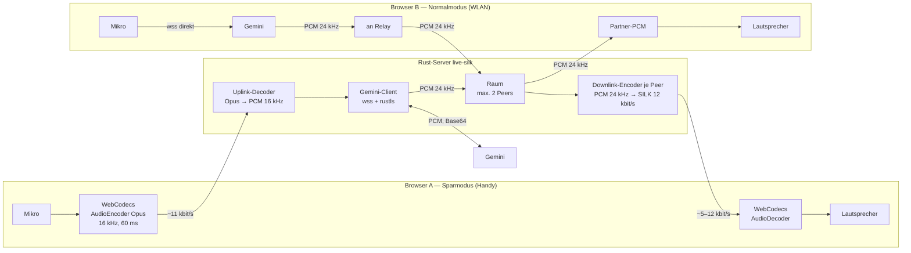
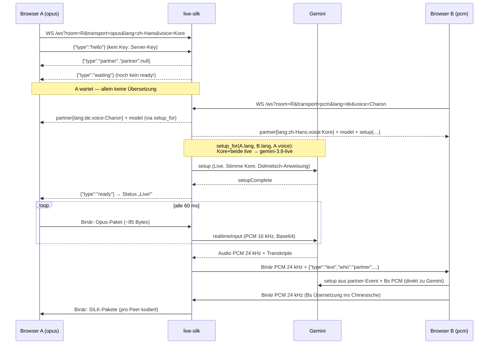
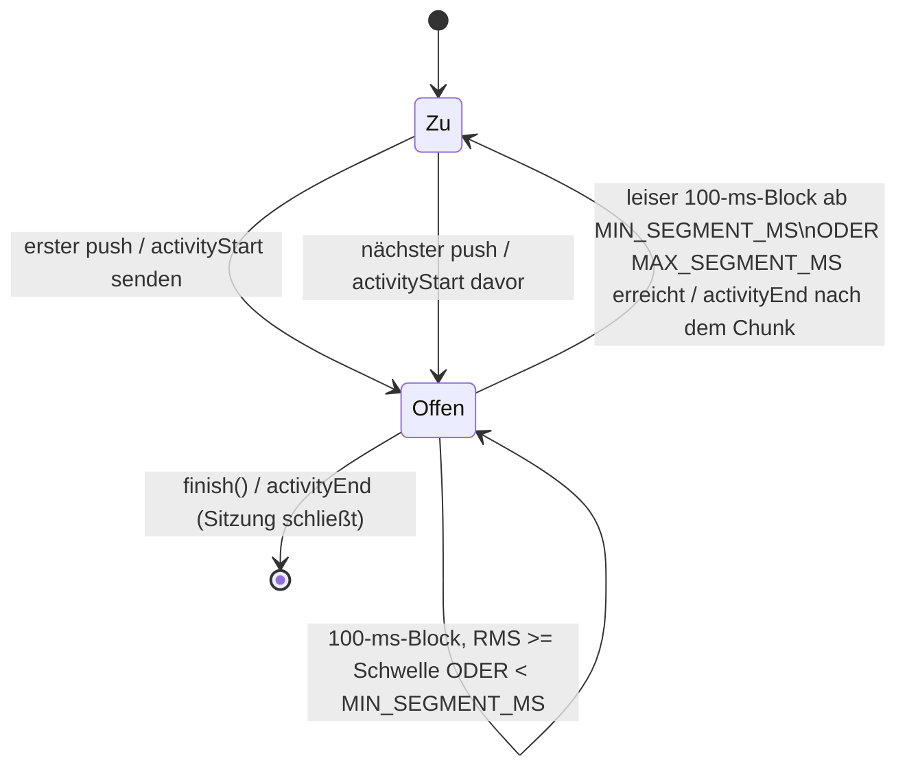
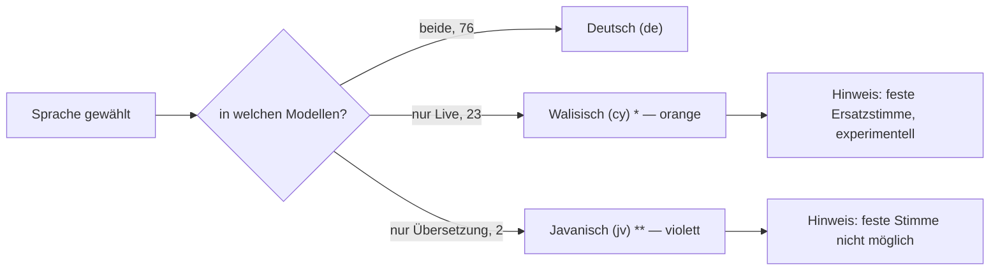

# Walkthrough — Dolmetscher mit Opus-SILK-Sparmodus (37_live/source2)

Stand: 2026-10-27. Auftrag von wol pumba: ein Programm wie `source1`
(Live-Dolmetscher im Browser), bei dem jeder Nutzer **beim Verbinden**
wählen kann, ob sein eigenes Audio und das ankommende Audio als stark
komprimierter **Opus-SILK-Strom** laufen — für langsame Mobilverbindungen.
Dazu: alle Sprachen des Google-Live-Modells wählbar (Default Deutsch ↔
Chinesisch), höchstens zwei Clients pro Raum.

Ergebnis in einem Satz: Ein Handy im Sparmodus braucht im echten Test
**16 kbit/s** statt **1082 kbit/s** — rund 70-mal weniger Daten — und
hört und liest trotzdem die Übersetzung seines Partners.

## Glossar

Abkürzungen werden im Text beim ersten Auftreten ausgeschrieben; hier
alle noch einmal zum Nachschlagen.

- **PCM (Pulse-Code-Modulation):** unkomprimiertes Roh-Audio, hier
  16 Bit mono. Gemini will 16 kHz hinein und liefert 24 kHz heraus.
- **Opus:** moderner, freier Audio-Codec (Codec = Kodierer/Dekodierer,
  der Audio auf wenige Bytes eindampft und wieder herstellt). Opus hat
  drei Betriebsarten: SILK, CELT und Hybrid.
- **SILK:** der Sprach-Teil von Opus (ursprünglich von Skype). Er
  beschreibt die Stimme über ein Modell des Sprechtrakts statt über das
  Spektrum und kommt deshalb mit ~6–20 kbit/s aus. Wird gewählt, wenn die
  Bandbreite höchstens „Wideband" (8 kHz Tonumfang) ist.
- **CELT:** der Musik-/Breitband-Teil von Opus — hier bewusst *nicht*
  genutzt.
- **kbit/s:** Kilobit pro Sekunde, das Maß für die Datenrate.
- **WS (WebSocket):** dauerhafte Zwei-Wege-Verbindung zwischen Browser
  und Server; **wss** = verschlüsselt über TLS.
- **TLS (Transport Layer Security):** Verschlüsselungsschicht von
  https/wss.
- **WebCodecs:** Browser-Schnittstelle (`AudioEncoder`/`AudioDecoder`),
  mit der JavaScript direkt auf die eingebauten Codecs zugreift — kein
  Zusatz-Paket nötig.
- **BCP-47:** Standard für Sprachcodes, z. B. `de`, `zh-Hans`
  (Chinesisch vereinfacht), `pt-BR`.
- **HIL (Hardware-in-the-Loop):** Test mit echter Umgebung (echter
  Browser, echtes Gemini) statt Simulation.
- **Fake-Gemini:** kleiner Test-Server, der sich wie Gemini verhält,
  aber nur Sinustöne und den Text „hallo" zurückgibt — deterministisch,
  kostenlos, ohne Netz.
- **TUI (Text-User-Interface):** Statusanzeige im Terminal.
- **Spike:** kurzes Wegwerf-Experiment, das eine riskante Annahme prüft,
  bevor man darauf baut.
- **DTX/FEC:** Opus-Optionen für Sprechpausen (Discontinuous
  Transmission) bzw. Fehlerkorrektur bei Paketverlust (Forward Error
  Correction) — als Erweiterung vorgemerkt.
- **F0 (Grundfrequenz):** die tiefste Schwingung einer Stimme, in Hertz;
  grob das, was man als Tonhöhe hört. Männliche Sprechstimmen liegen etwa
  bei 85–155 Hz, weibliche bei 165–255 Hz. Wir schätzen F0 per
  Autokorrelation (Selbstähnlichkeit des Signals bei verschiedenen
  Verzögerungen) und nehmen den Median über die stimmhaften Frames — so
  prüft der HIL, ob die gewählte Stimme hörbar befolgt wird.
- **Voice Replication (Stimmnachbildung):** das Übersetzungsmodell gibt die
  Übersetzung in einer Stimme aus, die der des Sprechers ähnelt, statt in
  einer fest wählbaren — nützlich für „klingt wie ich", aber eine feste
  Stimme lässt sich dort nicht erzwingen.
- **Prebuilt-Stimme:** eine der 30 von Gemini vorgefertigten Stimmen (z. B.
  Kore, Charon); nur das Konversationsmodell `gemini-3.8-live` befolgt sie.

## 1. Was exakt implementiert wurde

### 1.1 Das Problem in Zahlen

In `source1` spricht jeder Browser selbst mit Gemini. Das ist bequem,
aber teuer, denn alles läuft als PCM — und zu Gemini sogar als
Base64-Text (Base64 macht aus 3 Bytes 4 Zeichen, also +33 %):

| Strecke | Rate (gerechnet) |
|---|---|
| Mikro → Gemini, PCM 16 kHz in Base64 | ≈ 341 kbit/s |
| Gemini → Browser, eigene Übersetzung 24 kHz in Base64 | ≈ 512 kbit/s |
| Browser → Relay, eigene Übersetzung weiterreichen | 384 kbit/s |
| Relay → Browser, Übersetzung des Partners | 384 kbit/s |

Gemessen im echten HIL: Der PCM-Browser kam auf **1082 kbit/s** (hoch +
runter). Eine mobile Edge- oder schwache 3G-Verbindung schafft das nicht.

### 1.2 Die Idee: Im Sparmodus hält der Server die Gemini-Sitzung



Der Kern-Trick: **Im Raum fließt intern immer PCM 24 kHz
„Übersetzungs-Audio".** Woher es kommt (vom Browser im Normalmodus oder
vom Server-eigenen Gemini im Sparmodus) und wie es ausgeliefert wird
(roh oder pro Peer Opus-kodiert), entscheidet allein der jeweilige Peer.
Dadurch sind gemischte Paare (A spart, B nicht) ohne Sonderfälle möglich.
Die teuren PCM-Strecken zu Gemini liegen im Sparmodus im Rechenzentrum,
nicht auf dem Handy.

### 1.3 Ablauf einer Verbindung (Protokoll)

Der Browser öffnet `/ws?room=R&transport=opus&lang=zh-Hans&voice=Kore`. Neben
der eigenen Sprache geht jetzt auch die **eigene Sprecherstimme** mit (`auto`
oder ein Prebuilt-Name; fehlt sie, gilt `auto`, siehe 2.15). Das Beispiel
zeigt den experimentellen Pfad mit fester Stimme. Die Zielsprache
ergibt sich automatisch aus der Sprache des Partners (Nutzer-Feedback, siehe
2.11). Darum **startet die Gemini-Sitzung erst, wenn ein Partner im Raum ist**:
vorher sendet der Server `{"type":"waiting"}` und (noch) kein `ready`.



Weitere Regeln:

- **Zielsprache automatisch:** jeder Peer hält im Raumbuch einen
  `watch::Sender<Option<PeerInfo>>`; `join`/`leave` setzen allen Peers ihren
  jeweiligen Partner. Der Opus-Peer wartet in einer `select`-Schleife auf
  Partner-Wechsel und baut die Gemini-Sitzung passend auf (Ziel =
  Partner-Sprache), ab oder neu. Im PCM-Modus macht der Browser dasselbe mit
  seiner eigenen Gemini-Verbindung — mit dem **fertigen Setup aus dem
  `partner`-Event** (eine Quelle der Wahrheit, siehe 2.13).
- **Modell und Stimme:** `voices::choose` + `gemini::setup_for` wählen je Peer
  Übersetzungs- oder Live-Modell und bauen das passende Setup (siehe 2.13).
  Das Relay legt PCM-Peers das Setup ins `partner`-Event; Opus-Peers bekommen
  nur `model` zur Anzeige.
- **Gleiche Sprache:** sprechen beide dieselbe Sprache (Ziel == Quelle), setzt
  der Server beim Translate-Modell `translationConfig.echoTargetLanguage = true`
  — sonst schwiege Gemini; beim Live-Modell lautet die Anweisung dann „repeat
  verbatim".
- **Key:** Im Sparmodus (Default) nutzt der Server nur seinen eigenen Key
  (`--key-file`); das Frontend zeigt dort kein Key-Feld und schickt keinen
  Key. Das Protokoll erlaubt noch ein optionales `"key"` in `hello` (nie in
  der URL, denn URLs landen in Proxy-Logs), das Frontend nutzt es nicht. Weder Server noch Tests loggen ihn; Fehlertexte werden
  durch `sanitize()` vom Key bereinigt. Im Normalmodus verlässt der Key
  den Browser nie Richtung Server.
- **Raum voll:** der dritte Client bekommt `{"type":"error","msg":"raum voll"}`
  und wird geschlossen; der Raum bleibt bei genau zwei Peers.
- **Untertitel:** Gemini liefert Transkripte von Eingabe und Übersetzung.
  Im Sparmodus reicht sie der Server weiter, im Normalmodus schickt der
  Browser sie als Text an den Relay. Sie kosten fast nichts und helfen,
  wenn auf dem Handy Audio stockt.

### 1.4 Der Server (`source2/src/`)

Dateien nach Datenfluss nummeriert; `lib.rs`/`main.rs` enthalten nur
Deklarationen und Verdrahtung.

| Datei | Zeilen | Inhalt |
|---|---|---|
| `01_config.rs` | 189 | CLI, `Transport {Pcm, Opus}`, `MAX_PEERS = 2`, Modelle `GEMINI_TRANSLATE_MODEL`/`GEMINI_LIVE_MODEL` |
| `02_languages.rs` | 321 | 101 Sprachen (Code, deutscher + englischer Name, Flags `translate`/`live`), Defaults `de` / `zh-Hans` |
| `02b_voices.rs` | 275 | 30 Prebuilt-Stimmen (+ Geschlecht), `default_voice`, `Model {Translate, Live}`, Entscheidung `choose` |
| `03_codec.rs` | 228 | `DownlinkEncoder` (PCM 24 kHz → SILK, 60 ms, 12 kbit/s) und `UplinkDecoder` (Opus → PCM 16 kHz) |
| `04_state.rs` | 283 | Raumbuch mit Peer-Infos (`lang`, `transport`, `voice`), Partner-Watch je Peer, `broadcast` ohne Echo, `send_to` |
| `05_gemini.rs` | 473 | Gemini-Client: `translate_setup_json`/`live_setup_json`/`setup_for`, Audio-JSON, Parser, Sitzung mit Sende-/Empfangs-Task |
| `06_relay.rs` | 399 | `/ws`-Handler, PCM-Pfad, persönliche `partner`-Events mit `model`+`setup` |
| `06b_relay_opus.rs` | 383 | Opus-Pfad (partner-gesteuerte Server-Gemini-Sitzung: `waiting`/`ready`, Untertitel) |
| `07_serve.rs` | 61 | Router: `/`, `/ws`, `/healthz`, `/api/rooms`, `/api/languages` (Sprachen, Stimmen, Default-Stimmen), `/api/config` |
| `08_status.rs` | 171 | TUI-light `--check/--watch`, z. B. `raum r1: 2 peers [zh-Hans opus Kore, de pcm Charon]` |

Ein Beispiel für „kein Resampler nötig": Opus darf mit 24 kHz kodieren
und beim Dekodieren direkt 16 kHz ausgeben. Gemini liefert 24 kHz → der
Encoder nimmt es 1:1; der Browser schickt Opus → der Decoder gibt genau
die 16 kHz aus, die Gemini will. Eine ganze Abhängigkeit (Resampling)
entfällt.

### 1.5 Das Frontend (`source2/public/`)

- `index.html` (Markup, CSS, `label for`, `aria-live` für Status und
  Untertitel), `01_audio.js` (Resampling auf 16 kHz, lückenlose
  Wiedergabe-Warteschlange), `02_opus.js` (WebCodecs-Encoder/Decoder),
  `app.js` (Ablauf, Statistik).
- Auswahl **„Ich spreche"** mit allen **101 Sprachen** aus `/api/languages`
  (eine Quelle der Wahrheit im Rust-Code) sowie **„Meine Stimme (so hört mich
  der Partner)"**: „Automatisch – eigene Stimme nachbilden" plus Optgroups
  „Feste Stimme · weiblich/männlich (experimentell)" mit den 30
  Prebuilt-Stimmen. Default ist für alle „Automatisch" (2.15); eine selbst
  gewählte Stimme bleibt in `localStorage`. Sprachen, die nur eines der
  Modelle kann, sind mit `*` (nur Live, orange) bzw. `**` (nur Übersetzung,
  violett) markiert, mit Legende und passendem Hinweis. Die Zielsprache wählt niemand — sie folgt automatisch dem
  Partner (siehe 2.11). Das „Partner hört"-Select und der Tausch-Knopf sind
  entfallen.
- Partner-Anzeige: „Partner spricht: &lt;Name&gt; · &lt;Normal|Sparmodus&gt;"
  bzw. „Warte auf Partner…". Im PCM-Modus baut der Browser seine
  Gemini-Verbindung erst mit Partner auf — und zwar mit dem **fertigen Setup
  aus dem `partner`-Event** (keine Setup-Logik im JS) — und wieder ab, wenn
  der Partner geht (das Mikro läuft weiter, sendet dann aber nichts). Im
  Opus-Modus folgt der Status `waiting`/`ready` vom Server. Ein Hinweistext
  zeigt das Modell aus dem `partner`-Event: „Übersetzung fortlaufend, eigene
  Stimme" (Translate) bzw. „gewählte Stimme, spricht nach kurzer Pause" (Live).
- Transport-Wahl **„Sparmodus (Opus SILK, ~12 kbit/s)" als Default** und
  „Normal (PCM, viel Daten)". Das API-Key-Feld erscheint **nur im
  Normalmodus**. Fehlt WebCodecs (`AudioEncoder.isConfigSupported`) oder
  meldet `/api/config` keinen Server-Key, wird der Sparmodus mit Hinweis
  deaktiviert und der Normalmodus vorausgewählt (siehe 2.12).
- kbit/s-Anzeige hoch/runter, Gesamtzähler in `window.__stats` (für die
  automatischen Tests).
- Normalmodus nutzt das fertig gebaute Setup (Translate oder Live) aus dem
  `partner`-Event (siehe 2.13).

### 1.6 Tests und Nachweise (echte Zahlen)

| Ebene | Was | Ergebnis |
|---|---|---|
| Unit (45) | CLI, Sprachtabelle (101 eindeutig, 78 translate, 99 live, jv/su nur translate, 23 nur live, Sortierung, Defaults, englische Namen), Stimmen (30, Default-Regeln, `choose` für alle Fälle inkl. Fallbacks/Fehler), Codec, Raumbuch (Limit 2, kein Echo, Partner-Watch), Setup-JSON beider Modelle (`setup_for`, Transkription auf setup-Ebene, Live ohne `translationConfig`, Translate ohne `speechConfig`), Parser, Key-Bereinigung, `partner`-JSON (model+setup), Untertitel, Status-Format | grün |
| Integration (9 + 1 ignoriert) | `ws_relay.rs`: PCM↔PCM ohne Echo, Raum voll (bleibt 2), `partner`-Event-Inhalt beide Seiten, Opus allein → `waiting`, feste Stimme Kore → `hallo:live:Kore` + PCM-Partner-Setup (Charon), Auto-Ziel Translate `hallo:de` + Live-Fallback `hallo:live:Zephyr` (cy), feste Stimme + jv → Translate-Fallback `hallo:jv`, PCM→Opus (SilkOnly, < 1/10 Bytes), `/api/languages` = 101 + 30 Stimmen; `gemini_fake.rs`; `gemini_live.rs` (manuell `--ignored`) | grün |
| Smoke | `scripts/smoke.sh`: Build, `/healthz`, 101 Codes, Transport-Auswahl, `app.js` 200, `--check` | `SMOKE OK` |
| Browser automatisch | `scripts/browser-fake.sh`: Headless-Chrome, Tab A Opus (zh, feste Stimme Kore), Tab B PCM (de, Automatisch), Fake-Gemini, 20 s; prüft Untertitel `hallo:live:Kore`/`hallo:zh-Hans`, Default `auto`, Sprachmarkierung `*`/`**` samt Farbe und Hinweisen | `BROWSER-FAKE PASS` |
| HIL echt | `scripts/hil-real.sh`: zwei Chrome-Prozesse, echtes Gemini, ~50 s | `HIL-REAL PASS` |

Messwerte `browser-fake` (20 s, Fake-Gemini liefert Audio in Echtzeit, neuer
Lauf nach der Auto-Ziel-Umstellung):

| Peer | hoch | runter | gesamt |
|---|---|---|---|
| A Sparmodus | 28 872 B | 30 151 B | **24 kbit/s** |
| B Normal | 1 841 990 B | 960 000 B | **1121 kbit/s** |

Messwerte `hil-real` (echtes Gemini, neuer Lauf nach der Auto-Ziel-Umstellung;
A spricht Mandarin aus `chinese/十萬個為什麼…webm`, B spricht eine per
Gemini-TTS erzeugte deutsche Referenz). Jetzt wählt niemand mehr ein Ziel —
es folgt automatisch dem Partner:

| Messpunkt | A (Sparmodus, zh→de) | B (Normal, de→zh) |
|---|---|---|
| Bytes hoch | 70 329 | 4 491 284 |
| Bytes runter | 29 077 (Opus) | 2 232 000 (PCM) |
| Rate gesamt | **16 kbit/s** | **1076 kbit/s** |
| erstes Partner-Audio | ≈ 4,7 s | ≈ 4,7 s |
| Partner-Anzeige | „Partner spricht: Deutsch" | „…: Chinesisch (vereinfacht)" |
| Partner-Untertitel | „早上好。" / „今天是个好…" | „Nein, nein, nein, nein," |

Der Downlink von A ist kleiner als 12 kbit/s, weil B nicht ununterbrochen
spricht — in Pausen liefert Gemini kein Audio, also gibt es auch nichts
zu kodieren. Ehrliche Einschränkung: Die deutschen Untertitel bei B
(„Nein, nein …") sind eine plausible Übersetzung des Kinderprogramms,
inhaltlich wurde sie nur per Stichprobe, nicht Satz für Satz geprüft.
Dass Deutsch → Chinesisch inhaltlich stimmt, belegt „早上好" für „Guten
Morgen" eindeutig.

## 2. Architektur-Entscheidungen, die Tests und Spikes erzwungen haben

1. **Transkription gehört auf `setup`-Ebene.** Die offizielle
   Live-Translate-Doku zeigt `inputAudioTranscription` innerhalb von
   `generationConfig`. Die echte Sonde antwortete mit Close
   `1007 Unknown name "inputAudioTranscription" at 'setup.generation_config'`.
   Richtig ist:

   ```json
   {"setup":{"model":"models/gemini-3.5-live-translate-preview",
     "generationConfig":{"responseModalities":["AUDIO"],
       "translationConfig":{"targetLanguageCode":"zh-Hans"}},
     "inputAudioTranscription":{},"outputAudioTranscription":{}}}
   ```

   Ein Unit-Test schützt genau diese Ebene vor Rückfällen.
2. **`translationConfig` statt Systemanweisung.** `source1` beschwor
   Gemini per Prompt („ONLY the translation"). Das Translate-Modell hat
   dafür ein eigenes Feld; die Quellsprache erkennt es selbst. Dadurch
   genügt eine Zielsprache — und 78 Sprachen kosten keine 78×77
   Prompt-Varianten mehr.
3. **rustls braucht genau einen Crypto-Provider.** DeepWiki behauptete,
   mit `rustls-tls-webpki-roots` sei nichts weiter nötig. Der Spike
   panickte: „Could not automatically determine the process-level
   CryptoProvider". Lösung: `rustls` mit `default-features = false`,
   nur `ring`. Lehre: KI-Antworten über Bibliotheken immer per Spike
   gegenprüfen.
4. **60-ms- statt 20-ms-Frames.** Jedes WebSocket-Paket kostet über TCP
   und TLS grob 70 Bytes Verwaltungsdaten. Bei 20 ms wären das 50 Pakete/s
   × 70 B ≈ 28 kbit/s — mehr als das Audio selbst. Bei 60 ms sind es
   ≈ 9 kbit/s. Preis: 40 ms mehr Latenz, gegenüber ~4 s Gemini-Latenz
   vernachlässigbar.
5. **Kein Resampler.** Spike: 24-kHz-Eingang + `max_bandwidth = Wideband`
   ergibt 50/50 Pakete `SilkOnly` bei 10,7 kbit/s, Encode+Decode von 3 s
   Audio in 20 ms CPU; der Decoder gibt direkt 16 kHz aus.
6. **Fake-Gemini mit Echtzeit-Drossel.** Der erste Fake antwortete auf
   jeden Eingangs-Block mit 100 ms Audio. Weil der Browser alle 60 ms
   sendet, entstand mehr Audio als Echtzeit → A-Downlink ~28 kbit/s, der
   Browser-Test lag knapp an der 40-kbit/s-Grenze. Der Fake liefert jetzt
   nie mehr Audio als Eingangszeit vergangen ist — so realistisch wie
   Gemini.
7. **Script-Reihenfolge im Frontend.** Dynamisches Nachladen von
   `02_opus.js` führte im Browser-Test zu `opusSupported is not defined`.
   Jetzt werden `01_audio.js` und `02_opus.js` statisch vor `app.js`
   geladen.
8. **Zwei Chrome-Prozesse im echten HIL.** Das Fake-Mikrofon
   (`--use-file-for-fake-audio-capture`) gilt pro Browser-Prozess; zwei
   Tabs würden dieselbe Datei „hören". Für Chinesisch bei A und Deutsch
   bei B braucht es zwei Instanzen.
9. **Sichtbare Transport-Auswahl.** Auf dem HIL-Screenshot waren
   während der Sitzung beide Optionen grau und nicht unterscheidbar;
   die gewählte Option ist jetzt per `:has(input:checked)` umrandet.
10. **`Rooms::send_to`.** Antworten nur an einen Peer (`ready`, Fehler,
    eigene Untertitel) laufen über dasselbe Raumbuch statt über einen
    zweiten Kanal je Peer — eine Sende-Stelle, eine Reihenfolge.
11. **Zielsprache automatisch (Nutzer-Feedback).** Rückmeldung nach dem
    ersten HIL: *„Es macht keinen Sinn, dass man die Sprache des Partners
    auswählen muss — das weiß der Partner am besten."* Stimmt: jeder kennt
    nur die eigene Sprache sicher. Also wählt jetzt jeder nur noch `lang`
    („Ich spreche"); das Ziel ist automatisch die Sprache des Partners.
    Technisch hält das Raumbuch je Peer einen
    `tokio::sync::watch::Sender<Option<PeerInfo>>`; `join`/`leave`
    aktualisieren alle Partner-Watches. Der Opus-Peer wartet in einer
    `select`-Schleife auf Partner-Wechsel: neuer/wechselnder Partner →
    Gemini-Sitzung mit Ziel = Partner-Sprache (neu) aufbauen, kein Partner →
    Sitzung beenden und `waiting` senden (**kein `ready` ohne Partner**).
    Ist eigene Sprache == Partner-Sprache, setzt `setup_json(target, echo)`
    `echoTargetLanguage = true`, sonst schwiege Gemini. Konsequenz: das alte
    `peers`-Event wurde durch ein **persönliches** `partner`-Event ersetzt
    (jeder Peer bekommt genau seinen Partner), `target` fiel aus Query,
    `PeerInfo` und `/api/rooms` heraus. Nachgewiesen im neuen echten HIL
    (50 s, Key maskiert `AIza…msBM`): A (Opus, spricht zh-Hans) kam auf
    **16 kbit/s**, B (PCM, spricht de) auf **1076 kbit/s**;
    `/api/rooms` zeigte mittendrin
    `[{"lang":"de","transport":"pcm"},{"lang":"zh-Hans","transport":"opus"}]`
    (kein `target` mehr). A sah „Partner spricht: Deutsch", B „Chinesisch";
    A sah chinesische Untertitel (`早上好。`, `今天是个好`), B deutsche
    (`Nein, nein, nein, nein,`); erstes Partner-Audio nach ~4,7 s. Der
    Fake-Gemini spiegelt das empfangene Ziel in der Transkription
    (`hallo:<targetLanguageCode>`), damit Integrationstests das **automatisch
    gewählte** Ziel prüfen: Opus allein → `waiting`; PCM-Partner `lang=de` →
    `ready` + Untertitel `hallo:de`; Partner verlässt → `waiting`; neuer
    Partner `lang=ja` → wieder `ready` + `hallo:ja`.
12. **Sparmodus als Default, Key nur im Normalmodus (Nutzer-Feedback).**
    Wer das Programm auf dem Handy öffnet, soll ohne Nachdenken den
    sparsamen Weg bekommen und keinen Key eintippen müssen. Darum ist
    „Sparmodus" vorausgewählt, und das Key-Feld (`hidden`) erscheint erst,
    wenn jemand „Normal" wählt — nur dort spricht der Browser selbst mit
    Gemini. Konsequenz: Der Sparmodus hängt jetzt vom Server-Key ab. Damit
    niemand in einen Fehler läuft, meldet der neue Endpunkt `/api/config`
    nur `{"server_key":true|false}` (nie den Key; ein Integrationstest prüft,
    dass der Key-Text nicht in der Antwort steht). Ohne Server-Key graut das
    Frontend den Sparmodus aus („Nicht verfuegbar: der Server hat keinen
    API-Key.") und wählt „Normal". Fallstrick dabei: `.field{display:flex}`
    überstimmt das `hidden`-Attribut; erst `[hidden]{display:none!important}`
    versteckt das Feld wirklich. `browser-fake` prüft auf einer frischen
    Seite: Sparmodus ist Default, Key-Feld versteckt, nach Klick auf
    „Normal" sichtbar (alle drei `ok`, PASS mit 24 kbit/s für A).

### 2.13 Stimmenwahl mit zwei Modellen (Option 3)

Nach der Stimmen-Messung (Tabelle in Abschnitt 3) entschied wol pumba:
**jeder Nutzer wählt seine eigene Sprecherstimme** — die Stimme, mit der der
Partner die Übersetzung hört. „Automatisch – eigene Stimme nachbilden" nutzt
das **Übersetzungsmodell** `gemini-3.5-live-translate-preview` (Voice
Replication, fortlaufend). Eine **feste Stimme** nutzt das Konversationsmodell
`gemini-3.8-live` mit einer Dolmetsch-Systemanweisung (befolgt die Stimme,
spricht aber erst nach einer Sprechpause). **Beide** Modelle bekommen die
korrekte Sprachauswahl.

**Zwei Sprachmengen, eine Tabelle.** `02_languages.rs` trägt jetzt je Sprache
`translate` und `live`: Übersetzungsmodell **78**, Live-Modell **99**,
Vereinigung **101**. `jv` (Javanisch) und `su` (Sundanesisch) können nur
`translate`; 23 Sprachen (Assamesisch, Bosnisch, Cebuano, Walisisch,
Färöisch, Westfriesisch, Irisch, Kurdisch, Kirgisisch, Maori, Maltesisch,
Oromo, Oriya, Paschtu, Quechua, Rätoromanisch, Somali, Sesotho, Tadschikisch,
Turkmenisch, Setswana, Wolof, Yoruba) nur `live`. Jede Sprache hat zusätzlich
ein Feld `en` (englischer Name) für die Live-Systemanweisung.

**Eine Quelle der Wahrheit: `choose()` → `setup_for()`.** Das neue Modul
`02b_voices.rs` kennt die 30 Prebuilt-Stimmen (mit Geschlecht), die
Default-Stimmen (zh-* → Kore, de → Charon, sonst `auto`) und die
Modell-Entscheidung:

```mermaid
flowchart TD
  A[choose(lang, partner_lang, voice)] --> B{Stimme == auto<br/>oder unbekannt?}
  B -- ja --> C{beide Sprachen<br/>translate?}
  C -- ja --> D[Translate-Modell<br/>Voice Replication]
  C -- nein --> E{beide Sprachen<br/>live?}
  E -- ja --> F[Live-Modell<br/>Fallback-Stimme]
  E -- nein --> G[Fehler: kein<br/>gemeinsames Modell]
  B -- "nein (feste Stimme)" --> H{beide Sprachen<br/>live?}
  H -- ja --> I[Live-Modell<br/>gewählte Stimme]
  H -- nein --> J{beide Sprachen<br/>translate?}
  J -- ja --> K[Translate-Modell<br/>Stimme ignoriert]
  J -- nein --> G
```

`gemini::setup_for` baut daraus das fertige `setup`-JSON: Translate wie bisher
(`translationConfig.targetLanguageCode`, `echoTargetLanguage` bei gleicher
Sprache, Transkription auf setup-Ebene, **kein** `speechConfig`); Live mit
`speechConfig.voiceConfig.prebuiltVoiceConfig.voiceName`, einer
`systemInstruction` mit **englischen** Quell-/Ziel-Namen („Translate … from
German into Simplified Chinese and speak ONLY the translation") bzw. „repeat
verbatim" bei gleicher Sprache, **ohne** `translationConfig`, **ohne**
`thinkingLevel`. Das Relay rechnet das Setup je Peer aus und legt es dem
PCM-Peer ins persönliche `partner`-Event (`"setup":{…}`, `"model":"translate|live"`);
der Browser schickt es nur noch unverändert an Gemini — keine Duplikat-Logik
im JS. Opus-Peers bekommen `model` nur zur Anzeige, der Server hält ihre
Sitzung selbst.

**Echter HIL (50 s, Key maskiert `AIza…msBM`, Default-Stimmen aktiv → beide
über `gemini-3.8-live`).** A (Opus, zh-Hans, **Kore**) kam auf **12 kbit/s**,
B (PCM, de, **Charon**) auf **440 kbit/s**. Die gewählte Stimme wird hörbar
befolgt: die am Partner-Audio per Autokorrelation (Median über stimmhafte
40-ms-Frames) geschätzte **Grundfrequenz F0** lag bei B (hört A/Kore) bei
**216 Hz** (weiblich, > 165 Hz) und bei A (hört B/Charon) bei **166 Hz**
(männlich). Das Live-Modell antwortet erst nach einer Sprechpause — erstes
Partner-Audio bei B nach **~3,6 s**, bei A nach **~18,8 s**. Übersetzung
inhaltlich korrekt (`[out] 早上好，今天是个美好的日子。你怎么样？`). `/api/rooms`
zeigt Stimme mit:
`[{"lang":"zh-Hans","transport":"opus","voice":"Kore"},{"lang":"de","transport":"pcm","voice":"Charon"}]`.
Die hohe Live-Latenz bei A ist bekannt (der Spike maß ~6 s erstes Audio bei
kurzer Eingabe); eine Drossel über `realtimeInputConfig.automaticActivityDetection`
wurde erwogen, aber nicht gesetzt, weil kein belegter Vorteil vorlag und der
Lauf grün war.

### 2.14 Live-Modell braucht eigene Segmentierung

**Das Problem.** Bei DURCHGEHENDER Sprache ohne Pause (≥ 0,3 s) übersetzte das
`gemini-3.8-live`-Modell mit Server-VAD GAR NICHTS. Gemessen am Spike
`spike/vad_probe.py` (30 s durchgehendes Mandarin mit Hintergrundmusik aus
`/tmp/live-hil/mic-zh.wav`) und am echten HIL:

| Variante | übersetztes Audio | erstes Audio |
|---|---|---|
| translate-preview (Vergleich) | 35,8 s | 3,0 s |
| 3.8-live, automatische Sprecherkennung (VAD) default | 0,0 s | – |
| 3.8-live, VAD + `activityHandling` NO_INTERRUPTION | 0,0 s | – |
| 3.8-live, VAD + NO_INTERRUPTION + END_SENSITIVITY_HIGH + `silenceDurationMs` 300 | 0,0 s | – |
| 3.8-live, VAD AUS, Client segmentiert selbst alle 3 s (`activityEnd`/`activityStart`) | 11,3 s, Deutsch korrekt | 3,8 s |
| dito alle 2 s | 9,6 s | 2,7 s |
| dito alle 5 s | 8,2 s | 6,2 s |

Im echten HIL (vor der Änderung) kam A (hört B = 3.8-live) erst nach **17,7 s**
Audio und insgesamt nur **4123 B Opus in 50 s**; B sah Platzhalter-Untertitel
wie „(German translation pending)". Die Live-Transkription enthielt Artefakte
wie `<no speech>` und `{pause}`.

**Die Lösung: eigene Segmentierung statt Server-VAD.** Das Live-Setup bekommt
`realtimeInputConfig {automaticActivityDetection:{disabled:true},
activityHandling:"NO_INTERRUPTION"}`; der Client markiert die Sprecherwechsel
selbst. Die Regel liegt als reine, unit-getestete Struktur `Segmenter` in
`src/05b_segment.rs` (Konstanten `MIN_SEGMENT_MS` 1500, `MAX_SEGMENT_MS` 3000,
`BLOCK_MS` 100, `QUIET_RMS_I16` 330 ≈ 0,01 normiert):



Reihenfolge am Netz bleibt immer `activityStart → Audio → … → activityEnd`;
ein Schnitt schließt das aktuelle Segment nach dem Chunk, der nächste `push`
öffnet das Folgesegment. **Opus-Pfad (Server):** der `Segmenter` läuft im
Sende-Task von `gemini::connect` (nur bei Live, Flag `segment`), die Session
sendet die Steuer-JSONs. **PCM-Pfad (Browser):** dieselbe Regel klein in
`public/app.js` (`PcmSegmenter`); OB segmentiert wird, sagt der Server über das
`partner`-Event (Feld `"segment":{"min_ms":1500,"max_ms":3000,"quiet_rms":0.01}`
NUR bei Live) — keine eigene Modellentscheidung im JS.

**Untertitel-Filter.** `segment::clean_subtitle` (Rust, unit-getestet) und
`cleanSubtitle` (JS) entfernen `<…>`/`{…}`-Tokens (`<no speech>`, `{pause}`)
und das Platzhalter-Wort „translation pending"; leere Untertitel werden nicht
gesendet. Die Live-Systemanweisung nennt jetzt explizit Quell- UND Zielsprache
und verbietet Platzhalter zu sprechen/schreiben; bei Stille soll nichts kommen.

**Neue HIL-Zahlen (echtes Gemini, 50 s, Key maskiert `AIza…msBM`, Default-
Stimmen → beide über `gemini-3.8-live`, F0 nach dem NCCF-Fix).** A (Opus,
zh-Hans, Kore) 12 kbit/s, B (PCM, de, Charon) ~390 kbit/s. **Latenz drastisch
besser:** erstes Partner-Audio bei A nach **3,4–8,7 s** (vorher 17,7 s).
Richtung **B→A** (Deutsch→Chinesisch, saubere TTS) liefert **3,9–4,7 s** Audio,
F0 Kore **185–200 Hz** (weiblich ✓), Übersetzung korrekt
(`早上好，今天是个美好的一天，你怎么样？`). Richtung **A→B**
(Chinesisch→Deutsch) bleibt schwach (**0,0–1,6 s**), F0 Charon **99–109 Hz**
(männlich ✓). Untertitel sind jetzt sauber (keine `<…>`/`{…}`/„pending"), aber
inhaltlich bei A→B oft Müll (`Chupapi Munyanyo`, `¿Qué?`).

**Gegentest 2 s statt 3 s (mit Zahlen protokolliert).** `MAX_SEGMENT_MS` = 2000
verschlechterte A→B von 1,6 s auf 0,0 s (opusDown 7143 B → 3275 B) — passend
zum Spike, der bei 3,0 s das meiste Audio maß. Darum bei **3,0 s** belassen.

**Ehrliche Bewertung (Kriterien NICHT aufgeweicht).** Die hil-real-PASS-Hürde
„beide Richtungen ≥ 5 s Partner-Audio" wird mit den vorhandenen Fixture-WAVs
nicht erreicht: `mic-zh.wav` ist durchgehendes Mandarin MIT Hintergrundmusik —
das Live-Modell transkribiert daraus Müll statt kohärentem Chinesisch, also
A→B bleibt dünn; `mic-de.wav` enthält nur ~6 s echte Sprache (3 kurze Sätze mit
Pausen) in 15 s, daher deckelt B→A bei ~4,5 s. Die Segmentierung SELBST
funktioniert nachweislich (B→A sauber übersetzt, korrekte Stimmen/F0, erstes
Audio 3–8 s statt 17,7 s). Die Schwäche von A→B ist eine Eigenschaft des
musik­belasteten Quell-WAV, kein Mechanik-Fehler.

**Learning: F0-Messfehler.** `scripts/hil-real.js` schätzte F0 vorher per ROHER
Autokorrelation und bevorzugte dadurch kurze Lags (mehr Fenster­überlappung) →
systematisch zu hoch (Charon 166 statt ~110 Hz). Auf **normierte
Kreuzkorrelation (NCCF)** umgestellt: Synth-Test 100–250 Hz exakt, Charon-TTS
109 Hz, HIL Kore 185–224 Hz / Charon 99–129 Hz. Lehre: bei
Autokorrelations-F0 immer über die Fenster­energie normieren.

### 2.15 „Automatisch" als Default, markierte Sprachen (Nutzer-Entscheidung)

Nach 2.14 blieb das Live-Modell in einer Richtung unzuverlässig. Gleicher
Aufbau (zh → de, Kore, Sparmodus), vier echte Läufe: 0 s, 3,4 s, 0 s und
20,5 s übersetztes Audio, erstes Audio nach 5–25 s. Ein Proxy-Mitschnitt
zeigte, warum: Der Server schließt brav alle ~1,5 s ein Segment
(`activityEnd`), aber das Modell antwortet nur auf das erste und schweigt
danach. Einmal sprach es sogar seine eigenen Überlegungen aus („The user
wants me to translate …"). Das Übersetzungsmodell zeigte nichts davon.

Entscheidung des Nutzers (Option 1): **„Automatisch" ist für alle der
Default**, feste Stimmen bleiben als „experimentell" wählbar. Damit die
Sprachauswahl ehrlich bleibt, markiert das Select, welche Sprachen nur eines
der beiden Modelle kann:



Warum Zeichen *und* Farbe: iOS-Safari färbt `<option>` nicht, das Zeichen
trägt die Information also allein, die Farbe hilft auf dem Desktop. Das
geschlossene Select übernimmt die Farbe der gewählten Option per Klasse.
`browser-fake` prüft das automatisch: `cy` endet auf ` *` und ist
`rgb(245, 158, 11)`, `jv` endet auf ` **` und ist `rgb(167, 139, 250)`, `de` ist
unmarkiert, beide Hinweistexte erscheinen, Default-Stimme ist `auto`. Im selben
Lauf nutzt A bewusst Kore (Live-Pfad) und B Automatisch (Übersetzungspfad):
PASS.

Echter HIL mit dem neuen Default und sauberen Aufnahmen (Predigt-Ausschnitt
statt Cartoon mit Musik, 34-s-TTS-Monolog statt 6 s Sprache), 50 s:

| Messpunkt | A (Sparmodus, zh) | B (Normal, de) |
|---|---|---|
| hört Partner-Audio | **47,3 s** | **47,0 s** |
| erstes Partner-Audio | 4,6 s | 4,4 s |
| Rate gesamt | **17 kbit/s** | 1080 kbit/s |
| Partner-Untertitel | „早上好。" „我叫马丁，" | „Ah, weil" „wer viel Weisheit" |

Zum Vergleich mit dem Live-Modell in derselben Konstellation: 10,8 s bzw. 0 s.
F0 ist jetzt nur noch informativ (161 Hz bzw. 150 Hz), weil „Automatisch" die
Stimme des jeweiligen Sprechers nachbildet.

## 3. Learnings und mögliche Erweiterungen

Messung zur **Stimmenwahl** (Spike `spike/voice_probe.py`,
`spike/voice_probe_live.py`; Geschlecht per Grundfrequenz F0 — Männer
etwa 85–155 Hz, Frauen 165–255 Hz — und per Gemini-Urteil):

| Modell | Eingang | gewünschte Stimme | Ergebnis |
|---|---|---|---|
| `gemini-3.5-live-translate-preview` | Mann (Charon) | Kore, Aoede (Frauen) | 4/4 Läufe **männlich** — Wunsch ignoriert |
| `gemini-3.5-live-translate-preview` | Frau (Kore) | Kore/Aoede/Puck/Charon | 4/8 weiblich, 4/8 männlich — **uneinheitlich**, selbst Kore einmal männlich |
| `gemini-3.5-live-translate-preview` | Mann / Frau | keine | 2/2 bzw. 2/2 wie der **Eingang** (Voice Replication) |
| `gemini-3.8-live` + Dolmetsch-Anweisung | Mann (113 Hz) | Kore | **220 Hz, weiblich**, „早上好，今天是个美好的一天。你怎么样？" |
| `gemini-3.8-live` + Dolmetsch-Anweisung | Mann | Charon | 104 Hz, männlich |

Das Übersetzungsmodell akzeptiert `speechConfig` zwar ohne Fehler, bildet
aber die **Stimme des Sprechers nach** (Voice Replication) — eine feste
Stimme lässt sich dort nicht wählen. Das Konversationsmodell
`gemini-3.8-live` befolgt die Stimme, übersetzt aber per Anweisung und
antwortet erst nach einer Sprechpause (erstes Audio nach ~6 s statt
fortlaufend).

Learnings:

- **Daten wandern dorthin, wo Bandbreite billig ist.** Die eigentliche
  Ersparnis kommt weniger vom Codec als von der Verlagerung der
  Gemini-Sitzung auf den Server: Das Handy schickt nur noch
  ~85-Byte-Pakete.
- **Ein interner Einheitsformat-Bus vereinfacht alles.** Weil der Raum
  nur PCM 24 kHz kennt, sind PCM↔PCM, Opus↔PCM und Opus↔Opus derselbe
  Code; die Kodierung passiert erst am Rand, im Sende-Task jedes Peers.
- **WebCodecs ist reif genug.** `AudioData` im Format `s16`, Opus mit
  `frameDuration: 60000` und Decoder mit `sampleRate: 24000` liefen in
  Chrome for Testing 156 ohne Anpassung.
- **Doku ≠ API.** Zweimal (Transkriptions-Ebene, rustls-Provider) waren
  Dokumentation bzw. DeepWiki falsch; kurze Spikes vor dem Plan haben
  beide Fehler gefunden, bevor Code darauf baute.
- **Fake + echt ergänzen sich.** Der Fake-Test ist schnell und
  reproduzierbar (Bandbreiten-Grenzen prüfbar), der echte HIL beweist den
  Inhalt (Chinesisch kommt als Deutsch an).

Mögliche Erweiterungen:

- **Ephemeral Tokens:** Server erzeugt Kurzzeit-Token statt Key im
  Browser (Doku: `v1beta/auth_tokens`), dann muss kein Nutzer seinen Key
  hergeben.
- **Robustheit im Funkloch:** Opus-FEC (`use_inband_fec`,
  `packet_loss_perc`) und DTX in Pausen; Wiederaufnahme der
  Gemini-Sitzung über `sessionResumptionUpdate`-Handles; automatisches
  Reconnect des WebSockets.
- **Adaptive Bitrate:** 8 kbit/s bei sehr schlechter Verbindung, 16–20
  kbit/s bei gutem Netz, gesteuert über gemessene Laufzeiten.
- **Fallback ohne WebCodecs:** Opus als WebAssembly für alte Browser
  (ältere iPhones).
- **Zwei-Geräte-HIL mit echten Handys** (Android/iPhone über
  HTTPS-Tunnel) und Messung über gedrosseltes Netz (`tc netem`).
- **Produktion:** TLS, Rate-Limit und Kostenbremse für den Server-Key im
  Reverse-Proxy (z. B. Caddy/Nginx, siehe `source1/README.md`).

## 4. Neue Programme/Pakete für das Dockerfile

| Paket | Wofür | Aufnahme |
|---|---|---|
| `ffmpeg` | Fake-Mikro-WAVs aus `.webm`/TTS erzeugen (Browser-Tests) | dauerhaft (in dieser Sitzung per apt installiert, fehlte nach Container-Neustart) |
| `unzip` | Chrome for Testing entpacken | dauerhaft |
| `libnss3 libnspr4 libatk1.0-0 libatk-bridge2.0-0 libcups2 libdrm2 libxkbcommon0 libxcomposite1 libxdamage1 libxfixes3 libxrandr2 libgbm1 libasound2t64 libpango-1.0-0 libcairo2 libatspi2.0-0` | Headless-Chrome starten | Test-Image (in `scripts/browser-setup.sh` nachinstalliert) |
| Chrome for Testing (Stable, 156) | Browser-Tests mit WebCodecs | Test-Image oder weiter per `browser-setup.sh` nach `/tmp/live-hil` |
| npm `playwright-core`, `ws` | Browser steuern, Test-WS-Clients | Test-Image (sonst per Skript) |
| `uv` + Python `websockets` | Gemini-Sonden (Spike) | bereits vorhanden (`uv run --with websockets`) |

Laufzeit des Servers selbst: nur das Rust-Binary, keine Systempakete
(TLS über rustls/ring, Opus in reinem Rust).
