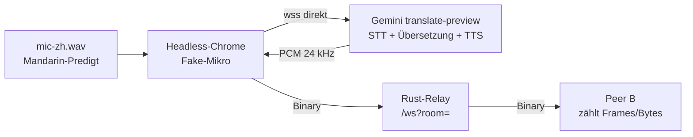

# Browser- und Inhalts-Tests (HIL)

Diese Seite erklärt die ausführbaren Tests unter `../scripts/` (Pfad relativ
zum Repo: `examples/37_live/source1/scripts/`). Sie beweisen Ende-zu-Ende,
dass Chinesisch rein und Deutsch beim Partner rauskommt — und umgekehrt.

Begriffe: **HIL** (Hardware-in-the-Loop, hier: echter Browser statt
simulierter Clients), **Relay** (unser Rust-Server, reicht Audio nur
weiter), **Peer B** (stummer Zuhörer im gleichen Raum, misst ankommendes
Audio), **Fake-Mikro** (Chrome-Flag, spielt eine WAV-Datei als Mikrofon).



## Skripte (alle ausführbar, alle idempotent)

| Skript | Zweck | Dauer |
|---|---|---|
| `hil-setup.sh` | lädt Chrome-for-testing + npm-Treiber, extrahiert Fake-Mikro aus `chinese/` | einmalig ~2 min |
| `hil-browser.sh` | startet ggf. Relay, ein Tab spricht, Peer B hört zu → `HIL PASS/FAIL` | ~1 min |
| `hil-content.sh` | ohne Browser: TTS-Referenz → Live-Loop → Relay → STT-Transkript, beide Richtungen | ~3 min |

Werkzeuge landen in `$HIL_DIR` (Default `/tmp/live-hil`), **nie im Repo**.
Der Key kommt aus `$HIL_KEY_FILE` (Default
`/workspace/src/cl-rust-generator/api_key.txt`), wird nur maskiert
(`AIza...msBM`) geloggt und nie committet.

```bash
cd examples/37_live/source1/scripts
./hil-setup.sh                    # einmalig
./hil-browser.sh                  # Browser-HIL (Default: zh-to-de)
HIL_MODE=de-to-zh ./hil-browser.sh
./hil-content.sh                  # Inhalts-Nachweis beider Richtungen
```

Wichtige Variablen: `PORT` (Default 3201), `HIL_ROOM`, `HIL_SECONDS`
(Abbruch-Fenster, bricht bei Erfolg früh ab), `HIL_OUT` (Screenshots,
`relay.log`, Referenz-WAVs).

## Was PASS bedeutet

`hil-browser.sh`: Seitenstatus enthält `Live`, Peer B empfängt
`> 50000` Bytes, keine Seitenfehler, Key taucht in keinem Log auf.
Beispiel aus echter Ausführung:

```text
t=5s status="Live! Einfach drauflos sprechen..." peerB: frames=8 bytes=96000
peerB frames: 8 bytes: 96000
key-in-logs: nein
seitenfehler: keine
HIL PASS
```

`hil-content.sh`: zusätzlich STT-Transkript mit Stichwort-Check, z. B.
`早上好，今天是个好日子。` bzw. `Guten Morgen, das Wetter ist heute
sehr schön.`

## Warum nicht Cloud-TTS/STT?

Beide REST-APIs antworten `403 disabled` für dieses Projekt — sie müssen
erst in der Cloud-Console freigeschaltet werden. Ersatz aus demselben
Haus, ohne Freischaltung: `gemini-2.5-flash-preview-tts` (Referenzen) und
`gemini-2.5-flash` mit Audio-Eingabe (Prüfer). Details und Messwerte im
[Walkthrough](../../20261023_01_first/walkthrough.md#16-bidirektionaler-inhalts-nachweis-google-tts-stt-ersatz-2310).

## Fehlerbilder (alle selbst beobachtet)

| Symptom | Ursache | Lösung |
|---|---|---|
| Gemini-Close `1008`, Status `Getrennt.` | `v1alpha`/`gemini-2.0-flash-exp` abgeschaltet | bereits gefixt: `v1beta` + `gemini-3.5-live-translate-preview` |
| STT liefert Fragmente (`早上`, `Guten Mor`) | Capture mit trailing Stille gefüttert | Skript trimmt Stille automatisch |
| Live-Antwort unvollständig/fabuliert | 3-s-Miniclips sind stochastisch | längere Äußerungen nehmen (Skript wiederholt ZH-Referenz 3×) |
| `429 quota` bei TTS | Kontingent aufgebraucht | warten / abrechenbares Projekt |
| Chrome startet nicht (`libnspr4.so`) | System-Libs fehlen | `apt install libnspr4 libnss3 libatk1.0-0 libatk-bridge2.0-0 libcups2t64 libdrm2 libxkbcommon0 libxcomposite1 libxdamage1 libxfixes3 libxrandr2 libgbm1 libasound2t64 libpango-1.0-0 libcairo2` |
