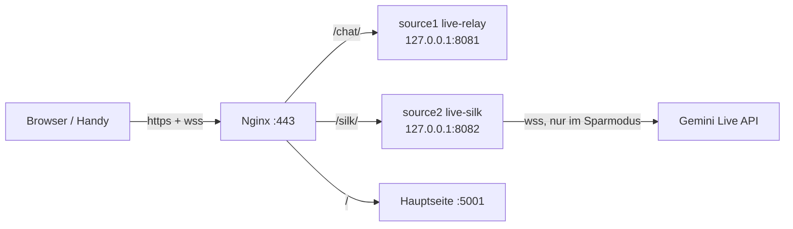

# Installation von source2 (live-silk) hinter Nginx

Ziel: `source2` läuft **zusätzlich** zu `source1` (`/chat`) unter
`https://rocketrecap.com/silk/`. `source1` und alle anderen Dienste bleiben
unverändert. Die Ports in der bestehenden `nginx.conf` sind schon belegt:
5001 (Hauptseite), 8080 (Karte), 8081 (`/chat` = source1), 3000
(jobs-Subdomain). `source2` bekommt deshalb **8082**. Nicht den Default
`3000` nehmen, der kollidiert mit der Jobs-App.



## 1. Bauen

Auf dem Server bauen, denn das Binary ist gegen die glibc des
Build-Rechners gelinkt:

```bash
cd ~/stage/cl-rust-generator/examples/37_live/source2
cargo build --release
./target/release/live-silk --help
```

Zur Laufzeit braucht es nur zwei Dinge: das Binary
`target/release/live-silk` und den Ordner `public/`. Keine Systempakete,
denn TLS zu Gemini läuft über rustls und Opus ist reines Rust.

## 2. Dienst (systemd)

Nur auf `127.0.0.1` lauschen, damit der Port nicht direkt aus dem Internet
erreichbar ist. Pfade und `User` anpassen:

```ini
# /etc/systemd/system/live-silk.service
[Unit]
Description=live-silk (Live-Dolmetscher mit Opus-SILK-Sparmodus)
After=network-online.target
Wants=network-online.target

[Service]
User=kiel
WorkingDirectory=/home/kiel/stage/cl-rust-generator/examples/37_live/source2
ExecStart=/home/kiel/stage/cl-rust-generator/examples/37_live/source2/target/release/live-silk \
    --listen 127.0.0.1:8082 --dir public \
    --key-file /home/kiel/.config/live-silk/api_key.txt
# ohne --key-file gibt es nur den Normalmodus (siehe Abschnitt 4, Kosten!)
Restart=on-failure

[Install]
WantedBy=multi-user.target
```

```bash
sudo systemctl daemon-reload
sudo systemctl enable --now live-silk
curl -s http://127.0.0.1:8082/healthz        # -> ok
```

## 3. Änderung in `nginx.conf`

Für `source1` muss **nichts geändert** werden. Für `source2` kommt ein
neuer Block in den `server { listen 443 ssl; server_name rocketrecap.com; … }`
dazu. Er gehört **vor** den generischen `location /`, am besten direkt
unter den `/chat/`-Block:

```nginx
    # live-silk (source2): Dolmetscher mit Opus-SILK-Sparmodus
    location = /silk { return 301 /silk/; }
    location /silk/ {
        proxy_pass http://127.0.0.1:8082/;      # Slash am Ende: streift /silk ab
        proxy_http_version 1.1;
        proxy_set_header Host $host;
        proxy_set_header X-Real-IP $remote_addr;
        proxy_set_header X-Forwarded-For $proxy_add_x_forwarded_for;
        proxy_set_header X-Forwarded-Proto $scheme;
        proxy_set_header Upgrade $http_upgrade;  # WebSocket /silk/ws
        proxy_set_header Connection "upgrade";
        proxy_connect_timeout 7d;
        proxy_send_timeout 7d;
        proxy_read_timeout 7d;                  # lange Gespräche nicht kappen
    }
```

Danach:

```bash
sudo nginx -t && sudo systemctl reload nginx
```

Warum der Block genau so aussieht:

- **`proxy_pass …/` mit Slash am Ende**: Nginx ersetzt `/silk/` durch `/`.
  Der Server kennt nur `/`, `/ws`, `/healthz` und `/api/…`.
- **Das Frontend ist subpfad-fähig.** `app.js` bildet `api/languages` und
  `ws` relativ zum Seitenpfad, die Skripte sind relativ eingebunden. Unter
  `/silk/` verbindet es also automatisch `wss://…/silk/ws?…`.
- **`Upgrade`/`Connection`**: ohne diese Header kein WebSocket, und dann
  kommt weder Audio noch Untertitel an.
- **Lange Timeouts**: Nginx schließt untätige Verbindungen sonst nach 60 s,
  und in Sprechpausen fließt im Sparmodus kaum etwas.
- **gzip im Server-Block** kann bleiben: JSON und JS werden komprimiert,
  WebSocket-Frames sind davon nicht betroffen.
- **HTTPS ist Pflicht**, weil Browser das Mikrofon nur in sicheren Kontexten
  freigeben. Das erledigt der vorhandene Certbot-Block.

Variante: Soll `source2` den alten Dolmetscher **ersetzen**, genügt es,
im bestehenden `/chat/`-Block den Port auf `8082` zu ändern (oder
`live-silk` mit `--listen 127.0.0.1:8081` zu starten und `source1` zu
stoppen). Der Rest des Blocks ist identisch.

## 4. API-Key und Kosten

- **Normalmodus (PCM):** Jeder Nutzer trägt seinen eigenen Gemini-Key im
  Browser ein. Der Key geht nie an den Server.
- **Sparmodus (Opus, Default im Frontend):** Der Server spricht mit Gemini,
  und zwar **nur mit seinem eigenen Key** (`--key-file`). Der Browser zeigt
  im Sparmodus kein Key-Feld und sendet keinen Key. Ohne `--key-file` meldet
  `/api/config` `{"server_key":false}`; das Frontend graut den Sparmodus dann
  aus und wählt den Normalmodus vor.
- **Kosten:** Mit `--key-file` kann **jeder**, der `/silk/` erreicht, auf
  deine Kosten übersetzen. Deshalb den Zugang beschränken, z. B. mit
  Nginx-`allow`/`deny` oder einem schwer erratbaren Pfad, und im
  Google-Projekt ein Budget-Limit setzen. Mit `auth_basic` auf iPhone/Safari vorher
  testen; dass Safari die Zugangsdaten an WebSockets weitergibt, ist hier
  nicht verifiziert. Falls doch ein Key-File: `chmod 600`, Besitzer = Dienst-User.
- Ein Raum nimmt höchstens 2 Nutzer auf. Der dritte bekommt „raum voll".

## 5. Prüfen nach der Installation

```bash
curl -sI https://rocketrecap.com/silk            # 301 -> /silk/
curl -s  https://rocketrecap.com/silk/healthz    # ok
curl -s  https://rocketrecap.com/silk/api/languages | head -c 120
curl -s  https://rocketrecap.com/silk/api/rooms  # {} oder aktive Räume
./target/release/live-silk --check http://127.0.0.1:8082   # Terminal-Status
```

Dann auf zwei Geräten `https://rocketrecap.com/silk/` öffnen, denselben
Raum eintragen, auf dem Handy „Sparmodus" wählen und starten. Die
kbit/s-Anzeige sollte im Sparmodus bei etwa 10–25 kbit/s liegen, im
Normalmodus bei über 700.

Lokal nachgestellt (2026-10-27, Nginx 1.28.3, Block wie oben auf
`127.0.0.1:8090`, live-silk mit Fake-Gemini):

| Anfrage über Nginx | Ergebnis |
|---|---|
| `/silk` | `301` |
| `/silk/`, `/silk/app.js`, `/silk/api/languages` | `200` (5200 / 11059 / 2704 Bytes, JSON gzip-komprimiert) |
| `/silk/healthz` | `ok` |
| `wss /silk/ws?…&transport=opus` + `hello` | `peers`, `ready`; nach 1 s PCM vom Partner kommen 1462 Bytes Opus an (≈ 12 kbit/s) |
| dritter Client im Raum | `{"type":"error","msg":"raum voll"}` |

## 6. Updates

```bash
cd ~/stage/cl-rust-generator && git pull
cd examples/37_live/source2 && cargo build --release
sudo systemctl restart live-silk
```

Nginx muss bei Updates nicht neu geladen werden.
