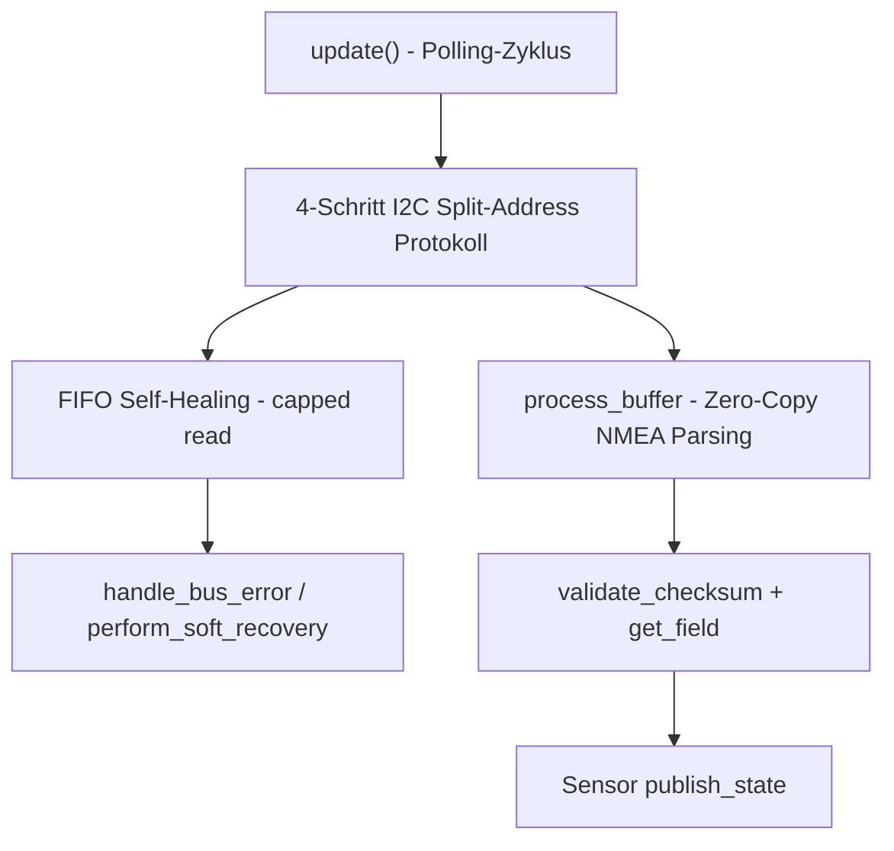

## Antwort

Die drei wichtigsten/komplexesten Algorithmen in diesem Repo sind:

1. **Das Split-Address I²C-Polling-Protokoll** (`LC76GComponent::update()`)
2. **FIFO Self-Healing mit Soft Recovery** (Fehlerzähler + capped reads + `perform_soft_recovery()`)
3. **Zero-Copy NMEA-Parsing** (`process_buffer()`, `validate_checksum()`, `get_field()`)

Zusammen bilden sie die Kernlogik, die dieses Projekt von einem einfachen UART-GPS-Parser unterscheidet: robuste, allokationsfreie Kommunikation mit einem eigenwilligen I²C-Chip.

---

## 1. Das 4-Schritt Split-Address I²C-Protokoll

Der LC76G-Chip spricht kein Standard-I²C, sondern verlangt eine strikte Sequenz über zwei Adressen (`0x50` schreiben, `0x54` lesen): Handshake → Header lesen → ACK schreiben → Payload lesen [1](#0-0) .

Jeder Schritt hat feste Timing-Verzögerungen via `vTaskDelay`, da der Chip Vorbereitungszeit zwischen den Transaktionen braucht [2](#0-1) . Die Länge wird aus einem Little-Endian 4-Byte-Header dekodiert [3](#0-2) . Dieses Protokoll ist deshalb kompliziert, weil es kein Standardmuster ist, sondern ein proprietäres Quectel-Verfahren, das exakt nachgebildet werden muss [4](#0-3) .

## 2. FIFO Self-Healing & automatische Soft Recovery

Da elektrisches Rauschen den Längen-Header korrumpieren kann (z. B. 60.000 Bytes gemeldet), erzwingt der Code immer einen "capped read" auf die feste 10-KB-Puffergröße, um den internen FIFO-Zeiger des Moduls zuverlässig voranzutreiben und Deadlocks zu verhindern [5](#0-4) .

Ein Fehlerzähler (`error_counter_`) wird bei jedem Bus- oder Daten-Fehler erhöht; erreicht er den Schwellenwert `SOFT_RECOVERY_THRESHOLD` (5), löst `handle_bus_error()` automatisch `perform_soft_recovery()` aus [6](#0-5) . Die Recovery selbst sendet einen Hot-Start-Befehl gefolgt von einem NOP-Paket, um die Zustandsmaschine des Moduls zurückzusetzen – ganz ohne Power-Cycle [7](#0-6) . Dieser Mechanismus macht die Software "self-healing" und verhindert permanente Hänger, die bei naiveren Implementierungen auftreten würden [8](#0-7) .

## 3. Zero-Copy NMEA-Parsing-Pipeline

`process_buffer()` parst NMEA-Sätze direkt im rohen Byte-Puffer, ohne Heap-Allokationen – inklusive eines "Smart Crop", der bei Puffern >2KB nur die letzten Daten verarbeitet, um CPU-Last zu vermeiden [9](#0-8) .

Innerhalb jeder Zeile wird die Prüfsumme per XOR-Reduktion zwischen `$` und `*` validiert [10](#0-9) , und Felder werden ohne String-Kopien direkt aus dem Puffer extrahiert [11](#0-10) . GGA- und RMC-Sätze werden danach direkt in Sensorwerte (Latitude, Speed, etc.) übersetzt [12](#0-11) . Diese Technik verhindert Heap-Fragmentierung auf dem ESP32 über lange Laufzeiten hinweg [13](#0-12) .

## Zusammenspiel

Diese drei Algorithmen greifen in der `update()`-Methode ineinander [1](#0-0)  und machen die Komponente robust gegenüber einem unzuverlässigen, proprietären I²C-Transport, während sie gleichzeitig ressourcenschonend auf dem ESP32 läuft.

## Notes

Die eingebettete Protokoll-Dokumentation im Kommentarblock am Dateianfang fasst diese drei Mechanismen nochmal explizit zusammen [14](#0-13) . Die Python-Codegen-Schicht (`__init__.py`) ist dagegen reine Konfigurations-/Verdrahtungslogik ohne algorithmische Komplexität und daher hier nicht als "wichtiger Algorithmus" zu zählen [15](#0-14) .

Wiki pages you might want to explore:
- [Component Architecture (fuzzybear62/esphome-lc76g)](/wiki/fuzzybear62/esphome-lc76g#2)
- [Actions, Debugging and Troubleshooting (fuzzybear62/esphome-lc76g)](/wiki/fuzzybear62/esphome-lc76g#3.2)
- [Glossary (fuzzybear62/esphome-lc76g)](/wiki/fuzzybear62/esphome-lc76g#4)
