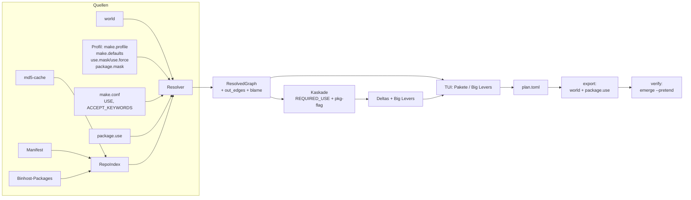
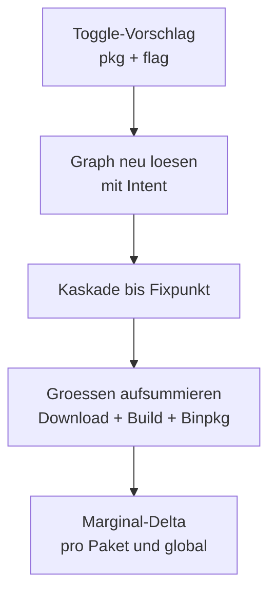

# walkthrough.md — `gentoo-dep-tui`: ein `ncdu` für Gentoo-USE-Flags

Stand: 2026-11-13, Branch `feature/gentoo-dep-tui`.
Dieses Dokument beschreibt, was wirklich gebaut wurde, welche
Architektur-Entscheidungen erst Tests und echte Gentoo-Daten erzwungen
haben, was wir daraus gelernt haben und welche Pakete der
Docker-Container braucht. Sprache: Deutsch, für Leser mit
Linux-Erfahrung, aber ohne Gentoo-Vorwissen.

## Glossar

| Kürzel | Bedeutung |
|---|---|
| PMS | Package Manager Specification — das Regelwerk, das Ebuilds und Abhängigkeiten definiert |
| EAPI | Ebuild API — Versionsstand des Ebuild-Formats (bestimmt z. B. welche `REQUIRED_USE`-Operatoren existieren) |
| CPV | Category/Package-Version — eindeutiger Paketbezeichner, z. B. `dev-libs/openssl-3.6.0` |
| RDEPEND | Runtime-Abhängigkeiten eines Ebuilds (werden zur Laufzeit gebraucht) |
| BDEPEND | Buildtime-Abhängigkeiten (werden nur zum Bauen gebraucht) |
| IUSE | Im Ebuild deklarierte USE-Schalter; `+flag` heißt „per Default an" |
| REQUIRED_USE | Ebuild-Regelwerk über Flag-Kombinationen (`\|\|`, `^^`, `??`, `flag? ( … )`) |
| VDB | Installierte-Paket-Datenbank (`/var/db/pkg`) — Quelle für reale Installationsgrößen |
| USE_EXPAND | Variablen (`PYTHON_TARGETS`, `ABI_X86`, …), die zu `präfix_wert`-Flags expandieren |
| KEYWORDS | Stabilitätsmarkierung (`amd64` stabil, `~amd64` testing, `-*` maskiert) |
| Slot | Koexistenz-Klasse (`SLOT=0`, `0/2`); fehlender Sub-Slot defaultet auf den Slot |
| package.mask | Maskierte Atome; `-atom`-Zeilen **entmaskieren** frühere Masken wieder |
| package.use | Paketweise USE-Vorgaben, z. B. `dev-libs/openssl -ssl` |
| Blocker | `!cat/pkg[…]`-Abhängigkeit: verbietet die gematchte Konfiguration; Use-Deps gelten dabei **invertiert** |
| `world` | Datei der gewünscht installierten Pakete (`/var/lib/portage/world`), ein Atom pro Zeile |
| md5-cache | Vom Repo bereitgestellte, bereits geparste Ebuild-Metadaten (`metadata/md5-cache/<kat>/<paket-version>`) |
| Manifest | `Manifest`-Datei je Paketverzeichnis mit `DIST <datei> <bytes>`-Zeilen (Download-Größen) |
| Binhost | Server mit fertigen Binärpaketen plus `Packages`-Index (`CPV`, `SIZE`, `USE`) |
| Big Lever | USE-Flag, das — global abgeschaltet — über alle Pakete die größte Ersparnis bringt |
| Kaskade | Fixpunkt-Algorithmus aus REQUIRED_USE- und `pkg[flag]`-Constraints mit Quick-Switch-Vorschlägen |
| `plan.toml` | Vom Tool erzeugte Plandatei: Baseline, `[[package]]`-Overrides, `[[choice]]`-Alternativen (mit Pros/Cons), `[[or_decision]]`-Zweigwahlen |
| HIL | Hardware-in-the-Loop — Nachweis gegen echte Gentoo-Daten vom Host `kiel@localhost` per SSH statt gegen Mocks |
| TUI | Text User Interface — interaktive Terminal-Oberfläche (hier mit `ratatui` 0.30) |

## 1. Was exakt implementiert wurde

`gentoo-dep-tui` beantwortet eine einzige Frage: **„Was kostet mich
dieses USE-Flag wirklich — und wer hängt dran?"** Vier Modi plus TUI:

- **Modus 1 `index-check`**: lädt Profilstapel, `world`, `make.conf`,
  `package.use`, den md5-cache, alle Manifeste und den
  Binhost-`Packages`-Index; wählt pro Paket die installierbare Version
  (KEYWORDS-/Mask-/Slot-Filter). HIL: 168 Kategorien, 13 693 Pakete,
  33 799 Cache-Dateien in ~1,1 s.
- **Modus 2a `graph`/`blame`**: löst `world` zu einem `ResolvedGraph`
  auf (519 Pakete, ~3,2 GB Download, **0 Konflikte**, 1 Skip). `blame
  dev-libs/openssl` zeigt echte Ketten wie `app-misc/tmate ->
  dev-libs/openssl` oder `dev-vcs/git -> dev-libs/openssl`, inklusive
  Via-Flags (`net-misc/mosh [+nettle]`). Unauflösbares wird als
  `SkippedDep`-Warnung gemeldet statt abzubrechen — der Skip
  (`sys-kernel/gentoo-sources:6.18.57`, veralteter Slot-Pin in `world`)
  stimmt mit `emerge --pretend` auf dem Host überein.
- **Modus 2b `deltas`/`big-levers`**: exakte Toggle-Deltas pro Paket
  per Re-Simulation (z. B. `media-video/ffmpeg`: `X +281 kB Download`,
  `amf +4,9 MB Download`), dazu globale Big Levers (z. B. `X` auf
  15 Paketen).
- **Modus 3 `init`/`export`/`verify`**: `init` schreibt `plan.toml`
  aus `world`; `export` erzeugt `world` + `package.use` für ein
  `PORTAGE_CONFIGROOT` (HIL: 115 `world`-, 22 `package.use`-Zeilen);
  `verify` parst `emerge --pretend`-Ausgaben (Mock-getestet plus
  Fake-Skripte für OK- und Fehlerfall).
- **TUI**: zwei Tabs (`[1] Pakete & Alternativen`, `[2] Global Big
  Levers`), drei Panes (links Pakete/Choices/`||`-Entscheidungen,
  Mitte USE-Flags, rechts Blame/Pros-Cons), `Space` toggelt mit
  Live-Neuberechnung, `Enter` schaltet Alternativen und öffnet
  Konflikt-Quick-Switch-Popups, `S`/`E`/`V` für Save/Export/Verify.
  Rendering-Tests mit `TestBackend` in 120x40 und 80x24; HIL-Test der
  Kernaktionen auf dem Snapshot: 519 Knoten, Toggle
  `gentoo-sources[build]`, Save + Export verifiziert.
- **Tests**: 44 Unit-Tests, 6 Host-Integrationstests
  (Index/Graph/Blame/Deltas/Plan/Export/Verify), 4 HIL-Regressionstests
  (`GENTOO_HIL_REPO=/tmp/gentoo-hil`). Gates grün: `cargo fmt --check`,
  `cargo clippy --all-targets -- -D warnings`, `cargo test`.

### Architektur und Datenfluss



Modulzuordnung (`src/`, Nummer = Datenfluss-Reihenfolge):
`01_types` (IDs, Größen, `BlameLink`, `ConflictInfo`, `QuickSwitch`),
`02_profile` (Profilstapel, `world`-, `make.conf`-, `package.use`-Reader,
USE_EXPAND, `${ARCH}`-Expansion), `03_manifest` (`DIST`-Größen),
`04_binhost` (`Packages`-Stanzas), `05_repo_index` (Versionwahl,
KEYWORDS-/Mask-/Slot-Filter), `06_graph` (RDEPEND-Resolver,
Refcounts, `||`-Alternativen, Blame-Kanten, `out_edges`, Skips),
`07_cascade` (REQUIRED_USE- + `pkg[flag]`-Fixpunkt), `08_delta`
(Re-Simulation, Big Levers), `09_plan_toml` (`plan.toml` mit Pros/Cons),
`10_export_verify` (Portage-Export, Pretend-Parser), `11_cli`
(alle Subkommandos), `12_tui_state` (Tabs, Panes, Aktionen),
`13_tui_view` (3-Pane-Layout, Konflikt-Modal), `14_tui_runner`
(Terminal-Lifecycle, Event-Loop).

### Kaskaden-Auflösung im Detail

```mermaid
flowchart TD
    S[Seed: package.use + TUI-Toggles\nTri-State-Intent] --> R1[REQUIRED_USE pruefen\n|| ^^ ?? flag?]
    R1 --> R2[pkg-flag-Constraints auf out_edges\nnur gewaehlte ||-Zweige]
    R2 --> B[Blocker invertiert auswerten\n!pkg[-f] verlangt f=AN]
    B --> F{Parent-Flip moeglich?\nVia-Use-Dep umschalten}
    F -->|ja| Q[Quick-Switch-Vorschlag]
    F -->|nein| C[Konflikt sammeln\n+ forced-Set Ping-Pong-Schutz]
    Q --> N{Fixpunkt?\nkeine Aenderung mehr}
    C --> N
    N -->|nein| R1
    N -->|ja, offen| K2[(kaskade)-Konflikt melden]
    N -->|ja, sauber| OK[stabile Flag-Belegung]
```

### Delta-Berechnung



## 2. Welche Architektur-Entscheidungen Tests und HIL erzwungen haben

Fast jede dieser zehn Korrekturen widersprach einer zunächst
plausiblen Annahme — erst echte Daten haben sie widerlegt:

1. **md5-cache ist zweistufig** (`<kat>/<paket-version>`), nicht
   dreistufig. Der erste `index-check` fand 0 Pakete (falsche
   `min_depth/max_depth`), danach 13 693.
2. **`parent`-Dateien listen mehrere Eltern** (eine pro Zeile). Der
   Loader folgt heute allen per DFS mit Zyklus-Schutz und
   lexikalischem `normalize_join`.
3. **`-*` allein maskiert nicht**, wenn später `amd64` folgt — die
   KEYWORDS-Auswertung nimmt die letzte passende Markierung.
4. **Mask-Semantik**: `-atom`-Zeilen in `package.mask`
   **entmaskieren** (letzte passende Zeile gewinnt); Slot-Vergleich
   beachtet den Sub-Slot, fehlender Sub-Slot defaultet auf den Slot
   (`SLOT=0` matcht `:0/0`). Ohne das wurden `libseccomp`, `elfutils`
   u. a. fälschlich maskiert.
5. **`ACCEPT_KEYWORDS="${ARCH}"`** braucht Expansion plus
   USE_EXPAND-Zweitpass (`PYTHON_TARGETS=python3_14`, `ABI_X86=64`)
   und Defaults für `ARCH`/`elibc_*`/`kernel_*` — sonst bleibt `ARCH`
   leer und alles ist maskiert.
6. **Blocker gelten invertiert**: `!gnupg[-alternatives]` verlangt
   `alternatives=AN`. Vorher gab es falsche Konflikte; Parent-Flips
   gibt es für Blocker nicht.
7. **Nur der gewählte `||`-Zweig** trägt Constraints bei — vorher
   wurden beide Zweige recorded und `gpg[reference/freepg]`
   widersprach sich selbst.
8. **Tri-State-Intent statt voller USE-Sets**: `UseOverrides` speichert
   nur expliziten Intent (`HashMap<String, HashMap<String, bool>>`);
   Abwesenheit heißt „kein Intent". Volle Sets ließen Defaults wie
   User-Wille aussehen und erzeugten 98 Schein-Konflikte in der
   Kaskade (z. B. alle ffmpeg-Deltas `CONFLICT` wegen
   `mpv[encode]`).
9. **Kaskaden-Stabilität**: `forced`-Set pro `(Paket, Flag)` überlebt
   Runden (Ping-Pong-Schutz), Konflikte werden dedupliziert,
   Nicht-Konvergenz wird als `(kaskade)`-Konflikt gemeldet statt zu
   hängen.
10. **Skips statt Abbrüche**: Unauflösbares (z. B. veralteter
    Kernel-Slot-Pin in `world`) landet in `graph.skipped` — exakt wie
    Host-`emerge --pretend`, das denselben Pin meldet.

## 3. Learnings und mögliche Erweiterungen

- **Gelernt**: Portage-Semantik steckt in Randfällen (`-*`, `-atom`,
  invertierte Blocker, `${ARCH}`), die keine Dokumentation so
  präzise beschreibt wie ein echter Tree. HIL war kein „nice to
  have", sondern der eigentliche Spezifikationsgeber.
- **Gelernt**: Intent gehört tri-state modelliert. „Default an" ist
  kein Wille — wer Defaults mit Intent vermischt, baut
  Schein-Konflikte.
- **Erweiterung VDB-Größen**: reale Installationsgrößen aus
  `/var/db/pkg/*/*/SIZE` plus Historie aus `/var/log/emerge.log` in
  eine empirische SQLite-DB übernehmen, statt nur Manifest-`DIST`
  und Binhost-`SIZE` zu nutzen.
- **Erweiterung Solver**: REQUIRED_USE- und Use-Dep-Constraints in
  einen echten SAT-Solver geben statt Fixpunkt mit Heuristik; die
  heutigen Quick-Switches wären dann optimale statt gierige
  Vorschläge.
- **Erweiterung Binhost-Abdeckung**: Der Snapshot enthält keinen
  Binhost (`Binpkg`-Metrik 0). Mit `Packages`-Index vom Host ließe
  sich die Binärpaket-Ersparnis real beziffern.

## 4. Neue Programme für den Docker-Container

Während der Arbeit musste **kein einziges Paket nachinstalliert**
werden — alles Benötigte war vorhanden:

| Paket / Toolchain | Wofür |
|---|---|
| `openssh-client` (`ssh`, `scp`) | HIL-Zugriff `ssh kiel@localhost -i ~/.ssh/from_android`, Snapshot-Transfer |
| Rust-Toolchain (`cargo`, `rustc`, `rustfmt`, `clippy`) | Build, `fmt --check`, `clippy -D warnings`, Tests |
| `tar`, `find`, `du` (coreutils) | Snapshot-Erstellung und -Vermessung |

Folglich: **keine Änderung am Dockerfile nötig.** Falls der Container
je ohne SSH-Client gebaut wird, ist `openssh-client` der einzige
nachzutragende Eintrag.
