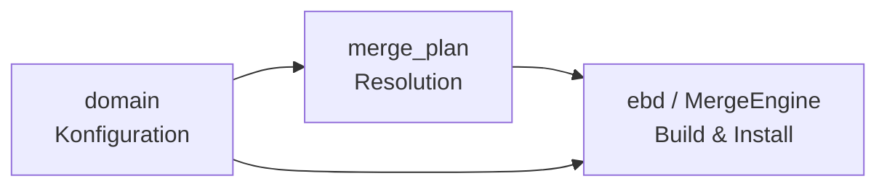

Die drei komplexesten Algorithmen in pkgcore sind: (1) der **Backtracking-Dependency-Resolver** in `merge_plan`, (2) die **Konfigurations-Aggregation** in `domain` (USE-Flags, Profile, Masking), und (3) die **Build-/Merge-Orchestrierung** über `ebd` und `pmerge`. Zusammen bilden sie den Kern eines Paketmanagers: entscheiden *was* installiert wird, *mit welcher Konfiguration*, und *wie* es gebaut und ins Dateisystem überführt wird.

---

## 1. Dependency Resolution: `merge_plan` (Backtracking-Solver)

Das Herzstück ist `merge_plan` in `src/pkgcore/resolver/plan.py`. `insert_choice` fügt einen gewählten Kandidaten in den Resolver-State ein und behandelt dabei Zyklen, VDB-Ersetzungen und Blocker-Konflikte — inklusive eines Early-Exits, wenn ein Zyklus exakt dasselbe Paket erneut einfügt [1](#0-0) .

Blocker werden separat über `insert_blockers` abgearbeitet; schwache Blocker (`weak_blocker`) lösen sogar eine rekursive Re-Resolution aus (`_rec_add_atom`), um den Konflikt durch eine andere Version aufzulösen [2](#0-1) .

Die Auswahlstrategien am Ende der Datei (`prefer_highest_version_strategy`, `prefer_reuse_strategy`, `prefer_downgrade_version_strategy` etc.) steuern, aus welchen Repos und in welcher Reihenfolge Kandidaten gezogen werden — das ist der "Policy"-Teil des Solvers [3](#0-2) .

**Warum zentral:** Das ist der eigentliche "Intelligenz"-Algorithmus — er macht aus `pmerge sys-apps/foo` einen vollständigen, konfliktfreien Installationsplan.

## 2. Konfigurations-Domäne: `domain` (USE-Flags, Profile, Filtering)

`domain.get_package_use_unconfigured` implementiert die komplizierte USE-Flag-Logik von Gentoo: IUSE-Defaults, `USE_EXPAND`-Expansion, stabile vs. unstable Keywords, profil-erzwungene und -maskierte Flags, plus Glob-Support — alles in einer festen Auswertungsreihenfolge [4](#0-3) .

`get_package_domain` erzeugt pro Paket eine modifizierte Domain-Kopie, wenn `package.env`-Einträge matchen — inklusive Neu-Laden von `make.conf`-Dateien und Zurücksetzen aller JIT-Attribute [5](#0-4) .

`filter_repo` kombiniert globale Masks, Profil-Masks/Unmasks (inkrementell) und Keyword-Filter zu einem `filtered.tree` [6](#0-5) . Die Ergebnisse werden als `RepositoryGroup` über `source_repos`/`installed_repos` exponiert [7](#0-6) .

**Warum zentral:** Dieser Algorithmus definiert, was "das System" überhaupt ist — welche Pakete sichtbar, installierbar und mit welchen Flags gebaut werden.

## 3. Build- und Merge-Pipeline: `ebd` + `pmerge`

Die `ebd`-Klasse orchestriert die Ebuild-Phasen (`setup` → `unpack` → `compile` → `install`) über einen persistenten Bash-Daemon (`EbuildProcessor`) mit IPC-Kommandos, die Helpers wie `Doins` in Python implementieren (laut Wiki-Übersicht; die Datei selbst war nicht im Snippet-Kontext). 

Auf der Außenseite treibt `pmerge.main` den Plan ab: pro Operation `fetch` → `build` → `localize` → `install_pkg`/`replace_pkg`/`uninstall_pkg`, mit Cleanup-Stack und World-File-Updates [8](#0-7) .

**Warum zentral:** Das ist die Ausführungsseite — sie überführt den Resolver-Plan in reale Dateisystem-Änderungen.

## Zusammenspiel

`domain` liefert die gefilterten Repos und USE-Flags, `merge_plan` löst darüber die Abhängigkeiten, und `ebd`/`pmerge` führen das Ergebnis aus. 

## Notes

- Die `atom.intersects`-Logik (Versionsoperatoren `=`, `=*`, `~`, `<`, `>`) ist ein weiterer subtiler Algorithmus, der dem Resolver zugrunde liegt [9](#0-8) .
- `ProfileStack` kollabiert Profil-Vererbung (masks, unmasks, keywords) über `_collapse_generic` — Teil der Konfigurations-Aggregation [10](#0-9) .
- Der eigentliche Backtracking-Mechanismus (`resolver_frame`, `choice_point`) und `ebd`/`EbuildProcessor` waren nicht vollständig im Index-Kontext; für deren Details lohnt ein Blick in `src/pkgcore/resolver/plan.py` (Anfang der Datei) und `src/pkgcore/ebuild/ebd.py`.

Wiki pages you might want to explore:
- [Overview (pkgcore/pkgcore)](/wiki/pkgcore/pkgcore#1)

