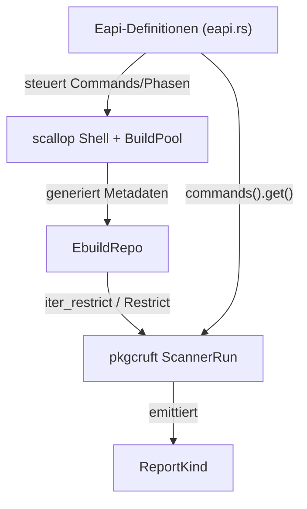

Die drei komplexesten Algorithmen sind: **(1)** das inkrementelle EAPI-Vererbungssystem in `eapi.rs`, **(2)** die eingebettete Bash-Ausführung von Ebuilds über `scallop`/`BuildPool` zur Metadaten-Generierung, und **(3)** die Restriction-basierte Paketfilterung kombiniert mit der pkgcruft-Scan-Pipeline. Zusammen machen sie pkgcraft zu einem schnellen, PMS-konformen Werkzeugkasten für Gentoo-Repositories. [1](#0-0) 

---

## 1. Inkrementelles EAPI-System (`crates/pkgcraft/src/eapi.rs`)

Jede EAPI wird als Delta auf die vorherige definiert: `Eapi::new("6", Some(&EAPI5))` erbt Features, Commands, Phasen und Env-Variablen und modifiziert sie per Builder-Methoden wie `.enable_features()`, `.update_commands()`, `.disable_commands()`. [2](#0-1) 

Das ist der Kern der PMS-Kompatibilität: statt jede EAPI komplett neu zu spezifizieren, kodiert der Algorithmus nur die Unterschiede (z. B. EAPI 7 deaktiviert `TrailingSlash`, fügt `BDEPEND` hinzu). [3](#0-2)  Features wie `NonfatalDie` oder `DosymRelative` sind als Enum modelliert und steuern später das Shell-Verhalten. [4](#0-3) 

## 2. Eingebettete Bash-Ausführung & Metadaten-Generierung (`scallop`, `BuildPool`)

Der zweite komplexe Teil ist das Sourcen von Ebuilds in einer echten, eingebetteten Bash-Umgebung. `BuildData` fungiert als Zustandsmaschine, ein fork-basierter `BuildPool` isoliert die Shell-Prozesse, damit Seiteneffekte nicht den Hauptprozess verschmutzen — das ermöglicht parallele Metadaten-Regeneration. Laut Wiki: `EbuildPkg → BuildData → BuildPool → scallop::Shell → source_ebuild → execute_phase`. [5](#0-4) 

Die EAPI-Definition aus (1) steuert hier direkt, welche Phasen (`SrcUnpack`, `SrcCompile`, …) in welcher Reihenfolge pro Operation laufen. [6](#0-5)  Das ist der Grund, warum Tests mit `cargo nextest` in separaten Prozessen laufen müssen — Bash ist nicht thread-sicher. [7](#0-6) 

## 3. Restriction-Engine & pkgcruft-Scan-Pipeline

`EbuildRepo` implementiert `PkgRepository` mit lazy Iteratoren (`iter_cpv_restrict`, `iter_restrict`), die Pakete über `Restrict`-Objekte filtern statt alles zu materialisieren. [8](#0-7)  Besonders clever ist `restrict_from_path`: es wandelt einen Dateipfad schrittweise in eine `Restrict::and(...)`-Kette aus `DepRestrict::category`, `DepRestrict::package` und `DepRestrict::Version` um. [9](#0-8) 

Darauf aufbauend läuft in `pkgcruft` die QA-Pipeline `Repo → ScannerRun → CheckRunner → Source → Report`. Ein Beispiel-Check: `eapi_command` traversiert den Tree-sitter-AST eines Ebuilds, prüft gegen die EAPI-Command-Tabelle aus (1) und meldet z. B. `CommandScopeInvalid` oder unnötige `|| die`-Konstrukte. [10](#0-9) 

## Zusammenspiel

Die drei Algorithmen verstärken sich gegenseitig: die EAPI-Deltas definieren die Regeln, die Bash-Engine führt Ebuilds regelkonform aus, und die Restriction-/Scan-Pipeline macht daraus ein performantes QA- und Paketmanagement-Tool. [11](#0-10) 

## Notes

- `ConfiguredRepo` delegiert alle `PkgRepository`-Methoden an das rohe `EbuildRepo` und ergänzt nur `Settings` (USE-Flags, KEYWORDS) — es ist ein Wrapper, kein eigener Algorithmus. [12](#0-11) 
- Der Dep-PEG-Parser (`dep/parse.rs`) und die `RepoSet`-Mengenoperationen sind ebenfalls nichttrivial, aber im gezeigten Kontext nicht enthalten — für deren Details wäre ein Blick in die vollen Dateien nötig. 

Wiki pages you might want to explore:
- [Glossary (pkgcraft/pkgcraft)](/wiki/pkgcraft/pkgcraft#11)
- [Repository System (pkgcraft/pkgcraft)](/wiki/pkgcraft/pkgcraft#3.3)
