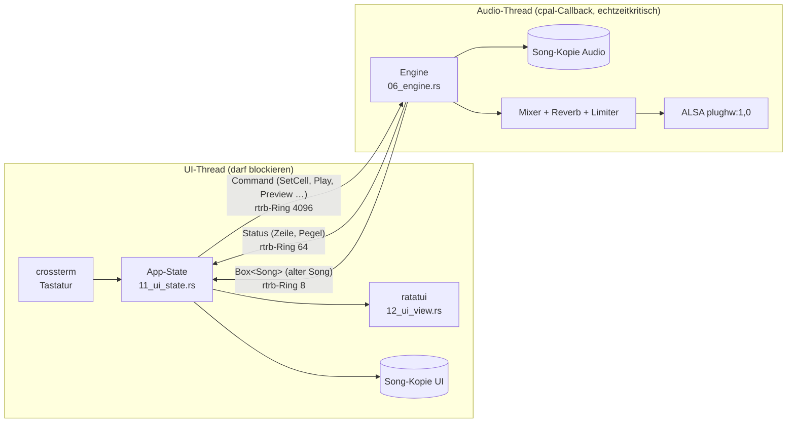
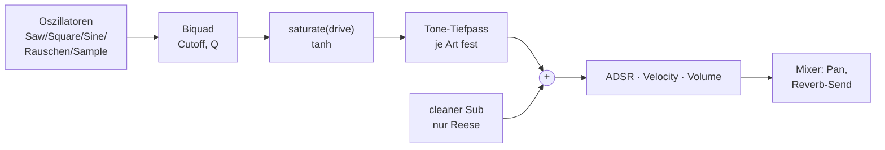
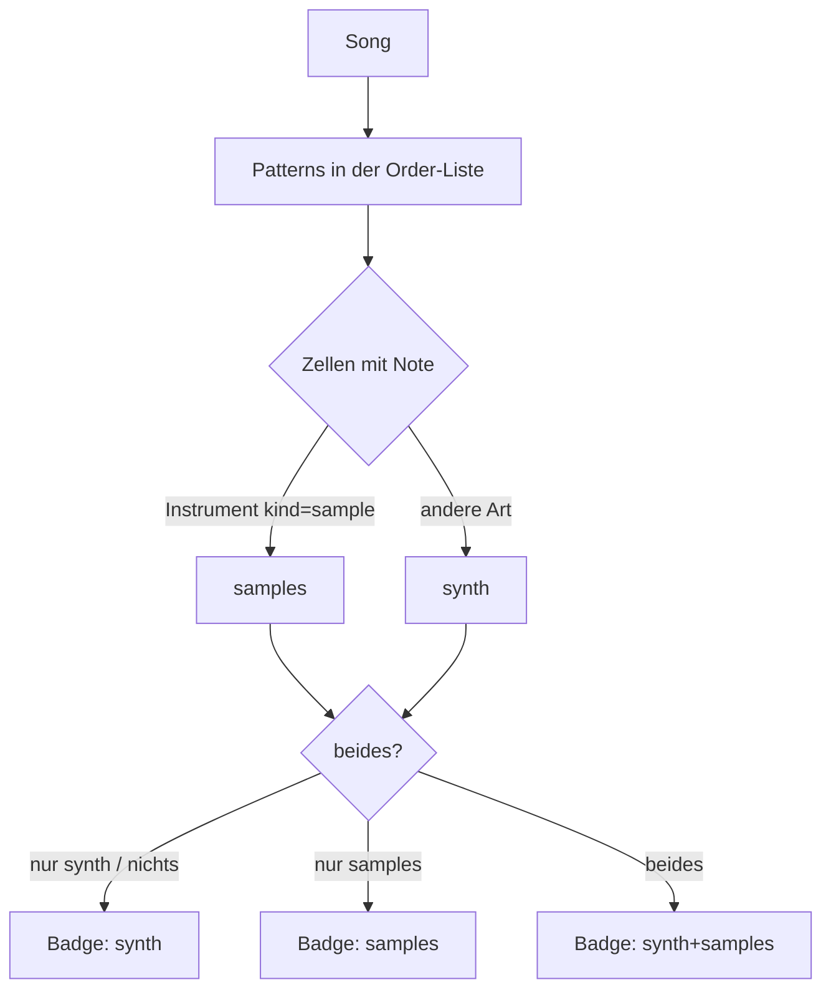
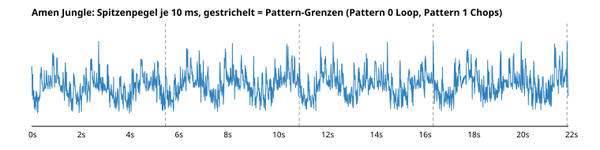
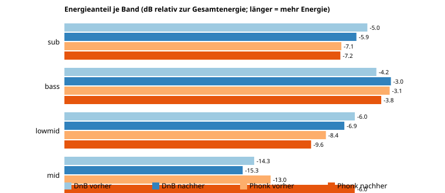

# Walkthrough: `dnb-tracker`, ein Terminal-Tracker für Drum and Bass und Phonk

Stand: 2026-11-21 · Crate: `examples/41_tracker/tracker` · Auftrag: `prompt.txt` in diesem Ordner

Dieses Dokument erklärt, was gebaut wurde, warum es so gebaut wurde und was
unterwegs schiefging. Es richtet sich an Leser, die Rust können, aber nicht
unbedingt Audio-Programmierung. Fachbegriffe werden beim ersten Auftreten kurz
erklärt und stehen gesammelt im [Glossar](#glossar) am Ende.

---

## 0. Worum geht es?

Ein **Tracker** ist ein Musikprogramm, in dem man Musik nicht als Noten auf
Linien schreibt, sondern als Tabelle: Zeilen sind Zeitschritte (hier
Sechzehntelnoten), Spalten sind Kanäle. Jede Zelle sagt „spiele Note X mit
Instrument Y, Lautstärke Z, Effekt W“. So sieht eine Zeile aus unserem
Amen-Jungle-Song aus:

```text
3C | C-4 08 .. O1C | --- .. .. ... | …
     │   │  │  └── Effekt O, Argument 1C: Sample ab Slice 28/32 starten
     │   │  └───── Lautstärke: nicht gesetzt (= voll)
     │   └──────── Instrument 08 (Amen-Break)
     └──────────── Note C-4
```

Gebaut wurde ein **TUI**-Tracker (Text User Interface, eine Oberfläche im
Terminal) mit eigener Klangerzeugung, der sofort Musik macht: zwei komplett
synthetisierte Demos und zwei Demos, die echte Aufnahmen (Samples) mit
Synthesizer-Stimmen mischen.

## 1. Was exakt implementiert wurde

### 1.1 Überblick in Zahlen

| | |
|---|---|
| Quelltext | 13 nummerierte Module in `src/`, alle < 600 Zeilen |
| Tests | 47 (41 Unit-Tests, 6 Integrationstests inkl. 2 Echtdaten-Tests) |
| Gates | `cargo test`, `cargo clippy --all-targets -- -D warnings`, `cargo fmt --check`: grün |
| Abhängigkeiten | `ratatui`, `crossterm`, `cpal`, `rtrb`, `hound`, `anyhow` (siehe `deps.md`) |
| Render-Geschwindigkeit | 60 s Musik in 0,49 s, also ≈ 120-fach Echtzeit (Release-Build) |
| Latenz | 512 Frames pro ALSA-Periode ≈ 10,7 ms (vorher 16384 ≈ 341 ms, siehe 2.3) |

### 1.2 Architektur

Die wichtigste Regel in Audio-Software: Der **Audio-Thread** (der Code, den
die Soundkarte alle paar Millisekunden aufruft) darf nie warten. Kein Mutex,
keine Speicher-Allokation, kein `free`. Sonst kommt der nächste Puffer zu spät
und es knackst. So einen Aussetzer nennt man **Xrun**. Deshalb gibt es
zwei getrennte Welten, die nur über drei lock-freie Ringpuffer reden:



**Warum zwei Song-Kopien?** Würden beide Threads denselben Song teilen,
bräuchte man eine Sperre. Stattdessen ändert die UI ihre Kopie und schickt
*dieselbe* Änderung als kleine Nachricht (`Command::SetCell { pat, row, ch, cell }`).
Damit das Anwenden im Audio-Thread nie Speicher anfordert, reserviert
`Song::new()` alles vorab: 32 Patterns × 64 Zeilen × 8 Kanäle, Order-Liste als
festes Array.

**Warum ein Rückkanal für alte Songs?** Beim Laden eines Songs tauscht der
Audio-Thread den `Box<Song>` aus. Den alten freizugeben wäre ein `free` im
Echtzeit-Thread. Also schickt er ihn zurück, und die UI wirft ihn weg. Laut
DeepWiki-Recherche zu `rtrb` sind `push`/`pop` allokationsfrei, das Droppen
eines Ring-Endes aber *nicht* garantiert echtzeitsicher. Deshalb leben die
Ring-Enden so lange wie der Stream.

**SPSC-Ring** (single producer, single consumer): ein Puffer mit genau einem
Schreiber und einem Leser. Das erlaubt eine Implementierung nur mit atomaren
Zählern, ganz ohne Sperren.

### 1.3 Module (Datenfluss-Reihenfolge)

| Datei | Zuständigkeit |
|---|---|
| `01_types.rs` | `Note`, `Cell`, `Pattern`, `Patch`/`Kind`, `Song`, `Sources`-Badge |
| `02_dsp.rs` | Rauschen, PolyBLEP-Oszillatoren, Biquad-Filter, ADSR-Hüllkurve, Sättigung, Panorama |
| `03_voice.rs` | eine Stimme: Synthese je Instrument-Art, Glide, Sample-Wiedergabe |
| `04_master_fx.rs` | Freeverb-Hall (Send-Effekt) und Peak-Limiter |
| `05_protocol.rs` | `Command`, `Status`, die drei Ringpuffer |
| `06_engine.rs` | Sequencer (Zeilen/Ticks/Effekte) und Mixer |
| `07_audio_out.rs` | cpal: Geräteauswahl, Latenz, Formatwandlung |
| `08_wav.rs` | Offline-Render nach WAV, WAV laden |
| `09_song_io.rs` | Textformat speichern/laden |
| `10_demo_songs.rs` | vier Demos, aus kompakten Tabellen erzeugt |
| `11_ui_state.rs` / `12_ui_view.rs` / `13_ui_runner.rs` | Tastenlogik / Zeichnen / Event-Schleife |

`lib.rs` und `main.rs` enthalten nur Deklarationen bzw. CLI-Verdrahtung.

### 1.4 Zeit: Zeilen, Ticks, Samples

Ein Beat hat 4 Zeilen (LPB = *lines per beat*, also Sechzehntel). Jede Zeile
ist in `speed` = 6 **Ticks** unterteilt. Effekte wie Retrigger arbeiten in
Ticks. Bei 120 BPM (*beats per minute*) und 48 kHz ergibt das:

```text
Zeile = 48000 · 60 / (120 · 4) = 6000 Samples      Tick = 6000 / 6 = 1000 Samples
```

Die Engine zählt mit einem `f64`-Akkumulator rückwärts, damit sich auch bei
krummen Tempi (174 BPM → 4137,93 Samples pro Zeile) kein Fehler aufsummiert.
Der Test `row_timing_is_sample_exact` prüft genau das: Nach 6000 Frames ist
noch Zeile 0 aktiv, nach 6001 Frames Zeile 1, nach 64 Zeilen beginnt das
Pattern wieder bei 0.

### 1.5 Klangerzeugung: der Weg eines Samples durch eine Stimme



Die Instrument-Arten (`Kind`):

| Art | Rezept | typisch für |
|---|---|---|
| `kick` | Sinus 55 Hz mit Pitch-Hüllkurve (+36 Halbtöne → fällt in 35 ms), Rausch-Klick | beide |
| `snare` | Sinus-Körper 190 Hz + hochpassgefiltertes Rauschen | beide |
| `hat` | sechs Rechteck-Oszillatoren mit den Frequenzen der Roland TR-808 + etwas Rauschen, Hochpass | beide |
| `reese` | zwei gegeneinander verstimmte Sägezähne → Tiefpass → Sättigung, plus cleaner Sinus-Sub | DnB |
| `sub` | Sinus mit Pitch-Hüllkurve und starker Sättigung („808“) | Phonk |
| `bell` | zwei Rechtecke im 808-Kuhglocken-Verhältnis 540:800, tonhöhenabhängiger Tiefpass | Phonk |
| `lead` | zwei Sägezähne, Tiefpass, ADSR | Flächen/Melodien |
| `sample` | WAV-Wiedergabe mit linearer Interpolation, Grundton `root` | Breaks, echte Drums |

Kurz erklärt:
- **PolyBLEP**: Ein naiver Sägezahn springt von +1 auf −1, und dieser Sprung
  erzeugt Obertöne oberhalb der halben Abtastrate, die als falsche Töne
  zurückgespiegelt werden (**Aliasing**, klingt metallisch-kratzig). PolyBLEP
  rundet den Sprung über zwei Samples ab und entfernt so den Großteil davon.
- **Biquad**: ein Filter zweiter Ordnung (zwei Pole, zwei Nullstellen); die
  Koeffizienten stammen aus Robert Bristow-Johnsons „Audio EQ Cookbook“ (RBJ).
  **Q** (Güte) bestimmt, wie stark die Frequenz am Cutoff betont wird.
- **ADSR**: Attack, Decay, Sustain, Release, die vier Phasen einer
  Lautstärke-Hüllkurve.
- **Reese**: nach Kevin Saundersons „Just Want Another Chance“ benannter Bass
  aus verstimmten Sägezähnen; deren Schwebung ist das Markenzeichen von DnB.

### 1.6 Effekt-Spalte

| Befehl | Wirkung | Beispiel aus den Demos |
|---|---|---|
| `Cxx` | Filter-Cutoff, exponentiell 40 Hz … 18 kHz | Reese öffnet/schließt sich je Takt (`C60 → C90`) |
| `Dxx` | Drive (Sättigung) | verzerrter 808 |
| `Gxx` | Glide zur neuen Note in xx·5 ms | 808-Slides in die nächste Taktzeile (`G10`) |
| `Rxx` | Retrigger alle x Ticks | Snare-Rolls (`R02`, `R01`), Hat-Triolen (`R03`) |
| `Kxx` | Note nach xx Ticks abschneiden | Stotter-Effekte |
| `Txx` | Tempo = xx (hex) BPM | `TAE` = 174 BPM |
| `Oxx` | Sample ab Slice xx/32 starten | Amen-Chops |

### 1.7 Vier Demos und das Herkunfts-Badge

Der Nutzer wollte synthetische und sample-basierte Stücke unterscheiden
können, wobei ein Song auch beides enthalten darf. Deshalb ist das Badge
**berechnet** und keine Namenskonvention: `Song::sources()` geht die
Patterns der Order-Liste durch und schaut, welche Instrument-Arten wirklich
gespielt werden. Ein geladenes, aber ungenutztes Sample zählt nicht (Test
`sources_follow_the_instruments_played`).



| Demo | Badge | Tempo | Inhalt |
|---|---|---|---|
| `--demo synth-dnb` „Two-Step Reese“ | `synth` | 174 | Two-Step-Beat, Reese in d-Moll mit Cutoff-Fahrten, Ghost-Snares, Roll |
| `--demo synth-phonk` „Cowbell Drift“ | `synth` | 140 | Kuhglocken-Riff in f-Moll, verzerrter 808 mit Slides, Hat-Rolls |
| `songs/mixed_amen_jungle.txt` | `synth+samples` | 175 | Amen-Break erst am Stück, dann gechoppt, mit Rolls; Synth-Kick, Reese, Lead |
| `songs/mixed_drift_phonk.txt` | `synth+samples` | 125 | Kick/Clap/Hat/808/Cowbell aus dem Phonk Producer Toolkit, Riffs aus dessen `melodies.json`/`grooves.json`, Vinyl-Knistern, Riser, Synth-Pad |

Header in der TUI:

```text
 dnb-tracker  ■ STOP  jam  synth+samples  Amen Jungle │ BPM 175 │ Pat 00 │ Oct 4 │ Ins 08 Amen │ Step 1
```

### 1.8 Amen-Slicing mit `Oxx`

Der **Amen-Break** (Schlagzeug-Solo aus „Amen, Brother“ der Winstons, 1969)
ist das Fundament von Jungle und DnB. `cw_amen01_175.wav` ist exakt zwei Takte
bei 175 BPM lang: 120 960 Frames bei 44,1 kHz = 2,742857 s = 8 Beats ×
0,342857 s. Zwei Takte sind 32 Sechzehntel; teilt man das Sample in 32 Slices,
fällt jeder Slice genau auf eine Tracker-Zeile. `O1C` heißt also: starte bei
Sechzehntel 28.

```text
Pattern 1, Kanal 0 (Ausschnitt)
38 | C-4 08 .. O18 |   Slice 24 (wie im Original)
3A | C-4 08 .. O0C |   Slice 12 statt 26: umgestellt
3C | C-4 08 .. O1C |   Slice 28
3D | --- .. .. R03 |   Roll ohne Note: wiederholt Slice 28 alle 3 Ticks
3E | C-4 08 .. O1E |   Slice 30
3F | --- .. .. R02 |   schnellerer Roll auf Slice 30
```



*Spitzenpegel je 10 ms. Pattern 0 spielt den Loop am Stück, Pattern 1 die
Chops; die gestrichelten Linien sind Pattern-Grenzen (64 Zeilen = 5,49 s).*

### 1.9 Bedienung und Werkzeuge

- **Jam- vs. Edit-Modus** (`Esc`): Im Jam-Modus spielen die Tasten nur an
  (Preview-Stimme), im Edit-Modus wird geschrieben und der Cursor rückt um
  `Step` Zeilen weiter. Klaviatur im FastTracker-Layout: `z s x d c …` und
  `q 2 w 3 e …`.
- `examples/stems.rs` rendert jeden Kanal solo nach WAV; das war das
  wichtigste Werkzeug bei der Klangdiagnose (Abschnitt 2.5).
- `examples/write_songs.rs` erzeugt `songs/mixed_*.txt` aus dem Code.
- `plan/…/spikes/spectrum.py`, `pitch.py`, `figures.py`: Python-Spikes
  (per `uv run`, Abhängigkeit nur `numpy`) für Messungen und Abbildungen.

## 2. Architektur-Entscheidungen, die Tests und Hören erzwungen haben

### 2.1 Snare über Vollaussteuerung (Unit-Test)

`every_kind_sounds_and_decays` verlangt `|s| ≤ 1` je Stimme. Die erste Snare
lieferte 1,15. Das bandpassgefilterte Rauschen war mit Faktor 2,5 zu laut.
Gelernt: Jede Stimme bekommt am Ende ein `clamp(-1, 1)`, und der Test bleibt
als Wächter.

### 2.2 Instrument-Defaults hingen von der Schlüssel-Reihenfolge ab (Integrationstest)

Der Test `song_file_resolves_samples_relative_to_itself` fand das Sample
zu leise (RMS 0,048 statt > 0,05). Ursache: `from_text` erzeugte jedes
Instrument zunächst als `Lead` (Cutoff 2,5 kHz, Volume 0,4) und setzte dann
`kind=sample`. Alle *nicht* in der Datei stehenden Parameter hatten also
Lead-Werte. Fix: zuerst `kind` lesen, dann `Patch::new(kind)`, dann die
übrigen Schlüssel. Regressionstest: `missing_keys_use_defaults_of_the_kind`.

### 2.3 340 ms Latenz statt 10 ms (Hardware-Messung)

Über `/proc/asound/card1/pcm0p/sub0/hw_params` zeigte sich, dass cpal ohne
Vorgabe ALSA-Perioden von 16 384 Frames anfordert. Für einen Tracker, in dem
man Töne anspielt, ist das unbrauchbar. Jetzt wird `BufferSize::Fixed(512)`
gesetzt (in den Grenzen, die das Gerät meldet). Ergebnis: `period_size: 512`,
0 Xruns in allen Hörtests.

### 2.4 Geräteauswahl (Container-Realität)

`cpal::default_output_device()` hätte im Container ein HDMI-Gerät der Karte 0
gewählt. Die Heuristik bevorzugt nun ein Gerät, dessen Name „Analog“ enthält
und das über `plughw` läuft (ALSA wandelt dort Format und Rate; rohes `hw`
lehnt oft `f32` ab). `--device <teilstring>` übersteuert.

### 2.5 „Klingt 8-bit, kein ordentlicher Bass, blechern“ (Hörtest → Messung)

Das war die wichtigste Kurskorrektur, und sie kam vom Nutzer. Statt nach
Gehör herumzuschrauben, wurde gemessen: `spectrum.py` teilt das Spektrum in
sechs Bänder und berechnet den **spektralen Schwerpunkt** (*centroid*, die
„mittlere“ Frequenz, gewichtet nach Energie; hoch = hell/dünn) und den
**Crest-Faktor** (Spitze zu Effektivwert in dB; niedrig = stark
komprimiert/verzerrt). Die Solo-Stems zeigten:

| Stem | Befund | Ursache |
|---|---|---|
| Kick | 63 % der Energie < 60 Hz | 50-Hz-Sinus: Kopfhörer und kleine Lautsprecher geben das kaum wieder |
| Hats | Schwerpunkt 16 kHz | reines weißes Rauschen ist Zischen, kein Metall |
| Cowbell | Schwerpunkt 3 kHz | Bandpass bei 3,3 kHz ließ nur hohe Obertöne der Rechtecke durch |
| Reese | Sub bei 36 Hz | Sub-Oszillator eine Oktave zu tief und mitverzerrt |
| Master | Crest 11 dB | `tanh` auf die Summe drückte die Transienten platt |

Eine Überraschung: Der DnB-Mix hatte gar nicht *zu wenig* Bassenergie
(−5 dB im Subband). Sie lag nur in einem Bereich, den man kaum hört.
„Hörbarer Bass“ braucht einen klaren Grundton bei 60–120 Hz plus Obertöne bei
120–500 Hz.

Umgebaut wurde:
1. **Tone-Tiefpass nach der Sättigung** je Instrument-Art. Die Obertöne, die
   `tanh` erzeugt, werden geglättet, das „8-bit“-Kratzen verschwindet.
2. **Sanftere Sättigung** (`g = 1 + 6·drive` statt `1 + 12·drive`).
3. **Cleaner Reese-Sub** auf dem Grundton, *an* Filter und Verzerrung vorbei.
4. **808-Hats** aus sechs Rechtecken (205,3 / 304,4 / 369,6 / 522,7 / 540 /
   800 Hz) statt Rauschen.
5. **Cowbell-Tiefpass folgt der Tonhöhe**, Resonanz von 2,0 auf 1,0.
6. **Freeverb-Hall als Send** (Snare 0,25, Hat 0,12, Bell 0,3, Lead 0,35, Bässe 0):
   Trockene Signale ohne Raum klingen nach Chiptune.
7. **Limiter statt `tanh`**: Leise Passagen bleiben unberührt, Spitzen werden
   sofort auf 0,9 begrenzt und die Verstärkung kehrt in 250 ms zurück.



| Kennzahl | vorher | nachher |
|---|---|---|
| Phonk: Präsenz 2–6 kHz | −9,7 dB | **−15,2 dB** |
| Phonk: Schwerpunkt | 754 Hz | **429 Hz** |
| Cowbell-Stem: Schwerpunkt | 3033 Hz | **1152 Hz** |
| Hat-Stem: Schwerpunkt | 15951 Hz | **10594 Hz** |
| Reese-Stem: Band 60–120 Hz | −3,6 dB | **−2,3 dB** |
| Snare-Stem: Körper 120–500 Hz | −5,1 dB | **−1,8 dB** |

Rückmeldung des Nutzers nach dem Hörtest: „sounds better now“. Zwei neue
Tests halten die Verbesserungen fest: `reese_keeps_a_clean_fundamental_sub`
(> 50 % der Energie unter 150 Hz) und `hat_is_metallic_not_pure_hiss`
(< 15 % über 16 kHz).

### 2.6 Eine Effektspalte reicht nicht für „Slice + Roll“

Der erste Amen-Demo-Code schrieb `.fx(OFFSET).fx(RETRIG)` in *eine* Zelle,
und das zweite überschrieb das erste: Die Rolls hätten den Anfang des Breaks
gespielt. Statt eine zweite Effektspalte einzuführen (breitere Zellen, mehr
UI-Logik), wurde die klassische Tracker-Semantik übernommen: Der Offset gehört
zur *Note* und bleibt erhalten, bis eine neue Note kommt; `Rxx` in einer Zeile
ohne Note rollt den laufenden Slice. Test: `roll_without_note_keeps_slice_offset`.

### 2.7 Grundton der Samples muss gemessen werden

Damit `Drift808_F.wav` beim Spielen von F auch F klingt, braucht jedes Sample
einen Grundton (`root`). `pitch.py` (Autokorrelation) maß zuerst 1225 Hz,
weil es bei verzerrten 808s auf einen Oberton einrastete. Mit begrenztem
Suchbereich (`--max 250`) passte es zu den Dateinamen: `Drift808_F` = F-1
(43,8 Hz), `Drift808_C` = C-2 (65,5 Hz), Toolkit-Cowbells F-4/G-4/G#4/C-5.
Die Cowbells des Drift-Packs ließen sich nicht zuverlässig messen (zu
geräuschhaft) und wurden durch die Toolkit-Cowbells ersetzt.

### 2.8 Kleinkram mit Lerneffekt

- `cargo fmt` sortiert `mod`-Deklarationen alphabetisch und zerstört damit
  die Datenfluss-Reihenfolge in `lib.rs`. Leerzeilen zwischen den
  Deklarationen verhindern das.
- Nach der sanfteren Sättigung ist die Normierung `tanh(g·x)/tanh(g)` minimal
  größer als 1 (1/tanh(5,8) ≈ 1,00002); der Test toleriert jetzt 1e-3, die
  Stimme klemmt ohnehin.
- Die erste Mixed-Fassung traf ständig den Limiter (Spitze 0,900, Crest
  ≈ 10 dB), weil der echte 808 bei 44 Hz und der Reese bei 55 Hz zu laut
  waren. Nach dem Absenken: Crest 12,7 / 11,2 dB.
- Commit-Plan-Abweichung: „Song-Format“ und „TUI“ wurden ein Commit, weil
  `lib.rs` beide Module schon verdrahtete und ein Zwischenstand nicht gebaut
  hätte.

## 3. Learnings und mögliche Erweiterungen

**Learnings**

1. *Früh Ton ausgeben lohnt sich.* Nach gut zehn Minuten lief die
   Engine über die Host-Hardware. Die entscheidende Klangkritik kam aus dem
   Hören, nicht aus einem Test.
2. *Klangprobleme messen, nicht raten.* Die Stem-Analyse widerlegte die erste
   Hypothese („zu wenig Bass“) und zeigte das eigentliche Problem (Bass im
   falschen Band).
3. *Eine reine `render(&mut [f32])`-Engine ist Gold wert.* Dieselbe Funktion
   bedient Soundkarte, WAV-Export, Stems und alle Tests, deterministisch und
   ohne Gerät.
4. *Echtzeit-Disziplin ist eine Architekturfrage, keine Optimierung:*
   Vorallokation, Kommandos statt geteilter Daten, Rückkanal zum Freigeben.

**Mögliche Erweiterungen** (grob priorisiert)

1. Instrument-Parameter in der TUI editieren (heute nur in der Song-Datei).
2. Sidechain-Ducking: Bass duckt unter der Kick, typisch für beide Genres.
3. Zweite Effektspalte oder Effekt-Speicher (z. B. `O` + `R` in einer Zeile).
4. Order-Liste als eigener Editor-Bereich; Copy/Paste, Undo.
5. Time-Stretch für Breaks (heute: Tempo anpassen = Tonhöhe ändern, was im
   Jungle allerdings Stilmittel ist).
6. Oversampling in der Sättigung gegen Rest-Aliasing bei hohem Drive.
7. MIDI-Eingang, Datei-Browser für Samples, Export pro Kanal aus der TUI.

## 4. Neue Programme und Pakete fürs Dockerfile

| Paket / Programm | Installation | Wofür |
|---|---|---|
| `libasound2-dev` | `apt-get install` | ALSA-Header, von `cpal` (`alsa-sys`) beim Bauen gebraucht |
| `pkg-config` | `apt-get install` | findet `alsa.pc` |
| `alsa-utils` | `apt-get install` | `aplay -l`, `amixer`: Geräte prüfen und Pegel ansehen |
| `tmux` | `apt-get install` (war schon vorhanden) | TUI automatisiert bedienen und Bildschirm abgreifen |
| `cargo-edit` | `cargo install cargo-edit --locked` | `cargo upgrade` |
| `uv` | war vorhanden | Python-Spikes mit `numpy` |

**Hinweise zur Umgebung**

- Audio aus dem Container kommt ohne PipeWire direkt auf der Host-Hardware
  an: `/dev/snd` ist durchgereicht, Karte 1 (`CX11880 Analog`) ist frei.
  Kopfhörer stehen auf 69 %, die Lautsprecher sind stummgeschaltet (Auto-Mute
  bei eingestecktem Kopfhörer).
- `ssh kiel@localhost` schlug wegen eines geänderten Host-Keys fehl (Eintrag
  in `/root/.ssh/known_hosts:3` passt nicht mehr, vermutlich weil `localhost`
  mit `--host-network` jetzt auf einen anderen sshd zeigt). Der Eintrag wurde
  bewusst *nicht* automatisch überschrieben. Falls der neue Schlüssel stimmt:
  `ssh-keygen -f /root/.ssh/known_hosts -R localhost`.
- Die Prompt-Vorgabe „Regressionstests auf echtem Datensatz (Paketzensus,
  Echo- und Rauschpaket-Dekodierung)“ stammt aus einem anderen Projekt. Hier
  entspricht ihr `tests/real_samples.rs`: alle WAVs unter `samples/` (bzw.
  `$TRACKER_SAMPLES`) werden geladen und gespielt, die `mixed_*`-Songs müssen
  alle Samples finden; ohne Daten wird übersprungen.
- Die Sample-Daten (Amen-Pack von rhythm-lab.com, Phonk Producer Toolkit von
  GareBear99, laut README frei inkl. kommerzieller Nutzung) sind nicht
  eingecheckt; Bezug siehe `tracker/README.md`.

---

## Glossar

| Begriff | Erklärung |
|---|---|
| **ADSR** | Attack/Decay/Sustain/Release, die Phasen einer Lautstärke-Hüllkurve |
| **ALSA** | Advanced Linux Sound Architecture, die Kernel-Audioschnittstelle; `hw:1,0` = Karte 1, Gerät 0; `plughw` mit automatischer Format-/Ratenwandlung |
| **Aliasing** | Frequenzen über der halben Abtastrate „spiegeln“ zurück und klingen als falsche, kratzige Töne |
| **Amen-Break** | vierstimmiges Schlagzeug-Solo von 1969, Grundbaustein von Jungle/DnB |
| **Badge** | hier: Kennzeichnung `synth` / `samples` / `synth+samples`, berechnet aus dem Song-Inhalt |
| **Biquad** | Filter zweiter Ordnung; RBJ-Cookbook liefert die Formeln für Tief-, Hoch-, Bandpass |
| **BPM** | Beats per Minute, Tempo |
| **Crest-Faktor** | Verhältnis Spitzenpegel zu Effektivwert in dB; niedrig = stark komprimiert |
| **DnB** | Drum and Bass, schnelle Breakbeats um 170–176 BPM mit tiefem Bass |
| **DSP** | Digital Signal Processing, digitale Signalverarbeitung |
| **Freeverb** | bekannter, gemeinfreier Hall-Algorithmus aus 8 Kammfiltern und 4 Allpässen je Kanal |
| **Glide** | Tonhöhe gleitet zur nächsten Note statt zu springen |
| **Limiter** | regelt die Lautstärke herunter, sobald die Spitze eine Schwelle überschreitet |
| **LPB** | Lines per Beat, Zeilen pro Beat (hier 4 = Sechzehntel) |
| **Phonk** | Hip-Hop-Abart mit Memphis-Rap-Wurzeln: Kuhglocken-Melodien, verzerrte 808 |
| **PolyBLEP** | Polynomial Band-Limited Step, billige Anti-Aliasing-Korrektur für Sägezahn/Rechteck |
| **Q** | Güte eines Filters: wie schmal/betont das Band am Cutoff ist |
| **Reese** | Bass aus verstimmten Sägezähnen mit Schwebung |
| **RMS** | Root Mean Square, Effektivwert, ein Maß für die gefühlte Lautstärke |
| **Sample** | (1) ein Abtastwert; (2) eine Audio-Aufnahme, die als Instrument abgespielt wird |
| **Send** | Anteil eines Signals, der zusätzlich in einen gemeinsamen Effekt (hier Hall) geht |
| **Slice** | Teilstück eines Samples; hier 1/32, bei einem 2-Takt-Break eine Sechzehntel |
| **Spektraler Schwerpunkt** | energiegewichtete mittlere Frequenz; hoch = hell/dünn |
| **SPSC** | Single Producer, Single Consumer: Ringpuffer mit genau einem Schreiber und einem Leser |
| **Stem** | Einzelspur eines Mixes (hier: ein Kanal solo gerendert) |
| **Tick** | Unterteilung einer Zeile (hier 6); Zeiteinheit für Effekte |
| **Tracker** | Musikprogramm, in dem Musik als Tabelle aus Zeilen (Zeit) und Kanälen notiert wird |
| **TUI** | Text User Interface, Oberfläche im Terminal |
| **808** | Roland TR-808 Drumcomputer; heute auch Kurzform für dessen langen Bass-Kick |
| **Xrun** | Puffer-Unter-/Überlauf: das Audio kam zu spät und es knackst |
